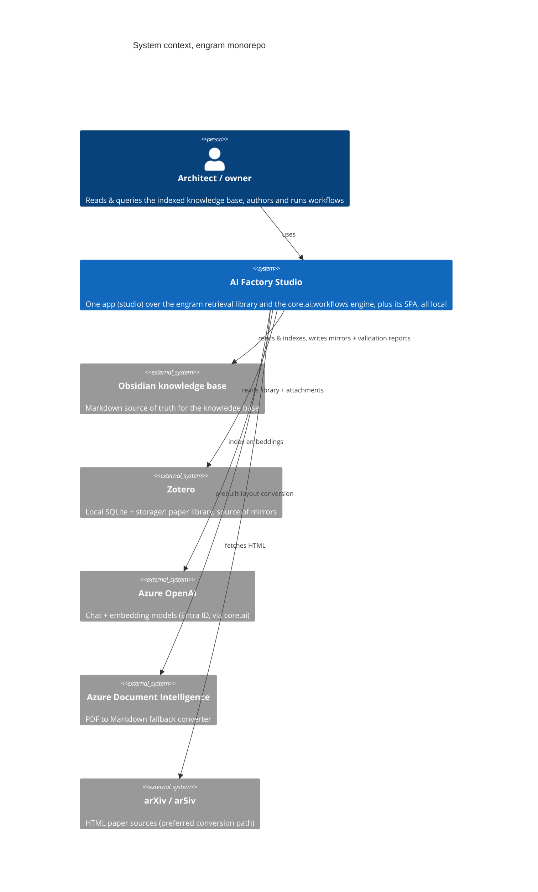

# engram's system architecture

This is the arc42-lite architecture master for the monorepo: system context and
containers (C4 L1/L2), the cross-cutting concepts every app obeys, and one
building-block section per app. It is **split-doc'd**: edit this master only,
then run `python3 scripts/docs/split_doc.py --dir docs/architecture`. Readers
and agents should start from [index.md](index.md) and load only the sections
whose *load-when* keywords match their question. Contracts per feature slice
live in the apps' `docs/reference/` docs. Decision rationale lives in the ADRs
and [explanation docs](../explanation/tech-stack.md). The entry point to
everything is [CONTEXT-MAP.md](../../CONTEXT-MAP.md).

## 1. System context
> **TL;DR:** One person's local toolchain, a domain-general markdown knowledge base indexer (an Obsidian-style knowledge base folder, to Postgres, to hybrid retrieval for agents), its screen, and workflows that run against that knowledge base behind gates, assembled as one product, AI Factory Studio, over in-repo libraries.
<!-- load-when: system context, what is this repo, external systems, integrations, personas, C4 L1 -->

The monorepo hosts **one toolchain for a single user** (the architect/owner),
local-only throughout. It is one product, **AI Factory Studio**, with two
halves and two libraries underneath:

- **The knowledge base half**, `studio.corpus` (Typer CLI + local FastAPI + MCP) over
  the `engram` library, surfaced in `studio-client`: indexes an Obsidian-style
  markdown knowledge base into Postgres and serves hybrid retrieval (BM25 + vector +
  ltree) to agents and the Studio.
- **The agent half**, the `harness` app (local FastAPI + ACP) over the
  `core.ai.workflows` engine, surfaced as the studio station in `studio-client`:
  workflows as data, validated before anything runs, executed behind
  gates decided by a person, and trusted only by the evidence their runs leave behind.



Personas beyond the owner are **programmatic**: MCP clients of `studio mcp`,
the agents that author and run workflows, and the building-feature
tooling that maintains this repo.

## 2. Containers & data flow
> **TL;DR:** Two Python apps (studio on :8100, harness on :8770) + one TS app (studio-client) over four libraries (engram, core, engram-connectors, client-core), with `templates/` as data beside them. Two Postgres databases of the same shape on one server, the knowledge base DB (the disposable local Postgres on :5434 by default, ParadeDB on :5433 opt-in) and the workflow library `engram_workflows`, migrated by one alembic chain.
<!-- load-when: containers, deployment, databases, local Postgres, ParadeDB, ports, data flow, C4 L2, connectors, templates -->

```mermaid
C4Container
    title Containers, AI Factory Studio
    Person(owner, "Architect / owner")
    System_Boundary(se, "AI Factory Studio") {
        Container(studioclient, "studio-client", "Next.js 16 / React 19, :3031", "UI: search, ask, graph, workflow studio, ops, evals")
        Container(studiocorpus, "studio.corpus", "Typer CLI + FastAPI :8100 + MCP", "Knowledge base sync to index to serve pipeline")
        Container(studioagent, "harness", "FastAPI :8770 + ACP", "Coding agent, validates, indexes and runs workflows behind gates")
        Container(engram, "engram", "Python lib, uv path dep", "Note grammar, indexing pipeline, retrieval plugins, evals, sources ports, init/export")
        Container(connectors, "engram-connectors", "Python lib, uv path dep + extras", "Zotero / YouTube / URL-intake connectors and their converters, found by entry point")
        Container(core, "core", "Python lib, uv path dep", "db, files, markdown, cqrs, ai: model factories, retrieval, disclosure, workflows engine")
        Container(clientcore, "client-core", "TS lib, file: dep", "typed zod fetch, ui primitives, test harness")
        Container(templates, "templates/", "Data, one folder per knowledge base", "knowledge-base-schema.json, _meta/ guidance, workflows/, the template a knowledge base starts from")
        ContainerDb(corpusdb, "knowledge base DB", "local Postgres pg17, :5434 (ParadeDB :5433 opt-in)", "disposable indexed knowledge base + api schema, kb_reader role and one login role per private knowledge base")
        ContainerDb(storedb, "engram_workflows", "same server, same memory schema", "workflows as an indexed collection")
    }
    System_Ext(corpus, "Obsidian knowledge base + Zotero")
    System_Ext(azure, "Azure OpenAI / Document Intelligence")
    Rel(owner, studioclient, "localhost")
    Rel(studioclient, studiocorpus, "/api/* (127.0.0.1:8100, no auth)")
    Rel(studioclient, studioagent, "/api/* (127.0.0.1:8770, no auth), the studio station")
    Rel(studiocorpus, studioagent, "POST /api/runs/history/{run_id}/artifacts/resolve, reads a run's fixed value to keep as a note")
    Rel(studiocorpus, studioagent, "POST /api/schedules/refresh-runs, reports each ended refresh run through its outbox")
    Rel(studiocorpus, engram, "indexes and queries through the library plugins")
    Rel(studioagent, core, "core.ai.workflows engine + adapters")
    Rel(studiocorpus, corpusdb, "SQLAlchemy 2 async, serve path via corpus_reader")
    Rel(studioagent, storedb, "workflows as an engram collection")
    Rel(studiocorpus, corpus, "sync mirrors, index notes")
    Rel(studiocorpus, azure, "embeddings + PDF fallback")
    Rel(studiocorpus, providers, "resolves declared connector names by entry point")
    Rel(studioagent, providers, "classifies a pasted URL through the same registry")
    Rel(studiocorpus, templates, "studio init --template copies schema + guidance into a new knowledge base")
    Rel(studioagent, templates, "harness import loads a template's workflows into the library")
```

Load-bearing properties of this picture:

- **The knowledge base DB is disposable. The workflow library is not. One chain migrates both.**
  The knowledge base DB is a global derivative of the knowledge base, rebuilt by
  `studio index` ([ADR 0001](../adr/0001-wiki-app-placement-and-core.md)). The
  **default** local bed is the disposable **local Postgres on host :5434**
  (`postgres:17` + `pg_textsearch` BM25 + Apache AGE + pgvector + ltree),
  `docker compose up` from `engram/` starts it, and it runs the `pg_textsearch`
  dialect + AGE graph the same way the managed Postgres target does, so the
  pipeline is developed and tested offline on that grammar (engram
  [ADR-0017](../../engram/docs/adr/0017-local-postgres-primary-testbed.md)).
  **ParadeDB on :5433** stays a first-class opt-in, behind a `paradedb` compose
  profile (`APP_RETRIEVAL__DIALECT=pg_search` + `graph_backend=cte` at runtime).
  The **workflow library** is a second database, `engram_workflows`, on the same
  server and with the same `memory` schema: workflows live in it as an engram
  collection: the save path writes them through engram's validated ingest, so
  the library carries authored rows rather than being a pure rebuild of a markdown
  tree. Run state is a local run log beside it, and the agent's own timeline is the
  append-only session log (harness ADR 0001). Neither database has a chain of
  its own,
  engram's single chain migrates both by URL parameter
  ([ADR 0009](../adr/0009-ai-factory-studio-consolidation.md), amended by [ADR 0010](../adr/0010-harness-extraction.md)).
  Source: engram/docs/adr/0017-local-postgres-primary-testbed.md, engram/docker-compose.yml
- **The knowledge base app reads a run's value from the agent app, over one route it does not choose.**
  Keeping what a run produced as a note means writing a value the agent app holds, so
  `studio` posts the run's own reference to the agent's read-only resolver at
  `/api/runs/history/{run_id}/artifacts/resolve` and validates the answer against that
  reference. The base URL is `infrastructure.harness.base_url`, which defaults to the local
  harness, and no request ever supplies an address.
  Nothing imports a harness module and nothing opens its run store
  ([ADR 0019](../adr/0019-knowledge-base-reads-a-run-value-over-http.md)).
  The studio also reports each ended refresh run to `POST /api/schedules/refresh-runs` through its outbox, which delivers again until the harness answers
  ([ADR 0020](../adr/0020-refresh-runs-arm-schedules.md)). These are the only two edges between the two backends.
- **Both backends are localhost-only by design.** `studio serve-http` binds
  127.0.0.1:8100 (CORS open exactly to :3031). The agent app binds
  127.0.0.1:8770 (CORS open to exactly the two spellings of the studio's dev
  origin). Neither has auth. The localhost binding is the boundary.
- **Shared code flows through libraries, not imports across apps.**
  Python apps consume `core/` and `engram/` as editable uv path sources. TS apps
  consume `client-core/` as a `file:` dependency (copy-installed, see
  [section 3](#3-cross-cutting-concepts)). `engram` never imports `studio` or the
  engine. A package-boundary test enforces it. A change in a shared lib must
  keep **all** consumers' suites green.
- **Knowledge base vocabulary and host knowledge are both outside the code.** A knowledge base's
  page types, folders, field names, statuses and collection name live in its template
  (`templates/<slug>/knowledge-base-schema.json` plus its guidance pages and workflows), and
  every layer above the grammar takes them from the knowledge base's own schema or from the
  request. A connector's URL shapes, key derivation, item-type vocabulary and deep
  links live in `providers/`, discovered by entry point rather than imported, so
  `engram` indexes a knowledge base with no connector installed. Both rules are the root
  ownership clause and [ADR 0018](../adr/0018-corpus-bundles-and-provider-packages.md),
  held by an import-boundary test per Python project.

## 3. Cross-cutting concepts
> **TL;DR:** Vertical slices in the engram library. CQRS bus from core.cqrs, used by the knowledge base half only. Five records about one workflow run (graph, presentation, intent, checked outcome, graded usefulness and owner acceptance), each answering one question. A governed outcome benchmark refuses before it measures, and names its own model paths by reading them. zod-parse every TS boundary. Both backends local-only with no auth. Path-source (not workspace) dependency strategy. Two composition styles inside studio (wireup DI in the knowledge base half, plain composition in the agent half). One alembic chain, in engram, for both databases.
<!-- load-when: conventions, patterns, adding a new app, adding a slice, dependency strategy, DI, migrations, testing discipline, presentation, intent, checked outcome, usefulness, owner acceptance, artifact action, run arguments, outcome benchmark, case custody, metered model path, blocked report -->

One subsection per concept. The *why* for each lives in
[design-patterns.md](../explanation/design-patterns.md) and the ADRs.

### Vertical slices
In the engram library, every feature is a self-contained package, `domain.py`
(contracts), `repository`/`orm`, `service`/`handlers`, under `src/engram/`:
`compile, retrieval, evals, sources, memory, db, init, export`. Their wireup
providers sit app-side, one module per slice under `studio/src/studio/corpus/wiring/`,
because registration is composition
([engram ADR 0039](../../engram/docs/adr/0039-library-app-package-split.md)).
Cross-slice calls go through `domain.py` protocols, not internals.
The workflow engine keeps its own shape: a framework-pure package
(`core.ai.workflows`, grammar, validator, graph builder, library seam, trust
machinery) plus `adapters/`, with the agent half's FastAPI app over it, split
into `browsing` and `running` slices.

### CQRS message bus (knowledge base half only)
`core/src/core/cqrs/`, frozen pydantic `Command`/`Event` bases, one handler per command. A handler's events go to the
`coordination.outbox` table (inside the handler's transaction when it has one), and the app's `Worker` delivers them to
the bus's subscriptions once per subscriber, recorded in `coordination.event_deliveries`. Background work is a row in
`coordination.jobs`, claimed under `SKIP LOCKED`. Deliberately introduced for the ingestion pipeline
([ADR 0002](../adr/0002-wiki-cqrs-bus-and-wikinote-kernel.md)) and re-homed into the shared library by
[ADR 0007](../adr/0007-consolidate-shared-python-into-core.md). Only the knowledge base half dispatches through it, and nothing
else should grow a second bus casually.

### Agent inspection and measured improvements

The harness uses the same durable job machinery in the sessions database for inspection. Its record's existing events
trigger dispatch, while reconciliation catches terminal events missed by the cursor. Scheduling and dispatch,
reconciliation, rules, attribution and scans each run in an independent loop. Terminal event markers distinguish an
earlier partial inspection from processing the completed transcript.

The inspector reads paged recorded messages, instructions and complete request/tool schemas. Native output validation
records rejected answers. A shared lead-row lock protects final findings and explicit dismissals against concurrent
late answers. Uncertainty and invalid output remain unresolved, and a diagnosis remains a causal hypothesis.

The owner can curate versioned diagnostic cases and run paired outcome evaluations through `harness evals inspection`.
Independent grading, repeated held-out trials, provenance and runtime fingerprints distinguish measured improvements
from plausible explanations. Learning records accumulate comparable evidence and every accepted or rejected proposal.
The evaluation command does not activate skills or publish changes. The contract is in the
[inspection reference](../../harness/docs/reference/inspection.md) and the decision in
[inspection evidence and outcomes](../../harness/docs/adr/0020-inspection-evidence-and-outcomes.md).

### Reliable workflow execution (outcomes, retry feedback, durable continuation)

A rejected judge, person, or orchestrator gate records one `RetryFeedback`, keyed to the target
node and turn, carrying the reviewer's exact words, the immutable value it rejected, and the
requested repair. Every item of a rewound map turn receives it, and a second use of the same work
elsewhere receives none. Each gate spends a bounded `max_attempts` (default 3, the first review
included) before it fails the run rather than rewind again. Every ended run classifies a checked
`Outcome`, kept apart from the graph's own execution status: which pieces of the declared primary
work settled, and whether every required gate's decision covers the exact bytes the run ended
holding, by an accepted source, at the current generation. A multi-turn map's durable line survives
a worker restart: the conversation lives in `core.ai.history`'s continuation tables, addressed by a
bounded `ContinuationRef` rather than a process-local store or a Temporal payload transcript. The
contract is in [core-ai.md](../../core/docs/reference/core-ai.md) and
[workflow-monitoring.md](../../harness/docs/reference/workflow-monitoring.md).

### Five records about one run, and the question each one answers

One workflow run leaves five records behind, and they are easy to mistake for each other because
four of them are prose about the same piece of work. They are kept apart on purpose: each answers
one question, and no layer may answer its question with another one's record.

| The question | The record | Who writes it | What checks it | What rewriting it costs |
|---|---|---|---|---|
| What will actually run? | `Workflow`, the executable graph | whoever authored the spec | the validator, before anything starts | the workflow's identity. `spec_identity` hashes the graph, so an edit mints a new version and the old one keeps its own evidence |
| How is this put to a person? | `WorkflowPresentation`, on the library card | the same author, in their own words | `verify_presentation` against the spec: a labelled input must name a declared parameter, an action must name a declared artifact | nothing. Identity and evidence are untouched, which is the reason it lives on the card and not in the graph |
| What did somebody ask for? | `WorkflowIntent`, on the library card | the person who wanted the automation, through guided authoring | nothing. A request is not a claim about the graph, so it is kept as it was stated | nothing, and it grants nothing: no work is selected and no tool is named |
| What did this run do? | `Outcome`, on the run | nobody writes it. It is derived from the run's own facts when the run ends | itself. Item dispositions, the active generation, and each required gate's decision over the exact bytes | nothing, because it is never rewritten. `unknown` stays unknown |
| Was the work any good, and did the owner take it? | `TaskOutcome` (graded) and `OwnerReview` (an event) | an independent grader, and the owner | the grader's own rubric, over resolved artifact bytes. A review is appended to what a resolver answered, never to a value the caller already had | nothing on the run. Both are separate records, joined by a read model that returns unknown when there is no review |

The three confusions worth naming, because each one has a rule attached:

- **Presentation is not intent.** Presentation is what a reader is *shown*. Intent is what was
  *asked for*. That is why one is checked against the spec and the other against nothing, and why
  the save gate reads the presentation and ignores the intent. A draft carrying half an intent
  saves. A draft carrying no presentation does not.
- **A checked outcome is not a verdict on the work.** `status == "succeeded"` says every piece of
  the declared primary work settled and every required gate's decision covered the exact bytes the
  run ended holding. It says nothing about whether the result was worth having. The evaluation
  layer scores that separately, and the owner's acceptance is a third record again, so a rejected
  review leaves a `succeeded` run `succeeded`.
- **A recorded number is not a status.** A presentation may name recorded-output fields for a run's
  page to show under their own labels. They are read off what the run recorded, they are display
  only, and they never move the status word beside them. A run that reports "12 notes written" and
  fails its gate is a failed run that recorded twelve.

**The closed artifact-intent resolver.** An action a presentation offers is one of a closed
first-party set (`save_note`, `record_owner_review`), each naming a handler this deployment already
implements. The data carries a kind, an id, a label, and which declared artifacts it concerns, and
there is nowhere in it to put a URL, an HTTP method, a filesystem path, or a request body, because
the models refuse an extra key rather than dropping it. Pressing one resolves every reference it
names through the run's own read-only route (`POST /api/runs/history/{run_id}/artifacts/resolve`)
and hands the resolved documents to that handler. The references come from the selected run, never
from the client. An intent whose handler is not installed in this deployment renders unavailable
and does nothing: it never falls back to a route the surface invented. This is what lets a template
offer an action without a template ever naming a route.

**The JSON value boundary.** A run is given one JSON value per parameter
(`WorkflowArguments = dict[str, JsonValue]`), and one admission
(`core.ai.workflows.contracts.normalize_arguments`) is shared by every launch path: the HTTP route, the agent
tool, a schedule fire, a rerun, and an adaptation. Each value is checked against that parameter's
own Draft 2020-12 schema with nothing converted to fit. An array stays an array, a boolean is never
read as an integer, and a string parameter keeps whatever text it was given. The one accommodation
is for callers that can send nothing but text (a stored schedule row, an older client, a form): text
supplied to a parameter whose schema cannot hold text is decoded once with `json.loads` and then
checked like any other value. Text that is not JSON is refused naming the parameter and the path
inside the value, so a Python repr such as `"['research']"` is a refusal rather than a guess.
Whether a name is one of the knowledge bases this deployment is registered to read is deliberately
not decided here. It belongs to the host holding that registry, which checks it after admission
against the control the saved card declares.

### Governed outcome benchmarks (what a measurement is allowed to claim)

A benchmark that compares a simple single-run baseline against workflow automation is a paid,
irreversible act, so `harness evals outcomes` is built to refuse before it measures. Every refusal
happens before a budget cycle is opened, and the world the benchmark would run in is composed only
once the cases have proved legitimate, so a set that makes no held-out claim never builds the models
it would have run.

**Cases are legitimate or the run is blocked.** A workflow-automation development set declares itself
author-visible in its own type and cannot carry a seal, so a rollout claim over it is refused
structurally rather than by a flag. A sealed comparison reads a custodian's own `TaskDataset` beside a
custody record, and `engram.evals.outcomes.contracts.audit_cycle` grades seals, freeze timing,
fingerprint match, authorship disjointness, recorded label exposure and case freshness. A cycle with
no verified held-out claim writes a blocked report and skips every paid step. That report is the
expected outcome when no independent custodian exists, not a failure.

**Three checks, and only one of them reads behaviour.** The classifier reads each declared path's own
model object, and a path that does not admit on this record and this cycle lands in the manifest's
unmetered set and refuses the run. The declaration is then held against what each of the three says:
the paths it requests through, object for object and in both directions, and whether its figures
come from this record or from another. That refuses a composer that hands one of them an object it
never declared, a declared path none of them stands behind, one that declares nothing without
claiming another record's figures, and a grader that does not itself ask through a declared
grader-role path. It compares statements, so one that misstates any of them is not caught by it.

The third check reads behaviour, and it reads less than its name suggests. After the arm and after
the grader, whether either returned or raised, the requests it reports are compared with the
requests the record admitted for that trial. It is asked only of one whose figures come from this
record and it reads over-reporting only, so what it establishes is that such a one cannot claim to
have spent more than the record admitted without stopping the sitting. One that under-reports
passes. It detects rather than prevents, and the only bound on what one slot costs is that there is
one: the thresholds live inside `BudgetedModel` and these are requests no `BudgetedModel` saw. Every
later slot refuses before its arm runs, and the sitting is never reported as measured.

The command is also the one caller that can mount the meter at all: the environment a person's
journeys run in is composed once when the process boots, long before a pilot opens, so the Studio
path cannot meter itself. This deployment's composer puts `BudgetedModel` on the baseline and on the
grader, which are the two paths that ask a model during a benchmark. The workflow arm reads the runs
a person's journeys already archived, so it asks nothing now and whatever it reads back was admitted
under the pilot's own cycle. A reader comparing the two arms' charges under the
`measured-generative-model-cost` objective is therefore reading two records, not one.

**A report says what it ran on.** `empirical_status` is `blocked`, `inconclusive` or `measured`, and
`model_kind` is `live`, `test_double` or `unbuilt`, so a measured report over stand-ins reads as
apparatus output rather than as evidence about a deployment. Every slot is filed under its own name
before a verdict is folded over it, including one the grader's own request was refused on, and a
report is written once under a name derived from its content. A report that ran carries each
slot's grade and the paired comparison's verdict, reasons, success rates, regressions and per-arm
usage. The shipped grader judges answer text, and a candidate's pass stands only when its archived
run's checked status is `succeeded`. The statistical claim is
`descriptive_only` and the recommendation is `none`, both as constants, so a reader sees them in the
record rather than inferring them from an absence. The contract is in
[workflow-monitoring.md](../../harness/docs/reference/workflow-monitoring.md).

### zod at the boundary (TS apps)
Every backend response is `.parse()`d against a zod schema before reaching
components, never `as`-cast, so backend drift surfaces as a `ZodError` at the
boundary. The typed fetch wrapper lives in `client-core` (`api/client`).

### Local-only, no auth
Neither backend authenticates: `studio serve-http` and the agent app bind
loopback and the localhost binding *is* the security boundary. Each opens CORS
to exactly the Studio's origin it serves (`:3031`). Workflow steps that shell
out are explicitly **not sandboxed**, their mitigations are a wall-clock
timeout, an output-character cap, `start_new_session` + process-group kill, and
a resolved working directory. The documented non-goal is "never load untrusted
courses" (it runs the user's own code on the user's own machine). Programs
are the exception: they run in a Monty sandbox, never `exec`.

### Dependency strategy (`file:` / path sources, not workspaces)
Python: `core = { path = "../core" }` and `engram = { path = "../engram" }` in
the app, deliberately **not** a uv workspace, so each project keeps its own
lockfile/venv ([ADR 0001](../adr/0001-wiki-app-placement-and-core.md)).
`engram-connectors = { path = "../connectors" }` joins them in `studio` and
`harness`, each naming the extras it uses
(`engram-connectors[conversion,source-queue,youtube,zotero]`). `engram` itself never
depends on it, and resolves a knowledge base's declared connector names through the
`engram.sources.connectors` / `engram.sources.converters` entry-point groups at
wiring time ([ADR 0018](../adr/0018-corpus-bundles-and-provider-packages.md)).
Because that lookup is by entry point rather than by import, a stale editable
install surfaces as "connector not installed" rather than as an `ImportError`:
after a package layout change, re-sync every consumer with
`--reinstall-package`. The
workflow engine ships behind `core[workflows]` / `core[workflows-temporal]`, so
plain `core` (and therefore `engram`) never installs the engine's optional
weight ([ADR 0009](../adr/0009-ai-factory-studio-consolidation.md), amended by [ADR 0010](../adr/0010-harness-extraction.md)). TS:
`"client-core": "file:../client-core"` + `transpilePackages`
([ADR 0004](../adr/0004-client-core-shared-frontend-package.md)), **pivoted
to copy-install** (`install-links=true` in `.npmrc`) after a Turbopack OOM
incident. The ADR's symlink wording is stale on this point, root `CLAUDE.md`
is authoritative. Editing `client-core` requires `npm install ../client-core`
in each consumer.

### Dependency injection (two styles, deliberately)
The knowledge base half is **wireup DI**: composition root
`studio/src/studio/corpus/container.py`. Slices contribute `@wireup.injectable`
factories from `studio/corpus/wiring/<slice>.py` via module discovery. FastAPI
integration through `wireup.integration.fastapi`. The CLI injects a test
container through a `ctx.obj` zero-arg factory seam, no monkeypatching.
Multi-implementation seams use the **strategy registry** pattern (frozen
dataclass over `Mapping[Enum, Adapter]`). The agent half is **plain
composition**: `harness_session()` in `harness/src/harness/composition.py` builds the environment on
an `AsyncExitStack`, with no container, and depends on its seams through
`Protocol`s. `tests/unit/test_layering.py` enforces the tier boundaries. The two styles coexist on purpose and neither is migrated toward
the other. The structural DI gates are scoped to the knowledge base half so the code
says so.

### Migrations: one alembic chain, in engram
`engram` owns the repo's only alembic chain and `alembic.ini`, resolved
checkout-relative, from `0001_wiki_schema` (extensions: pg_search, vector,
ltree) through the `api` surface, the read-only roles, the graph, eval and
index state, the `memory` schema rename, and the envelope surface. The
`corpus_reader` role is granted SELECT/EXECUTE on the `api` schema only,
read-only, `statement_timeout=10s`. The same chain migrates **both** databases
by URL parameter. The studio owns no chain and reads the workflow library through
that same read-only role.

### Progressive disclosure (cross-app protocol)
Any provider serves information level by level by returning a conformant
`DisclosureEnvelope` (`core.ai.disclosure`): the disclosed unit plus child
summaries and refs, deeper levels exist only as refs, and the provider's tool
accepts a ref back (the descent convention,
[ADR 0008](../adr/0008-progressive-disclosure-protocol.md)). Enforcement is
tiered: the `ProgressiveDisclosure` pydantic-ai capability budgets and traces
envelopes in owned runtimes. engram's leveled `fetch` MCP tool and
`/api/envelope` serve server-enforced thin envelopes to uncontrolled clients.
engram is the first conforming provider (`api.envelope_*` reader surface,
indexed, governed `memory.unit_summaries`).

### Testing discipline
Pytest `asyncio_mode=auto`, tiers `unit/integration/e2e`, polyfactory
factories, hand-written `Fake*` over mocks. The library's integration tier and
the app's integration/e2e tiers run a real database via testcontainers
(auto-skip without Docker). TS: Biome, Vitest + MSW
(`onUnhandledRequest: "error"`, deliberately empty default handlers),
Playwright e2e. Ruff `ALL` @ 140, Google docstrings, no `Any`/`# noqa`
masking across every Python project.

## 4. engram building blocks
> **TL;DR:** A knowledge base to Postgres indexer and read-only retrieval library, organized into five bounded contexts (Ingestion, Knowledge, Retrieval, Evaluation, Lifecycle & interchange). Its structure has graduated into engram's own arc42/C4 master, linked below.
<!-- load-when: engram, knowledge base, memory, compile, indexing, serve, sync, retrieval, knowledge base pipeline, note grammar, mcp, Studio backend, bounded contexts -->

The `engram` library (`engram/`, distribution `engram`) owns the whole knowledge base
pipeline. It absorbed the standalone Zotero sync tool as slices
([ADR 0003](../adr/0003-absorb-zotero-sync-into-wiki-app.md)) and then shed its
application half to `studio.corpus`
([engram ADR 0039](../../engram/docs/adr/0039-library-app-package-split.md),
[ADR 0009](../adr/0009-ai-factory-studio-consolidation.md)). Its building blocks
are organized into **five bounded contexts**, **Ingestion** (Zotero to
`Sources/` mirror reconcile and PDF/HTML to Markdown conversion), **Knowledge**
(the note-grammar kernel and the indexing pipeline), **Retrieval** (the
read-only query surface the CLI / HTTP / MCP plugins serve, behind the
`corpus_reader` role), **Evaluation** (structural ground-truths, the tuning
loop, and retrieval metrics), and **Lifecycle & interchange** (knowledge base
init/scaffold, OKF export, and the Claude Code plugin), over a cross-cutting
CQRS / DB / DI core. Outside consumers reach all of it through the lazy plugins in
`engram/__init__.py`.

engram's structure has **graduated out of this section** per
[ADR-0005](../adr/0005-docs-as-code-standard.md)'s graduation rule and the layered
three-view pattern of engram ADR-0020: the per-slice C4 L3 **component** diagrams, the per-slice
**domain-model class** diagrams, and the single system **ERD** now live in
engram's own arc42/C4 master, **[engram/docs/architecture/index.md](../../engram/docs/architecture/index.md)**.
Glossary: [engram/CONTEXT.md](../../engram/CONTEXT.md).

## 5. Frontends & client-core
> **TL;DR:** One Next.js 16/React 19 SPA, studio-client (:3031), local and no-auth, branded "AI Factory Studio", over client-core: a typed zod fetch factory, UI primitives, and a Vitest/MSW test harness.
<!-- load-when: frontend, studio-client, client-core, AI Factory Studio, the Studio, dashboard, react, next.js, ui, SPA -->

- **studio-client/**, user-visibly **AI Factory Studio**:
  `/search`, `/chat`, `/graph` (sigma.js + graphology), `/studio` (the workflow
  studio, React Flow over a dagre layout, talking to the agent half on :8770),
  `/ops` (job triggers), `/evals`, `/settings`. Types generated from the running
knowledge base API's `/openapi.json` (`npm run gen:types`). Every response zod-parsed
in `src/api`. The brand lives in copy only, routes, ports, and
  `NEXT_PUBLIC_*` names are unchanged
  ([ADR 0009](../adr/0009-ai-factory-studio-consolidation.md), amended by [ADR 0010](../adr/0010-harness-extraction.md)).
- **client-core/**, `client-core` v0.0.x, raw TS, no build step,
  transpiled by each consumer. Exported seams: `api/client`
  (`createApiClient({baseUrl, getToken?, onUnauthorized?})`), `ui/button`,
  `ui/confirm-dialog`, `lib/cn`, `lib/format-relative`, and the test harness
  (`test-support/setup`, `test-support/render`). React/next/zod/TanStack are
peerDependencies. Deep imports per module, no barrel
  ([ADR 0004](../adr/0004-client-core-shared-frontend-package.md)).

Ownership rule (mirrors `core/`): a `client-core` change must keep **every**
consumer's suite green.

## 6. Quality, risks, tech debt
> **TL;DR:** Clean codebase (zero inline debt markers, debt is ledgered in prose). The live risks are ADR-0004's stale symlink story, engram's hand-written SQL api surface, the sync lazy-route invariant, Docker-gated coverage, the workflow runner's shell-out posture, and ADR-0009's recorded manifest/contract follow-ups.
<!-- load-when: risks, tech debt, known issues, caveats, coverage, drift -->

- **ADR-0004 is partly stale.** It records `client-core` as a `file:` symlink.
  The copy-install pivot (post-Turbopack-OOM) is recorded only in root
  `CLAUDE.md`. Treat `CLAUDE.md` as authoritative. Re-syncing `client-core`
  after dependency changes is a known foot-gun.
- **engram `api` surface is hand-written SQL** inside the migration chain,
  no type-checker coverage against `compile/orm.py`. Drift is a silent
  maintenance seam.
- **Sync lazy-route invariant.** `SyncMirrors` is bus-registered as a side
  effect of resolving its handler. Every dispatch site must go through
  `resolve_sync_bus` or the route is missing. Funnelled by design, breakable
  by refactor.
- **Coverage shape.** The integration/e2e tiers auto-skip without Docker.
  CI without Docker exercises only the unit tier. `core/` and `engram/` changes
  require running every consumer suite manually (no enforced gate).
- **CQRS onboarding bar.** The bus/UoW shape has no analogue in the agent half.
  ADR 0002 accepts this cost. Subscriber failures are logged, not surfaced.
  A future outbox subscriber needs its own monitoring.
- **Note grammar and knowledge base schema drift.** The kernel encodes the knowledge base's
  `_meta/schema.md` in code. The early-warning net is one golden fixture
  (`lightrag-2025.md`).
- **Workflow steps can shell out by design.** A workflow's shell capability is
  a runner, not a sandbox. Running a workflow authored elsewhere would execute
  its steps locally. The gate decided by a person and the validator's checks guard this,
  not a technical jail.
- **Consolidation follow-ups.**
  [ADR 0009](../adr/0009-ai-factory-studio-consolidation.md) records what the
  restructure deliberately did not do: engram's and studio's manifests still
  need a hygiene pass, and `/api/health` returns a `corpus` probe the client still reads
  as `vault`.

  Debt is ledgered in `CLAUDE.md`'s "Known caveats" and ADR Consequences sections. There are deliberately no inline TODO/FIXME markers.
there are deliberately no inline TODO/FIXME markers.

## 7. Glossary pointers
> **TL;DR:** Domain terms live in per-app CONTEXT.md files, indexed from CONTEXT-MAP.md, not here.
<!-- load-when: glossary, terminology, domain language, what does X mean -->

- [engram/CONTEXT.md](../../engram/CONTEXT.md), knowledge base, mirror, Note, claim,
  index, retrieval ladder, jobs, AI Factory Studio…
- [studio/CONTEXT.md](../../studio/CONTEXT.md), schema, step, node types,
  contract port, workflow fingerprint, evidence, lineage…
- [CONTEXT-MAP.md](../../CONTEXT-MAP.md), the index of every governed doc.
