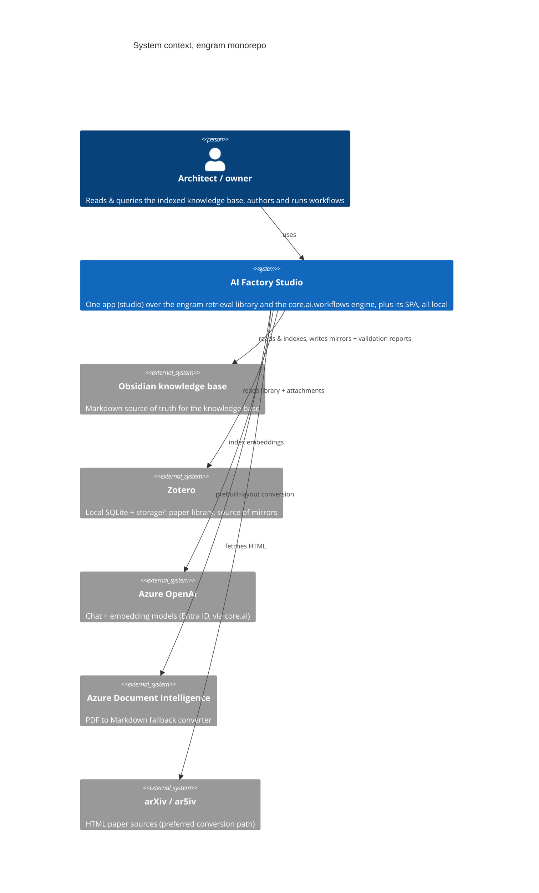

<!-- GENERATED from architecture.md by scripts/docs/split_doc.py --dir docs/architecture — do not edit here; edit the master and re-run the script. -->

## 1. System context
> **TL;DR:** One person's local toolchain, a domain-general markdown knowledge base indexer (an Obsidian-style knowledge base folder, to Postgres, to hybrid retrieval for agents), its screen, and workflows that run against that knowledge base behind gates, assembled as one product, AI Factory Studio, over in-repo libraries.
<!-- load-when: system context, what is this repo, external systems, integrations, personas, C4 L1 -->

The monorepo hosts **one toolchain for a single user** (the architect/owner),
local-only throughout. It is one product, **AI Factory Studio**, with two
halves and two libraries underneath:

- **The knowledge base half**, `studio.corpus` (Typer CLI + local FastAPI + MCP) over
  the `engram` library, surfaced in `studio-client`: indexes an Obsidian-style
  markdown knowledge base into Postgres and serves hybrid retrieval (BM25 + vector +
  ltree) to agents and the Studio.
- **The agent half**, the `harness` app (local FastAPI + ACP) over the
  `core.ai.workflows` engine, surfaced as the studio station in `studio-client`:
  workflows as data, validated before anything runs, executed behind
  gates decided by a person, and trusted only by the evidence their runs leave behind.

Personas beyond the owner are **programmatic**: MCP clients of `studio mcp`,
the agents that author and run workflows, and the building-feature
tooling that maintains this repo.
