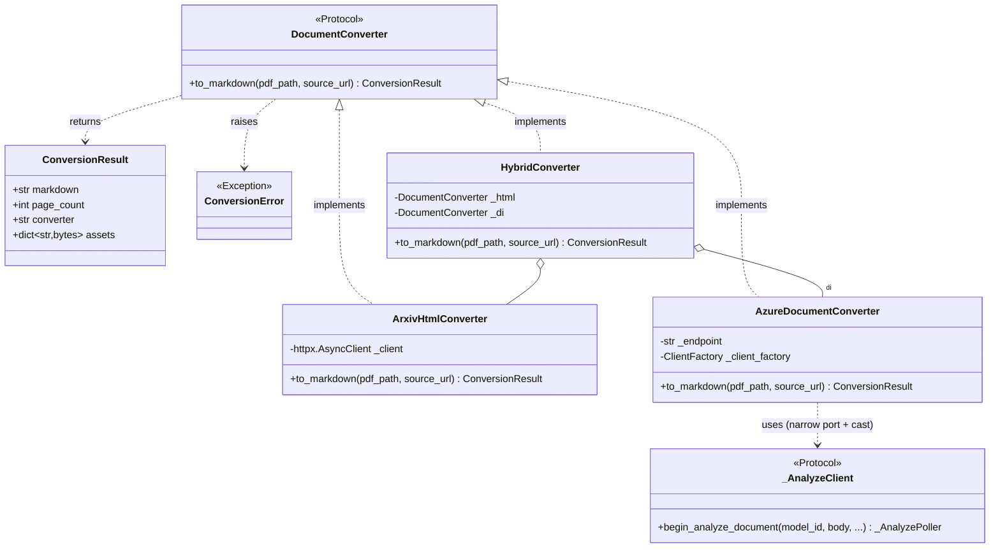
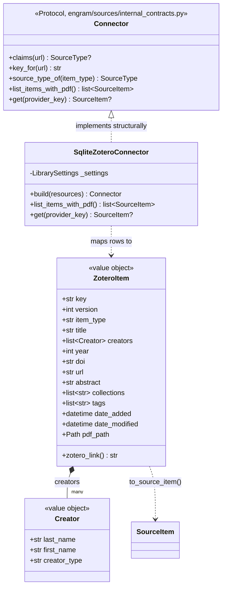
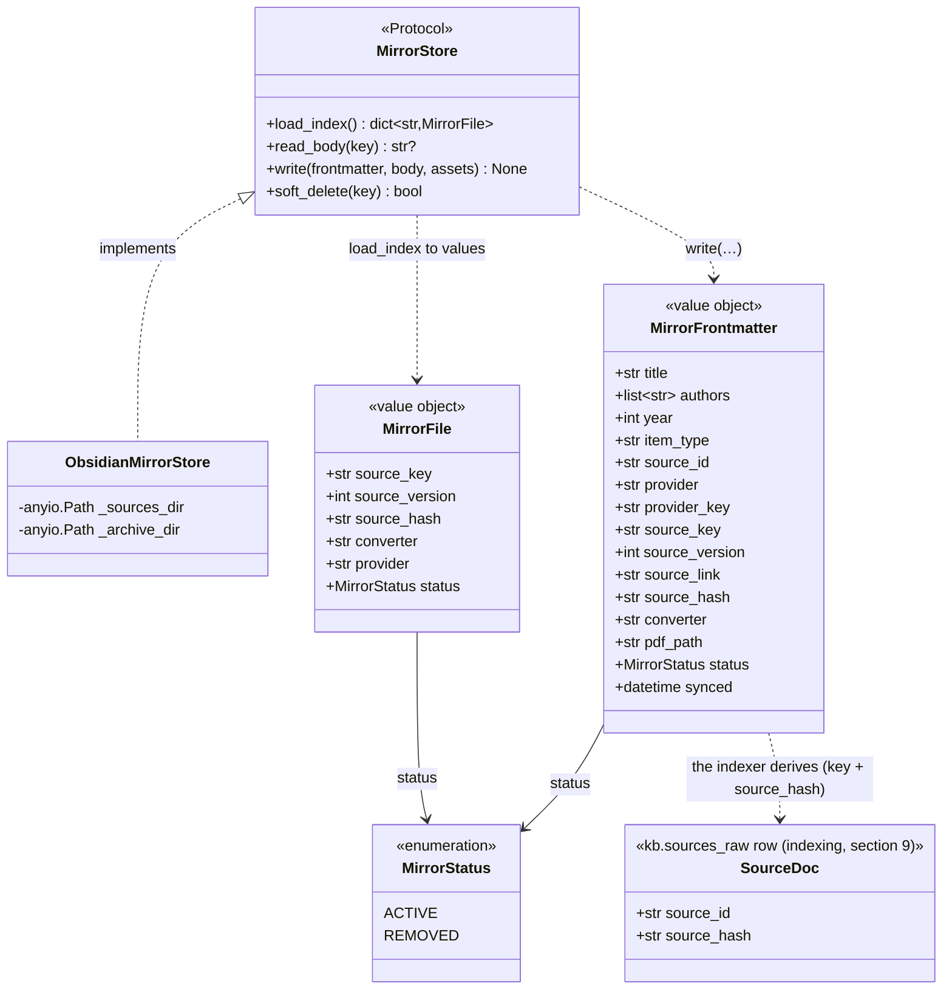
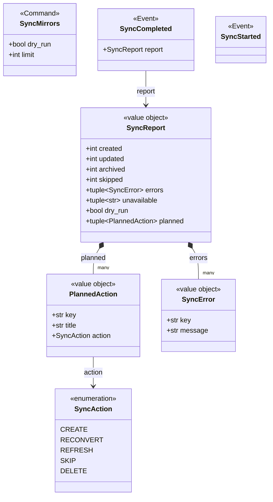
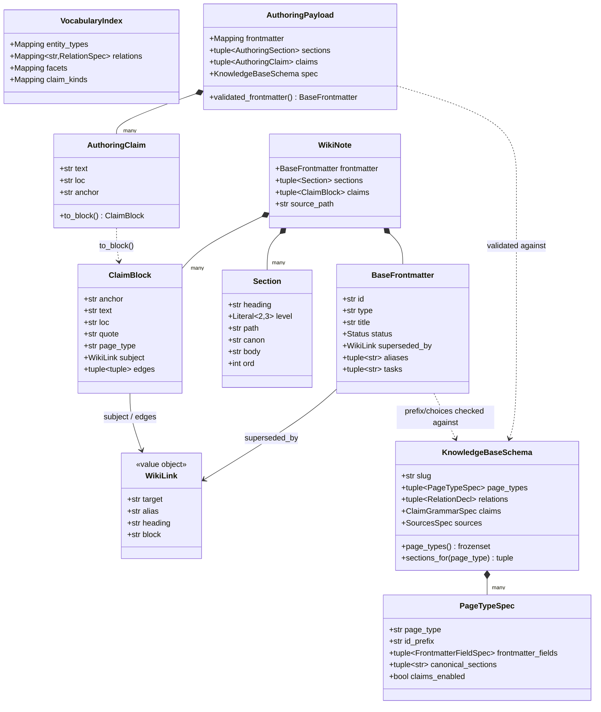
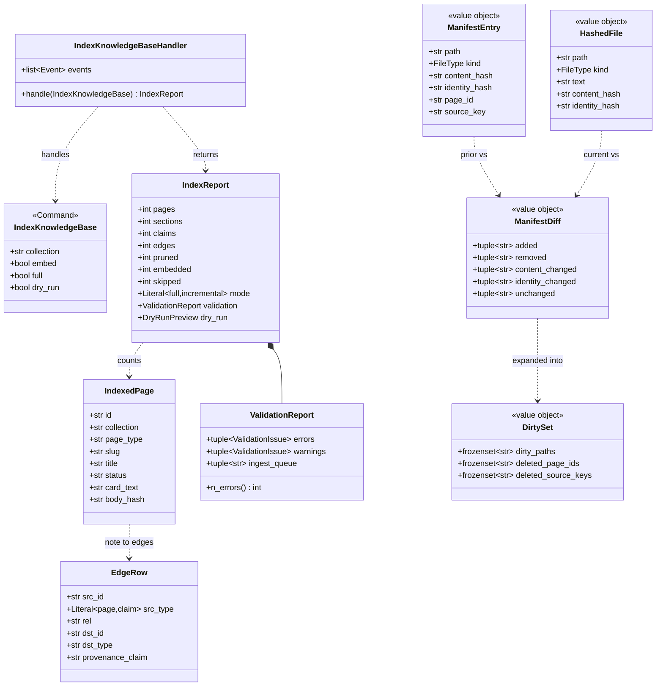
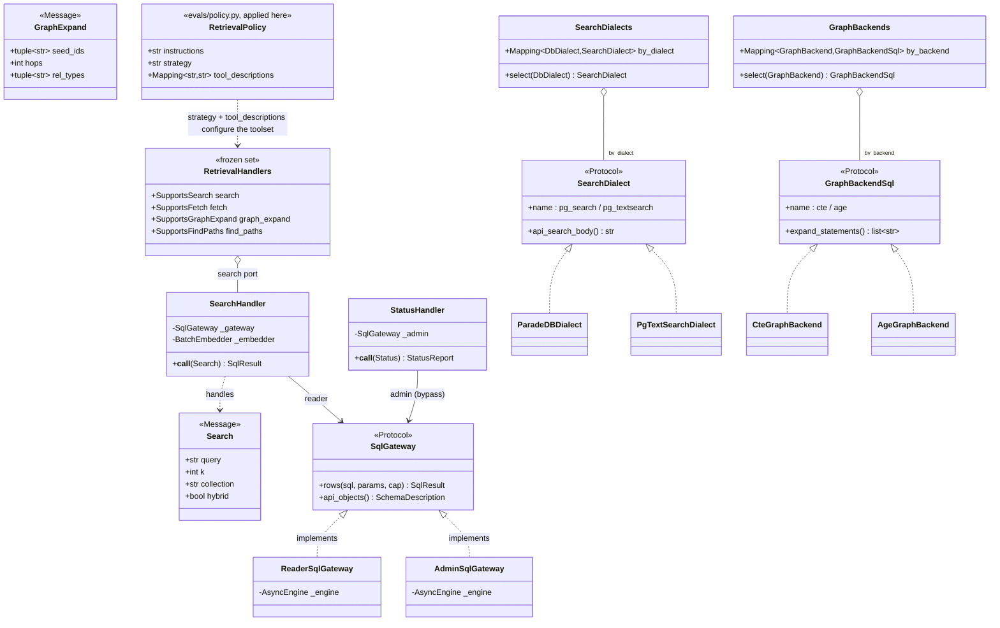
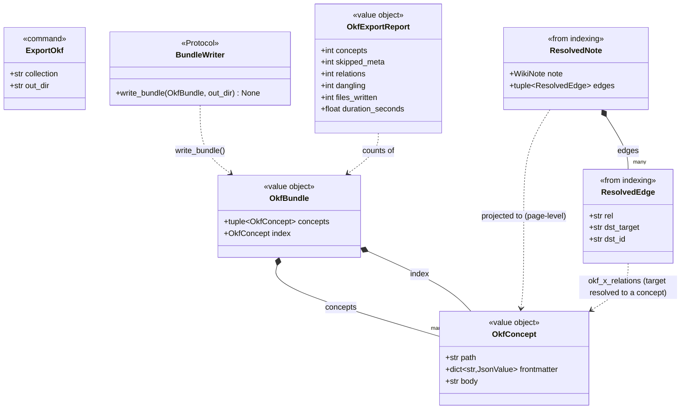

# engram's architecture

This is engram's **graduated arc42-lite / C4 architecture master** (badge
**arc42** + **C4**, an architecture description in the sense of **ISO/IEC/IEEE 42010**,
whose per-slice component + domain-model diagrams are its **IEEE-1016** software-design view).
It graduated out of the root master's section 04 per
[ADR-0005](../../../docs/architecture/architecture.md)'s graduation rule and the
layered-three-view pattern of
[ADR-0020](../adr/0020-domain-documentation-architecture.md): engram's structure
had outgrown a ~430-token section. This master owns **structure**, the C4 L2
container/component overview, the per-slice C4 L3 component diagrams, the
per-slice domain-model class diagrams, and the single system ERD. It is
**split-doc'd**: edit this master only, then run
`python3 scripts/docs/split_doc.py --dir engram/docs/architecture`. Readers and
agents should start from [index.md](index.md) and load only the sections whose
*load-when* keywords match the question.

Around this master sit its sibling layers (per ADR-0020): the three-view domain
package (Business / Research / Engineering, under `engram/docs/explanation/domain/`)
narrates the domain and links *down* here for structure. Each per-slice
`engram/docs/reference/<slice>.md` owns the *contract* (entry points, public API,
testing seams) and links *up* to the matching component diagram here. The
`vision.md` / `product-decisions.md` / ADRs own the *why* and are linked, never
restated. The entry point to every governed doc is
[CONTEXT-MAP.md](../../../CONTEXT-MAP.md). The binding vocabulary is
[engram/CONTEXT.md](../../CONTEXT.md).

## 1. Orientation & scope
> **TL;DR:** engram is a domain-general Obsidian-style markdown knowledge-base indexer (knowledge base to Postgres) plus a read-only retrieval server over CLI + HTTP + MCP, organized into five bounded contexts (Ingestion, Knowledge, Retrieval, Evaluation, and Lifecycle & interchange) over a cross-cutting CQRS / DB / DI core.
<!-- load-when: orientation, scope, what is engram, bounded contexts, how to navigate, arc42 -->

engram (`engram/`, dist `engram`) is a **knowledge-base-to-Postgres indexer and
read-only retrieval server**. It indexes an Obsidian-style markdown knowledge base
into Postgres (the local Postgres by default, ParadeDB opt-in,
[ADR-0017](../adr/0017-local-postgres-primary-testbed.md)), driven by a per-knowledge-base
`KnowledgeBaseSchema`, so it serves any domain
([ADR-0014](../adr/0014-domain-general-vault-spec-and-plugin.md)), with no
default ontology of its own. A knowledge base that declares no `knowledge-base-schema.json` is
refused, and the schemas, guidance pages and workflows of the knowledge bases this repo
runs live in the top-level `templates/` package
([root ADR-0018](../../docs/adr/0018-corpus-bundles-and-provider-packages.md)). It then serves hybrid
retrieval (BM25 + vector + graph) read-only over a CLI, a local FastAPI Studio
API, and a FastMCP stdio server. It owns the whole knowledge-base pipeline: the optional
Zotero-to-knowledge-base mirror reconcile, the indexer, the `wikinote` note grammar, a CQRS
bus, and a retrieval-tuning loop.

**The five bounded contexts** (the building-block organization fixed by
[ADR-0020](../adr/0020-domain-documentation-architecture.md), section 3 below):

| Context | Owns | Slices |
|---|---|---|
| **Ingestion** (section 3) | getting source documents into the knowledge base as mirrors | `connector`/`converter` (the two ports), `registry` (entry-point discovery), `fetch` (the SSRF guard), `mirror`, `sync`, `source_queue`, `watch_list`. The connector implementations live in `../connectors/` |
| **Knowledge** (section 4) | the note grammar + turning the knowledge base into queryable Postgres | `wikinote` (kernel), `index` |
| **Retrieval** (section 5) | the read-only query surface agents and AI Factory Studio use | `serve` |
| **Evaluation** (section 6) | generating and scoring retrieval quality, tuning the policy | `evals` |
| **Lifecycle & interchange** (section 7) | bootstrap, interchange export, plugin packaging | `init`, `export`, `plugin` |
| **Cross-cutting** (section 8) | the bus, DB foundation, DI, settings, observability, CLI | `cqrs`, `db`, `container`, `settings`, `observability`, the `cli*` modules |

**How to navigate this layered documentation.** The **master** (this doc) is
where you go for *structure*, a diagram of how the pieces fit. The **domain
views** (forthcoming, `engram/docs/explanation/domain/`) are where you go for the
*narrative*, what the domain means, told three ways for three audiences. The
**reference docs** (`engram/docs/reference/<slice>.md`) are where you go for a
slice's *contract*, its entry points, public types, and testing seams. The
**ADRs** (`engram/docs/adr/`) are where you go for the *why*. One fact has one
home. This master does not restate a contract or a rationale that lives in
another layer.

## 2. Container & component overview (C4 L2)
> **TL;DR:** `engram/src/` holds exactly one package, the `engram` library. The application over it is `studio.knowledge_base`, a separate project whose three entry points (the Typer CLI, the FastAPI Studio API on :8100, the FastMCP stdio server) drive engram. Write-side intents (index, sync, export) flow through a CQRS bus to slice handlers, while the read path (search/fetch/graph) bypasses the bus and goes straight through query handlers + a read-only SQL gateway to Postgres. Azure OpenAI supplies embeddings.
<!-- load-when: containers, components, C4 L2, entry points, CQRS bus, data flow, overview, how it fits together, package layout, engram library vs studio application, library, application -->

`engram/src/` holds **exactly one package**: `engram`, the library (`kb`, `db`, `config`, `indexing`, `retrieval`, `evals`,
`sources`, `init`, `export`). The application over it is `studio.knowledge_base` (the `cli*` modules, `settings`,
`container`, `resolver`, `wiring/`, `http/`, `ask/`) in the sibling `studio/` project. `engram` never imports `studio`. The app
reaches the library through its public surface like any other consumer, and consumers import `engram` only
([ADR-0039](../adr/0039-library-app-package-split.md)).

engram's runtime is **three entry points over one composition root**, all owned by `studio.knowledge_base`. The Typer CLI
(`studio/src/studio/knowledge_base/cli.py`, mounting `cli_evals`, `cli_note`, `cli_init`) owns the top-level `studio` commands. The
FastAPI app (`studio/src/studio/knowledge_base/http/api.py`) serves the Studio over loopback :8100. The FastMCP stdio server it builds
from the library's `engram/src/engram/retrieval/infrastructure/mcp_server.py` exposes the retrieval surface to MCP clients. All three are wired
from the single wireup composition root (`studio/src/studio/knowledge_base/container.py`).

A **command/query split** runs underneath. Write-side intents (`index`, `sync`, `export`, and the evals commands) are frozen
pydantic `Command`s dispatched through the in-process CQRS bus (`core.cqrs.bus`) to exactly one handler each, with events landing
in the outbox with the handler's unit of work, delivered once per subscriber by a worker. The **read path is deliberately not
on the bus**: `search`, `fetch`,
`graph_expand`, and `find_paths` go through dedicated query handlers (`engram/src/engram/retrieval/queries.py`) and a read-only
SQL gateway (`engram/src/engram/retrieval/infrastructure/gateway.py`, the `kb_reader` role) straight to the `api` schema. The shared retrieval
toolset (`engram/src/engram/retrieval/tools.py`) backs **both** the MCP server and the evals agent-under-test, so the evaluated
surface is the real one ([ADR-0011](../adr/0011-single-source-retrieval-toolset.md)).

```mermaid
C4Container
    title Containers & components (C4 L2), engram
    Person(owner, "Owner / agent", "Runs the CLI, queries via the Studio or MCP")
    System_Ext(knowledge base, "Markdown knowledge base + Zotero", "Markdown source of truth + paper library")
    System_Ext(aoai, "Azure OpenAI", "Embedding + chat models (via core.ai)")

    System_Boundary(engram, "studio.knowledge_base (application) over the engram library") {
        Container(cli, "Typer CLI", "studio/src/studio/knowledge_base/cli.py (+ cli_evals/cli_note/cli_init)", "index, status, search, fetch, sync, export okf, serve-http, mcp, evals/note/init groups")
        Container(http, "Studio API", "studio/src/studio/knowledge_base/http/api.py, FastAPI :8100", "Knowledge base registry, graph, refresh jobs and events, studio-client backend")
        Container(mcp, "FastMCP server", "engram/src/engram/retrieval/infrastructure/mcp_server.py, stdio", "Retrieval tools for MCP clients")

        Container(container, "Composition root", "studio/src/studio/knowledge_base/container.py, wireup", "Wires every slice, owns cross-slice routing")
        Container(bus, "CQRS bus", "core.cqrs.bus", "Command to one handler, events to the outbox, a worker delivers")

        Component(ingestion, "Ingestion slices", "engram/src/engram/sources/{connector,converter,registry,fetch,mirror,sync,source_queue,watch_list}", "Ports + mirror/sync/queue, connectors arrive from engram-connectors by entry point")
        Component(knowledge, "Knowledge slices", "engram/src/engram/{kb,indexing}", "Note grammar + 5-stage indexing (incl. incremental)")
        Component(retrieval, "Retrieval slice", "engram/src/engram/retrieval", "Query handlers + tools + read-only gateway")
        Component(evaluation, "Evaluation slice", "engram/src/engram/evals", "Structural gen + tuning + harness/RCA")
        Component(lifecycle, "Lifecycle slices", "engram/src/engram/{init,export}", "Scaffold/db bootstrap, OKF export")
    }
    ContainerDb(pg, "Postgres", "local Postgres :5434 / ParadeDB :5433", "Indexed knowledge base + api schema, kb_reader role")

    Rel(owner, cli, "invokes")
    Rel(owner, http, "localhost :8100")
    Rel(owner, mcp, "stdio (MCP)")

    Rel(cli, container, "resolves")
    Rel(http, container, "resolves (lifespan-built, per-request get)")
    Rel(mcp, retrieval, "calls shared toolset")

    Rel(container, bus, "builds (fully routed at construction)")
    Rel(bus, knowledge, "IndexKnowledgeBase to handler")
    Rel(bus, ingestion, "SyncMirrors to handler")
    Rel(bus, lifecycle, "ExportOkf to handler")
    Rel(bus, evaluation, "Tune/Generate to handler")

    Rel(http, retrieval, "read path (NOT via bus)")
    Rel(cli, retrieval, "search/fetch (NOT via bus)")

    Rel(ingestion, knowledge base, "writes mirrors")
    Rel(knowledge, pg, "loads knowledge base (SQLAlchemy 2 async)")
    Rel(knowledge, aoai, "embeddings")
    Rel(retrieval, pg, "reads via kb_reader")
    Rel(lifecycle, pg, "reads for export")
```



Source: `studio/src/studio/knowledge_base/cli.py`, `studio/src/studio/knowledge_base/cli_evals.py`, `studio/src/studio/knowledge_base/cli_note.py`, `studio/src/studio/knowledge_base/cli_init.py`, `studio/src/studio/knowledge_base/container.py`, `core.cqrs.bus`, `core.cqrs.domain`, `studio/src/studio/knowledge_base/http/api.py`, `engram/src/engram/retrieval/infrastructure/mcp_server.py`, `engram/src/engram/retrieval/queries.py`, `engram/src/engram/retrieval/infrastructure/gateway.py`, `engram/src/engram/retrieval/tools.py`

Per-slice **L3 component diagrams** drill into each of these grouped components.
They land in the per-context sections (sections 3 to 7) below as those slices are
delivered. This overview stays at L2 (containers + grouped components).

## 3. Ingestion (bounded context)
> **TL;DR:** The source-to-`Sources/` path: engram owns the two ports (`Connector`, `DocumentConverter`), the entry-point registry that resolves a knowledge base's declared connector names, the guarded fetcher, the mirror store, the reconcile, the source queue and the scanners. The connector and converter implementations (Zotero, YouTube, the general URL connector, arXiv-HTML/Azure conversion) live in the sibling `connectors/` project and arrive by entry point.
<!-- load-when: ingestion, connectors, zotero, conversion, mirror, sync, source queue, watch list, sources, pdf, arxiv, mirrors, paper import, entry point, registry, scanners, refresh -->

The **Ingestion** context turns whatever a connector hands over into the knowledge base's
`Sources/` mirrors. It runs only for a knowledge base whose schema sets `sources.enabled`. A
domain-general knowledge base may read no sources at all
([ADR-0014](../adr/0014-domain-general-vault-spec-and-plugin.md)).

**engram owns the ports, never a host** ([root ADR-0018](../../docs/adr/0018-corpus-bundles-and-provider-packages.md)).
`engram/sources/internal_contracts.py` holds the two ports, `Connector` and `DocumentConverter`, beside `MirrorStore` and `Scanner`. `engram/sources/registry.py`
resolves each name in the knowledge base's `sources.connectors` against the entry-point
groups `engram.sources.connectors` and `engram.sources.converters`, loading only
the one entry point asked for, so a knowledge base declaring one connector never imports
another's dependencies and a name nothing installs raises
`ConnectorNotInstalledError`. `core/net.py` is the one SSRF-guarded
fetcher both a scanner and a connector's article converter share.
`engram/sources/infrastructure/mirror.py` (`MirrorStore`, title-named immutable mirrors carrying
`source_key` + `source_hash`, ADRs [0002](../adr/0002-disposable-mirror-zotero-source-of-truth.md),
[0004](../adr/0004-title-named-mirrors.md)) and `engram/sources/service/sync.py` (`SyncMirrors`,
the reconcile that converts changed attachments, refreshes metadata, and archives
orphans, dispatched on the shared bus, whose route table is built at construction
in the composition root, [ADR-0021](../adr/0021-explicit-eager-composition-root.md))
are the mechanics. `engram/sources/infrastructure/source_queue.py` is the source queue, and `engram/sources/domain/source_queue.py` holds the
four-source-type grammar (`SourceType`: video, paper, post, article) and the
classification that asks the knowledge base's registered connectors which one claims a URL,
so no host name appears in engram. `engram/sources/service/watch_list.py` watches for new URLs to
put on that source queue.
The contract for the reconcile lives in [sync.md](../reference/sync.md).

**The `connectors` project owns the hosts.** `engram_connectors.zotero`
(`SqliteZoteroConnector`, the local Zotero SQLite plus linked files,
[ADR-0005](../adr/0005-zotero-linked-files-and-collection-filter.md)),
`engram_connectors.youtube`, `engram_connectors.source_queue` (the general URL connector and
its per-source-type resolvers) and `engram_connectors.conversion` (PDF/HTML to Markdown:
arXiv-HTML-first via pandoc with an Azure Document Intelligence fallback, ADRs
[0001](../adr/0001-pdf-to-markdown-via-azure-document-intelligence.md),
[0003](../adr/0003-hybrid-html-first-conversion.md)) are each an optional extra
carrying only their own fetcher dependencies. The two subsections that follow
describe those implementations as they stand today, in their new home.

### Conversion

`engram_connectors/conversion` is the PDF/HTML to Markdown step that produces a Mirror's
body: **arXiv-HTML-first via pandoc, Azure Document Intelligence as the fallback**
([ADR-0003](../adr/0003-hybrid-html-first-conversion.md),
[ADR-0001](../adr/0001-pdf-to-markdown-via-azure-document-intelligence.md)). It is
the most **host-coupled** corner of the Ingestion context. It reasons about
arXiv ids, ar5iv/LaTeXML HTML, and PDFs, none of which a domain-general knowledge base need
have, which is why it lives behind an optional extra of `engram-connectors` rather
than in the indexer.

Dispatch is **not** the project's strategy-registry pattern (no frozen dataclass
over a `Mapping[Enum, Converter]`). `HybridConverter` is a **Composite over the
`DocumentConverter` port**: it holds an `ArxivHtmlConverter` and an
`AzureDocumentConverter` and selects between them by *exception fallback*:
delegate to the HTML route, and only on its one documented `ConversionError`
signal ("not an arXiv HTML I can convert") fall back to Azure DI. Any other
exception propagates so reconcile records it per-item. The three converters are
bound to the single `DocumentConverter` port and the `HybridConverter` composed in
`studio/knowledge_base/wiring/conversion.py::document_converter_provider` (a wireup singleton).
The slice itself is library code and knows nothing about DI.

```mermaid
C4Component
    title Conversion slice (C4 L3), arXiv-HTML-first, Azure-DI fallback
    Container_Ext(sync, "SyncMirrorsHandler", "engram/sources/service/sync.py", "Calls to_markdown(pdf_path, source_url=…)")
    System_Ext(arxiv, "ar5iv / arxiv.org", "HTML version + figure assets")
    System_Ext(azure, "Azure Document Intelligence", "prebuilt-layout OCR (Managed Identity)")

    Component_Boundary(conv, "engram_connectors/conversion") {
        Component(hybrid, "HybridConverter", "infrastructure/hybrid.py", "Composite: try HTML, fall back to DI on ConversionError")
        Component(arxivc, "ArxivHtmlConverter", "infrastructure/arxiv_html/converter.py", "Entry point: fetch to convert to localise figures")
        Component(azurec, "AzureDocumentConverter", "infrastructure/azure_converter.py", "Azure DI prebuilt-layout+FORMULAS over the PDF")

        Component(fetch, "fetch", "infrastructure/arxiv_html/fetch.py", "arxiv_id(), image-URL resolution, arXiv host SSRF guard")
        Component(md, "html_to_markdown", "infrastructure/arxiv_html/markdown.py", "Stash math to pandoc to restore $…$ to strip chrome")
        Component(tables, "_normalise_tables", "infrastructure/arxiv_html/tables.py", "Rebuild LaTeXML tables into pipe tables")
        Component(svg, "_resolve_data_reference", "infrastructure/arxiv_html/svg.py", "Inline-SVG: prose / blockquote / repaired .svg asset")
        Component(spans, "_break_paragraph_spans", "infrastructure/arxiv_html/spans.py", "ltx_p inline-span breaks (shared by tables+svg)")
    }

    Rel(sync, hybrid, "DocumentConverter port")
    Rel(hybrid, arxivc, "1. delegate")
    Rel(hybrid, azurec, "2. on ConversionError")
    Rel(arxivc, fetch, "resolve id / images")
    Rel(arxivc, md, "HTML to Markdown")
    Rel(md, tables, "pre-pandoc")
    Rel(arxivc, svg, "localise data: figures")
    Rel(tables, spans, "uses")
    Rel(svg, spans, "uses")
    Rel(arxivc, arxiv, "GET /html/<id> + figures (httpx)")
    Rel(azurec, azure, "begin_analyze_document")
```

Source: `connectors/src/engram_connectors/conversion/infrastructure/hybrid.py`, `connectors/src/engram_connectors/conversion/infrastructure/arxiv_html/converter.py`, `connectors/src/engram_connectors/conversion/infrastructure/arxiv_html/fetch.py`, `connectors/src/engram_connectors/conversion/infrastructure/arxiv_html/markdown.py`, `connectors/src/engram_connectors/conversion/infrastructure/arxiv_html/tables.py`, `connectors/src/engram_connectors/conversion/infrastructure/arxiv_html/svg.py`, `connectors/src/engram_connectors/conversion/infrastructure/arxiv_html/spans.py`, `connectors/src/engram_connectors/conversion/infrastructure/azure_converter.py`, `studio/src/studio/knowledge_base/wiring/conversion.py`

The domain model is one **port** (`DocumentConverter`), one **result**
(`ConversionResult`), one **error** (`ConversionError`), and three implementers.
Note the HTTP-boundary shape here departs from the codebase's response-model
convention: `ConversionResult` is a plain (non-frozen) pydantic `BaseModel`, and the
Azure adapter narrows the un-mockable SDK through `Protocol` ports
(`_AnalyzeClient`/`_AnalyzePoller`/`_AnalyzeResult`) plus a single boundary `cast`
rather than a validated `BaseModel(frozen=True, extra="ignore")` response, and the
arXiv path consumes raw HTML text (regex/pandoc), so it has **no** ar5iv response
models or request `TypedDict`s at all.



Source: `engram/src/engram/sources/internal_contracts.py`, `connectors/src/engram_connectors/conversion/infrastructure/hybrid.py`, `connectors/src/engram_connectors/conversion/infrastructure/arxiv_html/converter.py`, `connectors/src/engram_connectors/conversion/infrastructure/azure_converter.py`

### zotero

`engram_connectors/zotero` is one provenance root of the Ingestion context:
it reads the user's local Zotero library (`zotero.sqlite` plus the `storage/`
attachment tree) and projects each PDF-bearing top-level item into a `ZoteroItem`
value object it maps onto engram's `SourceItem` for `sync` to mirror. It reaches a
host only when a knowledge base's schema names `zotero` among its connectors
([ADR-0005](../adr/0005-zotero-linked-files-and-collection-filter.md)). A
domain-general knowledge base need have no Zotero at all, and engram indexes without this
package installed.

The load-bearing rule is the **read-only invariant, the adapter NEVER writes Zotero**,
and `SqliteZoteroConnector` enforces it *structurally* on two layers, not by
convention. First, engram's `Connector` port exposes **only reads**
(`list_items_with_pdf`, `get`, plus the three stateless classification methods).
There is no write method to call. Second, the
adapter never opens the live database: because Zotero holds a write lock while its
app is open, every call **copies** `zotero.sqlite` (plus any `-wal` / `-shm`
sidecars) into a private `TemporaryDirectory`, opens the *copy* through an
`sqlite+aiosqlite:///…?mode=ro` URL (the SQLite read-only open mode), runs its
queries, then disposes the engine and deletes the copy. So it works whether or not
Zotero is running and cannot mutate the source even in principle.

```mermaid
C4Component
    title zotero slice (C4 L3), read-only access to the local Zotero library
    Container_Ext(sync, "SyncMirrorsHandler", "engram/sources/service/sync.py", "Calls list_items_with_pdf() to drive the reconcile")
    Container_Ext(deps, "connectors_provider", "studio/knowledge_base/wiring/sources.py", "wireup singleton: resolves each declared name through engram.sources.registry, then build(SourceResources)")
    System_Ext(zlib, "Local Zotero library", "~/Zotero, read-only source of truth", "zotero.sqlite (+ -wal/-shm) and storage/<key>/ files")

    Component_Boundary(zo, "engram_connectors/zotero") {
        Component(port, "Connector", "engram/sources/internal_contracts.py", "Read port: list_items_with_pdf() / get(key), NO write methods")
        Component(repo, "SqliteZoteroConnector", "infrastructure/connector.py", "Adapter: copy DB to temp -> open ?mode=ro -> JOINs -> ZoteroItem")
        Component(connect, "_connect / _copy_db", "infrastructure/connector.py", "TemporaryDirectory copy of zotero.sqlite (+sidecars), aiosqlite ?mode=ro engine, disposed after")
        Component(itemq, "_items_query", "infrastructure/connector.py", "_ITEMS_SQL: PDF + linkMode IN (0,1,2) + not deletedItems, optional _COLLECTION_CLAUSE")
        Component(maprow, "_row_to_item / _pdf_path", "infrastructure/connector.py", "Maps row + creators/collections/tags, resolves storage:/attachments: path")
    }

    Rel(deps, repo, "SqliteZoteroConnector(library)")
    Rel(sync, port, "list_items_with_pdf() via the Connector port")
    Rel(port, repo, "implemented by")
    Rel(repo, connect, "async with _connect()")
    Rel(repo, itemq, "build SQL + params")
    Rel(repo, maprow, "row -> ZoteroItem")
    Rel(connect, zlib, "copyfile then SELECT … ?mode=ro (never the original)")
    Rel(maprow, zlib, "resolves pdf_path under storage/<key>/")
```

Source: `connectors/src/engram_connectors/zotero/domain.py`, `connectors/src/engram_connectors/zotero/infrastructure/connector.py`, `connectors/pyproject.toml`, `engram/src/engram/sources/registry.py`, `studio/src/studio/knowledge_base/wiring/sources.py`, `engram/src/engram/sources/service/sync.py`, `studio/src/studio/knowledge_base/settings.py`

The domain model is a thin **value-object aggregate** plus its read port, no
entities, no SQLAlchemy (the slice maps raw `RowMapping`s straight to pydantic).
`ZoteroItem` is the unit of mirroring: a top-level item carrying a `pdf_path` plus
its scalar metadata and `list[Creator]`. Note its `collections` and `tags` are
plain `list[str]`, **not** their own value objects. There is no `Collection`
class. The optional single-collection filter is a `LibrarySettings.collection`
string (`connectors/src/engram_connectors/zotero/domain.py`) applied in the SQL. `ZoteroItem` / `Creator` are ordinary (non-frozen)
pydantic models. They depart from the HTTP-boundary `frozen=True` convention, but
this is a local SQLite read, not an external API.



Source: `connectors/src/engram_connectors/zotero/domain.py`, `connectors/src/engram_connectors/zotero/infrastructure/connector.py`

### mirror

`engram/sources/infrastructure/mirror.py` owns the knowledge base's `Sources/` tree, the converted paper bodies a
`ZoteroItem` projects into. `ObsidianMirrorStore` (the sole `MirrorStore`
implementer) writes, reads back, and soft-deletes those mirrors, with the on-disk
note's YAML frontmatter as the **only** persisted state (the store keeps no
database of its own, ADRs
[0002](../adr/0002-disposable-mirror-zotero-source-of-truth.md),
[0004](../adr/0004-title-named-mirrors.md)).

Two invariants are load-bearing and both are enforced *structurally*, not by
convention. **Title-naming + single-active identity:** an active mirror lives at
`Sources/<safe_slug(title)>.md`, but the permanent identity is the `source_key`
carried in frontmatter (`source_key` is the one field name the store reads it from, and a note
carrying anything else is skipped rather than guessed at). `_path_for_key` resolves a key by *reading* frontmatter,
never by trusting the filename, so a title change renames the note and a title
collision across two items disambiguates by appending ` (<key>)`. **No-stale-write
atomicity:** `write` resolves the prior note for the key, writes the new note via
`core.files.atomic_write` (temp file + `os.replace`), then unlinks the old name and
any `_archive/<key>.md` copy, so a half-written note is never observable and a key
always maps to exactly one active note. Note the *mirror* is not immutable in the
never-overwrite sense, `write` overwrites on a re-sync. Immutability is the
property of the upstream **`Source (raw)`** DB row (below), not of the on-disk file.
The decision of *whether* to rewrite (CREATE / RECONVERT on a changed `source_hash`
/ REFRESH / SKIP) lives in `engram/sources/domain/sync.py` (`decide`), not the store. The store is a
mechanical, idempotent knowledge-base port. It is invoked only along the `sync` reconcile
path, wired as the `mirror_store_provider` wireup singleton from `KnowledgeBaseSettings`
(`sources_dir` / `archive_dir`) in `studio/src/studio/knowledge_base/wiring/mirror.py`. The slice itself is
library code and knows nothing about DI.

```mermaid
C4Component
    title mirror slice (C4 L3), the knowledge base Sources/ port (write, read-back, soft-delete)
    Container_Ext(sync, "SyncMirrorsHandler", "engram/sources/service/sync.py", "decide() -> write / soft_delete, builds MirrorFrontmatter (source_hash = pdf_sha256)")
    Container_Ext(deps, "mirror_store_provider", "studio/src/studio/knowledge_base/wiring/mirror.py", "wireup singleton: ObsidianMirrorStore(KnowledgeBaseSettings)")
    Container_Ext(corelib, "core.files / core.markdown", "core", "atomic_write(+_bytes), safe_slug, render/split_frontmatter")
    System_Ext(tree, "Knowledge base Sources/ tree", "Sources/<title>.md (+ figures) and Sources/_archive/<key>.md", "YAML frontmatter is the ONLY persisted state")

    Component_Boundary(m, "engram/sources") {
        Component(port, "MirrorStore", "internal_contracts.py", "Port: load_index / read_body / write / soft_delete")
        Component(store, "ObsidianMirrorStore", "infrastructure/mirror.py", "Adapter over sources_dir + archive_dir")
        Component(pathfor, "_path_for_key", "infrastructure/mirror.py", "Resolve key->note by READING frontmatter (never the filename)")
        Component(target, "_target_path", "infrastructure/mirror.py", "safe_slug(title) stem, ` (key)` suffix on cross-item collision")
        Component(asset, "_asset_path", "infrastructure/mirror.py", "Reject absolute / `..` asset paths (stay inside Sources/)")
        Component(fm, "_parse_frontmatter / _render / _split_body", "infrastructure/mirror.py", "Require leading fence, MirrorFile.model_validate")
    }

    Rel(deps, store, "ObsidianMirrorStore(knowledge base)")
    Rel(sync, port, "write / soft_delete / load_index / read_body")
    Rel(port, store, "implemented by")
    Rel(store, target, "title-derived path + collision suffix")
    Rel(store, pathfor, "find existing note for key")
    Rel(store, asset, "validate figure paths")
    Rel(store, fm, "(de)serialise frontmatter")
    Rel(store, corelib, "atomic_write / safe_slug / render_frontmatter")
    Rel(store, tree, "atomic write (temp+os.replace), glob *.md, move to _archive/")
```

Source: `src/engram/sources/domain/mirror.py`, `src/engram/sources/internal_contracts.py`, `src/engram/sources/infrastructure/mirror.py`, `studio/src/studio/knowledge_base/wiring/mirror.py`, `src/engram/sources/service/sync.py`, `studio/src/studio/knowledge_base/settings.py`

The domain model is **no entity and no SQLAlchemy**. It is the `MirrorStore` port
plus two pydantic value objects over the frontmatter. `MirrorFrontmatter` is the
full block `write` serialises (provenance: `source_id`, `provider`,
`provider_key`, `source_key`, `source_version`, `source_link`, `source_hash`,
`converter`, `pdf_path`, and the optional connector-supplied `channel` /
`published`). `MirrorFile` is the thin
reconcile-relevant slice `load_index` reads back (`converter` defaults to
`"unknown"` so a note naming no provenance label still loads. `provider` has no default and is
required, since a sync run's orphan pass narrows by it), keyed by
`source_key`. Nothing in the model names a host: `source_link` carries whatever
deep link the item's own connector filled in, empty for a connector that owns none.
The on-disk
**Mirror** (this frontmatter) is the F10 counterpart of the indexed **`Source
(raw)`** row (`SourceRawORM` to `kb.sources_raw` / `SourceDoc`, section 9, owned by
`index`): the DB row is the immutable raw-mirror *metadata* the indexer derives from
the mirror, joined on the shared key + `source_hash`. The indexing tier's own column for that key
is `kb.index_manifest.source_key` and reads the mirror's `source_key`, the one name on both
sides of the join. Mirror (file) = source of the body bytes. Source (raw) (row) = its queryable
projection.



Source: `src/engram/sources/domain/mirror.py`, `src/engram/sources/internal_contracts.py`, `src/engram/sources/infrastructure/mirror.py`, `src/engram/indexing/domain/models.py`, `src/engram/indexing/infrastructure/orm.py`

### sync

`engram/sources/service/sync.py` is the reconcile orchestrator that converges the knowledge base's
`Sources/` mirrors to whatever the knowledge base's declared connectors hold, on
`studio sync`: convert changed attachment PDFs, refresh frontmatter when only
metadata moved, and archive orphaned mirrors whose item left the connector. It runs
only for a knowledge base whose schema sets `sources.enabled`, and `MultiConnectorSync`
(`service/sync.py`) runs one handler per declared connector and merges their reports, so a
knowledge base naming several syncs all of them from one dispatch. The orphan pass narrows
by the mirror's `provider` field, so one connector's run never archives another's mirrors. Driven by
`SyncMirrors` on the CQRS bus. `dry_run` previews the
plan with zero writes, and a `limit` slices to a partial backfill that **never**
archives orphans (a partial view must not delete the rest of the library).

Two structural facts are load-bearing. First, the **reconcile/mutation policy
lives here, not in the store**: the pure `decide` function (`domain/sync.py`) maps
an item's current `MirrorFile` + freshly hashed PDF onto a `SyncAction`
(CREATE / RECONVERT / REFRESH / SKIP, DELETE is tallied by the orphan pass), and
`SyncMirrorsHandler` drives the side effects, sync *owns the decision*, `mirror`
owns only the atomic write (the policy-vs-store split, mirror section 3 above). Second,
**each Ingestion adapter gets its own wiring module app-side**:
`studio/src/studio/knowledge_base/wiring/sources.py`, `studio/src/studio/knowledge_base/wiring/conversion.py`, and
`studio/src/studio/knowledge_base/wiring/mirror.py` each bind one
port as a wireup singleton (`connectors_provider` resolving every name in
`spec.sources.connectors` through `engram.sources.registry` and building each one
from `SourceResources`, `document_converter_provider` resolving the
converters the same way, `mirror_store_provider`
for the `MirrorStore` write port). Neither connector module holds a
name-to-factory dict of its own, and **`studio/src/studio/knowledge_base/wiring/sync.py` composes ports
only**. Its single `sync_handler_provider` injects the three ports and provides
the plain `SyncMirrorsHandler` the composition root routes at construction
([ADR-0021](../adr/0021-explicit-eager-composition-root.md) task A7). sync
orchestrates the flow connector (read) to converter (convert) to mirror (write). The
contract lives in [sync.md](../reference/sync.md).

```mermaid
C4Component
    title sync slice (C4 L3), the source to Sources/ reconcile, composing the three adapter ports
    Container_Ext(bus, "MessageBus", "src/cqrs/bus.py", "Routes SyncMirrors at construction (composition root)")
    Container_Ext(zo, "Connector", "engram/sources/internal_contracts.py", "list_items_with_pdf() / get(), read port, implemented in engram-connectors")
    Container_Ext(conv, "DocumentConverter", "engram/sources/internal_contracts.py", "HybridConverter.to_markdown(), convert port")
    Container_Ext(mir, "MirrorStore", "engram/sources/internal_contracts.py", "load_index / read_body / write / soft_delete, write port")
    Container_Ext(deps, "ports-only wiring module", "studio/src/studio/knowledge_base/wiring/sync.py", "one wireup singleton: sync_handler_provider over the three ports (each provided by its own wiring module, ADR-0021 A7)")

    Component_Boundary(s, "engram/sources") {
        Component(handler, "SyncMirrorsHandler", "service/sync.py", "Drives convert+write+soft-delete, collects per-item failures, emits SyncStarted/SyncCompleted")
        Component(decide, "decide", "domain/sync.py", "Pure policy: item + MirrorFile + pdf_hash to SyncAction (CREATE/RECONVERT/REFRESH/SKIP)")
        Component(apply, "_apply / _apply_one / _resolve_body", "service/sync.py", "Applying run: hash PDF, decide, build_frontmatter, write (REFRESH may reuse stored body)")
        Component(plan, "_plan", "service/sync.py", "Dry run: same decisions into report.planned, zero writes/conversions")
        Component(orphans, "_archive_orphans", "service/sync.py", "Soft-delete active mirrors whose item left this run's connector (skipped when limited)")
    }

    Rel(bus, handler, "SyncMirrors to __call__ (routed at construction)")
    Rel(deps, handler, "sync_handler_provider: injects the three ports")
    Rel(handler, decide, "per-item action")
    Rel(handler, apply, "applying run")
    Rel(handler, plan, "dry run")
    Rel(handler, orphans, "archive_orphans (limit is None)")
    Rel(handler, zo, "list_items_with_pdf()")
    Rel(apply, conv, "to_markdown(pdf_path, source_url) for CREATE/RECONVERT")
    Rel(apply, mir, "load_index / read_body / write")
    Rel(orphans, mir, "soft_delete(key)")
```

Source: `src/engram/sources/service/sync.py`, `studio/src/studio/knowledge_base/wiring/sync.py`, `src/engram/sources/domain/sync.py`, `src/cqrs/bus.py`

The domain model (`domain/sync.py`) is the write-side bus contract plus the run-report
value objects, **no entity and no SQLAlchemy** (sync persists nothing of its own.
Its only durable state is the mirrors `mirror` writes). `SyncMirrors` is the one
command. `SyncAction` is the decision enum. `PlannedAction` is one dry-run row
(`key` + `title` + `action`). `SyncError` is one captured per-item failure so the
run continues. `SyncReport` is the frozen tally (`created` / `updated`
(RECONVERT+REFRESH both count as an update) / `archived` / `skipped`, plus
`errors`, the `unavailable` list of items whose PDF path could not resolve, and the
dry-run `planned` rows). `SyncStarted` / `SyncCompleted` are the events the bus
hands to the outbox once the handler returns, delivered once per subscriber by a worker.



Source: `src/engram/sources/domain/sync.py`, `src/engram/sources/service/sync.py`

## 4. Knowledge (bounded context)
> **TL;DR:** The wikinote kernel is the note grammar (a parser ⟷ renderer pair over one set of domain models, shared by the indexer and authoring), and indexing is the five-stage rebuild (parse to resolve to validate to load to embed) with a true-incremental path that indexes again only a provably minimal dirty set.
<!-- load-when: knowledge, knowledge base, wikinote, note grammar, index, indexing, parse, resolve, validate, validation, embed, incremental, claims, pipeline -->

The **Knowledge** context owns the note grammar and the indexing pipeline. The
`wikinote` kernel (`src/engram/kb/`) is a **shared kernel**: a `parser` and a
`renderer` over the same `domain` models, so the rules that indexing reads a note
by are the rules `studio note build/validate/verify/schema` writes one by, one
grammar, two directions. The grammar (page types, frontmatter, canonical H2s,
the claims grammar, vocabulary) is derived from the knowledge base's
`KnowledgeBaseSchema` (`engram/kb/spec.py`).

`engram/indexing` is the **five-stage rebuild**: parse the knowledge base to resolve
wikilinks to page ids to validate to load Postgres in one transaction to
embed (hash-gated). It is idempotent and pruned per `--collection`. A
**true-incremental** path re-indexes only the *dirty set* (content-changed ∪
added ∪ inbound-closure ∪ mirror-citers), proven minimal against a full index,
backed by an indexing manifest, a link-reference graph, a persisted validation store, and
an index fingerprint that auto-forces a full index on a schema / vocabulary /
embed-model change ([ADR-0019](../adr/0019-true-incremental-ingestion.md), the
engineering reference exemplar is `engram/docs/explanation/incremental-ingestion/`).
The indexing contract lives in [the indexing reference](../reference/indexing.md).

### WikiNote kernel

The `wikinote` kernel (`src/engram/kb/`, a **library** package, not an app slice) is engram's
shared note-grammar kernel: one set of frozen pydantic `domain` models with a
`parser` (Markdown to `WikiNote`) and a `renderer` (`AuthoringPayload`/`WikiNote`
to canonical Markdown) that are *inverses*. `render(parse(text))` round-trips and
`render` is idempotent. Both directions are driven by a `KnowledgeBaseSchema` (page
types, frontmatter fields, canonical H2s, the claims grammar), which is what makes
engram **domain-general** ([ADR-0014](../adr/0014-domain-general-vault-spec-and-plugin.md)):
the kernel is itself domain-agnostic, and `BaseFrontmatter.type` is a plain `str`
(not the `PageType` literal) so any schema-declared type parses without a model
change. The kernel scopes itself tightly. It enforces only structural,
always-true invariants (id-prefix, closed `status`, the one required claim `loc::`)
and raises `NoteGrammarError`. Vocabulary/threshold validation is the indexing validate
stage's job against a `VocabularyIndex`. Both sides call this kernel: `index`
takes the **parse path** (knowledge base to `WikiNote` to loaded `pages`). The `studio note`
CLI takes the **author path** (`AuthoringPayload` to `render` to `parse` to validate).

```mermaid
C4Component
    title WikiNote kernel (C4 L3), one grammar, two directions (parse ⟷ render)
    Container_Ext(indexing, "indexing (parse path)", "engram/indexing/{service/index,service/incremental,domain/validator}.py", "Knowledge base Markdown to WikiNote to pages")
    Container_Ext(notecli, "note CLI (author path)", "studio/src/studio/knowledge_base/cli_note.py", "build / validate / verify / schema")

    Component_Boundary(k, "src/engram/memory, shared kernel") {
        Component(parser, "parser.parse", "parser.py", "Markdown (markdown-it tokens) to WikiNote")
        Component(renderer, "renderer.render", "renderer.py", "AuthoringPayload | WikiNote to canonical Markdown")
        Component(domain, "domain models", "domain.py", "WikiNote, Section, ClaimBlock, WikiLink, BaseFrontmatter, VocabularyIndex, parse_frontmatter")
        Component(spec, "KnowledgeBaseSchema", "spec.py", "Per-knowledge-base schema, resolve_schema / load_knowledge_base_schema, no default: KnowledgeBaseSchemaMissingError names studio init --template")
        Component(registry, "parse_vocabulary", "registry.py", "_meta/vocabulary/*.md to VocabularyIndex (+ RegistryWarning)")
        Component(payload, "AuthoringPayload", "payload.py", "Extractor JSON contract, assign_anchors, payload_json_schema")
        Component(verify, "quote verify", "verify.py", "quotes_in_mirror / find_quote (whitespace-normalized)")
        Component(slug, "heading_slug", "slug.py", "Collision-proof ltree-safe section slugs")
    }

    Rel(indexing, parser, "parse(text, spec)")
    Rel(indexing, registry, "parse_vocabulary(docs)")
    Rel(indexing, verify, "quotes_in_mirror(quote, mirror)")
    Rel(notecli, payload, "AuthoringPayload.model_validate")
    Rel(notecli, renderer, "render(payload, spec)")
    Rel(notecli, parser, "parse(rendered), round-trip validation")
    Rel(notecli, payload, "payload_json_schema(page_type)")

    Rel(parser, domain, "builds WikiNote / parse_frontmatter")
    Rel(renderer, domain, "reads ClaimBlock / re-validates frontmatter")
    Rel(renderer, payload, "assign_anchors then to_block")
    Rel(parser, spec, "resolve_schema, canon_set / claim fields")
    Rel(renderer, spec, "resolve_schema, sections_for")
    Rel(payload, spec, "resolve_schema, field specs")
    Rel(domain, spec, "prefix/choices/required (deferred import)")
    Rel(parser, slug, "heading_slug")
    Rel(renderer, slug, "heading_slug")
```

Source: `src/engram/kb/domain/parser.py`, `src/engram/kb/domain/renderer.py`, `src/engram/kb/domain/note.py`, `src/engram/kb/domain/schema.py`, `src/engram/kb/domain/vocabulary.py`, `src/engram/kb/domain/payload.py`, `src/engram/kb/domain/verify.py`, `core/src/core/markdown.py`, `src/engram/indexing/service/index.py`, `studio/src/studio/knowledge_base/cli_note.py`

The domain model is one rich aggregate, a `WikiNote` is a parsed
`Wiki/**/*.md` file: a `BaseFrontmatter` plus a tuple of `Section`s and a tuple of
`ClaimBlock`s. This is the **authored** object and is distinct from the indexed
`pages` row (the indexer's DB projection, section 9 ERD). The kernel never imports
SQLAlchemy. `KnowledgeBaseSchema` is the value object that parameterizes the grammar
(its `PageTypeSpec` / `FrontmatterFieldSpec` / `ClaimGrammarSpec` parts), and
`VocabularyIndex` is the indexed controlled vocabulary the validate stage references.
`AuthoringPayload` is the construct-side input contract (an extractor's JSON), with
`AuthoringClaim` mirroring `ClaimBlock` but with an optional anchor that
`assign_anchors` fills.



Source: `src/engram/kb/domain/note.py`, `src/engram/kb/domain/schema.py`, `src/engram/kb/domain/payload.py`

### Indexing

`engram/indexing` is the **knowledge-base-to-Postgres pipeline** and the *only writer* of the
derived tables: a five-stage rebuild **parse to resolve to validate to load to embed**,
idempotent and pruned per `--collection`. It is **incremental by default**
([ADR-0019](../adr/0019-true-incremental-ingestion.md)). `IndexKnowledgeBaseHandler.handle`
re-hashes the knowledge base against the stored `index_manifest` and re-indexes only the
*dirty set*, with `--full` as the escape hatch and property-test oracle. The DB is a
disposable derivative of the knowledge base: the indexer writes the base `kb.*` tables, while the
serving role reads only the `api` projection (the writer/reader split, section 9). The
indexed `pages` row is the projection of an authored `WikiNote` (distinct objects),
and the Parse stage calls straight into the WikiNote kernel's `parser.parse`. The
incremental algorithm (the closure-completeness argument, the fingerprint invalidator)
is owned by the incremental-ingestion package and ADR-0019. This is the structural
view only. The indexing contract lives in [the indexing reference](../reference/indexing.md).

```mermaid
C4Component
    title Indexing slice (C4 L3), five-stage pipeline + incremental dispatch
    System_Ext(knowledge base, "Obsidian knowledge base", "Wiki/**/*.md, Sources/*.md, _meta/vocabulary/*.md")
    Container_Ext(kernel, "wikinote kernel", "src/engram/memory", "parse / parse_vocabulary / quotes_in_mirror")
    System_Ext(aoai, "Azure OpenAI", "Embeddings via core.ai")
    ContainerDb_Ext(pg, "Postgres", "kb.* base tables", "Indexing is the only writer")

    Component_Boundary(c, "engram/indexing") {
        Component(handler, "IndexKnowledgeBaseHandler", "service/index.py", "Orchestrates the stages, dispatches full vs incremental, owns the bus events")
        Component(reader, "FilesystemKnowledgeBaseReader", "kb_reader.py", "Globs the 4 surfaces to RawDocument, chunk_mirror cuts mirrors at headings and to the chunk sizes")
        Component(resolver, "resolve / resolve_with_index", "domain/resolver.py", "wikilinks to page ids (LinkIndex), loc:: to ltree, dangling to warning | resolution queue")
        Component(validator, "validate", "domain/validator.py", "schema.md's validation rules to ValidationReport (flagged-but-loaded)")
        Component(card, "card", "domain/card.py", "card_text + breadcrumb embed inputs + content_hash (re-embed gate)")
        Component(vocab, "_vocab_rows", "service/vocab.py", "VocabularyIndex to kb.vocab rows")
        Component(uow, "SqlAlchemyWikiUnitOfWork", "infrastructure/uow.py + infrastructure/repository.py", "One rebuild txn, per-aggregate repos, hash-gated upsert + collection-scoped prune")
        Component(embedder, "PydanticAiEmbedder", "infrastructure/embedder.py", "BatchEmbedder, batched embed_documents, embedding IS NULL queue")
        Component(cutplans, "CutPlanStage", "service/cut_plan_stage.py", "Cut plans for a heading section over the maximum: stored in kb.cut_plans, else asked of the ChunkPlanner port, else filled")

        Component(manifest, "compute_diff / identity_hash", "domain/manifest.py", "Re-hash files vs stored manifest to ManifestDiff")
        Component(closure, "compute_closure", "domain/manifest.py", "Diff to DirtySet (reparse ∪ inbound-closure ∪ mirror-citers) + targeted deletes")
        Component(incremental, "run_incremental", "service/incremental.py", "Dirty-only parse/resolve/validate/load + gated graph refresh")
    }

    Rel(reader, knowledge base, "globs (sorted, deterministic)")
    Rel(handler, reader, "Parse stage")
    Rel(reader, kernel, "parse(text, spec) / parse_vocabulary")
    Rel(handler, resolver, "Resolve stage")
    Rel(resolver, vocab, "VocabularyIndex")
    Rel(handler, validator, "Validate stage")
    Rel(validator, kernel, "quotes_in_mirror (quote check)")
    Rel(handler, card, "card_text / content_hash at Load")
    Rel(handler, uow, "Load: one txn upsert + prune (P8)")
    Rel(uow, pg, "INSERT … ON CONFLICT / DELETE … collection-scoped")
    Rel(handler, embedder, "Embed stage (hash-gated)")
    Rel(embedder, aoai, "embed_documents")
    Rel(handler, cutplans, "before Load, on both paths")
    Rel(cutplans, aoai, "PydanticAiChunkPlanner: paragraph numbers only")

    Rel(handler, manifest, "incremental? re-hash + diff")
    Rel(manifest, closure, "ManifestDiff")
    Rel(closure, incremental, "DirtySet")
    Rel(incremental, uow, "dirty-only load (targeted deletes)")
    Rel(handler, incremental, "_can_incremental to run_incremental, else _full_path")
```

Source: `src/engram/indexing/service/index.py`, `src/engram/indexing/service/cut_plan_stage.py`, `src/engram/indexing/infrastructure/knowledge_base_reader.py`, `src/engram/indexing/domain/resolver.py`, `src/engram/indexing/domain/validator.py`, `src/engram/indexing/domain/card.py`, `src/engram/indexing/service/vocab.py`, `src/engram/indexing/infrastructure/uow.py`, `src/engram/indexing/infrastructure/repository.py`, `src/engram/indexing/infrastructure/embedder.py`, `src/engram/indexing/domain/manifest.py`, `src/engram/indexing/service/incremental.py`

The domain layer (`domain.py`) is one command, one report, ports, and the
loadable-row models whose field names mirror the `kb.*` ORM columns 1:1 so the Load
stage builds each repository `Row` by `model_dump`. `IndexedPage` / `SourceDoc` /
`RawChunk` / `EdgeRow` are frozen row models. The `kb.sections`, `kb.claims`,
`link_refs`, and `validation_store` rows are assembled directly as
dicts by `_RowBuilder` / `link_ref_row` / `validation_row` against the ORM column names
(`SectionORM` / `ClaimORM` / `LinkRefORM` / `ValidationStoreORM`, see section 9). The incremental
value objects (`manifest.py`) are pure (no IO, no SQLAlchemy): `ManifestEntry` is the
stored row, `HashedFile` the file as seen this run, `ManifestDiff` the five-way raw
partition, and `DirtySet` the minimal recompute set plus targeted deletes.



Source: `src/engram/indexing/domain/models.py`, `src/engram/indexing/domain/manifest.py`, `src/engram/indexing/service/incremental.py`, `src/engram/indexing/infrastructure/orm.py`

## 5. Retrieval (bounded context)
> **TL;DR:** The serve slice is the read-only query surface, one shared retrieval toolset (search/fetch/graph_expand/find_paths) over dialect (BM25) and graph seams, hitting only the `api` schema through the read-only `kb_reader` role (a private knowledge base through its own login role), one snapshot per tool call, exposed identically over the CLI, the Studio API, and the MCP server.
<!-- load-when: retrieval, serve, search, fetch, graph, mcp, http api, dialect seam, graph backend, kb_reader, read path, read tools, SQL tools, private knowledge base, statement guard, tuning, snapshot, graph reach -->

The **Retrieval** context is the single `engram/retrieval` slice, and it is the
only read path. Its core is the **shared retrieval toolset**
(`engram/retrieval/tools.py`): `search`, `fetch`, `graph_expand`, and `find_paths`,
defined once and registered into both the FastMCP server and the evals agent's
`FunctionToolset` ([ADR-0011](../adr/0011-single-source-retrieval-toolset.md)).
Lexical retrieval goes through a **dialect seam**, a `SearchDialect` strategy
registry emitting backend-specific BM25 SQL so one codebase serves both the
local Postgres (`pg_textsearch`) and ParadeDB (`pg_search`) (ADRs
[0006](../adr/0006-dual-dialect-bm25-seam.md),
[0017](../adr/0017-local-postgres-primary-testbed.md)), and graph retrieval
through a **dual graph backend** (the relational `cte` backend or Apache AGE,
[ADR-0007](../adr/0007-age-multihop-dual-graph-backend.md)). Both backends render
the same walks, and each walk keeps the set of nodes it reached and takes one hop
at a time, so its work grows with the nodes and edges it reaches, never with the
number of paths between them
([ADR-0049](../adr/0049-graph-walks-keep-the-set-of-reached-nodes.md)). Every query runs
under the read-only `kb_reader` role against the `api` schema only
(`engram/retrieval/infrastructure/gateway.py`), and `verify_reader_role` refuses
a reader engine whose role can do more than read `api` when the engine is built. A private
knowledge base is read only through its own login role, a member of `kb_reader`
that `kb.reader_scopes` names
([ADR-0046](../adr/0046-private-knowledge-base-read-through-its-own-login-role.md)).
Base `kb.*` tables are never granted. The
studio HTTP API sits app-side under `studio/src/studio/knowledge_base/http/`, over this surface rather than in it,
and serves no search or fetch route. The retrieval
contract lives in [serve.md](../reference/serve.md).

### serve (retrieval)

`engram/retrieval` is the whole Retrieval context: a **read-only** hybrid-retrieval
surface (`search` / `fetch` / `graph_expand` / `find_paths`, plus
`describe_schema` / `run_sql` / `submit_feedback`) exposed identically over the
Typer CLI and the Studio API (both `studio.knowledge_base`) and the FastMCP stdio
server it builds itself. The read path
**bypasses the CQRS bus**: the shared toolset (`tools.py`) calls query handlers
(`queries.py`) directly, each holding a `SqlGateway` port, and every read hits only
the `api` schema through the `kb_reader` role. Lexical ranking goes through a
real **dialect strategy registry** (`pg_textsearch` vs ParadeDB `pg_search`,
[ADR-0006](../adr/0006-dual-dialect-bm25-seam.md)) and graph traversal through a
real **graph-backend strategy registry** (relational `cte` vs Apache AGE,
[ADR-0007](../adr/0007-age-multihop-dual-graph-backend.md)), both frozen
dataclasses wrapping `Mapping[Enum, Adapter]`, in contrast with conversion's
exception-fallback Composite (section 3).

The slice is also engram's progressive-disclosure provider
([root ADR 0008](../../../docs/adr/0008-progressive-disclosure-protocol.md)):
`envelope.py`'s `EnvelopeHandler` renders `core.ai.disclosure` envelopes for
`collection:` / `page:` / `section:` refs through the `api.envelope_*`
`SECURITY DEFINER` functions (migration 0012), with child summaries drawn from
the indexed, governed `kb.unit_summaries` rows (written `pending` by the
indexing summary stage, promoted via `studio summaries approve`) and a
`truncated:<ref>` sentinel child when a listing is row-capped. The same handler
backs the `disclose` MCP tool and `GET /api/envelope`. The tool contract lives
in [serve.md](../reference/serve.md).

```mermaid
C4Component
    title serve slice (C4 L3), one toolset, three entry points, read-only api surface
    Person_Ext(agent, "Agent / operator", "CLI, Studio, MCP client")
    Container_Ext(evals, "evals agent-under-test", "engram/evals/harness/agent.py", "Binds the SAME toolset")
    ContainerDb_Ext(pg, "Postgres, api schema only", "api.search / fetch / cards / edges / graph_expand / graph_paths / graph_reach", "kb_reader role: read-only, 10s statement_timeout, 5s lock_timeout")

    Component_Boundary(serve, "engram/retrieval, the library surface") {
        Component(mcp, "FastMCP stdio server", "mcp_server.py, create_mcp_server", "register_mcp_tools + run_sql/describe_schema/run_code/submit_feedback")
        Component(tools, "shared toolset", "tools.py", "build_retrieval_toolset / register_mcp_tools over a RetrievalHandlers set (ADR-0011)")
        Component(queries, "query handlers", "queries.py", "Search/Fetch/LookupValue/DescribeSchema/Graph/GraphExpand/GraphPaths/Status, one per read message")
        Component(reader_gw, "ReaderSqlGateway", "gateway.py + studio/src/studio/knowledge_base/wiring/contracts.py", "Capped reads + api introspection over the reader engine (NullPool), one REPEATABLE READ snapshot per tool call, a private collection through its own role")
        Component(admin_gw, "AdminSqlGateway", "gateway.py + studio/src/studio/knowledge_base/wiring/contracts.py", "StatusHandler ONLY, the sanctioned kb_reader bypass")
        Component(dialects, "SearchDialects registry", "search_dialect/registry.py", "select(DbDialect) to pg_textsearch | paradedb BM25 SQL")
        Component(backends, "GraphBackends registry", "graph_backend/registry.py", "select(GraphBackend) to cte | age traversal SQL")
    }

    Component_Boundary(app, "studio.knowledge_base, the entry points over it") {
        Component(cli, "CLI search/fetch + mcp", "studio/src/studio/knowledge_base/cli.py", "Resolves handlers, builds the MCP server")
        Component(http, "FastAPI app :8100", "studio/src/studio/knowledge_base/http/api.py, create_app", "/api/knowledge-bases/*, /api/graph, /api/events, /api/jobs/{job_id}, /api/templates")
    }

    Rel(agent, cli, "search / fetch / mcp")
    Rel(agent, http, "GET/POST /api/* (loopback)")
    Rel(agent, mcp, "stdio (MCP)")
    Rel(evals, tools, "build_retrieval_toolset")
    Rel(cli, tools, "register_mcp_tools (+ active-policy override)")
    Rel(mcp, tools, "register_mcp_tools")
    Rel(http, queries, "GraphHandler for /api/graph, NOT via the bus")
    Rel(cli, queries, "resolves handlers")
    Rel(tools, queries, "RetrievalHandlers ports to handler.__call__")
    Rel(queries, reader_gw, "rows(api.*) / api_objects")
    Rel(queries, admin_gw, "StatusHandler: kb.* counts (bypass)")
    Rel(reader_gw, pg, "SELECT api.* (kb_reader)")
    Rel(admin_gw, pg, "SELECT kb.* (admin URL)")
    Rel(dialects, pg, "api.search BM25 SQL (migration-time DDL)")
    Rel(backends, pg, "api.graph_* traversal SQL (migration-time DDL)")
```

Source: `src/engram/retrieval/tools.py`, `src/engram/retrieval/queries.py`, `src/engram/retrieval/infrastructure/gateway.py`, `studio/src/studio/knowledge_base/wiring/serve.py`, `studio/src/studio/knowledge_base/http/api.py`, `src/engram/retrieval/infrastructure/mcp_server.py`, `src/engram/retrieval/search_dialect/registry.py`, `src/engram/retrieval/graph_backend/registry.py`, `studio/src/studio/knowledge_base/cli.py`

The domain model is the read-side contract (`domain.py`): frozen query `Message`s
(reads, **not** `Command`s, the CQS asymmetry), result models, and the `SqlGateway`
port. Two adapters satisfy that one port, `ReaderSqlGateway` over the `kb_reader`
engine for the `api` surface, and `AdminSqlGateway` over the admin engine, injected
**only** into `StatusHandler` so its `kb.*` count read is the single sanctioned
bypass of the reader role (F5). The dialect and graph seams are genuine strategy
registries (`SearchDialects` / `GraphBackends`, each `select`-ing a `SearchDialect`
/ `GraphBackendSql` Protocol impl). **`RetrievalPolicy` is defined in
`engram/evals/tuning/policy.py`** (Evaluation context) and *applied here*, the
serve-read tail (`studio/src/studio/knowledge_base/cli.py::_apply_active_policy`) reads `_meta/active-policy.yaml` and
feeds the policy's `strategy` + `tool_descriptions` into `register_mcp_tools` via
`resolve_description`. The same policy drives the evals harness's
`build_retrieval_toolset`. That is a cross-context dependency edge: Retrieval
consumes a type owned by Evaluation.



Source: `src/engram/retrieval/domain.py`, `src/engram/retrieval/infrastructure/gateway.py`, `src/engram/retrieval/queries.py`, `src/engram/retrieval/tools.py`, `studio/src/studio/knowledge_base/wiring/serve.py`, `src/engram/retrieval/search_dialect/registry.py`, `src/engram/retrieval/search_dialect/__init__.py`, `src/engram/retrieval/graph_backend/registry.py`, `src/engram/retrieval/graph_backend/__init__.py`, `src/engram/evals/tuning/policy.py`, `studio/src/studio/knowledge_base/cli.py`

### What every read guarantees

These hold on both dialects and both graph backends, for the read tools and for `run_sql` alike.

- **One snapshot per tool call.** The read tools and the MCP graph tools run inside `read_snapshot()`, so every read of
  one call sees one state of the knowledge base in a read-only `REPEATABLE READ` transaction, even while an index
  commits. A re-rank releases the snapshot before its model call
  ([ADR-0048](../adr/0048-search-legs-are-bounded-tuned-and-read-from-one-snapshot.md)).
- **`run_sql` checks a statement before it runs.** `single_statement` (`core.ai.retrieval.statement`) refuses anything
  but one statement, more than 20,000 characters, brackets nested deeper than 100, `WITH RECURSIVE`, the forms sqlparse
  and Postgres read differently, and the denied functions such as `set_config` and `pg_advisory_lock`. The statement
  then runs as `SELECT * FROM (<statement>) AS q LIMIT cap + 1`, so the database stops at the row cap. The guard is
  defence in depth, and the role stays the boundary
  ([ADR-0047](../adr/0047-the-agents-sql-is-checked-before-it-runs.md)).
- **`vector_query` texts are found by tokens.** The rewrite reads the statement's tokens, so a word in a string or a
  comment is never touched. It takes at most four texts of at most 2,000 characters, embeds them together under a 10 s
  deadline, and passes `query_model`, so the semantic leg compares the query only with vectors of the same model.
- **Pinned search paths and short waits.** Every `SECURITY DEFINER` function pins `pg_catalog` first and `pg_temp`
  last. A reader stops a statement after 10 s and gives up on a lock after 5 s.
- **Bounded, tuned search.** `api.search` keys every row by `(collection, id)` and returns `src_collection`. Each leg of
  each surface ranks at most a budget of rows: a keyword leg reads its BM25 index in score order, a semantic leg orders
  by exact distance. The budget, the RRF constant, the `k` ceiling, the snippet length, the rows per group, the hits per
  document and a weight per surface and leg come from `kb.retrieval_tuning`, one row the function reads as its owner and
  no reader may read, clamped by bounds generated into the function. The defaults are a budget of 50, an RRF constant of
  60, `k` at most 50, snippets of 480 characters, 3 rows per group and 1 hit per document.
- **Rank policies.** A card whose title equals the query, ignoring case and surrounding spaces, goes first when no other
  candidate holds that title. Then each page keeps its best `rows_per_group` hits across its card, sections and claims,
  and each source its best raw chunks. Then each document keeps its best `max_hits_per_document` hits, the pinned card
  its best, so `k` counts documents. A unit's document is the source it was made from when it has one, otherwise its own
  page. The document's next three matching units ride under its best hit as `folded_units`, each with its id and hit
  level, and the search tools give each one the ref that fetches it. A cap of 0 or null keeps every hit.
  `api.search_hits_per_document()` answers the cap, and a `search` description states the cap its process read, with
  the exceptions the serve reference lists. When an answer runs over its size budget, folded units go first, from the
  lowest-ranked hit up. `meta.` pages leave before `k` applies.
- **Several knowledge bases merge by rank.** Each hit keeps its fused `score`, and a re-rank adds `rerank_score`. A
  search over several knowledge bases merges by re-rank probability when every hit has one, else rank by rank.
- **Graph walks say how far they go.** An expansion walks at most 6 hops and a route at most 8. `api.graph_reach` walks
  with no hop limit, stops at 10,000 nodes, and returns the nodes reached, the hops to the farthest and to a target, and
  whether the walk took in every node it could. Graph results carry it as `reach`, and their next step says whether
  nodes lie past the last hop, how long the shortest route is, or that no route exists
  ([ADR-0049](../adr/0049-graph-walks-keep-the-set-of-reached-nodes.md)).

## 6. Evaluation (bounded context)
> **TL;DR:** The evals slice generates judge-free retrieval ground-truths from the knowledge base's own structure, maintains them as immutable freshness-swept dataset versions with a frozen yardstick, runs a tuning loop that adjusts a unified RetrievalPolicy against them (human-gated everywhere except one machine rung that may write the per-knowledge-base `_meta/active-policy.yaml` behind four guardrails), diagnoses failures with deterministic detectors plus a gated LLM reflector, proposes gated structural-schema recommendations, scores runs with recall@k/precision@k/MRR over a Logfire-instrumented harness, and grades an answer's support, contradiction handling and abstention from the immutable evidence one blind, tool-guarded trial retained.
<!-- load-when: evaluation, evals, tuning, retrieval policy, gold dataset, recall, precision, mrr, rca, structural seed, coverage, freshness, staleness, frozen split, freeze, runtime policy, rollback, reflection, recommend, evaluation run, tuning run, dataset, recommendation, quote check, freshness check, outcome evaluation, answer grading, answer criterion, delivered evidence, blind trial, abstention, counterevidence, answer support, trial trace -->

The **Evaluation** context is the single `engram/evals` slice, the
self-tuning-retrieval program (Vibe RAG, all eight phases 0-7 shipped. The
program story lives in [vibe-rag.md](../explanation/vibe-rag.md)). It has five parts.
**Structural generation** seeds judge-free QA cases from the indexed knowledge base's
own structure (a claim, a survey fan-in, a multi-hop path, a synthesis fan-out,
four archetypes), so a case's gold source ids are known by
construction before any model runs
([ADR-0016](../adr/0016-structural-eval-generation.md)). The **dataset lifecycle**
keeps those cases trustworthy at knowledge base scale: stratified salted-hash seed draws
against a coverage report ([ADR-0027](../adr/0027-stratified-salted-hash-seed-selection.md)),
immutable dataset versions with stable case identity
([ADR-0028](../adr/0028-immutable-dataset-versions-and-case-identity.md)), an
`evals freshness` check whose staleness fraction warns but never gates
([ADR-0030](../adr/0030-freshness-via-mirror-hash-invalidation.md)), staleness-aware
top-up + a retirement record ([ADR-0031](../adr/0031-staleness-aware-dataset-maintenance.md)),
and a **frozen split** (`evals freeze`) the loop never trains on
([ADR-0033](../adr/0033-frozen-split.md)). The **tuning loop**
tunes a unified `RetrievalPolicy` (instructions + strategy + tool descriptions)
against those ground-truths, accepting a candidate only if it beats a primary
accuracy metric within a cost guardrail on a fixed decision core
([ADR-0029](../adr/0029-decision-core-subsampled-calibration.md)) and generalizes
on a held-out split ([ADR-0018](../adr/0018-calibration-loop.md)). Delivery is
human-gated with **one machine rung**: `studio evals tune` emits a
winning-policy file, `studio evals apply-policy` writes the working tree
without committing, and `tune --apply-runtime` may write exactly one
file (the per-knowledge-base `_meta/active-policy.yaml`) behind four guardrails,
every apply snapshotted to an append-only `_meta/policy-history/` with an
`evals rollback-policy` escape hatch
([ADR-0032](../adr/0032-runtime-policy-rung.md)). **Diagnosis** is deterministic
detectors first (a per-case error-type taxonomy) with an optional gated LLM
**reflector** whose findings only recommend to the proposer and whose predictions are
graded against the next round ([ADR-0034](../adr/0034-reflective-diagnosis.md)).
The **recommendation loop** proposes schema edits as simulated, gated,
human-applied recommendations ([ADR-0026](../adr/0026-structural-advisor.md)). The
**harness** scores runs with `RetrievalMetrics` (recall@k / precision@k / MRR)
under Logfire instrumentation, with saved-SQL + Logfire-MCP **RCA**.
The contract lives in [evals.md](../reference/evals.md).

### evals

`engram/evals` is the whole Evaluation context, the self-tuning-retrieval
program. It generates judge-free retrieval ground-truths from the indexed knowledge base's
own structure, hill-climbs a unified `RetrievalPolicy` against them (human-gated,
plus the one guardrailed ADR-0032 machine rung), and scores runs with `RetrievalMetrics`
(recall@k / precision@k / MRR) over a Logfire-instrumented harness. The slice is
organised into five sub-packages
(`generation/`, `tuning/`, `rca/`, `harness/`, `recommendation/`, plus `shared/` value
objects and the slice-level `commands.py` / `handlers.py` bus surface. Its wiring is
app-side, in `studio/src/studio/knowledge_base/wiring/evals.py`, and the `studio evals` CLI is its only
entry point, with no HTTP route) and gets **two** C4 L3 component sub-diagrams.

**Generation, the dataset lifecycle, and the tuning loop.** Generation seeds
cases whose gold ids are known by construction (`SeedQueries` reads `kb.*` over
the owner session, `archetypes` dispatches the four structural shapes, the
`CaseDrafter` writes only question/answer/quotes and `accept` quote-verifies them via
the WikiNote kernel's `quotes_in_mirror`, `CaseCurator` dedups + stratifies, and the
`GenerationPipeline` stamps each accepted case's stable seed-derived name). The
lifecycle keeps datasets honest at scale: `allocate` turns the coverage report's
stratum inventory into per-cell quotas (ADR-0027), `datasets` owns the immutable
`<name>.v{N}.yaml` version chain, its `.current` pointer, and the stamp sidecars
(ADR-0028), `freshness` recomputes every case's anchors + structural premises
against the live knowledge base (ADR-0030, report-only premises per D12), `topup` plans
staleness-aware replacements against the retirement record (ADR-0031), and `frozen`
carves the held-out sidecar `evals freeze` writes (ADR-0033). The
`TuningLoop` then hill-climbs on a fixed decision core with a rotating
diagnosis tail (ADR-0029), excluding the frozen names and scoring baseline
and winner once each on them at run end: `diagnose` folds an eval report into a
`Diagnosis`, the `PolicyProposer` emits one targeted revision (non-binding reflective
findings render as extra context when a reflector is bound), the
`TuningObjective` owns the accept / convergence / `frozen_beat` rules, and the
run promotes the highest-validation `RetrievalPolicy` as a YAML file
([ADR-0018](../adr/0018-calibration-loop.md)). Writing that policy into a knowledge base is the
ADR-0032 machine rung, and the file is the Knowledge base's own: Evals keeps the four
guardrails and, once they pass, dispatches `ApplyRetrievalPolicy`, whose handler
snapshots the outgoing live policy into the append-only `_meta/policy-history/`, writes
`_meta/active-policy.yaml`, and restores it on `evals rollback-policy`. The Evals
handler never touches the folder itself. `mcp_tuning` exposes the same propose to evaluate to
submit primitives as MCP tools so a Claude Code client can be the controller brain
by hand.

```mermaid
C4Component
    title evals (C4 L3, 1/2), generation, the dataset lifecycle, and the tuning loop
    ContainerDb_Ext(pg, "Postgres, kb.*", "owner/primary session", "edges / claims / sections")
    Container_Ext(kernel, "wikinote kernel", "wikinote/verify.py", "quotes_in_mirror (quote check)")
    System_Ext(model, "pydantic-ai Model", "Azure, TestModel", "drafter / proposer brain")
    Container_Ext(kbmeta, "knowledge base _meta/", "active-policy.yaml + policy-history/", "the serve-read tail (section 5, F35)")

    Component_Boundary(gen, "engram/evals/generation, cases + the dataset lifecycle") {
        Component(seedrepo, "SeedQueries", "generation/infrastructure/seeds.py", "5 structural seeders to Seed (gold ids by construction), band_case SQL mirror")
        Component(archetypes, "ArchetypeSpec registry", "generation/service/archetypes.py", "resolve_archetype to seeder + drafting prompt")
        Component(drafter, "PydanticAiDrafter / accept", "generation/infrastructure/drafter.py + domain/drafting.py", "draft Q/A/quotes, accept = quote-verify gate")
        Component(curator, "CaseCurator", "generation/service/curate.py", "dedup (cosine) + stratify by archetype")
        Component(pipeline, "GenerationPipeline", "generation/service/pipeline.py", "seed to draft to accept to curate, stamps stable case names (ADR-0028)")
        Component(coverage, "coverage + allocate", "generation/domain/coverage.py + allocation.py + infrastructure/stratum_inventory.py", "StratumInventoryQueries to CoverageReport to per-cell quotas (ADR-0027)")
        Component(datasets, "datasets version chain", "generation/domain/datasets.py + infrastructure/files.py", "<name>.v{N}.yaml + .current pointer + stamps, require_slug / require_basename")
        Component(fresh, "freshness check", "generation/domain/freshness.py + infrastructure/freshness.py", "era verdicts + structural premises (D12), SqlFreshnessQueries (SELECT-only)")
        Component(topup, "top-up planner", "generation/domain/topup.py", "staleness-aware replacements vs the retirement record (ADR-0031)")
        Component(frozen, "frozen split", "generation/domain/frozen.py", "carve_frozen to <name>.frozen.v{M}.json sidecar (evals freeze, ADR-0033)")
    }

    Component_Boundary(tun, "engram/evals/tuning, the tuning loop") {
        Component(loop, "TuningLoop", "tuning/service.py", "decision core + rotating tail (ADR-0029), frozen names excluded, scored once at run end")
        Component(objective, "TuningObjective", "tuning/domain/objective.py", "accepts (paired bootstrap) / frozen_beat / should_stop")
        Component(proposer, "PydanticAiProposer", "tuning/infrastructure/proposer.py", "one targeted ProposedPolicy per round (+ non-binding findings section)")
        Component(policy, "RetrievalPolicy / active policy", "tuning/policy.py", "load_active_policy / effective_baseline_policy / save_policy")
        Component(strategy, "resolve_strategy", "tuning/strategy.py", "RetrievalStrategy to RetrievalProfile (tools + leg)")
        Component(mcptun, "register_tuning_tools", "tuning/infrastructure/mcp_tuning.py", "diagnose / evaluate_policy / submit_tuning MCP tools")
    }

    Component_Boundary(kbpol, "engram/kb, the knowledge base's own policy file") {
        Component(applyrt, "ApplyRetrievalPolicy", "kb/domain/retrieval_policy.py", "snapshot to apply to rollback (the ADR-0032 machine rung)")
    }

    Rel(seedrepo, pg, "SELECT edges/claims/cells (read-only)")
    Rel(archetypes, seedrepo, "SeedFn to *_seeds")
    Rel(pipeline, archetypes, "resolve_archetype")
    Rel(pipeline, seedrepo, "draw Seeds (stratified salted-hash order)")
    Rel(pipeline, coverage, "inventory to allocate quotas")
    Rel(pipeline, drafter, "draft per seed")
    Rel(drafter, model, "agent.run")
    Rel(drafter, kernel, "quotes_in_mirror")
    Rel(pipeline, curator, "dedup + stratify")
    Rel(pipeline, datasets, "build EvaluationDataset")
    Rel(fresh, pg, "recompute anchors + premises (SELECT-only)")
    Rel(topup, fresh, "verdicts to replacement plan")
    Rel(frozen, datasets, "carve a version's cases")

    Rel(loop, datasets, "split EvaluationDataset (frozen excluded)")
    Rel(loop, proposer, "propose(policy, diagnosis, findings)")
    Rel(proposer, model, "agent.run to ProposedPolicy")
    Rel(proposer, strategy, "EVAL_STRATEGY_NAMES (validate)")
    Rel(loop, objective, "accepts / frozen_beat / should_stop")
    Rel(loop, policy, "winning RetrievalPolicy to save_policy")
    Rel(loop, applyrt, "dispatch ApplyRetrievalPolicy once the 4 guardrails pass")
    Rel(applyrt, kbmeta, "load_policy / save_policy (boundary re-validation), append-only history")
    Rel(mcptun, loop, "propose/evaluate/submit primitives")
```

Source: `src/engram/evals/generation/contracts.py`, `src/engram/evals/generation/domain/{drafting,coverage,allocation,datasets,freshness,topup,frozen,carving}.py`, `src/engram/evals/generation/service/{archetypes,curate,pipeline}.py`, `src/engram/evals/generation/infrastructure/{seeds,stratum_inventory,freshness,files,drafter}.py`, `src/engram/evals/tuning/{contracts,internal_contracts,service,policy,strategy}.py`, `src/engram/evals/tuning/domain/{objective,proposal}.py`, `src/engram/evals/tuning/infrastructure/{proposer,mcp_tuning}.py`, `src/engram/kb/domain/verify.py`, `src/engram/kb/domain/retrieval_policy.py`, `src/engram/kb/infrastructure/retrieval_policy_files.py`

**Harness + diagnosis/reflection + the recommendation loop.** The harness binds the
**same** single-source retrieval toolset the MCP surface exposes
(`harness.build_agent` over `serve/tools.build_retrieval_toolset`,
[ADR-0011](../adr/0011-single-source-retrieval-toolset.md)), so evaluating the
agent-under-test is evaluating the real retrieval surface. `runner.run_eval` is the
shared run flow both the CLI and the HTTP job delegate to, `evaluators.RetrievalMetrics`
scores recall@k / precision@k / MRR off the captured span tree, and
`experiments.expand_variants` runs the factorial axes. `delivery.apply_policy` is the
**human** shipped-code apply (it snapshots `policy-history` first, sharing the runtime
rung's rollback discipline). Diagnosis lives in `rca/`: `diagnose` folds a report into a
`Diagnosis` with a deterministic per-case **error-type taxonomy** routed to a primary
corrective surface, and `reflect` is the optional gated LLM layer, findings only recommend
to the proposer, and each finding's falsifiable predictions are graded against the next
round's measured deltas ([ADR-0034](../adr/0034-reflective-diagnosis.md)). `rca.py` is
the programmatic saved-SQL + Logfire-MCP root-cause path over the traces. The
**recommendation loop** (`recommendation/`, [ADR-0026](../adr/0026-structural-advisor.md)) turns
structural signals into simulated, evidence-gated, human-applied schema recommendations.
`instrumentation` ships every span to Logfire (the deep store). `generation/service/subscriber.py`
enqueues changed digest pages off the indexing `CitingPagesChanged` event for the gen-dataset worker.

```mermaid
C4Component
    title evals (C4 L3, 2/2), harness/metrics, diagnosis + reflection, and the recommendation loop
    Container_Ext(serve, "serve toolset", "serve/tools.py", "build_retrieval_toolset (the SAME toolset)")
    System_Ext(aoai, "Azure OpenAI", "core.ai", "chat model under test")
    System_Ext(logfire, "Pydantic Logfire", "spans + Query API + MCP", "the deep telemetry store")

    Component_Boundary(run, "engram/evals/harness, run + score + deliver") {
        Component(harness, "build_agent / make_task", "harness/agent.py", "AgentUnderTest = model by instructions by toolset to RetrievalAnswer")
        Component(runner, "run_eval / build_eval_model", "harness/service.py", "shared run flow, EvaluationRunConfig, average_metrics")
        Component(metrics, "RetrievalMetrics", "harness/domain/evaluators.py", "recall@k / precision@k / mrr + n_tool_calls (page-level)")
        Component(experiments, "expand_variants / run_experiment", "harness/domain/experiments.py", "factorial: hold one axis, vary the rest")
        Component(instr, "configure_logfire", "harness/infrastructure/instrumentation.py", "process-wide Logfire config, local span fallback")
        Component(delivery, "apply_policy (human)", "harness/infrastructure/policy_files.py", "shipped-code + skill block + active-policy, snapshots policy-history first")
    }

    Component_Boundary(rcab, "engram/evals/rca, diagnosis + reflection") {
        Component(diagnose, "diagnose / classify_case", "rca/domain/diagnosis.py", "EvaluationRunReport to Diagnosis, error-type taxonomy to S1/S2 routing")
        Component(reflect, "Reflector / gate_reflection", "rca/domain/reflection.py + rca/infrastructure/reflector.py", "gated LLM findings (recommend-only), grade_predictions next round (ADR-0034)")
        Component(rcasql, "build_rca_report / build_rca_prompt", "rca/service.py + rca/domain/rca_report.py", "saved-SQL over the Logfire Query API + MCP prompt")
    }

    Component_Boundary(rec, "engram/evals/recommendation, gated schema recommendations (ADR-0026)") {
        Component(detectors, "detectors + simulate", "recommendation/domain/detectors.py + service.py", "structural signals to counterfactual restructure simulation")
        Component(recprop, "PydanticAiRecommendationProposer", "recommendation/infrastructure/proposer.py", "DraftRecommendation over SqlKnowledgeBaseGateway reads")
        Component(recgate, "gate_recommendation / verify_recommendation", "recommendation/domain/gate.py + domain/verify.py", "evidence floor in, A/B verify out, human applies")
    }

    Component(subscriber, "QaGenerationSubscriber", "generation/service/subscriber.py", "CitingPagesChanged to enqueue digest page ids (gen-dataset worker)")

    Rel(runner, harness, "build_agent")
    Rel(harness, serve, "build_retrieval_toolset")
    Rel(runner, aoai, "create_azure_chat_model")
    Rel(harness, metrics, "dataset.evaluate scores")
    Rel(runner, instr, "configure_logfire (best-effort)")
    Rel(instr, logfire, "configure + instrument_pydantic_ai")
    Rel(experiments, runner, "VariantEvaluator")
    Rel(diagnose, reflect, "Diagnosis to gated findings")
    Rel(reflect, aoai, "reflection agent (optional, TestModel in tests)")
    Rel(rcasql, logfire, "query_json_rows / MCP")
    Rel(recprop, detectors, "signals + simulations in the prompt")
    Rel(recgate, recprop, "gate the DraftRecommendation")
```

Source: `src/engram/evals/harness/{agent,service,contracts,internal_contracts}.py`, `src/engram/evals/harness/domain/{evaluators,experiments,delivery}.py`, `src/engram/evals/harness/infrastructure/{instrumentation,policy_files}.py`, `src/engram/evals/rca/{service,contracts,internal_contracts}.py`, `src/engram/evals/rca/domain/{diagnosis,reflection,rca_report}.py`, `src/engram/evals/rca/infrastructure/{logfire_query,saved_queries,reflector}.py`, `src/engram/evals/recommendation/{service,contracts,internal_contracts}.py`, `src/engram/evals/recommendation/domain/{detectors,gate,verify}.py`, `src/engram/evals/recommendation/infrastructure/{proposer,gateway}.py`, `src/engram/evals/generation/service/subscriber.py`, `src/engram/retrieval/tools.py`

The domain model is one family of frozen value objects (`shared/domain.py`) plus the
tuning value objects (`tuning/policy.py` / `domain/objective.py` / `service.py`)
and the thin Postgres run summary (`shared/infrastructure/orm.py`). A `Seed` is the structural unit
whose `gold_ids` are known by construction (its `Archetype` fixing the retrieval shape
and `difficulty` derived from its structural counts). A drafted `AuthoredCase`
(question + `ExpectedQa` ground truth + `QaCaseMeta`, carrying its stable seed-derived
`case_name`) maps to the pydantic-evals `EvaluationCase`. Phases 5-7 add the lifecycle
value objects beside their owning modules, the `DatasetStamp` version sidecar
(`generation/domain/datasets.py`), the freshness `CaseFreshness` / `CasePremise`
(`generation/domain/freshness.py`), and the `FrozenSplit` (`generation/domain/frozen.py`).
**`RetrievalPolicy` is defined here** (its `strategy` field validated against
`EVAL_STRATEGY_NAMES`) and *applied in serve* (section 5, F35), the coupling is via the
`_meta/active-policy.yaml` file `save_policy` writes, **not** a typed import:
serve reads the YAML, so the context boundary is a file, not a code dependency.
`EvaluationRunORM` / `EvaluationCaseResultORM` are the section 9 ERD's Evals cluster. The deep telemetry
lives in Logfire, not Postgres.

```mermaid
classDiagram
    class Archetype {
        <<StrEnum>>
        PINPOINT
        SURVEY
        TRACE
        SYNTHESIS
    }
    class Seed {
        <<value object>>
        +Archetype archetype
        +tuple~str~ gold_ids
        +tuple~str~ source_bodies
        +str seed_key
        +int n_hops
        +int n_sections
        +tuple~AnchorHash~ anchors
        +n_sources() int
        +difficulty() QaDifficulty
    }
    class ExpectedQa {
        <<value object>>
        +str answer
        +tuple~str~ expected_source_ids
        +tuple~str~ expected_claim_anchors
    }
    class QaCaseMeta {
        <<value object>>
        +str anchor_page_id
        +QaDifficulty difficulty
        +Archetype archetype
        +tuple~AnchorHash~ anchors
    }
    class AuthoredCase {
        <<value object>>
        +QaInput question
        +ExpectedQa expected
        +QaCaseMeta meta
        +str case_name
    }
    class FrozenSplit {
        <<value object, frozen sidecar>>
        +str dataset_name
        +int dataset_version
        +tuple~str~ case_names
        +str salt
        +float staleness_at_freeze
    }
    class RetrievalAnswer {
        <<value object>>
        +str answer
        +list~str~ cited_source_ids
    }
    class RetrievalPolicy {
        <<value object, applied in serve>>
        +str instructions
        +str strategy
        +Mapping~str,str~ tool_descriptions
    }
    class ProposedPolicy {
        <<agent output>>
        +RetrievalPolicy policy
        +str rationale
    }
    class TuningObjective {
        +str primary_metric
        +str cost_metric
        +float cost_budget_pct
        +float min_gain
        +int max_rounds
        +int patience
        +float val_split
        +float apply_staleness_max
        +is_improvement() bool
        +accepts() AcceptDecision
        +frozen_beat() bool
        +should_stop() StopDecision
    }
    class TuningResult {
        +RetrievalPolicy winning_policy
        +RetrievalPolicy baseline_policy
        +tuple~TuningRound~ rounds
        +StopReason stop_reason
        +bool frozen_beat
        +bool applied_runtime
    }
    class RetrievalMetrics {
        <<Evaluator>>
        +tuple~int~ ks
        +evaluate(ctx) dict~str,float~
    }
    class EvaluationRunORM {
        +str id
        +str dataset
        +str model_name
        +dict variant
        +dict metrics
    }
    class EvaluationCaseResultORM {
        +int id
        +str run_id
        +str case_name
        +dict scores
        +int n_tool_calls
    }

    Seed --> Archetype : shape
    QaCaseMeta --> Archetype : labelled
    AuthoredCase *-- ExpectedQa
    AuthoredCase *-- QaCaseMeta
    Seed ..> AuthoredCase : accept() builds (gold_ids to expected_source_ids)
    RetrievalMetrics ..> RetrievalAnswer : scores cited_source_ids
    ProposedPolicy *-- RetrievalPolicy
    TuningResult *-- "winning" RetrievalPolicy
    TuningObjective ..> TuningResult : accept + stop rules
    FrozenSplit ..> TuningResult : frozen_* scored once at run end
    EvaluationRunORM ||--o{ EvaluationCaseResultORM : case scores
```

Source: `src/engram/evals/shared/domain.py`, `src/engram/evals/tuning/{policy,service}.py`, `src/engram/evals/tuning/domain/{objective,proposal}.py`, `src/engram/evals/tuning/infrastructure/proposer.py`, `src/engram/evals/generation/domain/{datasets,frozen}.py`, `src/engram/evals/harness/domain/evaluators.py`, `src/engram/evals/shared/infrastructure/orm.py`

### Blind trials and answer grading

`engram/evals/outcomes` grades what an answer is worth, which is a different question from the
recall the harness above measures. It is built on the general outcome-evaluation kernel in
`core.ai.evaluation`: `outcomes/domain/governance.py` is case custody, `outcomes/toolset.py` is the guarded
tracing toolset a trial runs behind, `outcomes/domain/evaluators.py` is the layered retrieval metrics,
`outcomes/domain/answers.py` plus `outcomes/infrastructure/answer_grader.py` are the hidden criterion and
the verdict over it, and `outcomes/service.py` holds the use cases that read delivered evidence back.
Callers outside the slice import `outcomes/contracts.py`. `harness/service.py` carries `BlindTrialRunner`, the `TaskRunner` a comparison drives.

**Execution is blind and grading is tool-free.** A trial receives only
`EvaluationInput(case_id, input)`. Its `AnswerCriterion` never leaves the case, so nothing execution
produces can be shaped by the labels it will be graded against. The trial runs behind
`GuardedTracingToolset` over the references that case withholds: every tool result is stored as
immutable `DeliveredEvidence` before the model reads it, and the trial's tool calls and model turns
land in an `ExecutionTrace`. `trial_id_for(case_id, identity, repetition)` names the record, so two
arms of one comparison never read or overwrite each other's evidence and the id itself names no arm.

`PydanticAnswerGrader` then grades that record. It holds no retrieval tools, never learns the
variant, and reads every payload back through a `DeliveredEvidenceReader`, which refuses anything
whose bytes, byte count or hash differ from the reference it names. A source that changed after the
trial therefore cannot change the verdict, because nothing rereads it. A reference the reader
refuses stops grading before any request is made: every dimension the criterion asks for reads
`unknown`. The model then sees exactly the criterion, the answer and those payloads, and nothing
else.

**Which dimensions a criterion asks for is the criterion's business, not the answer's.** Every other
dimension reads `not_applicable`, which is the only place that status is legal, and a dimension the
criterion does ask for is `pass`, `fail` or `unknown`, never `not_applicable`.

| Dimension | Graded when |
|---|---|
| `correctness` | answerability is `answerable` or `ambiguous` |
| `support` | always |
| `coverage` | the criterion names at least one required condition |
| `contradiction_handling` | at least one evidence requirement carries the `counterevidence` role |
| `abstention` | answerability is `unsupported`, or the criterion carries an abstention requirement |

**Every requirement expects one claim assessment, and the criterion decides which claim answered
it.** The grader instructions ask for one `ClaimAssessment` per entry of the criterion's `evidence`
with that entry's claim text copied verbatim. A claim answers a requirement when the two texts match
once whitespace is collapsed, the ends are trimmed and case is folded (`claim_key`, the same
normalization case custody uses for actor names), so the wording a grading model echoes back never
decides whether the requirement was checked. Matching is positional on both sides: requirements are
walked in their declared order, each takes the first claim not already taken, and the record of what
went unanswered is kept by position too, so a criterion stating one requirement twice is two
requirements to the binder and to the backstop alike. A requirement no claim answered is recorded as
an `unknown` claim naming the source that would have decided it. A `required` one is `critical`, so
silence about a deciding source folds the answer to `unknown` rather than passing. One that does not
decide the case is recorded the same way and left non-critical, visible in the verdict without
moving the fold.

The model's verdict is then bound back to the record before it counts. A claim citing a reference
this trial did not retain (matched on evidence id and payload hash) reads `unknown`, and that check
runs on every claim, including one answering no requirement at all. A claim answering a requirement
that pins `source_version` reads `unknown` unless the retained `DeliveredSource` carries that same
version and a content hash, so source-integrity-dependent support is never guessed. A claim
asserting support reads `unknown` unless its citations carry that requirement's own `source_ref`. A
claim graded `fail` needs no citation, since demanding evidence for a rejection would erase an
honest one. `overall` is then `fail` when any graded dimension or critical claim fails, `pass` only
when every one of them passes, and `unknown` otherwise. A grading model that times out or breaks its
own output contract folds to `unknown` keeping the usage it spent, never a crash and never a free
run.

Source: `src/engram/evals/outcomes/{contracts,internal_contracts,exceptions,service,toolset}.py`, `src/engram/evals/outcomes/domain/{answers,comparison,evaluators,governance,withheld}.py`, `src/engram/evals/outcomes/infrastructure/answer_grader.py`, `src/engram/evals/harness/service.py`

## 7. Lifecycle & interchange (bounded context)
> **TL;DR:** The cradle-to-interchange slices, init scaffolds `_meta/` and migrates the DB from a `KnowledgeBaseSchema`, export projects a collection into a read-only OKF v0.1 export directory on disk, and the plugin packages engram as a Claude Code plugin you install into any knowledge base.
<!-- load-when: lifecycle, interchange, init, scaffold, bootstrap, export, okf, plugin, claude code plugin, onboarding -->

The **Lifecycle & interchange** context covers a knowledge base's cradle and its at-rest
interchange. `engram/init` is the **bootstrap** (`studio init`):
`scaffold.py` writes `_meta/` + templates from a `KnowledgeBaseSchema`, `db.py` runs
the alembic upgrade and loads vocab, and `all` chains scaffold to db to index.
The contract lives in [init.md](../reference/init.md). `engram/export` projects
a collection into an **OKF v0.1 export directory** on disk (`projector.py` + `writer.py`,
`ExportOkf` dispatched on the shared bus, routed at construction), a
rebuildable, read-only derivative that never mutates the knowledge base or DB
([ADR-0009](../adr/0009-okf-export-interchange.md)). The contract lives in
[export.md](../reference/export.md). The **plugin** (`engram/plugin/`) packages
engram as a Claude Code plugin you install into a knowledge base, onboarding
(`/knowledge-base:init`) co-designs the schema ([ADR-0014](../adr/0014-domain-general-vault-spec-and-plugin.md)).
The contract lives in [plugin.md](../reference/plugin.md).

### export

`engram/export` projects an indexed collection into an **OKF v0.1** (Open Knowledge
Format) export directory on disk: a directory of UTF-8 Markdown files, one per
*concept*, each concept's identity being its export-directory-relative path minus `.md`. It is a
**read-only** derivative, `studio export okf` parses and resolves the live knowledge base and
writes an export directory, but **never mutates the knowledge base or the database**
([ADR-0009](../adr/0009-okf-export-interchange.md), the okf.md explanation doc owns the
format walkthrough). The handler runs a four-stage **parse to resolve to project to
write** pipeline that reuses the indexing slice's `KnowledgeBaseReader` + `resolve` for the
first two stages, then a pure projector and a filesystem writer for the last two.

```mermaid
C4Component
    title export slice (C4 L3), parse to resolve to project to write (read-only)
    System_Ext(knowledge base, "Obsidian knowledge base", "Wiki/**/*.md (read-only, never mutated)")
    Container_Ext(kernel, "wikinote kernel", "src/engram/memory", "parser.parse")
    Container_Ext(indexing, "indexing slice", "engram/indexing", "KnowledgeBaseReader port + resolve()")
    System_Ext(disk, "OKF export directory", "out_dir/**/*.md", "frontmattered Markdown, rebuildable derivative")

    Component(cli, "ExportOkf", "domain/models.py", "Command: collection + out_dir (bus-routed write-side command)")

    Component_Boundary(c, "engram/export") {
        Component(handler, "ExportOkfHandler", "service.py", "Orchestrates the four stages, emits ExportStarted / ConceptsProjected / ExportCompleted")
        Component(projector, "project_with_counts / project_bundle", "domain/projector.py", "Pure: ResolvedNotes to OkfBundle, skips meta, okf_x_* overlay, fence-aware wikilink rewrite")
        Component(index, "_ExportIndex", "domain/projector.py", "wikilink target to exported concept id (stem/id/title/aliases, lower-cased)")
        Component(writer, "FilesystemBundleWriter", "infrastructure/writer.py", "BundleWriter port, the slice's only IO, render_concept = ---YAML + body")
    }

    Rel(cli, handler, "dispatches ExportOkf on the shared bus (routed at construction)")
    Rel(handler, indexing, "Parse (KnowledgeBaseReader.wiki_notes) + Resolve (resolve)")
    Rel(handler, kernel, "parser.parse (per-note, skip-on-fail)")
    Rel(handler, projector, "project_with_counts(ResolvedNotes, collection, spec)")
    Rel(projector, index, "builds + resolves links/relations")
    Rel(handler, writer, "write_bundle(OkfBundle, out_dir)")
    Rel(writer, disk, "writes UTF-8 .md per concept + root index.md")
```

Source: `src/engram/export/service.py`, `src/engram/export/domain/projector.py`, `src/engram/export/infrastructure/writer.py`, `src/engram/export/domain/models.py`, `src/engram/export/internal_contracts.py`, `studio/src/studio/knowledge_base/wiring/export.py`

`ExportOkf` is a bus-routed write-side command bound to `ExportOkfHandler` in the
composition root's declarative route table, the bus is **fully routed at construction**
([ADR-0021](../adr/0021-explicit-eager-composition-root.md)), so a dispatcher resolves
the shared `MessageBus` and calls `handle`, with no registration ordering to get right.
The slice's wiring module (`studio/src/studio/knowledge_base/wiring/export.py`) contributes `export_handler_provider` (the plain handler over
the indexing slice's `KnowledgeBaseReader` and the schema) and binds the `BundleWriter` adapter.

The domain layer is all frozen pydantic. The projector maps each engram **page**
(`WikiNote` + its resolved frontmatter `edges`) to one `OkfConcept`. `meta` pages are
skipped (not knowledge), every other schema-declared type becomes a concept under a type
subdir (`paper → papers/`, `moc → maps/`, …). Engram's typed edges + provenance survive
in the `okf_x_relations` / `okf_x_engram` extension keys (plain-OKF consumers ignore
unknown keys, so the export directory stays conformant while round-trippable). The slice does
**not** carry engram's `Claim` aggregate into OKF. Projection is page-level: claim
text rides inside a concept's body sections, and only frontmatter relations become
`okf_x_relations` edges.



Source: `src/engram/export/domain/models.py`, `src/engram/export/domain/projector.py (mapping)`, `src/engram/indexing/domain/models.py (ResolvedNote / ResolvedEdge)`

### init

`engram/init` is the **bootstrap** for a knowledge base: `studio init {scaffold,db,all,spec}`
turns a `KnowledgeBaseSchema` into the on-disk `_meta/` scaffold, migrates the DB schema
to head, and seeds the controlled vocab. It is the **domain-general onboarding seam**
([ADR-0014](../adr/0014-domain-general-vault-spec-and-plugin.md)): the *same* code
scaffolds a cooking, legal or manuals knowledge base (the schema is the only thing that
changes), so init carries no knowledge base vocabulary of its own. `studio init --template <slug>`
copies a template's `knowledge-base-schema.json` and `_meta/` guidance pages out of `templates/<slug>/`
into the new knowledge base before the scaffold runs, and the knowledge base owns its copy from then on
([root ADR-0018](../../docs/adr/0018-corpus-bundles-and-provider-packages.md)). The
template resolver is one of the two sanctioned readers of `templates/`. It deliberately **never constructs
`ApplicationSettings`**, so every mode runs on a *fresh* directory that has no `_meta/`
tree yet.

```mermaid
C4Component
    title init slice (C4 L3), four modes over a pure scaffold + a settings-free DB seam
    Person(operator, "Operator / plugin", "studio init …")
    System_Ext(spec_file, "knowledge-base-schema.json", "KnowledgeBaseSchema on disk (--spec | <knowledge base>/knowledge-base-schema.json)")
    System_Ext(knowledge base, "Knowledge base dir", "_meta/ + templates + AGENTS.md/CLAUDE.md (written here)")
    SystemDb_Ext(db, "Postgres", "alembic head schema + kb.vocab rows")
    Container_Ext(kernel, "wikinote kernel", "src/engram/memory", "KnowledgeBaseSchema, parse_vocabulary, load_vocab")
    Container_Ext(indexing, "indexing slice", "engram/indexing", "WikiUnitOfWorkFactory + index (all only)")

    Component_Boundary(c, "engram/init (+ studio/src/studio/knowledge_base/cli_init wiring)") {
        Component(cli, "init_app", "studio/src/studio/knowledge_base/cli_init.py", "Typer group: scaffold | db | all | spec, _load_schema, _resolve_db_url")
        Component(scaffold_fn, "scaffold", "domain/scaffold.py", "PURE: KnowledgeBaseSchema -> dict[path,text] (registry, templates, purpose/schema, AGENTS/CLAUDE, knowledge-base-schema.json)")
        Component(writer_fn, "write_scaffold", "infrastructure/writer.py", "Idempotent IO: written / skipped / merged / forced, registry files union-merged (human edits win)")
        Component(resolve_url, "_resolve_db_url", "infrastructure/db.py", "--db-url | APP_INFRASTRUCTURE__DATABASE__URL | infrastructure.database.url (application_settings.json)")
        Component(upgrade, "upgrade_schema", "infrastructure/db.py", "alembic upgrade head via config.attributes['sqlalchemy_url'] seam, NO ApplicationSettings")
        Component(loadvocab, "load_vocabulary(_sync)", "infrastructure/db.py", "minimal engine + WikiUnitOfWorkFactory -> load_vocab")
    }

    Rel(operator, cli, "studio init {scaffold|db|all|spec}")
    Rel(cli, spec_file, "KnowledgeBaseSchema.from_path (scaffold / all)")
    Rel(cli, scaffold_fn, "scaffold(spec)  [scaffold, all]")
    Rel(scaffold_fn, kernel, "reads PageTypeSpec / RelationDecl / facets")
    Rel(cli, writer_fn, "write_scaffold(knowledge_base_root, files, force)")
    Rel(writer_fn, knowledge base, "create / union-merge registry / skip / force")
    Rel(writer_fn, kernel, "parse_vocabulary (union-merge)")
    Rel(cli, resolve_url, "resolve URL  [db, all]")
    Rel(cli, upgrade, "upgrade_schema(url)  [db, all]")
    Rel(upgrade, db, "alembic upgrade head")
    Rel(cli, loadvocab, "load_vocabulary_sync(url, registry)  [db, all]")
    Rel(loadvocab, db, "upsert kb.vocab rows")
    Rel(loadvocab, kernel, "load_vocab(factory, VocabularyIndex)")
    Rel(cli, indexing, "_dispatch_index(IndexKnowledgeBase(embed=False))  [all only]")
```

Source: `src/engram/init/domain/scaffold.py`, `src/engram/init/infrastructure/writer.py`, `src/engram/init/infrastructure/db.py`, `studio/src/studio/knowledge_base/cli_init.py`, `studio/src/studio/knowledge_base/cli_support.py`

The four modes layer over those components. **`scaffold`** is the pure `scaffold` to
`write_scaffold` pair (no DB, no container). **`db`** resolves a URL, runs
`upgrade_schema`, then `load_vocabulary_sync` over the knowledge base's `_meta/vocabulary/` (no
`--collection`, schema and vocab are collection-agnostic). **`all`** chains
`scaffold → db →` a `index --no-embed` smoke. Before the indexing step it pins
`APP_INFRASTRUCTURE__DATABASE__URL` into the env and threads the just-scaffolded root into
`fetch_application_settings` as an explicit knowledge base argument, so `_build_container`
targets that knowledge base rather than whatever `application_settings.json`
points at (the lru-cached settings resolver is still cold because stages 1-2 bypass
`ApplicationSettings`). **`spec --interactive`** is the non-LLM stdin builder: it prompts
for page types, relations, vocab, and facets, then constructs a validated
`KnowledgeBaseSchema`. The DB-URL **resolution precedence** (`_resolve_db_url`) is `--db-url`
to `APP_INFRASTRUCTURE__DATABASE__URL` to `infrastructure.database.url` in
`config/application_settings.json`, mirroring `alembic/env.py` so the bootstrap and the
migration agree.

The slice's *own* domain is thin, just `InitReport`, the value object summarising a
`write_scaffold` run. The objects that actually drive the scaffold are the wikinote
kernel's `KnowledgeBaseSchema` and its children (`PageTypeSpec`, `RelationDecl`,
`FacetSpec`, `VocabEntry`, `ClaimGrammarSpec`, `FrontmatterFieldSpec`). init *consumes*
the kernel's schema type rather than redefining it, which is precisely what makes init
domain-general (section 4 owns the schema, init reads it).

Three schema declarations replace behavior the indexer and the harness once hard-coded for one knowledge
base. A facet marked `card` prints its values on every page's search card, in the schema's facet order. A
relation marked `queue_when_missing` sends a link whose target is missing to the ingest queue rather than raising
a dangling-link warning. `sources.digest_workflow` names the workflow that digests a knowledge base's new mirrors,
which the harness's `digest_now` starts.

```mermaid
classDiagram
    class InitReport {
        <<value object, init owns>>
        +tuple~str~ written
        +tuple~str~ skipped
        +tuple~str~ merged
        +tuple~str~ forced
        +summary() str
    }
    class KnowledgeBaseSchema {
        <<from wikinote kernel>>
        +str version
        +str slug
        +str purpose
        +tuple~PageTypeSpec~ page_types
        +tuple~RelationDecl~ relations
        +tuple~VocabEntry~ entity_types
        +tuple~VocabEntry~ claim_kinds
        +tuple~FacetSpec~ facets
        +ClaimGrammarSpec claims
        +from_path(path) KnowledgeBaseSchema
    }
    class PageTypeSpec {
        <<from kernel>>
        +str page_type
        +str id_prefix
        +tuple~str~ canonical_sections
        +tuple~FrontmatterFieldSpec~ frontmatter_fields
        +bool claims_enabled
    }
    class RelationDecl {
        <<from kernel>>
        +str slug
        +str domain
        +str range
        +bool symmetric
        +bool queue_when_missing
    }
    class FacetSpec {
        <<from kernel>>
        +str key
        +tuple~str~ scope
        +tuple~str~ seed
        +bool card
    }
    class VocabEntry {
        <<from kernel>>
        +str value
        +str definition
    }
    class ClaimGrammarSpec {
        <<from kernel>>
        +str section
    }

    KnowledgeBaseSchema *-- "many" PageTypeSpec : page_types
    KnowledgeBaseSchema *-- "many" RelationDecl : relations
    KnowledgeBaseSchema *-- "many" FacetSpec : facets
    KnowledgeBaseSchema *-- "many" VocabEntry : entity_types / claim_kinds
    KnowledgeBaseSchema *-- "0..1" ClaimGrammarSpec : claims
    PageTypeSpec *-- "many" FrontmatterFieldSpec : frontmatter_fields
    KnowledgeBaseSchema ..> InitReport : scaffold to write_scaffold produces
```

Source: `src/engram/init/domain/models.py (InitReport)`, `src/engram/kb/domain/schema.py (KnowledgeBaseSchema + children)`

### plugin

The **plugin** is *packaging*, not a `src/` slice: it is the Claude Code
plugin at `engram/plugin/` that you install **into** a knowledge base to deliver engram's
MCP retrieval server, the `/knowledge-base:init` onboarding and `/knowledge-base:design-note-writing`
slash commands, the bundled skills (`engram-init`, `searching-the-knowledge-base`,
`authoring-notes`, `designing-note-writing`), and a `SessionStart` nudge, all
without hand-editing the knowledge base's `.mcp.json`
([ADR-0014](../adr/0014-domain-general-vault-spec-and-plugin.md), the contract
lives in [plugin.md](../reference/plugin.md)). It is a **configure-only**
dependency: the plugin never installs the CLI, it invokes whatever `studio` the
host already has via the `bin/studio` shim.

```mermaid
C4Component
    title plugin (C4 L3), packaging that wires a knowledge base into the studio CLI / MCP (configure-only)
    Person(agent, "Claude Code agent", "running in the opened knowledge base")
    System_Ext(cli, "studio CLI", "${STUDIO_BIN:-studio}", "init all / index / search / fetch / note … (configure-only, not installed by the plugin)")
    System_Ext(mcp, "knowledge-base MCP server", "studio mcp --knowledge-base .", "retrieval tools: search/fetch/graph_expand/find_paths/run_sql/describe_schema (profile-gated)")
    System_Ext(knowledge_base_schema, "knowledge-base-schema.json", "<knowledge base>/knowledge-base-schema.json", "KnowledgeBaseSchema: page_types, relations, facets, claims, sources, retrieval.profile, the sole per-knowledge-base config surface")
    SystemDb_Ext(db, "Postgres", "URL + dialect from env (APP_INFRASTRUCTURE__DATABASE__URL / APP_RETRIEVAL__*), no engram config file")

    Component_Boundary(c, "engram/plugin (Claude Code plugin)") {
        Component(manifest, "plugin.json", ".claude-plugin/plugin.json", "Manifest: name/version + mcpServers.knowledge-base = ${CLAUDE_PLUGIN_ROOT}/bin/studio mcp --knowledge-base ${CLAUDE_PROJECT_DIR}")
        Component(shim, "bin/studio", "bin/studio", "exec ${STUDIO_BIN:-studio} with all args, single binary-resolution seam")
        Component(commands, "/knowledge-base:* commands", "commands/init.md, design-note-writing.md", "Slash commands that load the matching skill")
        Component(skills, "bundled skills", "skills/engram-init|searching-the-knowledge-base|authoring-notes|designing-note-writing", "Procedural SKILL.md guides, engram-init carries knowledge-base-schema.schema.json + examples/")
        Component(hooks, "SessionStart hook", "hooks/hooks.json + nudge.sh", "If ./knowledge-base-schema.json is absent, nudge the agent to run /knowledge-base:init, always exits 0")
    }

    Rel(agent, commands, "/knowledge-base:init, /knowledge-base:design-note-writing")
    Rel(commands, skills, "load + follow SKILL.md")
    Rel(skills, shim, "studio init all / index / note … via ${STUDIO_BIN:-studio}")
    Rel(hooks, agent, "nudge /knowledge-base:init when uninitialized")
    Rel(manifest, shim, "mcpServers.studio.command")
    Rel(shim, cli, "exec ${STUDIO_BIN:-studio} (PATH or $STUDIO_BIN)")
    Rel(shim, mcp, "studio mcp --knowledge-base ${CLAUDE_PROJECT_DIR}")
    Rel(mcp, knowledge_base_schema, "resolves retrieval.profile (which tools to expose)")
    Rel(mcp, db, "reads URL + dialect from environment")
    Rel(agent, mcp, "search / fetch / graph_expand / … (after reload)")
```

Source: `engram/plugin/.claude-plugin/plugin.json`, `engram/plugin/bin/studio`, `engram/plugin/hooks/hooks.json`, `engram/plugin/hooks/nudge.sh`, `engram/plugin/commands/init.md`, `engram/plugin/commands/design-note-writing.md`, `engram/plugin/skills/engram-init/SKILL.md`, `engram/plugin/skills/searching-the-knowledge-base/SKILL.md`, `engram/plugin/README.md`

**Entities (light/procedural, no domain class diagram).** The plugin carries no
domain aggregates. Its "entities" are configuration and packaging artifacts. The
**manifest** (`.claude-plugin/plugin.json`) declares the plugin and registers the
single MCP server `knowledge-base` whose `command` is the in-plugin shim and whose `args`
are `["mcp", "--knowledge-base", "${CLAUDE_PROJECT_DIR}"]`. Claude Code substitutes
`CLAUDE_PROJECT_DIR` to the opened knowledge base, so the server is **self-contained**: it
resolves *this* knowledge base from that path with no dependence on a process working
directory. **`knowledge-base-schema.json`** (the kernel's `KnowledgeBaseSchema`, section 4) is the **sole
per-knowledge-base config surface** (page types, relations, facets, claims, sources, and
`retrieval.profile`) and is the only engram config a knowledge base keeps, the database URL
and dialect come from the **environment** (`APP_INFRASTRUCTURE__DATABASE__URL`,
`APP_RETRIEVAL__DIALECT`/`GRAPH_BACKEND`), **not** engram's own
`config/application_settings.json`. The **`bin/studio` shim** is the one
binary-resolution seam (`exec "${STUDIO_BIN:-studio}" "$@"`): every command and skill
invokes the CLI through `${STUDIO_BIN:-studio}`, never a hard-coded path, so the
plugin packages but never installs the studio.

## 8. Cross-cutting concepts
> **TL;DR:** The backbone every context rides on, the in-process CQRS bus (frozen Command/Event, one handler per command, events to the outbox for a worker to deliver), the DB foundation (`WikiBase` + custom types), the wireup composition root, pydantic-settings configuration, the observability facade, and the Typer CLI seam.
<!-- load-when: cross-cutting, cqrs bus, unit of work, db base, wikibase, wireup, composition root, settings, observability, cli, dependency injection -->

The **cross-cutting** backbone carries every context. The **CQRS bus**
(`src/cqrs/`) is framework-pure: frozen pydantic `Command`/`Event` bases
(`messages.py`), one handler per command, and events landed in the outbox with the
handler's unit of work for a worker to deliver (`bus.py`, `uow.py`). A subscriber that raises is
logged and skipped (ADR-0002 in the root chain). The **DB foundation**
(`src/engram/db/`) is engram's own `WikiBase` declarative base plus custom column types
(`types.py`). engram keeps its own metadata and alembic chain. The **wireup
composition root** (`studio/src/studio/knowledge_base/container.py`) is the only module that knows all slices:
each slice's `@wireup.injectable` factories live in its own `studio/src/studio/knowledge_base/wiring/<slice>.py`
module. Composition is app-side, so no library slice imports wireup, and
cross-slice routing lives here. `bus_provider` injects every slice's handler and
builds the `MessageBus` **at construction** from one declarative route table plus
one subscription table, no late registration anywhere
([ADR-0021](../adr/0021-explicit-eager-composition-root.md), conventions in
[ADR-0038](../adr/0038-dependency-injection-conventions.md)). **Configuration**
is pydantic-settings (`studio/src/studio/knowledge_base/settings.py`, `ApplicationSettings` over typed
sub-settings, env-prefixed `APP_*`). **Observability** is a single facade
(`src/observability.py`, `get_logger` / `configure_logging`) rather than scattered
logfire imports. The **Typer CLI** seam injects a test container through a
zero-arg `ctx.obj` factory (`studio/src/studio/knowledge_base/cli_support.py`), so the CLI needs no monkeypatching.

### Cross-cutting components

These are the backbone every bounded context (sections 3 to 7) sits on, not a feature slice:
the CQRS bus + unit-of-work port, the DB foundation, the wireup composition root
+ the `Resolver` port, pydantic-settings configuration, the observability facade,
and the Typer CLI. The one C4 L3 diagram below shows the backbone and how any slice
plugs in: its `studio/src/studio/knowledge_base/wiring/<slice>.py` module contributes `@wireup.injectable`
factories to the composition root. The entry points resolve everything through the `Resolver` port.
Write intents route through the `MessageBus` (one handler per command, events
to the outbox for a worker to deliver) while reads bypass it entirely.

**The CQS asymmetry is the headline fact (F4): writes go through the bus, reads
go direct.** `index` / `sync` / `export` / the evals commands are frozen
`Command`s dispatched through `MessageBus.handle` to exactly one handler, then the
handler's `events` land in the outbox with its unit of work, for a worker to
deliver once per subscriber (so a subscriber observes only committed state,
ADR-0002 in the root chain, a subscriber that raises is logged and skipped). The read path (`search` / `fetch` /
`graph_expand` / `find_paths`, section 5) never touches the bus. The CLI and MCP server
resolve the query handlers and the read-only gateway straight from the container.

Two deliberate seams enforce the project's code-style bar. The **`Resolver` port**
(`core/src/core/wiring/resolver.py`) is used *instead of* an `isinstance`/concrete-container check: ask
for a type, get an instance of it. `ContainerResolver` adapts a wireup
`AsyncContainer` (whose `get` is typed `T | None` because its key may be `None`)
into a plain `T`, raising `LookupError` on a missing provider. So callers never
suppress a type error or re-check at runtime. The **observability facade**
(`observability.py`) is the only sanctioned logging surface: modules call
`get_logger(__name__)` and get a backend-agnostic `Logger` Protocol. `logfire` is
imported in exactly one place (inside `configure_logging`, lazily), never scattered
across modules.

```mermaid
C4Component
    title Cross-cutting backbone (C4 L3), bus, UoW, DB, DI/Resolver, settings, observability, CLI
    Person(owner, "Owner / agent", "Runs the CLI, queries via HTTP/MCP")
    System_Ext(logfire, "Logfire (local recording)", "send_to_logfire=False, console=False")
    ContainerDb_Ext(pg, "Postgres", "kb.* + api schema")

    Container_Ext(slice, "A feature slice", "studio/src/studio/knowledge_base/wiring/<slice>.py", "Contributes @wireup.injectable factories, handler exposes events: list[Event]")
    Container_Ext(query, "Query handlers + gateway", "engram/retrieval", "Read path, resolved directly, NOT via the bus (F4)")

    Component_Boundary(cc, "Cross-cutting (src/)") {
        Component(cli, "Typer app + ctx.obj seam", "studio/src/studio/knowledge_base/cli.py / cli_init.py / cli_support.py", "_build_container(ctx): ctx.obj factory (tests) else _default_factory, configure_logging()")
        Component(container, "create_container", "studio/src/studio/knowledge_base/container.py", "Wires every slice's wiring module, bus_provider builds the fully-routed MessageBus at construction (declarative route + subscription tables)")
        Component(resolver, "Resolver / ContainerResolver", "core/src/core/wiring/resolver.py", "DI port: get[T](type) -> T (no isinstance), adapts wireup AsyncContainer, raises on missing provider")
        Component(bus, "MessageBus", "cqrs/bus.py", "Command -> one handler, events to the outbox for a worker to deliver, routes fixed at construction (ADR-0021)")
        Component(messages, "Command / Event / Message", "cqrs/messages.py", "Frozen pydantic bases (ConfigDict frozen=True)")
        Component(uow, "UnitOfWork", "cqrs/uow.py", "Async-context Protocol: commit explicitly, else rollback on exit")
        Component(settings, "ApplicationSettings + fetch_application_settings", "studio/src/studio/knowledge_base/settings.py", "pydantic-settings, init kwargs > APP_* env (__ nested) > application_settings.json (the knowledge base is init-kwarg only, a command names it with --knowledge-base or runs inside one), resource shapes re-exported from engram.config, cache-free fetch (ADR-0021)")
        Component(obs, "observability facade", "observability.py", "get_logger -> Logger Protocol, configure_logging (imports logfire, the one place)")
        Component(dbbase, "WikiBase + custom types", "engram/db/base.py, core/column_types.py", "DeclarativeBase (own MetaData), HALFVEC (asyncpg bind) + Ltree column types")
    }

    Rel(owner, cli, "invokes")
    Rel(cli, settings, "fetch_application_settings() (cached)")
    Rel(cli, container, "create_container(settings)")
    Rel(cli, resolver, "_build_container -> ContainerResolver")
    Rel(container, slice, "discovers wiring-module factories")
    Rel(slice, settings, "inject typed sub-settings (KnowledgeBaseSettings, …)")
    Rel(slice, obs, "get_logger(__name__)")
    Rel(slice, dbbase, "ORM subclasses WikiBase, HALFVEC/Ltree columns")
    Rel(container, bus, "late-register routes (register / register_subscriber)")
    Rel(cli, resolver, "get(MessageBus) for a write intent")
    Rel(resolver, bus, "resolve MessageBus singleton")
    Rel(bus, slice, "Command -> handler.__call__, hands its events to the outbox")
    Rel(slice, uow, "async with uow: … , commit() (then events observe committed state)")
    Rel(slice, pg, "writer engine (admin)")
    Rel(cli, query, "search/fetch, resolved directly, bypasses the bus (F4)")
    Rel(query, pg, "reads via kb_reader (api schema)")
    Rel(obs, logfire, "configure_logging (local recording only)")
```

Source: `src/cqrs/bus.py`, `src/cqrs/messages.py`, `src/cqrs/uow.py`, `src/engram/db/base.py`, `core/src/core/column_types.py`, `studio/src/studio/knowledge_base/container.py`, `core/src/core/wiring/resolver.py`, `studio/src/studio/knowledge_base/settings.py`, `src/observability.py`, `studio/src/studio/knowledge_base/cli.py`, `studio/src/studio/knowledge_base/cli_init.py`, `studio/src/studio/knowledge_base/cli_support.py`, `studio/src/studio/knowledge_base/wiring/indexing.py`, `studio/src/studio/knowledge_base/wiring/sync.py`

**Entity note (infrastructure, not domain, a component diagram suffices).** The
key cross-cutting types are: `Message` to `Command` / `Event` (frozen pydantic
bases, `cqrs/messages.py`). `MessageBus` (`cqrs/bus.py`) holding `dict[type[Command],
CommandHandler]` + `dict[type[Event], list[EventSubscriber]]`, with `CommandHandler`
/ `EventSubscriber` / `_EventCollector` as the structural Protocols it dispatches through.
`UnitOfWork` (`cqrs/uow.py`), the async-context-manager Protocol the indexing slice's
`SqlAlchemyWikiUnitOfWork` (section 4) satisfies. `WikiBase` (`engram/db/base.py`), engram's own
`DeclarativeBase` owning the `wiki` schema's `MetaData` (its own alembic chain,
never shared). The `HALFVEC` + `Ltree` column types (`core/column_types.py`). `Resolver` /
`ContainerResolver` (`core/src/core/wiring/resolver.py`), the DI port + wireup adapter. `Logger` (a
Protocol) behind `get_logger` (`observability.py`), and `ApplicationSettings`
(`studio/src/studio/knowledge_base/settings.py`), a `BaseSettings` composing typed sub-settings (`KnowledgeBaseSettings`,
`RetrievalSettings`, `InfrastructureSettings`, …) each registered as a wireup singleton.
The bus and the bus-built-here arrangement are owned by the indexing slice's
`message_bus_provider` (it constructs `MessageBus({IndexKnowledgeBase: handler}, {})`).
Every *other* command is late-registered from `studio/src/studio/knowledge_base/container.py`. There is **no**
cross-cutting domain class diagram, these are infrastructure ports, not entities.

## 9. System data model (ERD)
> **TL;DR:** The single system ERD, 18 of the 21 `kb` tables across five clusters (Sources, Knowledge, Ops, Indexing-private, Evals), every knowledge-base-owned table keyed by composite `(collection, id)` with containment FKs (same-collection, CASCADE) and citation FKs (own target-collection column, null-paired CHECK, no cascade), as one `erDiagram`. The agent-visible `api` schema is a read-only projection over these base tables, none of which are granted to `kb_reader`.
<!-- load-when: erd, schema, tables, data model, entity relationship, database tables, identity, composite key, containment, citation, facets, tenancy -->

This is engram's **one canonical data model**. Every table lives in the single
`kb` schema. There are **21** base tables across five logical clusters, and the diagram draws 18 of
them: `page_type_contracts`, `reader_scopes` and `retrieval_tuning` are left out. The
agent-visible `api` schema (the views + `SECURITY DEFINER` functions whose SQL
COMMENTs form the M-Schema) is a **read-only projection** over these base tables.
`kb_reader` is granted the `api` schema only and never any `memory.*` table
(the D-20 floor, the `api`/`kb_reader` role grants and ADR `0006`). Every knowledge-base-owned
table below is keyed by the composite **`(collection, id)`** or the table's own
natural-key analogue, `collection` is the tenancy axis, and a bare `id` is unique
only within one collection. No knowledge-base-owned read or write may address a row by bare
id (engram ADR-0042). Mermaid ER is flat, so the cluster structure is narrated in
prose below the diagram. Relationships are drawn only where the migrations declare
a foreign key or the code keys a logical join, and are labeled **containment**
(same-collection FK, cascades where the row is owned) or **citation** (own
target-collection column, no cascade, null-paired `CHECK`) per the classification
below the diagram.

```mermaid
erDiagram
    sources_raw {
        text collection PK
        text source_id PK
        text provider "e.g. 'zotero'"
        text provider_key "UNIQUE (collection, provider, provider_key)"
        text title
        text source_hash
        text pdf_path
        jsonb meta "doi, arxiv_id, venue, year"
        timestamptz synced_at
    }
    raw_chunks {
        text collection PK
        text id PK
        text source_id FK "-> sources_raw pair, CASCADE (containment)"
        ltree section_path
        text heading
        int seq
        text body
        int tokens
        halfvec embedding "1024"
    }
    pages {
        text collection PK
        text id PK
        text page_type
        text slug
        text title
        text_array aliases
        text summary
        text status
        text superseded_by FK "-> pages pair, self, same collection (containment)"
        text source_id FK "-> sources_raw pair, same collection (containment)"
        text source_hash
        jsonb facets "declared per-knowledge-base (GIN)"
        jsonb frontmatter "declared typed fields"
        text card_text
        text body_hash
        date created
        date updated
        date page_date "what a search date range reads"
        halfvec embedding "1024"
    }
    sections {
        text collection PK
        text id PK
        text page_id FK "-> pages pair, CASCADE (containment)"
        text canon
        text heading
        ltree path
        int ord
        text body
        int tokens
        text body_hash
        text summary
        halfvec embedding "1024"
    }
    claims {
        text collection PK
        text id PK
        text page_id FK "-> pages pair, CASCADE (containment)"
        text block_id
        text text
        text quote
        text loc
        ltree loc_path
        text kind
        text subject_id "citation"
        text subject_collection FK "-> pages pair, null-paired CHECK"
        jsonb fields "declared text fields by name, empty by default"
        text status "default 'active'"
        halfvec embedding "1024"
    }
    claim_qualifiers {
        text collection PK
        text claim_id PK,FK "-> claims pair, CASCADE (containment)"
        text qualifier PK "declared field name (e.g. on_dataset)"
        int ord PK "multilink order"
        text target_collection FK "-> pages pair (citation)"
        text target_id FK "-> pages pair (citation)"
    }
    edges {
        bigserial id PK
        text src_collection "citation, NOT NULL"
        text src_id "logical -> pages/claims"
        text src_type
        text rel
        text dst_collection "citation, NOT NULL"
        text dst_id "logical -> pages/claims"
        text dst_type
        jsonb qualifiers
        text provenance_claim
    }
    vocab {
        text collection PK
        text vocab PK
        text value PK
        text definition
        jsonb meta
    }
    unit_summaries {
        text collection PK
        text unit_id PK "a page or section id, NOT a FK"
        text unit_type
        text summary
        text status "default 'pending'"
        text model
        text source_hash
        timestamptz indexed_at
    }
    embed_meta {
        text model "no DDL PK (single-row)"
        int dim
        timestamptz embedded_at
    }
    query_log {
        bigserial id PK
        timestamptz asked_at
        text agent
        text question
        text archetype
        text_array surfaces
        text_array cited_ids
        int tokens_loaded
        text wrote_back
    }
    index_manifest {
        text collection PK
        text path PK
        text page_type
        text content_hash
        text identity_hash
        text page_id "logical -> pages"
        text source_key "logical -> sources_raw"
        timestamptz indexed_at
    }
    link_refs {
        bigserial id PK
        text collection
        text src_page_id FK "-> pages pair, CASCADE (containment)"
        text src_type
        text rel
        text raw_target "name-keyed closure"
        text dst_id "citation, nullable"
        text dst_collection "citation partner, null-paired CHECK"
        text provenance_claim
    }
    validation_store {
        bigserial id PK
        text collection
        text page_id "NOT a FK (parse-error keying)"
        text severity
        text rule
        text message
        text anchor
    }
    index_fingerprint {
        text collection PK
        text indexer_version
        text spec_hash
        text registry_hash
        text embed_model
        timestamptz indexed_at
    }
    cut_plans {
        text collection PK
        text text_hash PK "sha256 of one heading section's text"
        text planner PK "cut plan identity"
        int_array starts "paragraph numbers, 1 left out"
    }
    evaluation_runs {
        text id PK
        text dataset
        text model_name
        jsonb variant
        timestamptz started_at
        timestamptz finished_at
        jsonb metrics
        text logfire_url
    }
    evaluation_case_results {
        int id PK
        text run_id FK "-> evaluation_runs"
        text case_name
        jsonb scores
        int n_tool_calls
        int total_tokens
        float duration_s
    }

    sources_raw   ||--o{ raw_chunks       : "chunks (containment, CASCADE)"
    sources_raw   |o--o{ pages            : "mirror -> note (containment)"
    pages         ||--o{ sections         : "owns (containment, CASCADE)"
    pages         ||--o{ claims           : "owns (containment, CASCADE)"
    pages         |o--o{ pages            : "superseded_by (containment)"
    pages         |o--o{ claims           : "subject (citation)"
    claims        ||--o{ claim_qualifiers : "qualifiers (containment, CASCADE)"
    pages         |o--o{ claim_qualifiers : "target (citation)"
    pages         ||--o{ link_refs        : "src_page_id (containment, CASCADE)"
    evaluation_runs     ||--o{ evaluation_case_results : "case scores"
```

Source: `alembic/versions/0001_wiki_schema.py`, `alembic/versions/0005_eval_runs.py`, `alembic/versions/0006_compile_state.py`, `alembic/versions/0024_spine_maturation.py`, `alembic/versions/0025_corpus_qualified_identity.py`, `alembic/versions/0069_cut_plans.py`, `src/engram/indexing/infrastructure/orm.py`, `src/engram/evals/shared/infrastructure/orm.py`

**The five clusters.** Mermaid ER is flat. The tables group as follows.

- **Sources** (raw source mirrors): `sources_raw` (one immutable row per
  mirrored item, keyed by its own vendor-neutral `(collection, source_id)`, with
  `provider` + `provider_key` naming the adapter and its native key) and
  `raw_chunks` (its fulltext cut at headings and to the chunk sizes, `(collection,
  source_id)` FK, `ON DELETE CASCADE` from the source). This is the only cluster
  the Ingestion context populates.
- **Knowledge** (the indexed knowledge base): `pages`, `sections`, `claims`,
  `claim_qualifiers`, `edges`, `vocab`, `unit_summaries`, and
  `embed_meta`. `pages` is the hub: `sections` and `claims` cascade from it
  (containment), a page may be `superseded_by` another page of the **same**
  collection (containment, supersession is knowledge-base-local), and a page optionally
  back-references its `sources_raw` mirror via `source_id` (containment, same
  collection). A `claim`'s `subject_id` is the one qualifier that stays typed on
  the row (a citation, carrying its own `subject_collection` and a null-pairing
  `CHECK`), while every other qualifier target (`on_dataset`, `on_task`, `metric`,
  and any a knowledge base declares) lives in `claim_qualifiers`, one row per target named
  by the claim-grammar's declared field, preserving multilink order (`ord`) where
  the old typed columns kept only element zero. `edges` is the resolved
  typed-relation graph (id-keyed `src_id`/`dst_id`, each paired with its own
  `src_collection`/`dst_collection`, projected into the AGE graph by migration
  `0004`), still FK-less, rebuilt wholesale per indexing run. `vocab` is the per-knowledge-base vocabulary
  indexed to data (schema-as-data), now itself knowledge-base-scoped (`(collection,
  vocab, value)`) so two knowledge bases may define the same term independently.
  `unit_summaries` is the indexed disclosure summary for a page or section
  (`(collection, unit_id)`, `unit_id` deliberately not a FK). `embed_meta` is the
  single-row embedding-model contract (global, no collection). The embeddable
  tables carry a `halfvec(1024)` ANN column.
- **Ops** (session telemetry): `query_log` alone, one row per retrieval question
  (D-17), written at query time, never indexed from the knowledge base.
- **Indexing-private** (true-incremental state, ADR-0019, migration `0006`):
  `index_manifest` (path to `content_hash`/`identity_hash` change detector,
  composite PK `collection` + `path`), `link_refs` (every outbound link target,
  resolved and dangling, name-keyed by `raw_target` for the inbound closure that
  `edges` cannot answer, `src_page_id`'s existing `collection` column now joins
  the FK as the pair `(collection, src_page_id)`, containment, CASCADE kept,
  `dst_id` stays a citation with no FK (dangling or unresolved), null-paired with
  `dst_collection`), `validation_store` (persisted per-page validation issues for
  whole-knowledge-base report reassembly), and `index_fingerprint` (the single
  per-collection global invalidator). These four are **indexing-private**:
  `index` is the only writer, and they appear in **no** `api` view/function,
  distinct from the `api`-exposed Knowledge tables. `cut_plans` (migration `0069`)
  is indexing-private too: the paragraph numbers a chunk planner chose for one heading
  section of a mirror, keyed by `collection`, the text's hash and the cut plan identity.
- **Evals** (run summary, D10, migration `0005`): `evaluation_runs` (one summary row
  per tuning/evaluation run) and `evaluation_case_results` (per-case scores, FK to
  `evaluation_runs`). These are a thin Postgres summary. Logfire is the deep store, and
  neither table is collection-scoped.

**Knowledge-base-qualified identity: the tenancy rule.** Every knowledge-base-owned table's primary key is
the composite `(collection, id)`, or the table's own natural-key analogue: `(collection,
source_id)` on `sources_raw`, `(collection, vocab, value)` on `vocab`, `(collection, unit_id)`
on `unit_summaries`. `collection` is the tenancy axis, not an ordinary column: two knowledge bases may
claim the identical bare `id` and coexist as two rows rather than one upsert theft winning. The
`server_default='research'` fallbacks on `pages.collection` and `sources_raw.collection` are
gone, a row arriving without a collection is an error, never a silent
file-under-the-founding-knowledge-base. A reference between rows is exactly one of two shapes: a
**containment** FK shares the row's own `collection` and cascades where the row is owned (a
section's page, a claim's page, a claim-qualifier's claim, a raw chunk's mirror, a page's own
supersession). A **citation** FK carries its own target-collection column beside the id, never
cascades, and, where nullable, carries a `CHECK ((x_id IS NULL) = (x_collection IS NULL))` so
a half-qualified reference cannot exist (`claims.subject_id`/`subject_collection`,
`claim_qualifiers.target_id`/`target_collection`, `edges.src_id`/`dst_id` with their NOT NULL collections,
`link_refs.dst_id`/`dst_collection`).

**Facets and frontmatter, by declaration.** The seven typed research scalars `pages` once
carried (`entity_type`, `paper_type`, `year`, `venue`, `citekey`, `maturity`,
`question_status`) are gone from the backbone. A knowledge base that wants them declares them as typed
frontmatter fields in its `KnowledgeBaseSchema`, and they land in `pages.frontmatter` jsonb. The five
fixed research facet arrays (`tasks`/`domains`/`stages`/`modalities`/`scale_regimes`) are gone
too, replaced by one generic, GIN-indexed `pages.facets` jsonb (facet name to `text[]`): every
knowledge base declares its own facets, and every declared facet is search-narrowable. There is no
longer a favored subset. `source_hash` is the one column that stayed typed on `pages` rather
than folding into either jsonb home: mirror-freshness invalidation is backbone machinery, not
profile vocabulary.

## 10. Quality, risks, tech debt
> **TL;DR:** engram-specific risks: the hand-written SQL `api` surface drifts silently from the ORM, the dual-dialect BM25 seam and AGE-vs-CTE graph backend each risk parity drift, the bus's declarative route table needs one entry per new command (pinned by the composition-root tests), and integration/e2e coverage is Docker-gated.
<!-- load-when: risks, tech debt, known issues, caveats, coverage, drift, parity, quality -->

- **The `api` surface is hand-written SQL.** The agent-visible views + functions
  live in the alembic migration, not in code derived from `indexing/infrastructure/orm.py`, no
  type-checker covers the join between them, so schema drift is a silent
  maintenance seam.
- **Dual-dialect BM25 drift.** The `SearchDialect` seam emits two BM25 grammars
  (`pg_textsearch` for the local Postgres, `pg_search` for ParadeDB). Only the
  lexical leg differs, but the two grammars can drift unless both are exercised.
  CI defaults to the local Postgres ([ADR-0017](../adr/0017-local-postgres-primary-testbed.md)).
  The integration tiers read as `kb_reader` on both beds, and `verify_reader_role` refuses a reader
  that can do more than read `api`, so a role bug fails the tests rather than hiding behind an owner login.
- **AGE-vs-CTE graph parity.** Graph retrieval has two backends (the relational
  `cte` backend and Apache AGE, [ADR-0007](../adr/0007-age-multihop-dual-graph-backend.md)).
  One generated body serves both, and only the one-hop read differs, so
  `graph_expand` / `find_paths` / `graph_reach` must return the same rows on both, a parity the
  test bed has to hold.
- **Route-at-construction invariant.** The bus is fully routed the moment
  `bus_provider` builds it, from one declarative `{Command: handler}` table
  ([ADR-0021](../adr/0021-explicit-eager-composition-root.md)). Adding a slice's
  command is one plain provider in the slice plus one entry in
  `build_command_routes`, and the composition-root contract tests pin the table.
- **`retrieval` ↔ `evals` is a two-way edge with one seam.** `evals` reaches
  retrieval only through `engram.evals.shared.serve_bridge`, an anti-corruption
  funnel a boundary test keeps one-directional. The reverse edge has no funnel:
  `retrieval/infrastructure/mcp_server.py` imports the recommendation, tuning, and dataset
  registrations from `engram.evals` **at module scope** to offer the opt-in
  authoring tool families, so importing the MCP server pulls in the whole evals
  tree even when a host wires none of those deps. The cost is import weight, not
  a runtime cycle. Deferring those imports into the registration branches would
  close it ([ADR-0039](../adr/0039-library-app-package-split.md)).
- **Coverage shape.** Integration/e2e tiers run a real Postgres via testcontainers
  and auto-skip without Docker, so a Docker-less CI exercises only the unit tier.

The *why* behind each design point lives in the ADRs. Debt is ledgered in prose
(no inline TODO/FIXME markers).
