<!-- GENERATED from architecture.md by scripts/docs/split_doc.py --dir engram/docs/architecture — do not edit here; edit the master and re-run the script. -->

## 2. Container & component overview (C4 L2)
> **TL;DR:** `engram/src/` holds exactly one package, the `engram` library. The application over it is `studio.knowledge_base`, a separate project whose three entry points (the Typer CLI, the FastAPI Studio API on :8100, the FastMCP stdio server) drive engram. Write-side intents (index, sync, export) flow through a CQRS bus to slice handlers, while the read path (search/fetch/graph) bypasses the bus and goes straight through query handlers + a read-only SQL gateway to Postgres. Azure OpenAI supplies embeddings.
<!-- load-when: containers, components, C4 L2, entry points, CQRS bus, data flow, overview, how it fits together, package layout, engram library vs studio application, library, application -->

`engram/src/` holds **exactly one package**: `engram`, the library (`kb`, `db`, `config`, `indexing`, `retrieval`, `evals`,
`sources`, `init`, `export`). The application over it is `studio.knowledge_base` (the `cli*` modules, `settings`,
`container`, `resolver`, `wiring/`, `http/`, `ask/`) in the sibling `studio/` project. `engram` never imports `studio`. The app
reaches the library through its public surface like any other consumer, and consumers import `engram` only
([ADR-0039](../../adr/0039-library-app-package-split.md)).

engram's runtime is **three entry points over one composition root**, all owned by `studio.knowledge_base`. The Typer CLI
(`studio/src/studio/knowledge_base/cli.py`, mounting `cli_evals`, `cli_note`, `cli_init`) owns the top-level `studio` commands. The
FastAPI app (`studio/src/studio/knowledge_base/http/api.py`) serves the Studio over loopback :8100. The FastMCP stdio server it builds
from the library's `engram/src/engram/retrieval/infrastructure/mcp_server.py` exposes the retrieval surface to MCP clients. All three are wired
from the single wireup composition root (`studio/src/studio/knowledge_base/container.py`).

A **command/query split** runs underneath. Write-side intents (`index`, `sync`, `export`, and the evals commands) are frozen
pydantic `Command`s dispatched through the in-process CQRS bus (`core.cqrs.bus`) to exactly one handler each, with events landing
in the outbox with the handler's unit of work, delivered once per subscriber by a worker. The **read path is deliberately not
on the bus**: `search`, `fetch`,
`graph_expand`, and `find_paths` go through dedicated query handlers (`engram/src/engram/retrieval/queries.py`) and a read-only
SQL gateway (`engram/src/engram/retrieval/infrastructure/gateway.py`, the `kb_reader` role) straight to the `api` schema. The shared retrieval
toolset (`engram/src/engram/retrieval/tools.py`) backs **both** the MCP server and the evals agent-under-test, so the evaluated
surface is the real one ([ADR-0011](../../adr/0011-single-source-retrieval-toolset.md)).

```mermaid
C4Container
    title Containers & components (C4 L2), engram
    Person(owner, "Owner / agent", "Runs the CLI, queries via the Studio or MCP")
    System_Ext(knowledge base, "Markdown knowledge base + Zotero", "Markdown source of truth + paper library")
    System_Ext(aoai, "Azure OpenAI", "Embedding + chat models (via core.ai)")

    System_Boundary(engram, "studio.knowledge_base (application) over the engram library") {
        Container(cli, "Typer CLI", "studio/src/studio/knowledge_base/cli.py (+ cli_evals/cli_note/cli_init)", "index, status, search, fetch, sync, export okf, serve-http, mcp, evals/note/init groups")
        Container(http, "Studio API", "studio/src/studio/knowledge_base/http/api.py, FastAPI :8100", "Read routes + job/prefs/evals, studio-client backend")
        Container(mcp, "FastMCP server", "engram/src/engram/retrieval/infrastructure/mcp_server.py, stdio", "Retrieval tools for MCP clients")

        Container(container, "Composition root", "studio/src/studio/knowledge_base/container.py, wireup", "Wires every slice, owns cross-slice routing")
        Container(bus, "CQRS bus", "core.cqrs.bus", "Command to one handler, events to the outbox, a worker delivers")

        Component(ingestion, "Ingestion slices", "engram/src/engram/sources/{connector,converter,registry,fetch,mirror,sync,source_queue,watch_list}", "Ports + mirror/sync/queue, connectors arrive from engram-connectors by entry point")
        Component(knowledge, "Knowledge slices", "engram/src/engram/{kb,indexing}", "Note grammar + 5-stage indexing (incl. incremental)")
        Component(retrieval, "Retrieval slice", "engram/src/engram/retrieval", "Query handlers + tools + read-only gateway")
        Component(evaluation, "Evaluation slice", "engram/src/engram/evals", "Structural gen + tuning + harness/RCA")
        Component(lifecycle, "Lifecycle slices", "engram/src/engram/{init,export}", "Scaffold/db bootstrap, OKF export")
    }
    ContainerDb(pg, "Postgres", "local Postgres :5434 / ParadeDB :5433", "Indexed knowledge base + api schema, kb_reader role")

    Rel(owner, cli, "invokes")
    Rel(owner, http, "localhost :8100")
    Rel(owner, mcp, "stdio (MCP)")

    Rel(cli, container, "resolves")
    Rel(http, container, "resolves (lifespan-built, per-request get)")
    Rel(mcp, retrieval, "calls shared toolset")

    Rel(container, bus, "builds (fully routed at construction)")
    Rel(bus, knowledge, "IndexKnowledgeBase to handler")
    Rel(bus, ingestion, "SyncMirrors to handler")
    Rel(bus, lifecycle, "ExportOkf to handler")
    Rel(bus, evaluation, "Tune/Generate to handler")

    Rel(http, retrieval, "read path (NOT via bus)")
    Rel(cli, retrieval, "search/fetch (NOT via bus)")

    Rel(ingestion, knowledge base, "writes mirrors")
    Rel(knowledge, pg, "loads knowledge base (SQLAlchemy 2 async)")
    Rel(knowledge, aoai, "embeddings")
    Rel(retrieval, pg, "reads via kb_reader")
    Rel(lifecycle, pg, "reads for export")
```

Source: `studio/src/studio/knowledge_base/cli.py`, `studio/src/studio/knowledge_base/cli_evals.py`, `studio/src/studio/knowledge_base/cli_note.py`, `studio/src/studio/knowledge_base/cli_init.py`, `studio/src/studio/knowledge_base/container.py`, `core.cqrs.bus`, `core.cqrs.domain`, `studio/src/studio/knowledge_base/http/api.py`, `engram/src/engram/retrieval/infrastructure/mcp_server.py`, `engram/src/engram/retrieval/queries.py`, `engram/src/engram/retrieval/infrastructure/gateway.py`, `engram/src/engram/retrieval/tools.py`

Per-slice **L3 component diagrams** drill into each of these grouped components.
They land in the per-context sections (sections 3 to 7) below as those slices are
delivered. This overview stays at L2 (containers + grouped components).
