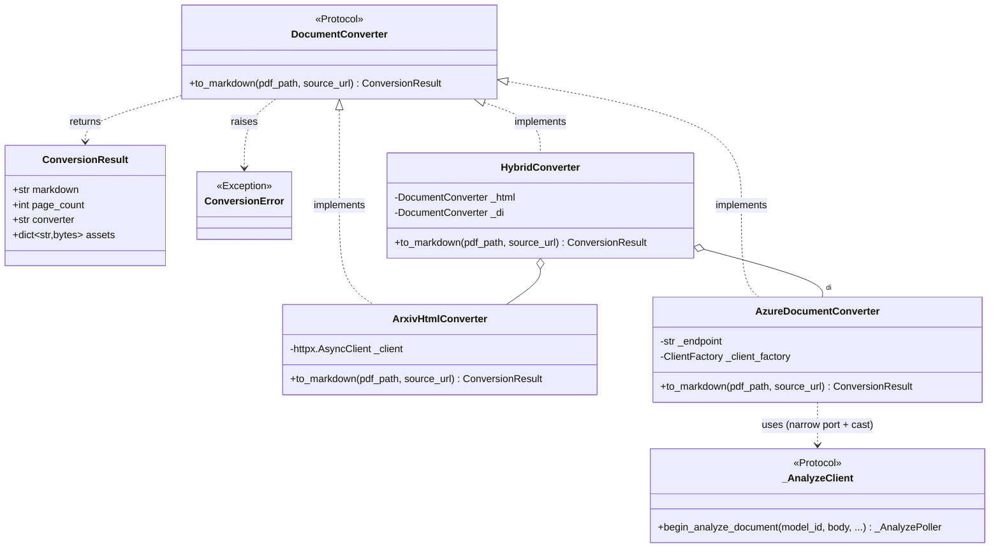
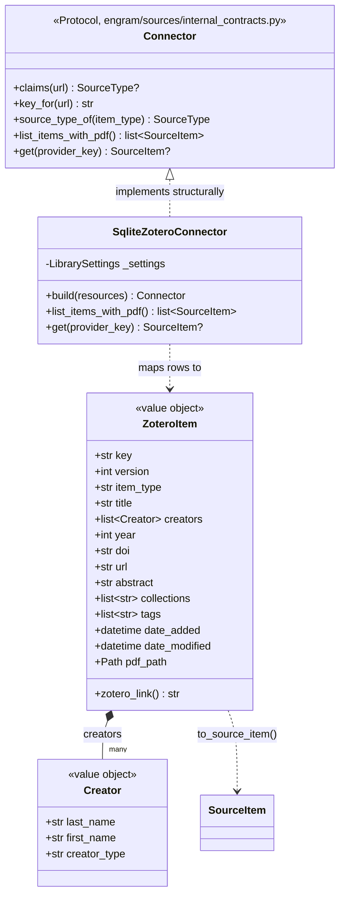
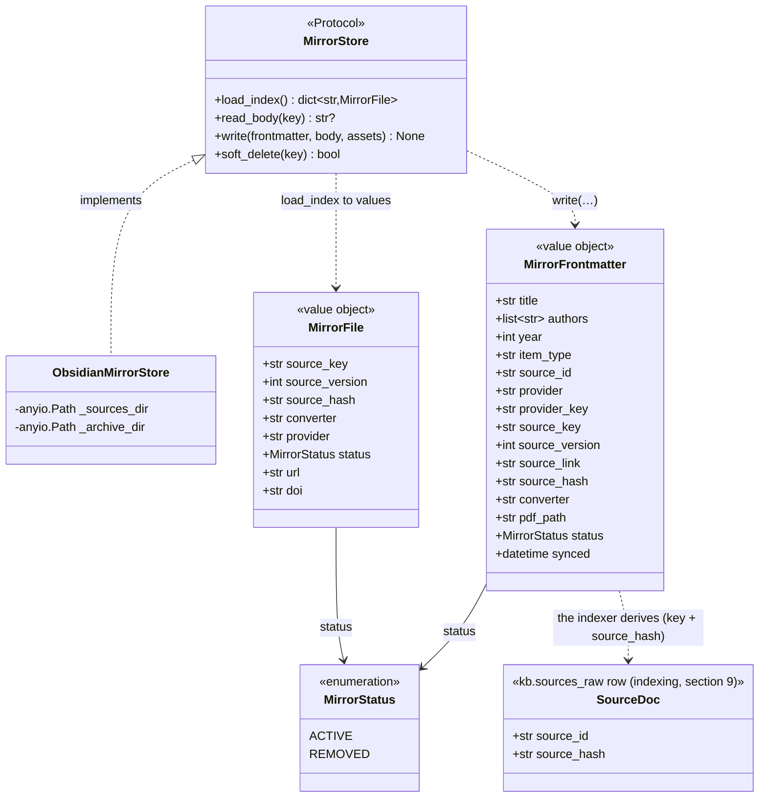
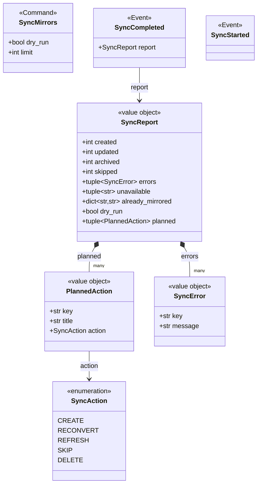

<!-- GENERATED from architecture.md by scripts/docs/split_doc.py --dir engram/docs/architecture — do not edit here; edit the master and re-run the script. -->

## 3. Ingestion (bounded context)
> **TL;DR:** The source-to-`Sources/` path: engram owns the two ports (`Connector`, `DocumentConverter`), the entry-point registry that resolves a knowledge base's declared connector names, the guarded fetcher, the mirror store, the reconcile, the source queue and the scanners. The connector and converter implementations (Zotero, YouTube, the general URL connector, arXiv-HTML/Azure conversion) live in the sibling `connectors/` project and arrive by entry point.
<!-- load-when: ingestion, connectors, zotero, conversion, mirror, sync, source queue, watch list, sources, pdf, arxiv, mirrors, paper import, entry point, registry, scanners, refresh -->

The **Ingestion** context turns whatever a connector hands over into the knowledge base's
`Sources/` mirrors. It runs only for a knowledge base whose schema sets `sources.enabled`. A
domain-general knowledge base may read no sources at all
([ADR-0014](../../adr/0014-domain-general-vault-spec-and-plugin.md)).

**engram owns the ports, never a host** ([root ADR-0018](../../../docs/adr/0018-corpus-bundles-and-provider-packages.md)).
`engram/sources/internal_contracts.py` holds the two ports, `Connector` and `DocumentConverter`, beside `MirrorStore` and `Scanner`. `engram/sources/registry.py`
resolves each name in the knowledge base's `sources.connectors` against the entry-point
groups `engram.sources.connectors` and `engram.sources.converters`, loading only
the one entry point asked for, so a knowledge base declaring one connector never imports
another's dependencies and a name nothing installs raises
`ConnectorNotInstalledError`. `core/net.py` is the one SSRF-guarded
fetcher both a scanner and a connector's article converter share.
`engram/sources/infrastructure/mirror.py` (`MirrorStore`, title-named immutable mirrors carrying
`source_key` + `source_hash`, ADRs [0002](../../adr/0002-disposable-mirror-zotero-source-of-truth.md),
[0004](../../adr/0004-title-named-mirrors.md)) and `engram/sources/service/sync.py` (`SyncMirrors`,
the reconcile that converts changed attachments, refreshes metadata, and archives
orphans, dispatched on the shared bus, whose route table is built at construction
in the composition root, [ADR-0021](../../adr/0021-explicit-eager-composition-root.md))
are the mechanics. `engram/sources/infrastructure/source_queue.py` is the source queue, and `engram/sources/domain/source_queue.py` holds the
four-source-type grammar (`SourceType`: video, paper, post, article) and the
classification that asks the knowledge base's registered connectors which one claims a URL,
so no host name appears in engram. `engram/sources/service/watch_list.py` watches for new URLs to
put on that source queue.
The contract for the reconcile lives in [sync.md](../../reference/sync.md).

**The `connectors` project owns the hosts.** `engram_connectors.zotero`
(`SqliteZoteroConnector`, the local Zotero SQLite plus linked files,
[ADR-0005](../../adr/0005-zotero-linked-files-and-collection-filter.md)),
`engram_connectors.youtube`, `engram_connectors.source_queue` (the general URL connector and
its per-source-type resolvers) and `engram_connectors.conversion` (PDF/HTML to Markdown:
arXiv-HTML-first via pandoc with an Azure Document Intelligence fallback, ADRs
[0001](../../adr/0001-pdf-to-markdown-via-azure-document-intelligence.md),
[0003](../../adr/0003-hybrid-html-first-conversion.md)) are each an optional extra
carrying only their own fetcher dependencies. The two subsections that follow
describe those implementations as they stand today, in their new home.

### Conversion

`engram_connectors/conversion` is the PDF/HTML to Markdown step that produces a Mirror's
body: **arXiv-HTML-first via pandoc, Azure Document Intelligence as the fallback**
([ADR-0003](../../adr/0003-hybrid-html-first-conversion.md),
[ADR-0001](../../adr/0001-pdf-to-markdown-via-azure-document-intelligence.md)). It is
the most **host-coupled** corner of the Ingestion context. It reasons about
arXiv ids, ar5iv/LaTeXML HTML, and PDFs, none of which a domain-general knowledge base need
have, which is why it lives behind an optional extra of `engram-connectors` rather
than in the indexer.

Dispatch is **not** the project's strategy-registry pattern (no frozen dataclass
over a `Mapping[Enum, Converter]`). `HybridConverter` is a **Composite over the
`DocumentConverter` port**: it holds an `ArxivHtmlConverter` and an
`AzureDocumentConverter` and selects between them by *exception fallback*:
delegate to the HTML route, and only on its one documented `ConversionError`
signal ("not an arXiv HTML I can convert") fall back to Azure DI. Any other
exception propagates so reconcile records it per-item. The three converters are
bound to the single `DocumentConverter` port and the `HybridConverter` composed in
`studio/knowledge_base/wiring/conversion.py::document_converter_provider` (a wireup singleton).
The slice itself is library code and knows nothing about DI.

```mermaid
C4Component
    title Conversion slice (C4 L3), arXiv-HTML-first, Azure-DI fallback
    Container_Ext(sync, "SyncMirrorsHandler", "engram/sources/service/sync.py", "Calls to_markdown(pdf_path, source_url=…)")
    System_Ext(arxiv, "ar5iv / arxiv.org", "HTML version + figure assets")
    System_Ext(azure, "Azure Document Intelligence", "prebuilt-layout OCR (Managed Identity)")

    Component_Boundary(conv, "engram_connectors/conversion") {
        Component(hybrid, "HybridConverter", "infrastructure/hybrid.py", "Composite: try HTML, fall back to DI on ConversionError")
        Component(arxivc, "ArxivHtmlConverter", "infrastructure/arxiv_html/converter.py", "Entry point: fetch to convert to localise figures")
        Component(azurec, "AzureDocumentConverter", "infrastructure/azure_converter.py", "Azure DI prebuilt-layout+FORMULAS over the PDF")

        Component(fetch, "fetch", "infrastructure/arxiv_html/fetch.py", "arxiv_id(), image-URL resolution, arXiv host SSRF guard")
        Component(md, "html_to_markdown", "infrastructure/arxiv_html/markdown.py", "Stash math to pandoc to restore $…$ to strip chrome")
        Component(tables, "_normalise_tables", "infrastructure/arxiv_html/tables.py", "Rebuild LaTeXML tables into pipe tables")
        Component(svg, "_resolve_data_reference", "infrastructure/arxiv_html/svg.py", "Inline-SVG: prose / blockquote / repaired .svg asset")
        Component(spans, "_break_paragraph_spans", "infrastructure/arxiv_html/spans.py", "ltx_p inline-span breaks (shared by tables+svg)")
    }

    Rel(sync, hybrid, "DocumentConverter port")
    Rel(hybrid, arxivc, "1. delegate")
    Rel(hybrid, azurec, "2. on ConversionError")
    Rel(arxivc, fetch, "resolve id / images")
    Rel(arxivc, md, "HTML to Markdown")
    Rel(md, tables, "pre-pandoc")
    Rel(arxivc, svg, "localise data: figures")
    Rel(tables, spans, "uses")
    Rel(svg, spans, "uses")
    Rel(arxivc, arxiv, "GET /html/<id> + figures (httpx)")
    Rel(azurec, azure, "begin_analyze_document")
```

Source: `connectors/src/engram_connectors/conversion/infrastructure/hybrid.py`, `connectors/src/engram_connectors/conversion/infrastructure/arxiv_html/converter.py`, `connectors/src/engram_connectors/conversion/infrastructure/arxiv_html/fetch.py`, `connectors/src/engram_connectors/conversion/infrastructure/arxiv_html/markdown.py`, `connectors/src/engram_connectors/conversion/infrastructure/arxiv_html/tables.py`, `connectors/src/engram_connectors/conversion/infrastructure/arxiv_html/svg.py`, `connectors/src/engram_connectors/conversion/infrastructure/arxiv_html/spans.py`, `connectors/src/engram_connectors/conversion/infrastructure/azure_converter.py`, `studio/src/studio/knowledge_base/wiring/conversion.py`

The domain model is one **port** (`DocumentConverter`), one **result**
(`ConversionResult`), one **error** (`ConversionError`), and three implementers.
Note the HTTP-boundary shape here departs from the codebase's response-model
convention: `ConversionResult` is a plain (non-frozen) pydantic `BaseModel`, and the
Azure adapter narrows the un-mockable SDK through `Protocol` ports
(`_AnalyzeClient`/`_AnalyzePoller`/`_AnalyzeResult`) plus a single boundary `cast`
rather than a validated `BaseModel(frozen=True, extra="ignore")` response, and the
arXiv path consumes raw HTML text (regex/pandoc), so it has **no** ar5iv response
models or request `TypedDict`s at all.



Source: `engram/src/engram/sources/internal_contracts.py`, `connectors/src/engram_connectors/conversion/infrastructure/hybrid.py`, `connectors/src/engram_connectors/conversion/infrastructure/arxiv_html/converter.py`, `connectors/src/engram_connectors/conversion/infrastructure/azure_converter.py`

### zotero

`engram_connectors/zotero` is one provenance root of the Ingestion context:
it reads the user's local Zotero library (`zotero.sqlite` plus the `storage/`
attachment tree) and projects each PDF-bearing top-level item into a `ZoteroItem`
value object it maps onto engram's `SourceItem` for `sync` to mirror. It reaches a
host only when a knowledge base's schema names `zotero` among its connectors
([ADR-0005](../../adr/0005-zotero-linked-files-and-collection-filter.md)). A
domain-general knowledge base need have no Zotero at all, and engram indexes without this
package installed.

The load-bearing rule is the **read-only invariant, the adapter NEVER writes Zotero**,
and `SqliteZoteroConnector` enforces it *structurally* on two layers, not by
convention. First, engram's `Connector` port exposes **only reads**
(`list_items_with_pdf`, `get`, plus the three stateless classification methods).
There is no write method to call. Second, the
adapter never opens the live database: because Zotero holds a write lock while its
app is open, every call **copies** `zotero.sqlite` (plus any `-wal` / `-shm`
sidecars) into a private `TemporaryDirectory`, opens the *copy* through an
`sqlite+aiosqlite:///…?mode=ro` URL (the SQLite read-only open mode), runs its
queries, then disposes the engine and deletes the copy. So it works whether or not
Zotero is running and cannot mutate the source even in principle.

```mermaid
C4Component
    title zotero slice (C4 L3), read-only access to the local Zotero library
    Container_Ext(sync, "SyncMirrorsHandler", "engram/sources/service/sync.py", "Calls list_items_with_pdf() to drive the reconcile")
    Container_Ext(deps, "connectors_provider", "studio/knowledge_base/wiring/sources.py", "wireup singleton: resolves each declared name through engram.sources.registry, then build(SourceResources)")
    System_Ext(zlib, "Local Zotero library", "~/Zotero, read-only source of truth", "zotero.sqlite (+ -wal/-shm) and storage/<key>/ files")

    Component_Boundary(zo, "engram_connectors/zotero") {
        Component(port, "Connector", "engram/sources/internal_contracts.py", "Read port: list_items_with_pdf() / get(key), NO write methods")
        Component(repo, "SqliteZoteroConnector", "infrastructure/connector.py", "Adapter: copy DB to temp -> open ?mode=ro -> JOINs -> ZoteroItem")
        Component(connect, "_connect / _copy_db", "infrastructure/connector.py", "TemporaryDirectory copy of zotero.sqlite (+sidecars), aiosqlite ?mode=ro engine, disposed after")
        Component(itemq, "_items_query", "infrastructure/connector.py", "_ITEMS_SQL: PDF + linkMode IN (0,1,2) + not deletedItems, optional _COLLECTION_CLAUSE")
        Component(maprow, "_row_to_item / _pdf_path", "infrastructure/connector.py", "Maps row + creators/collections/tags, resolves storage:/attachments: path")
    }

    Rel(deps, repo, "SqliteZoteroConnector(library)")
    Rel(sync, port, "list_items_with_pdf() via the Connector port")
    Rel(port, repo, "implemented by")
    Rel(repo, connect, "async with _connect()")
    Rel(repo, itemq, "build SQL + params")
    Rel(repo, maprow, "row -> ZoteroItem")
    Rel(connect, zlib, "copyfile then SELECT … ?mode=ro (never the original)")
    Rel(maprow, zlib, "resolves pdf_path under storage/<key>/")
```

Source: `connectors/src/engram_connectors/zotero/domain.py`, `connectors/src/engram_connectors/zotero/infrastructure/connector.py`, `connectors/pyproject.toml`, `engram/src/engram/sources/registry.py`, `studio/src/studio/knowledge_base/wiring/sources.py`, `engram/src/engram/sources/service/sync.py`, `studio/src/studio/knowledge_base/settings.py`

The domain model is a thin **value-object aggregate** plus its read port, no
entities, no SQLAlchemy (the slice maps raw `RowMapping`s straight to pydantic).
`ZoteroItem` is the unit of mirroring: a top-level item carrying a `pdf_path` plus
its scalar metadata and `list[Creator]`. Note its `collections` and `tags` are
plain `list[str]`, **not** their own value objects. There is no `Collection`
class. The optional single-collection filter is a `LibrarySettings.collection`
string (`connectors/src/engram_connectors/zotero/domain.py`) applied in the SQL. `ZoteroItem` / `Creator` are ordinary (non-frozen)
pydantic models. They depart from the HTTP-boundary `frozen=True` convention, but
this is a local SQLite read, not an external API.



Source: `connectors/src/engram_connectors/zotero/domain.py`, `connectors/src/engram_connectors/zotero/infrastructure/connector.py`

### mirror

`engram/sources/infrastructure/mirror.py` owns the knowledge base's `Sources/` tree, the converted paper bodies a
`ZoteroItem` projects into. `ObsidianMirrorStore` (the sole `MirrorStore`
implementer) writes, reads back, and soft-deletes those mirrors, with the on-disk
note's YAML frontmatter as the **only** persisted state (the store keeps no
database of its own, ADRs
[0002](../../adr/0002-disposable-mirror-zotero-source-of-truth.md),
[0004](../../adr/0004-title-named-mirrors.md)).

Two invariants are load-bearing and both are enforced *structurally*, not by
convention. **Title-naming + single-active identity:** an active mirror lives at
`Sources/<safe_slug(title)>.md`, but the permanent identity is the `source_key`
carried in frontmatter (`source_key` is the one field name the store reads it from, and a note
carrying anything else is skipped rather than guessed at). `_path_for_key` resolves a key by *reading* frontmatter,
never by trusting the filename, so a title change renames the note and a title
collision across two items disambiguates by appending ` (<key>)`. **No-stale-write
atomicity:** `write` resolves the prior note for the key, writes the new note via
`core.files.atomic_write` (temp file + `os.replace`), then unlinks the old name and
any `_archive/<key>.md` copy, so a half-written note is never observable and a key
always maps to exactly one active note. Note the *mirror* is not immutable in the
never-overwrite sense, `write` overwrites on a re-sync. Immutability is the
property of the upstream **`Source (raw)`** DB row (below), not of the on-disk file.
The decision of *whether* to rewrite (CREATE / RECONVERT on a changed `source_hash`
/ REFRESH / SKIP) lives in `engram/sources/domain/sync.py` (`decide`), not the store. The store is a
mechanical, idempotent knowledge-base port. It is invoked only along the `sync` reconcile
path, wired as the `mirror_store_provider` wireup singleton from `KnowledgeBaseSettings`
(`sources_dir` / `archive_dir`) in `studio/src/studio/knowledge_base/wiring/mirror.py`. The slice itself is
library code and knows nothing about DI.

```mermaid
C4Component
    title mirror slice (C4 L3), the knowledge base Sources/ port (write, read-back, soft-delete)
    Container_Ext(sync, "SyncMirrorsHandler", "engram/sources/service/sync.py", "decide() -> write / soft_delete, builds MirrorFrontmatter (source_hash = pdf_sha256)")
    Container_Ext(deps, "mirror_store_provider", "studio/src/studio/knowledge_base/wiring/mirror.py", "wireup singleton: ObsidianMirrorStore(KnowledgeBaseSettings)")
    Container_Ext(corelib, "core.files / core.markdown", "core", "atomic_write(+_bytes), safe_slug, render/split_frontmatter")
    System_Ext(tree, "Knowledge base Sources/ tree", "Sources/<title>.md (+ figures) and Sources/_archive/<key>.md", "YAML frontmatter is the ONLY persisted state")

    Component_Boundary(m, "engram/sources") {
        Component(port, "MirrorStore", "internal_contracts.py", "Port: load_index / read_body / write / soft_delete")
        Component(store, "ObsidianMirrorStore", "infrastructure/mirror.py", "Adapter over sources_dir + archive_dir")
        Component(pathfor, "_path_for_key", "infrastructure/mirror.py", "Resolve key->note by READING frontmatter (never the filename)")
        Component(target, "_target_path", "infrastructure/mirror.py", "safe_slug(title) stem, ` (key)` suffix on cross-item collision")
        Component(asset, "_asset_path", "infrastructure/mirror.py", "Reject absolute / `..` asset paths (stay inside Sources/)")
        Component(fm, "_parse_frontmatter / _render / _split_body", "infrastructure/mirror.py", "Require leading fence, MirrorFile.model_validate")
    }

    Rel(deps, store, "ObsidianMirrorStore(knowledge base)")
    Rel(sync, port, "write / soft_delete / load_index / read_body")
    Rel(port, store, "implemented by")
    Rel(store, target, "title-derived path + collision suffix")
    Rel(store, pathfor, "find existing note for key")
    Rel(store, asset, "validate figure paths")
    Rel(store, fm, "(de)serialise frontmatter")
    Rel(store, corelib, "atomic_write / safe_slug / render_frontmatter")
    Rel(store, tree, "atomic write (temp+os.replace), glob *.md, move to _archive/")
```

Source: `src/engram/sources/domain/mirror.py`, `src/engram/sources/internal_contracts.py`, `src/engram/sources/infrastructure/mirror.py`, `studio/src/studio/knowledge_base/wiring/mirror.py`, `src/engram/sources/service/sync.py`, `studio/src/studio/knowledge_base/settings.py`

The domain model is **no entity and no SQLAlchemy**. It is the `MirrorStore` port
plus two pydantic value objects over the frontmatter. `MirrorFrontmatter` is the
full block `write` serialises (provenance: `source_id`, `provider`,
`provider_key`, `source_key`, `source_version`, `source_link`, `source_hash`,
`converter`, `pdf_path`, and the optional connector-supplied `channel` /
`published`). `MirrorFile` is the thin
reconcile-relevant slice `load_index` reads back (`converter` defaults to
`"unknown"` so a note naming no provenance label still loads. `provider` has no default and is
required, since a sync run's orphan pass narrows by it, and `url` and `doi` are the source's own,
which a sync matches a new item against), keyed by
`source_key`. Nothing in the model names a host: `source_link` carries whatever
deep link the item's own connector filled in, empty for a connector that owns none.
The on-disk
**Mirror** (this frontmatter) is the F10 counterpart of the indexed **`Source
(raw)`** row (`SourceRawORM` to `kb.sources_raw` / `SourceDoc`, section 9, owned by
`index`): the DB row is the immutable raw-mirror *metadata* the indexer derives from
the mirror, joined on the shared key + `source_hash`. The indexing tier's own column for that key
is `kb.index_manifest.source_key` and reads the mirror's `source_key`, the one name on both
sides of the join. Mirror (file) = source of the body bytes. Source (raw) (row) = its queryable
projection.



Source: `src/engram/sources/domain/mirror.py`, `src/engram/sources/internal_contracts.py`, `src/engram/sources/infrastructure/mirror.py`, `src/engram/indexing/domain/models.py`, `src/engram/indexing/infrastructure/orm.py`

### sync

`engram/sources/service/sync.py` is the reconcile orchestrator that converges the knowledge base's
`Sources/` mirrors to whatever the knowledge base's declared connectors hold, on
`studio sync`: convert changed attachment PDFs, refresh frontmatter when only
metadata moved, and archive orphaned mirrors whose item left the connector. It runs
only for a knowledge base whose schema sets `sources.enabled`, and `MultiConnectorSync`
(`service/sync.py`) runs one handler per declared connector and merges their reports, so a
knowledge base naming several syncs all of them from one dispatch. The orphan pass narrows
by the mirror's `provider` field, so one connector's run never archives another's mirrors. Driven by
`SyncMirrors` on the CQRS bus. `dry_run` previews the
plan with zero writes, and a `limit` slices to a partial backfill that **never**
archives orphans (a partial view must not delete the rest of the library).

Two structural facts are load-bearing. First, the **reconcile/mutation policy
lives here, not in the store**: the pure `decide` function (`domain/sync.py`) maps
an item's current `MirrorFile` + freshly hashed PDF onto a `SyncAction`
(CREATE / RECONVERT / REFRESH / SKIP, DELETE is tallied by the orphan pass), and
`SyncMirrorsHandler` drives the side effects, sync *owns the decision*, `mirror`
owns only the atomic write (the policy-vs-store split, mirror section 3 above). Before `decide`,
`holder_of` refuses an item with no live mirror of its own whose URL, arXiv id or DOI an active
mirror under another key already holds, so a source two connectors bring gets one mirror
([ADR-0051](../../adr/0051-a-sync-admits-one-mirror-per-source.md)). Second,
**each Ingestion adapter gets its own wiring module app-side**:
`studio/src/studio/knowledge_base/wiring/sources.py`, `studio/src/studio/knowledge_base/wiring/conversion.py`, and
`studio/src/studio/knowledge_base/wiring/mirror.py` each bind one
port as a wireup singleton (`connectors_provider` resolving every name in
`spec.sources.connectors` through `engram.sources.registry` and building each one
from `SourceResources`, `document_converter_provider` resolving the
converters the same way, `mirror_store_provider`
for the `MirrorStore` write port). Neither connector module holds a
name-to-factory dict of its own, and **`studio/src/studio/knowledge_base/wiring/sync.py` composes ports
only**. Its single `sync_handler_provider` injects the three ports and provides
the plain `SyncMirrorsHandler` the composition root routes at construction
([ADR-0021](../../adr/0021-explicit-eager-composition-root.md) task A7). sync
orchestrates the flow connector (read) to converter (convert) to mirror (write). The
contract lives in [sync.md](../../reference/sync.md).

```mermaid
C4Component
    title sync slice (C4 L3), the source to Sources/ reconcile, composing the three adapter ports
    Container_Ext(bus, "MessageBus", "src/cqrs/bus.py", "Routes SyncMirrors at construction (composition root)")
    Container_Ext(zo, "Connector", "engram/sources/internal_contracts.py", "list_items_with_pdf() / get(), read port, implemented in engram-connectors")
    Container_Ext(conv, "DocumentConverter", "engram/sources/internal_contracts.py", "HybridConverter.to_markdown(), convert port")
    Container_Ext(mir, "MirrorStore", "engram/sources/internal_contracts.py", "load_index / read_body / write / soft_delete, write port")
    Container_Ext(deps, "ports-only wiring module", "studio/src/studio/knowledge_base/wiring/sync.py", "one wireup singleton: sync_handler_provider over the three ports (each provided by its own wiring module, ADR-0021 A7)")

    Component_Boundary(s, "engram/sources") {
        Component(handler, "SyncMirrorsHandler", "service/sync.py", "Drives convert+write+soft-delete, collects per-item failures, emits SyncStarted/SyncCompleted")
        Component(holder, "holder_of", "domain/sync.py", "Pure policy: the active mirror under another key holding the item's URL, arXiv id or DOI, else none")
        Component(decide, "decide", "domain/sync.py", "Pure policy: item + MirrorFile + pdf_hash to SyncAction (CREATE/RECONVERT/REFRESH/SKIP)")
        Component(apply, "_apply / _apply_one / _resolve_body", "service/sync.py", "Applying run: hash PDF, decide, build_frontmatter, write (REFRESH may reuse stored body)")
        Component(plan, "_plan", "service/sync.py", "Dry run: same decisions into report.planned, zero writes/conversions")
        Component(orphans, "_archive_orphans", "service/sync.py", "Soft-delete active mirrors whose item left this run's connector (skipped when limited)")
    }

    Rel(bus, handler, "SyncMirrors to __call__ (routed at construction)")
    Rel(deps, handler, "sync_handler_provider: injects the three ports")
    Rel(handler, holder, "per-item admission")
    Rel(handler, decide, "per-item action")
    Rel(handler, apply, "applying run")
    Rel(handler, plan, "dry run")
    Rel(handler, orphans, "archive_orphans (limit is None)")
    Rel(handler, zo, "list_items_with_pdf()")
    Rel(apply, conv, "to_markdown(pdf_path, source_url) for CREATE/RECONVERT")
    Rel(apply, mir, "load_index / read_body / write")
    Rel(orphans, mir, "soft_delete(key)")
```

Source: `src/engram/sources/service/sync.py`, `studio/src/studio/knowledge_base/wiring/sync.py`, `src/engram/sources/domain/sync.py`, `src/cqrs/bus.py`

The domain model (`domain/sync.py`) is the write-side bus contract plus the run-report
value objects, **no entity and no SQLAlchemy** (sync persists nothing of its own.
Its only durable state is the mirrors `mirror` writes). `SyncMirrors` is the one
command. `SyncAction` is the decision enum. `PlannedAction` is one dry-run row
(`key` + `title` + `action`). `SyncError` is one captured per-item failure so the
run continues. `SyncReport` is the frozen tally (`created` / `updated`
(RECONVERT+REFRESH both count as an update) / `archived` / `skipped`, plus
`errors`, the `unavailable` list of items whose PDF path could not resolve,
`already_mirrored` (each refused item's key mapped to the mirror holding its source), and the
dry-run `planned` rows). `SyncStarted` / `SyncCompleted` are the events the bus
hands to the outbox once the handler returns, delivered once per subscriber by a worker.



Source: `src/engram/sources/domain/sync.py`, `src/engram/sources/service/sync.py`
