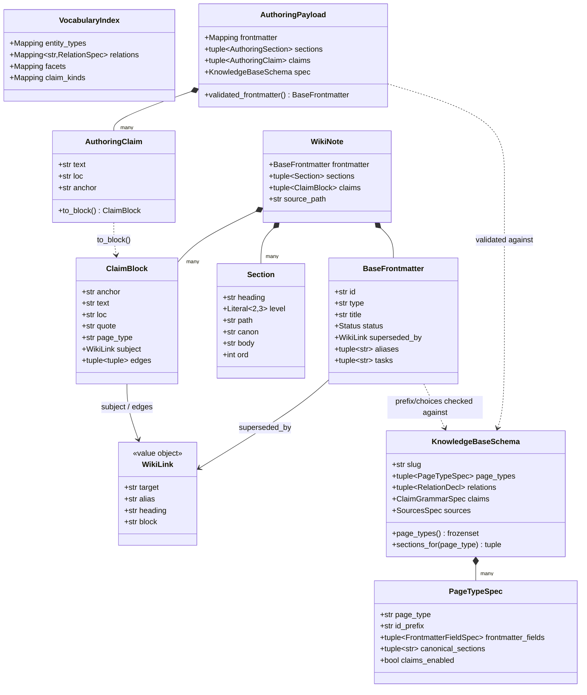
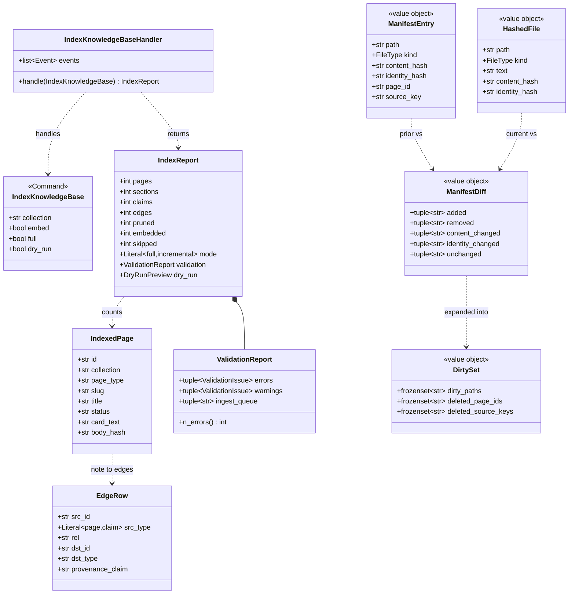

<!-- GENERATED from architecture.md by scripts/docs/split_doc.py --dir engram/docs/architecture — do not edit here; edit the master and re-run the script. -->

## 4. Knowledge (bounded context)
> **TL;DR:** The wikinote kernel is the note grammar (a parser ⟷ renderer pair over one set of domain models, shared by the indexer and authoring), and indexing is the five-stage rebuild (parse to resolve to validate to load to embed) with a true-incremental path that indexes again only a provably minimal dirty set.
<!-- load-when: knowledge, knowledge base, wikinote, note grammar, index, indexing, parse, resolve, validate, validation, embed, incremental, claims, pipeline -->

The **Knowledge** context owns the note grammar and the indexing pipeline. The
`wikinote` kernel (`src/engram/kb/`) is a **shared kernel**: a `parser` and a
`renderer` over the same `domain` models, so the rules that indexing reads a note
by are the rules `studio note build/validate/verify/schema` writes one by, one
grammar, two directions. The grammar (page types, frontmatter, canonical H2s,
the claims grammar, vocabulary) is derived from the knowledge base's
`KnowledgeBaseSchema` (`engram/kb/spec.py`).

`engram/indexing` is the **five-stage rebuild**: parse the knowledge base to resolve
wikilinks to page ids to validate to load Postgres in one transaction to
embed (hash-gated). It is idempotent and pruned per `--collection`. A
**true-incremental** path re-indexes only the *dirty set* (content-changed ∪
added ∪ inbound-closure ∪ mirror-citers), proven minimal against a full index,
backed by an indexing manifest, a link-reference graph, a persisted validation store, and
an index fingerprint that auto-forces a full index on a schema / vocabulary /
embed-model change ([ADR-0019](../../adr/0019-true-incremental-ingestion.md), the
engineering reference exemplar is `engram/docs/explanation/incremental-ingestion/`).
The indexing contract lives in [the indexing reference](../../reference/indexing.md).

### WikiNote kernel

The `wikinote` kernel (`src/engram/kb/`, a **library** package, not an app slice) is engram's
shared note-grammar kernel: one set of frozen pydantic `domain` models with a
`parser` (Markdown to `WikiNote`) and a `renderer` (`AuthoringPayload`/`WikiNote`
to canonical Markdown) that are *inverses*. `render(parse(text))` round-trips and
`render` is idempotent. Both directions are driven by a `KnowledgeBaseSchema` (page
types, frontmatter fields, canonical H2s, the claims grammar), which is what makes
engram **domain-general** ([ADR-0014](../../adr/0014-domain-general-vault-spec-and-plugin.md)):
the kernel is itself domain-agnostic, and `BaseFrontmatter.type` is a plain `str`
(not the `PageType` literal) so any schema-declared type parses without a model
change. The kernel scopes itself tightly. It enforces only structural,
always-true invariants (id-prefix, closed `status`, the one required claim `loc::`)
and raises `NoteGrammarError`. Vocabulary/threshold validation is the indexing validate
stage's job against a `VocabularyIndex`. Both sides call this kernel: `index`
takes the **parse path** (knowledge base to `WikiNote` to loaded `pages`). The `studio note`
CLI takes the **author path** (`AuthoringPayload` to `render` to `parse` to validate).

```mermaid
C4Component
    title WikiNote kernel (C4 L3), one grammar, two directions (parse ⟷ render)
    Container_Ext(indexing, "indexing (parse path)", "engram/indexing/{service/index,service/incremental,domain/validator}.py", "Knowledge base Markdown to WikiNote to pages")
    Container_Ext(notecli, "note CLI (author path)", "studio/src/studio/knowledge_base/cli_note.py", "build / validate / verify / schema")

    Component_Boundary(k, "src/engram/memory, shared kernel") {
        Component(parser, "parser.parse", "parser.py", "Markdown (markdown-it tokens) to WikiNote")
        Component(renderer, "renderer.render", "renderer.py", "AuthoringPayload | WikiNote to canonical Markdown")
        Component(domain, "domain models", "domain.py", "WikiNote, Section, ClaimBlock, WikiLink, BaseFrontmatter, VocabularyIndex, parse_frontmatter")
        Component(spec, "KnowledgeBaseSchema", "spec.py", "Per-knowledge-base schema, resolve_schema / load_knowledge_base_schema, no default: KnowledgeBaseSchemaMissingError names studio init --template")
        Component(registry, "parse_vocabulary", "registry.py", "_meta/vocabulary/*.md to VocabularyIndex (+ RegistryWarning)")
        Component(payload, "AuthoringPayload", "payload.py", "Extractor JSON contract, assign_anchors, payload_json_schema")
        Component(verify, "quote verify", "verify.py", "quotes_in_mirror / find_quote (whitespace-normalized)")
        Component(slug, "heading_slug", "slug.py", "Collision-proof ltree-safe section slugs")
    }

    Rel(indexing, parser, "parse(text, spec)")
    Rel(indexing, registry, "parse_vocabulary(docs)")
    Rel(indexing, verify, "quotes_in_mirror(quote, mirror)")
    Rel(notecli, payload, "AuthoringPayload.model_validate")
    Rel(notecli, renderer, "render(payload, spec)")
    Rel(notecli, parser, "parse(rendered), round-trip validation")
    Rel(notecli, payload, "payload_json_schema(page_type)")

    Rel(parser, domain, "builds WikiNote / parse_frontmatter")
    Rel(renderer, domain, "reads ClaimBlock / re-validates frontmatter")
    Rel(renderer, payload, "assign_anchors then to_block")
    Rel(parser, spec, "resolve_schema, canon_set / claim fields")
    Rel(renderer, spec, "resolve_schema, sections_for")
    Rel(payload, spec, "resolve_schema, field specs")
    Rel(domain, spec, "prefix/choices/required (deferred import)")
    Rel(parser, slug, "heading_slug")
    Rel(renderer, slug, "heading_slug")
```

Source: `src/engram/kb/domain/parser.py`, `src/engram/kb/domain/renderer.py`, `src/engram/kb/domain/note.py`, `src/engram/kb/domain/schema.py`, `src/engram/kb/domain/vocabulary.py`, `src/engram/kb/domain/payload.py`, `src/engram/kb/domain/verify.py`, `core/src/core/markdown.py`, `src/engram/indexing/service/index.py`, `studio/src/studio/knowledge_base/cli_note.py`

The domain model is one rich aggregate, a `WikiNote` is a parsed
`Wiki/**/*.md` file: a `BaseFrontmatter` plus a tuple of `Section`s and a tuple of
`ClaimBlock`s. This is the **authored** object and is distinct from the indexed
`pages` row (the indexer's DB projection, section 9 ERD). The kernel never imports
SQLAlchemy. `KnowledgeBaseSchema` is the value object that parameterizes the grammar
(its `PageTypeSpec` / `FrontmatterFieldSpec` / `ClaimGrammarSpec` parts), and
`VocabularyIndex` is the indexed controlled vocabulary the validate stage references.
`AuthoringPayload` is the construct-side input contract (an extractor's JSON), with
`AuthoringClaim` mirroring `ClaimBlock` but with an optional anchor that
`assign_anchors` fills.



Source: `src/engram/kb/domain/note.py`, `src/engram/kb/domain/schema.py`, `src/engram/kb/domain/payload.py`

### Indexing

`engram/indexing` is the **knowledge-base-to-Postgres pipeline** and the *only writer* of the
derived tables: a five-stage rebuild **parse to resolve to validate to load to embed**,
idempotent and pruned per `--collection`. It is **incremental by default**
([ADR-0019](../../adr/0019-true-incremental-ingestion.md)). `IndexKnowledgeBaseHandler.handle`
re-hashes the knowledge base against the stored `index_manifest` and re-indexes only the
*dirty set*, with `--full` as the escape hatch and property-test oracle. The DB is a
disposable derivative of the knowledge base: the indexer writes the base `kb.*` tables, while the
serving role reads only the `api` projection (the writer/reader split, section 9). The
indexed `pages` row is the projection of an authored `WikiNote` (distinct objects),
and the Parse stage calls straight into the WikiNote kernel's `parser.parse`. The
incremental algorithm (the closure-completeness argument, the fingerprint invalidator)
is owned by the incremental-ingestion package and ADR-0019. This is the structural
view only. The indexing contract lives in [the indexing reference](../../reference/indexing.md).

```mermaid
C4Component
    title Indexing slice (C4 L3), five-stage pipeline + incremental dispatch
    System_Ext(knowledge base, "Obsidian knowledge base", "Wiki/**/*.md, Sources/*.md, _meta/vocabulary/*.md")
    Container_Ext(kernel, "wikinote kernel", "src/engram/memory", "parse / parse_vocabulary / quotes_in_mirror")
    System_Ext(aoai, "Azure OpenAI", "Embeddings via core.ai")
    ContainerDb_Ext(pg, "Postgres", "kb.* base tables", "Indexing is the only writer")

    Component_Boundary(c, "engram/indexing") {
        Component(handler, "IndexKnowledgeBaseHandler", "service/index.py", "Orchestrates the stages, dispatches full vs incremental, owns the bus events")
        Component(reader, "FilesystemKnowledgeBaseReader", "kb_reader.py", "Globs the 4 surfaces to RawDocument, chunk_mirror cuts mirrors at headings and to the chunk sizes")
        Component(resolver, "resolve / resolve_with_index", "domain/resolver.py", "wikilinks to page ids (LinkIndex), loc:: to ltree, dangling to warning | resolution queue")
        Component(validator, "validate", "domain/validator.py", "schema.md's validation rules to ValidationReport (flagged-but-loaded)")
        Component(card, "card", "domain/card.py", "card_text + breadcrumb embed inputs + content_hash (re-embed gate)")
        Component(vocab, "_vocab_rows", "service/vocab.py", "VocabularyIndex to kb.vocab rows")
        Component(uow, "SqlAlchemyWikiUnitOfWork", "infrastructure/uow.py + infrastructure/repository.py", "One rebuild txn, per-aggregate repos, hash-gated upsert + collection-scoped prune")
        Component(embedder, "PydanticAiEmbedder", "infrastructure/embedder.py", "BatchEmbedder, batched embed_documents, embedding IS NULL queue")
        Component(cutplans, "CutPlanStage", "service/cut_plan_stage.py", "Cut plans for a heading section over the maximum: stored in kb.cut_plans, else asked of the ChunkPlanner port, else filled")

        Component(manifest, "compute_diff / identity_hash", "domain/manifest.py", "Re-hash files vs stored manifest to ManifestDiff")
        Component(closure, "compute_closure", "domain/manifest.py", "Diff to DirtySet (reparse ∪ inbound-closure ∪ mirror-citers) + targeted deletes")
        Component(incremental, "run_incremental", "service/incremental.py", "Dirty-only parse/resolve/validate/load + gated graph refresh")
    }

    Rel(reader, knowledge base, "globs (sorted, deterministic)")
    Rel(handler, reader, "Parse stage")
    Rel(reader, kernel, "parse(text, spec) / parse_vocabulary")
    Rel(handler, resolver, "Resolve stage")
    Rel(resolver, vocab, "VocabularyIndex")
    Rel(handler, validator, "Validate stage")
    Rel(validator, kernel, "quotes_in_mirror (quote check)")
    Rel(handler, card, "card_text / content_hash at Load")
    Rel(handler, uow, "Load: one txn upsert + prune (P8)")
    Rel(uow, pg, "INSERT … ON CONFLICT / DELETE … collection-scoped")
    Rel(handler, embedder, "Embed stage (hash-gated)")
    Rel(embedder, aoai, "embed_documents")
    Rel(handler, cutplans, "before Load, on both paths")
    Rel(cutplans, aoai, "PydanticAiChunkPlanner: paragraph numbers only")

    Rel(handler, manifest, "incremental? re-hash + diff")
    Rel(manifest, closure, "ManifestDiff")
    Rel(closure, incremental, "DirtySet")
    Rel(incremental, uow, "dirty-only load (targeted deletes)")
    Rel(handler, incremental, "_can_incremental to run_incremental, else _full_path")
```

Source: `src/engram/indexing/service/index.py`, `src/engram/indexing/service/cut_plan_stage.py`, `src/engram/indexing/infrastructure/knowledge_base_reader.py`, `src/engram/indexing/domain/resolver.py`, `src/engram/indexing/domain/validator.py`, `src/engram/indexing/domain/card.py`, `src/engram/indexing/service/vocab.py`, `src/engram/indexing/infrastructure/uow.py`, `src/engram/indexing/infrastructure/repository.py`, `src/engram/indexing/infrastructure/embedder.py`, `src/engram/indexing/domain/manifest.py`, `src/engram/indexing/service/incremental.py`

The domain layer (`domain.py`) is one command, one report, ports, and the
loadable-row models whose field names mirror the `kb.*` ORM columns 1:1 so the Load
stage builds each repository `Row` by `model_dump`. `IndexedPage` / `SourceDoc` /
`RawChunk` / `EdgeRow` are frozen row models. The `kb.sections`, `kb.claims`,
`link_refs`, and `validation_store` rows are assembled directly as
dicts by `_RowBuilder` / `link_ref_row` / `validation_row` against the ORM column names
(`SectionORM` / `ClaimORM` / `LinkRefORM` / `ValidationStoreORM`, see section 9). The incremental
value objects (`manifest.py`) are pure (no IO, no SQLAlchemy): `ManifestEntry` is the
stored row, `HashedFile` the file as seen this run, `ManifestDiff` the five-way raw
partition, and `DirtySet` the minimal recompute set plus targeted deletes.



Source: `src/engram/indexing/domain/models.py`, `src/engram/indexing/domain/manifest.py`, `src/engram/indexing/service/incremental.py`, `src/engram/indexing/infrastructure/orm.py`
