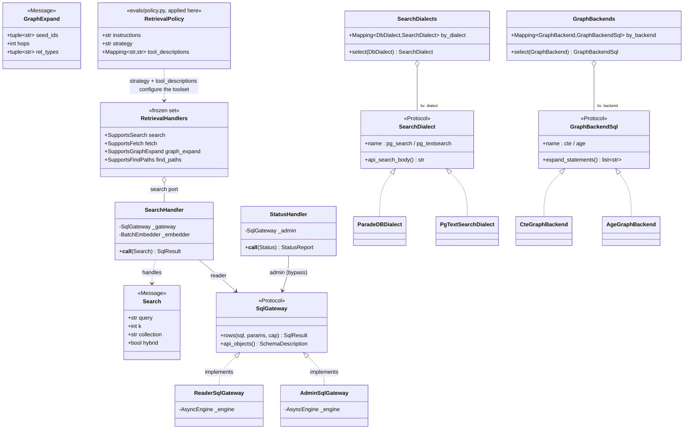

<!-- GENERATED from architecture.md by scripts/docs/split_doc.py --dir engram/docs/architecture — do not edit here; edit the master and re-run the script. -->

## 5. Retrieval (bounded context)
> **TL;DR:** The serve slice is the read-only query surface, one shared retrieval toolset (search/fetch/graph_expand/find_paths) over dialect (BM25) and graph seams, hitting only the `api` schema through the read-only `kb_reader` role (a private knowledge base through its own login role), one snapshot per tool call, exposed identically over the CLI, the Studio API, and the MCP server.
<!-- load-when: retrieval, serve, search, fetch, graph, mcp, http api, dialect seam, graph backend, kb_reader, read path, read tools, SQL tools, private knowledge base, statement guard, tuning, snapshot, graph reach -->

The **Retrieval** context is the single `engram/retrieval` slice, and it is the
only read path. Its core is the **shared retrieval toolset**
(`engram/retrieval/tools.py`): `search`, `fetch`, `graph_expand`, and `find_paths`,
defined once and registered into both the FastMCP server and the evals agent's
`FunctionToolset` ([ADR-0011](../../adr/0011-single-source-retrieval-toolset.md)).
Lexical retrieval goes through a **dialect seam**, a `SearchDialect` strategy
registry emitting backend-specific BM25 SQL so one codebase serves both the
local Postgres (`pg_textsearch`) and ParadeDB (`pg_search`) (ADRs
[0006](../../adr/0006-dual-dialect-bm25-seam.md),
[0017](../../adr/0017-local-postgres-primary-testbed.md)), and graph retrieval
through a **dual graph backend** (the relational `cte` backend or Apache AGE,
[ADR-0007](../../adr/0007-age-multihop-dual-graph-backend.md)). Both backends render
the same walks, and each walk keeps the set of nodes it reached and takes one hop
at a time, so its work grows with the nodes and edges it reaches, never with the
number of paths between them
([ADR-0049](../../adr/0049-graph-walks-keep-the-set-of-reached-nodes.md)). Every query runs
under the read-only `kb_reader` role against the `api` schema only
(`engram/retrieval/infrastructure/gateway.py`), and `verify_reader_role` refuses
a reader engine whose role can do more than read `api` when the engine is built. A private
knowledge base is read only through its own login role, a member of `kb_reader`
that `kb.reader_scopes` names
([ADR-0046](../../adr/0046-private-knowledge-base-read-through-its-own-login-role.md)).
Base `kb.*` tables are never granted. The
studio HTTP API sits app-side under `studio/src/studio/knowledge_base/http/`, over this surface rather than in it,
and serves no search or fetch route. The retrieval
contract lives in [serve.md](../../reference/serve.md).

### serve (retrieval)

`engram/retrieval` is the whole Retrieval context: a **read-only** hybrid-retrieval
surface (`search` / `fetch` / `graph_expand` / `find_paths`, plus
`describe_schema` / `run_sql` / `submit_feedback`) exposed identically over the
Typer CLI and the Studio API (both `studio.knowledge_base`) and the FastMCP stdio
server it builds itself. The read path
**bypasses the CQRS bus**: the shared toolset (`tools.py`) calls query handlers
(`queries.py`) directly, each holding a `SqlGateway` port, and every read hits only
the `api` schema through the `kb_reader` role. Lexical ranking goes through a
real **dialect strategy registry** (`pg_textsearch` vs ParadeDB `pg_search`,
[ADR-0006](../../adr/0006-dual-dialect-bm25-seam.md)) and graph traversal through a
real **graph-backend strategy registry** (relational `cte` vs Apache AGE,
[ADR-0007](../../adr/0007-age-multihop-dual-graph-backend.md)), both frozen
dataclasses wrapping `Mapping[Enum, Adapter]`, in contrast with conversion's
exception-fallback Composite (section 3).

The slice is also engram's progressive-disclosure provider
([root ADR 0008](../../../../docs/adr/0008-progressive-disclosure-protocol.md)):
`envelope.py`'s `EnvelopeHandler` renders `core.ai.disclosure` envelopes for
`collection:` / `page:` / `section:` refs through the `api.envelope_*`
`SECURITY DEFINER` functions (migration 0012), with child summaries drawn from
the indexed, governed `kb.unit_summaries` rows (written `pending` by the
indexing summary stage, promoted via `studio summaries approve`) and a
`truncated:<ref>` sentinel child when a listing is row-capped. The same handler
backs the `disclose` MCP tool and `GET /api/envelope`. The tool contract lives
in [serve.md](../../reference/serve.md).

```mermaid
C4Component
    title serve slice (C4 L3), one toolset, three entry points, read-only api surface
    Person_Ext(agent, "Agent / operator", "CLI, Studio, MCP client")
    Container_Ext(evals, "evals agent-under-test", "engram/evals/harness/agent.py", "Binds the SAME toolset")
    ContainerDb_Ext(pg, "Postgres, api schema only", "api.search / fetch / cards / edges / graph_expand / graph_paths / graph_reach", "kb_reader role: read-only, 10s statement_timeout, 5s lock_timeout")

    Component_Boundary(serve, "engram/retrieval, the library surface") {
        Component(mcp, "FastMCP stdio server", "mcp_server.py, create_mcp_server", "register_mcp_tools + run_sql/describe_schema/run_code/submit_feedback")
        Component(tools, "shared toolset", "tools.py", "build_retrieval_toolset / register_mcp_tools over a RetrievalHandlers set (ADR-0011)")
        Component(queries, "query handlers", "queries.py", "Search/Fetch/LookupValue/DescribeSchema/Graph/GraphExpand/GraphPaths/Status, one per read message")
        Component(reader_gw, "ReaderSqlGateway", "gateway.py + studio/src/studio/knowledge_base/wiring/contracts.py", "Capped reads + api introspection over the reader engine (NullPool), one REPEATABLE READ snapshot per tool call, a private collection through its own role")
        Component(admin_gw, "AdminSqlGateway", "gateway.py + studio/src/studio/knowledge_base/wiring/contracts.py", "StatusHandler ONLY, the sanctioned kb_reader bypass")
        Component(dialects, "SearchDialects registry", "search_dialect/registry.py", "select(DbDialect) to pg_textsearch | paradedb BM25 SQL")
        Component(backends, "GraphBackends registry", "graph_backend/registry.py", "select(GraphBackend) to cte | age traversal SQL")
    }

    Component_Boundary(app, "studio.knowledge_base, the entry points over it") {
        Component(cli, "CLI search/fetch + mcp", "studio/src/studio/knowledge_base/cli.py", "Resolves handlers, builds the MCP server")
        Component(http, "FastAPI app :8100", "studio/src/studio/knowledge_base/http/api.py, create_app", "/api/knowledge-bases/*, /api/graph, /api/events, /api/jobs/{job_id}, /api/templates")
    }

    Rel(agent, cli, "search / fetch / mcp")
    Rel(agent, http, "GET/POST /api/* (loopback)")
    Rel(agent, mcp, "stdio (MCP)")
    Rel(evals, tools, "build_retrieval_toolset")
    Rel(cli, tools, "register_mcp_tools (+ active-policy override)")
    Rel(mcp, tools, "register_mcp_tools")
    Rel(http, queries, "GraphHandler for /api/graph, NOT via the bus")
    Rel(cli, queries, "resolves handlers")
    Rel(tools, queries, "RetrievalHandlers ports to handler.__call__")
    Rel(queries, reader_gw, "rows(api.*) / api_objects")
    Rel(queries, admin_gw, "StatusHandler: kb.* counts (bypass)")
    Rel(reader_gw, pg, "SELECT api.* (kb_reader)")
    Rel(admin_gw, pg, "SELECT kb.* (admin URL)")
    Rel(dialects, pg, "api.search BM25 SQL (migration-time DDL)")
    Rel(backends, pg, "api.graph_* traversal SQL (migration-time DDL)")
```

Source: `src/engram/retrieval/tools.py`, `src/engram/retrieval/queries.py`, `src/engram/retrieval/infrastructure/gateway.py`, `studio/src/studio/knowledge_base/wiring/serve.py`, `studio/src/studio/knowledge_base/http/api.py`, `src/engram/retrieval/infrastructure/mcp_server.py`, `src/engram/retrieval/search_dialect/registry.py`, `src/engram/retrieval/graph_backend/registry.py`, `studio/src/studio/knowledge_base/cli.py`

The domain model is the read-side contract (`domain.py`): frozen query `Message`s
(reads, **not** `Command`s, the CQS asymmetry), result models, and the `SqlGateway`
port. Two adapters satisfy that one port, `ReaderSqlGateway` over the `kb_reader`
engine for the `api` surface, and `AdminSqlGateway` over the admin engine, injected
**only** into `StatusHandler` so its `kb.*` count read is the single sanctioned
bypass of the reader role (F5). The dialect and graph seams are genuine strategy
registries (`SearchDialects` / `GraphBackends`, each `select`-ing a `SearchDialect`
/ `GraphBackendSql` Protocol impl). **`RetrievalPolicy` is defined in
`engram/evals/tuning/policy.py`** (Evaluation context) and *applied here*, the
serve-read tail (`studio/src/studio/knowledge_base/cli.py::_apply_active_policy`) reads `_meta/active-policy.yaml` and
feeds the policy's `strategy` + `tool_descriptions` into `register_mcp_tools` via
`resolve_description`. The same policy drives the evals harness's
`build_retrieval_toolset`. That is a cross-context dependency edge: Retrieval
consumes a type owned by Evaluation.



Source: `src/engram/retrieval/domain.py`, `src/engram/retrieval/infrastructure/gateway.py`, `src/engram/retrieval/queries.py`, `src/engram/retrieval/tools.py`, `studio/src/studio/knowledge_base/wiring/serve.py`, `src/engram/retrieval/search_dialect/registry.py`, `src/engram/retrieval/search_dialect/__init__.py`, `src/engram/retrieval/graph_backend/registry.py`, `src/engram/retrieval/graph_backend/__init__.py`, `src/engram/evals/tuning/policy.py`, `studio/src/studio/knowledge_base/cli.py`

### What every read guarantees

These hold on both dialects and both graph backends, for the read tools and for `run_sql` alike.

- **One snapshot per tool call.** The read tools and the MCP graph tools run inside `read_snapshot()`, so every read of
  one call sees one state of the knowledge base in a read-only `REPEATABLE READ` transaction, even while an index
  commits. A re-rank releases the snapshot before its model call
  ([ADR-0048](../../adr/0048-search-legs-are-bounded-tuned-and-read-from-one-snapshot.md)).
- **`run_sql` checks a statement before it runs.** `single_statement` (`core.ai.retrieval.statement`) refuses anything
  but one statement, more than 20,000 characters, brackets nested deeper than 100, `WITH RECURSIVE`, the forms sqlparse
  and Postgres read differently, and the denied functions such as `set_config` and `pg_advisory_lock`. The statement
  then runs as `SELECT * FROM (<statement>) AS q LIMIT cap + 1`, so the database stops at the row cap. The guard is
  defence in depth, and the role stays the boundary
  ([ADR-0047](../../adr/0047-the-agents-sql-is-checked-before-it-runs.md)).
- **`vector_query` texts are found by tokens.** The rewrite reads the statement's tokens, so a word in a string or a
  comment is never touched. It takes at most four texts of at most 2,000 characters, embeds them together under a 10 s
  deadline, and passes `query_model`, so the semantic leg compares the query only with vectors of the same model.
- **Pinned search paths and short waits.** Every `SECURITY DEFINER` function pins `pg_catalog` first and `pg_temp`
  last. A reader stops a statement after 10 s and gives up on a lock after 5 s.
- **Bounded, tuned search.** `api.search` keys every row by `(collection, id)` and returns `src_collection`. Each leg of
  each surface ranks at most a budget of rows: a keyword leg reads its BM25 index in score order, a semantic leg orders
  by exact distance. The budget, the RRF constant, the `k` ceiling, the snippet length, the rows per group, the hits per
  document and a weight per surface and leg come from `kb.retrieval_tuning`, one row the function reads as its owner and
  no reader may read, clamped by bounds generated into the function. The defaults are a budget of 50, an RRF constant of
  60, `k` at most 50, snippets of 480 characters, 3 rows per group and 1 hit per document.
- **Rank policies.** A card whose title equals the query, ignoring case and surrounding spaces, goes first when no other
  candidate holds that title. Then each page keeps its best `rows_per_group` hits across its card, sections and claims,
  and each source its best raw chunks. Then each document keeps its best `max_hits_per_document` hits, the pinned card
  its best, so `k` counts documents. A unit's document is the source it was made from when it has one, otherwise its own
  page. The document's next three matching units ride under its best hit as `folded_units`, each with its id and hit
  level, and the search tools give each one the ref that fetches it. A cap of 0 or null keeps every hit.
  `api.search_hits_per_document()` answers the cap, and a `search` description states the cap its process read, with
  the exceptions the serve reference lists. When an answer runs over its size budget, folded units go first, from the
  lowest-ranked hit up. `meta.` pages leave before `k` applies.
- **Several knowledge bases merge by rank.** Each hit keeps its fused `score`, and a re-rank adds `rerank_score`. A
  search over several knowledge bases merges by re-rank probability when every hit has one, else rank by rank.
- **Graph walks say how far they go.** An expansion walks at most 6 hops and a route at most 8. `api.graph_reach` walks
  with no hop limit, stops at 10,000 nodes, and returns the nodes reached, the hops to the farthest and to a target, and
  whether the walk took in every node it could. Graph results carry it as `reach`, and their next step says whether
  nodes lie past the last hop, how long the shortest route is, or that no route exists
  ([ADR-0049](../../adr/0049-graph-walks-keep-the-set-of-reached-nodes.md)).
