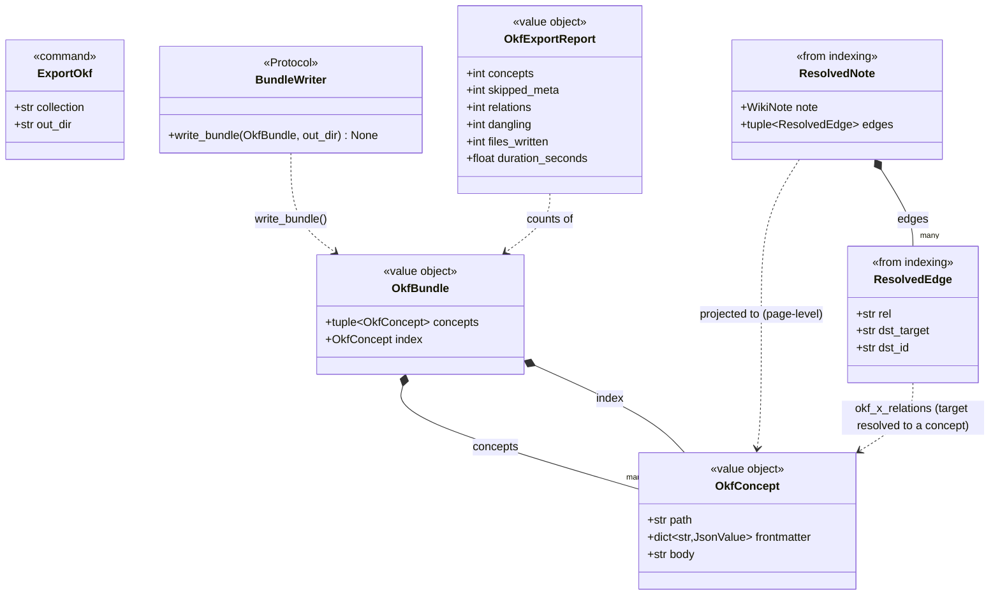
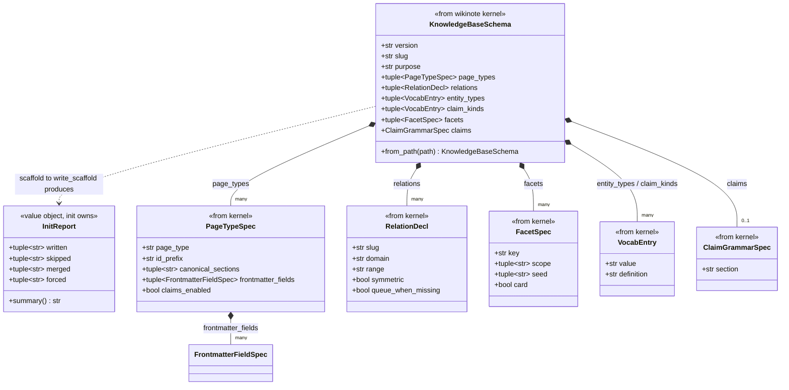

<!-- GENERATED from architecture.md by scripts/docs/split_doc.py --dir engram/docs/architecture — do not edit here; edit the master and re-run the script. -->

## 7. Lifecycle & interchange (bounded context)
> **TL;DR:** The cradle-to-interchange slices, init scaffolds `_meta/` and migrates the DB from a `KnowledgeBaseSchema`, export projects a collection into a read-only OKF v0.1 export directory on disk, and the plugin packages engram as a Claude Code plugin you install into any knowledge base.
<!-- load-when: lifecycle, interchange, init, scaffold, bootstrap, export, okf, plugin, claude code plugin, onboarding -->

The **Lifecycle & interchange** context covers a knowledge base's cradle and its at-rest
interchange. `engram/init` is the **bootstrap** (`studio init`):
`scaffold.py` writes `_meta/` + templates from a `KnowledgeBaseSchema`, `db.py` runs
the alembic upgrade and loads vocab, and `all` chains scaffold to db to index.
The contract lives in [init.md](../../reference/init.md). `engram/export` projects
a collection into an **OKF v0.1 export directory** on disk (`projector.py` + `writer.py`,
`ExportOkf` dispatched on the shared bus, routed at construction), a
rebuildable, read-only derivative that never mutates the knowledge base or DB
([ADR-0009](../../adr/0009-okf-export-interchange.md)). The contract lives in
[export.md](../../reference/export.md). The **plugin** (`engram/plugin/`) packages
engram as a Claude Code plugin you install into a knowledge base, onboarding
(`/knowledge-base:init`) co-designs the schema ([ADR-0014](../../adr/0014-domain-general-vault-spec-and-plugin.md)).
The contract lives in [plugin.md](../../reference/plugin.md).

### export

`engram/export` projects an indexed collection into an **OKF v0.1** (Open Knowledge
Format) export directory on disk: a directory of UTF-8 Markdown files, one per
*concept*, each concept's identity being its export-directory-relative path minus `.md`. It is a
**read-only** derivative, `studio export okf` parses and resolves the live knowledge base and
writes an export directory, but **never mutates the knowledge base or the database**
([ADR-0009](../../adr/0009-okf-export-interchange.md), the okf.md explanation doc owns the
format walkthrough). The handler runs a four-stage **parse to resolve to project to
write** pipeline that reuses the indexing slice's `KnowledgeBaseReader` + `resolve` for the
first two stages, then a pure projector and a filesystem writer for the last two.

```mermaid
C4Component
    title export slice (C4 L3), parse to resolve to project to write (read-only)
    System_Ext(knowledge base, "Obsidian knowledge base", "Wiki/**/*.md (read-only, never mutated)")
    Container_Ext(kernel, "wikinote kernel", "src/engram/memory", "parser.parse")
    Container_Ext(indexing, "indexing slice", "engram/indexing", "KnowledgeBaseReader port + resolve()")
    System_Ext(disk, "OKF export directory", "out_dir/**/*.md", "frontmattered Markdown, rebuildable derivative")

    Component(cli, "ExportOkf", "domain/models.py", "Command: collection + out_dir (bus-routed write-side command)")

    Component_Boundary(c, "engram/export") {
        Component(handler, "ExportOkfHandler", "service.py", "Orchestrates the four stages, emits ExportStarted / ConceptsProjected / ExportCompleted")
        Component(projector, "project_with_counts / project_bundle", "domain/projector.py", "Pure: ResolvedNotes to OkfBundle, skips meta, okf_x_* overlay, fence-aware wikilink rewrite")
        Component(index, "_ExportIndex", "domain/projector.py", "wikilink target to exported concept id (stem/id/title/aliases, lower-cased)")
        Component(writer, "FilesystemBundleWriter", "infrastructure/writer.py", "BundleWriter port, the slice's only IO, render_concept = ---YAML + body")
    }

    Rel(cli, handler, "dispatches ExportOkf on the shared bus (routed at construction)")
    Rel(handler, indexing, "Parse (KnowledgeBaseReader.wiki_notes) + Resolve (resolve)")
    Rel(handler, kernel, "parser.parse (per-note, skip-on-fail)")
    Rel(handler, projector, "project_with_counts(ResolvedNotes, collection, spec)")
    Rel(projector, index, "builds + resolves links/relations")
    Rel(handler, writer, "write_bundle(OkfBundle, out_dir)")
    Rel(writer, disk, "writes UTF-8 .md per concept + root index.md")
```

Source: `src/engram/export/service.py`, `src/engram/export/domain/projector.py`, `src/engram/export/infrastructure/writer.py`, `src/engram/export/domain/models.py`, `src/engram/export/internal_contracts.py`, `studio/src/studio/knowledge_base/wiring/export.py`

`ExportOkf` is a bus-routed write-side command bound to `ExportOkfHandler` in the
composition root's declarative route table, the bus is **fully routed at construction**
([ADR-0021](../../adr/0021-explicit-eager-composition-root.md)), so a dispatcher resolves
the shared `MessageBus` and calls `handle`, with no registration ordering to get right.
The slice's wiring module (`studio/src/studio/knowledge_base/wiring/export.py`) contributes `export_handler_provider` (the plain handler over
the indexing slice's `KnowledgeBaseReader` and the schema) and binds the `BundleWriter` adapter.

The domain layer is all frozen pydantic. The projector maps each engram **page**
(`WikiNote` + its resolved frontmatter `edges`) to one `OkfConcept`. `meta` pages are
skipped (not knowledge), every other schema-declared type becomes a concept under a type
subdir (`paper → papers/`, `moc → maps/`, …). Engram's typed edges + provenance survive
in the `okf_x_relations` / `okf_x_engram` extension keys (plain-OKF consumers ignore
unknown keys, so the export directory stays conformant while round-trippable). The slice does
**not** carry engram's `Claim` aggregate into OKF. Projection is page-level: claim
text rides inside a concept's body sections, and only frontmatter relations become
`okf_x_relations` edges.



Source: `src/engram/export/domain/models.py`, `src/engram/export/domain/projector.py (mapping)`, `src/engram/indexing/domain/models.py (ResolvedNote / ResolvedEdge)`

### init

`engram/init` is the **bootstrap** for a knowledge base: `studio init {scaffold,db,all,spec}`
turns a `KnowledgeBaseSchema` into the on-disk `_meta/` scaffold, migrates the DB schema
to head, and seeds the controlled vocab. It is the **domain-general onboarding seam**
([ADR-0014](../../adr/0014-domain-general-vault-spec-and-plugin.md)): the *same* code
scaffolds a cooking, legal or manuals knowledge base (the schema is the only thing that
changes), so init carries no knowledge base vocabulary of its own. `studio init --template <slug>`
copies a template's `knowledge-base-schema.json` and `_meta/` guidance pages out of `templates/<slug>/`
into the new knowledge base before the scaffold runs, and the knowledge base owns its copy from then on
([root ADR-0018](../../../docs/adr/0018-corpus-bundles-and-provider-packages.md)). The
template resolver is one of the two sanctioned readers of `templates/`. It deliberately **never constructs
`ApplicationSettings`**, so every mode runs on a *fresh* directory that has no `_meta/`
tree yet.

```mermaid
C4Component
    title init slice (C4 L3), four modes over a pure scaffold + a settings-free DB seam
    Person(operator, "Operator / plugin", "studio init …")
    System_Ext(spec_file, "knowledge-base-schema.json", "KnowledgeBaseSchema on disk (--spec | <knowledge base>/knowledge-base-schema.json)")
    System_Ext(knowledge base, "Knowledge base dir", "_meta/ + templates + AGENTS.md/CLAUDE.md (written here)")
    SystemDb_Ext(db, "Postgres", "alembic head schema + kb.vocab rows")
    Container_Ext(kernel, "wikinote kernel", "src/engram/memory", "KnowledgeBaseSchema, parse_vocabulary, load_vocab")
    Container_Ext(indexing, "indexing slice", "engram/indexing", "WikiUnitOfWorkFactory + index (all only)")

    Component_Boundary(c, "engram/init (+ studio/src/studio/knowledge_base/cli_init wiring)") {
        Component(cli, "init_app", "studio/src/studio/knowledge_base/cli_init.py", "Typer group: scaffold | db | all | spec, _load_schema, _resolve_db_url")
        Component(scaffold_fn, "scaffold", "domain/scaffold.py", "PURE: KnowledgeBaseSchema -> dict[path,text] (registry, templates, purpose/schema, AGENTS/CLAUDE, knowledge-base-schema.json)")
        Component(writer_fn, "write_scaffold", "infrastructure/writer.py", "Idempotent IO: written / skipped / merged / forced, registry files union-merged (human edits win)")
        Component(resolve_url, "_resolve_db_url", "infrastructure/db.py", "--db-url | APP_INFRASTRUCTURE__DATABASE__URL | infrastructure.database.url (application_settings.json)")
        Component(upgrade, "upgrade_schema", "infrastructure/db.py", "alembic upgrade head via config.attributes['sqlalchemy_url'] seam, NO ApplicationSettings")
        Component(loadvocab, "load_vocabulary(_sync)", "infrastructure/db.py", "minimal engine + WikiUnitOfWorkFactory -> load_vocab")
    }

    Rel(operator, cli, "studio init {scaffold|db|all|spec}")
    Rel(cli, spec_file, "KnowledgeBaseSchema.from_path (scaffold / all)")
    Rel(cli, scaffold_fn, "scaffold(spec)  [scaffold, all]")
    Rel(scaffold_fn, kernel, "reads PageTypeSpec / RelationDecl / facets")
    Rel(cli, writer_fn, "write_scaffold(knowledge_base_root, files, force)")
    Rel(writer_fn, knowledge base, "create / union-merge registry / skip / force")
    Rel(writer_fn, kernel, "parse_vocabulary (union-merge)")
    Rel(cli, resolve_url, "resolve URL  [db, all]")
    Rel(cli, upgrade, "upgrade_schema(url)  [db, all]")
    Rel(upgrade, db, "alembic upgrade head")
    Rel(cli, loadvocab, "load_vocabulary_sync(url, registry)  [db, all]")
    Rel(loadvocab, db, "upsert kb.vocab rows")
    Rel(loadvocab, kernel, "load_vocab(factory, VocabularyIndex)")
    Rel(cli, indexing, "_dispatch_index(IndexKnowledgeBase(embed=False))  [all only]")
```

Source: `src/engram/init/domain/scaffold.py`, `src/engram/init/infrastructure/writer.py`, `src/engram/init/infrastructure/db.py`, `studio/src/studio/knowledge_base/cli_init.py`, `studio/src/studio/knowledge_base/cli_support.py`

The four modes layer over those components. **`scaffold`** is the pure `scaffold` to
`write_scaffold` pair (no DB, no container). **`db`** resolves a URL, runs
`upgrade_schema`, then `load_vocabulary_sync` over the knowledge base's `_meta/vocabulary/` (no
`--collection`, schema and vocab are collection-agnostic). **`all`** chains
`scaffold → db →` a `index --no-embed` smoke. Before the indexing step it pins
`APP_INFRASTRUCTURE__DATABASE__URL` into the env and threads the just-scaffolded root into
`fetch_application_settings` as an explicit knowledge base argument, so `_build_container`
targets that knowledge base rather than whatever `application_settings.json`
points at (the lru-cached settings resolver is still cold because stages 1-2 bypass
`ApplicationSettings`). **`spec --interactive`** is the non-LLM stdin builder: it prompts
for page types, relations, vocab, and facets, then constructs a validated
`KnowledgeBaseSchema`. The DB-URL **resolution precedence** (`_resolve_db_url`) is `--db-url`
to `APP_INFRASTRUCTURE__DATABASE__URL` to `infrastructure.database.url` in
`config/application_settings.json`, mirroring `alembic/env.py` so the bootstrap and the
migration agree.

The slice's *own* domain is thin, just `InitReport`, the value object summarising a
`write_scaffold` run. The objects that actually drive the scaffold are the wikinote
kernel's `KnowledgeBaseSchema` and its children (`PageTypeSpec`, `RelationDecl`,
`FacetSpec`, `VocabEntry`, `ClaimGrammarSpec`, `FrontmatterFieldSpec`). init *consumes*
the kernel's schema type rather than redefining it, which is precisely what makes init
domain-general (section 4 owns the schema, init reads it).

Three schema declarations replace behavior the indexer and the harness once hard-coded for one knowledge
base. A facet marked `card` prints its values on every page's search card, in the schema's facet order. A
relation marked `queue_when_missing` sends a link whose target is missing to the ingest queue rather than raising
a dangling-link warning. `sources.digest_workflow` names the workflow that digests a knowledge base's new mirrors,
which the harness's `digest_now` starts.



Source: `src/engram/init/domain/models.py (InitReport)`, `src/engram/kb/domain/schema.py (KnowledgeBaseSchema + children)`

### plugin

The **plugin** is *packaging*, not a `src/` slice: it is the Claude Code
plugin at `engram/plugin/` that you install **into** a knowledge base to deliver engram's
MCP retrieval server, the `/knowledge-base:init` onboarding and `/knowledge-base:design-note-writing`
slash commands, the bundled skills (`engram-init`, `searching-the-knowledge-base`,
`authoring-notes`, `designing-note-writing`), and a `SessionStart` nudge, all
without hand-editing the knowledge base's `.mcp.json`
([ADR-0014](../../adr/0014-domain-general-vault-spec-and-plugin.md), the contract
lives in [plugin.md](../../reference/plugin.md)). It is a **configure-only**
dependency: the plugin never installs the CLI, it invokes whatever `studio` the
host already has via the `bin/studio` shim.

```mermaid
C4Component
    title plugin (C4 L3), packaging that wires a knowledge base into the studio CLI / MCP (configure-only)
    Person(agent, "Claude Code agent", "running in the opened knowledge base")
    System_Ext(cli, "studio CLI", "${STUDIO_BIN:-studio}", "init all / index / search / fetch / note … (configure-only, not installed by the plugin)")
    System_Ext(mcp, "knowledge-base MCP server", "studio mcp --knowledge-base .", "retrieval tools: search/fetch/graph_expand/find_paths/run_sql/describe_schema (profile-gated)")
    System_Ext(knowledge_base_schema, "knowledge-base-schema.json", "<knowledge base>/knowledge-base-schema.json", "KnowledgeBaseSchema: page_types, relations, facets, claims, sources, retrieval.profile, the sole per-knowledge-base config surface")
    SystemDb_Ext(db, "Postgres", "URL + dialect from env (APP_INFRASTRUCTURE__DATABASE__URL / APP_RETRIEVAL__*), no engram config file")

    Component_Boundary(c, "engram/plugin (Claude Code plugin)") {
        Component(manifest, "plugin.json", ".claude-plugin/plugin.json", "Manifest: name/version + mcpServers.knowledge-base = ${CLAUDE_PLUGIN_ROOT}/bin/studio mcp --knowledge-base ${CLAUDE_PROJECT_DIR}")
        Component(shim, "bin/studio", "bin/studio", "exec ${STUDIO_BIN:-studio} with all args, single binary-resolution seam")
        Component(commands, "/knowledge-base:* commands", "commands/init.md, design-note-writing.md", "Slash commands that load the matching skill")
        Component(skills, "bundled skills", "skills/engram-init|searching-the-knowledge-base|authoring-notes|designing-note-writing", "Procedural SKILL.md guides, engram-init carries knowledge-base-schema.schema.json + examples/")
        Component(hooks, "SessionStart hook", "hooks/hooks.json + nudge.sh", "If ./knowledge-base-schema.json is absent, nudge the agent to run /knowledge-base:init, always exits 0")
    }

    Rel(agent, commands, "/knowledge-base:init, /knowledge-base:design-note-writing")
    Rel(commands, skills, "load + follow SKILL.md")
    Rel(skills, shim, "studio init all / index / note … via ${STUDIO_BIN:-studio}")
    Rel(hooks, agent, "nudge /knowledge-base:init when uninitialized")
    Rel(manifest, shim, "mcpServers.studio.command")
    Rel(shim, cli, "exec ${STUDIO_BIN:-studio} (PATH or $STUDIO_BIN)")
    Rel(shim, mcp, "studio mcp --knowledge-base ${CLAUDE_PROJECT_DIR}")
    Rel(mcp, knowledge_base_schema, "resolves retrieval.profile (which tools to expose)")
    Rel(mcp, db, "reads URL + dialect from environment")
    Rel(agent, mcp, "search / fetch / graph_expand / … (after reload)")
```

Source: `engram/plugin/.claude-plugin/plugin.json`, `engram/plugin/bin/studio`, `engram/plugin/hooks/hooks.json`, `engram/plugin/hooks/nudge.sh`, `engram/plugin/commands/init.md`, `engram/plugin/commands/design-note-writing.md`, `engram/plugin/skills/engram-init/SKILL.md`, `engram/plugin/skills/searching-the-knowledge-base/SKILL.md`, `engram/plugin/README.md`

**Entities (light/procedural, no domain class diagram).** The plugin carries no
domain aggregates. Its "entities" are configuration and packaging artifacts. The
**manifest** (`.claude-plugin/plugin.json`) declares the plugin and registers the
single MCP server `knowledge-base` whose `command` is the in-plugin shim and whose `args`
are `["mcp", "--knowledge-base", "${CLAUDE_PROJECT_DIR}"]`. Claude Code substitutes
`CLAUDE_PROJECT_DIR` to the opened knowledge base, so the server is **self-contained**: it
resolves *this* knowledge base from that path with no dependence on a process working
directory. **`knowledge-base-schema.json`** (the kernel's `KnowledgeBaseSchema`, section 4) is the **sole
per-knowledge-base config surface** (page types, relations, facets, claims, sources, and
`retrieval.profile`) and is the only engram config a knowledge base keeps, the database URL
and dialect come from the **environment** (`APP_INFRASTRUCTURE__DATABASE__URL`,
`APP_RETRIEVAL__DIALECT`/`GRAPH_BACKEND`), **not** engram's own
`config/application_settings.json`. The **`bin/studio` shim** is the one
binary-resolution seam (`exec "${STUDIO_BIN:-studio}" "$@"`): every command and skill
invokes the CLI through `${STUDIO_BIN:-studio}`, never a hard-coded path, so the
plugin packages but never installs the studio.
