<!-- GENERATED from architecture.md by scripts/docs/split_doc.py --dir engram/docs/architecture — do not edit here; edit the master and re-run the script. -->

## 9. System data model (ERD)
> **TL;DR:** The single system ERD, 17 tables across five clusters (Sources, Knowledge, Ops, Indexing-private, Evals), every knowledge-base-owned table keyed by composite `(collection, id)` with containment FKs (same-collection, CASCADE) and citation FKs (own target-collection column, null-paired CHECK, no cascade), as one `erDiagram`. The agent-visible `api` schema is a read-only projection over these base tables, none of which are granted to `kb_reader`.
<!-- load-when: erd, schema, tables, data model, entity relationship, database tables, identity, composite key, containment, citation, facets, tenancy -->

This is engram's **one canonical data model**. Every table lives in the single
`kb` schema. There are **17** base tables across five logical clusters. The
agent-visible `api` schema (the views + `SECURITY DEFINER` functions whose SQL
COMMENTs form the M-Schema) is a **read-only projection** over these base tables.
`kb_reader` is granted the `api` schema only and never any `memory.*` table
(the D-20 floor, the `api`/`kb_reader` role grants and ADR `0006`). Every knowledge-base-owned
table below is keyed by the composite **`(collection, id)`** or the table's own
natural-key analogue, `collection` is the tenancy axis, and a bare `id` is unique
only within one collection. No knowledge-base-owned read or write may address a row by bare
id (engram ADR-0042). Mermaid ER is flat, so the cluster structure is narrated in
prose below the diagram. Relationships are drawn only where the migrations declare
a foreign key or the code keys a logical join, and are labeled **containment**
(same-collection FK, cascades where the row is owned) or **citation** (own
target-collection column, no cascade, null-paired `CHECK`) per the classification
below the diagram.

```mermaid
erDiagram
    sources_raw {
        text collection PK
        text source_id PK
        text provider "e.g. 'zotero'"
        text provider_key "UNIQUE (collection, provider, provider_key)"
        text title
        text source_hash
        text pdf_path
        jsonb meta "doi, arxiv_id, venue, year"
        timestamptz synced_at
    }
    raw_chunks {
        text collection PK
        text id PK
        text source_id FK "-> sources_raw pair, CASCADE (containment)"
        ltree section_path
        text heading
        int seq
        text body
        int tokens
        halfvec embedding "1024"
    }
    pages {
        text collection PK
        text id PK
        text page_type
        text slug
        text title
        text_array aliases
        text summary
        text status
        text superseded_by FK "-> pages pair, self, same collection (containment)"
        text source_id FK "-> sources_raw pair, same collection (containment)"
        text source_hash
        jsonb facets "declared per-knowledge-base (GIN)"
        jsonb frontmatter "declared typed fields"
        text card_text
        text body_hash
        date created
        date updated
        date page_date "what a search date range reads"
        halfvec embedding "1024"
    }
    sections {
        text collection PK
        text id PK
        text page_id FK "-> pages pair, CASCADE (containment)"
        text canon
        text heading
        ltree path
        int ord
        text body
        int tokens
        text body_hash
        text summary
        halfvec embedding "1024"
    }
    claims {
        text collection PK
        text id PK
        text page_id FK "-> pages pair, CASCADE (containment)"
        text block_id
        text text
        text quote
        text loc
        ltree loc_path
        text kind
        text subject_id "citation"
        text subject_collection FK "-> pages pair, null-paired CHECK"
        jsonb fields "declared text fields by name, empty by default"
        text status "default 'active'"
        halfvec embedding "1024"
    }
    claim_qualifiers {
        text collection PK
        text claim_id PK,FK "-> claims pair, CASCADE (containment)"
        text qualifier PK "declared field name (e.g. on_dataset)"
        int ord PK "multilink order"
        text target_collection FK "-> pages pair (citation)"
        text target_id FK "-> pages pair (citation)"
    }
    edges {
        bigserial id PK
        text src_collection "citation, NOT NULL"
        text src_id "logical -> pages/claims"
        text src_type
        text rel
        text dst_collection "citation, NOT NULL"
        text dst_id "logical -> pages/claims"
        text dst_type
        jsonb qualifiers
        text provenance_claim
    }
    vocab {
        text collection PK
        text vocab PK
        text value PK
        text definition
        jsonb meta
    }
    unit_summaries {
        text collection PK
        text unit_id PK "a page or section id, NOT a FK"
        text unit_type
        text summary
        text status "default 'pending'"
        text model
        text source_hash
        timestamptz indexed_at
    }
    embed_meta {
        text model "no DDL PK (single-row)"
        int dim
        timestamptz embedded_at
    }
    query_log {
        bigserial id PK
        timestamptz asked_at
        text agent
        text question
        text archetype
        text_array surfaces
        text_array cited_ids
        int tokens_loaded
        text wrote_back
    }
    index_manifest {
        text collection PK
        text path PK
        text page_type
        text content_hash
        text identity_hash
        text page_id "logical -> pages"
        text source_key "logical -> sources_raw"
        timestamptz indexed_at
    }
    link_refs {
        bigserial id PK
        text collection
        text src_page_id FK "-> pages pair, CASCADE (containment)"
        text src_type
        text rel
        text raw_target "name-keyed closure"
        text dst_id "citation, nullable"
        text dst_collection "citation partner, null-paired CHECK"
        text provenance_claim
    }
    validation_store {
        bigserial id PK
        text collection
        text page_id "NOT a FK (parse-error keying)"
        text severity
        text rule
        text message
        text anchor
    }
    index_fingerprint {
        text collection PK
        text indexer_version
        text spec_hash
        text registry_hash
        text embed_model
        timestamptz indexed_at
    }
    evaluation_runs {
        text id PK
        text dataset
        text model_name
        jsonb variant
        timestamptz started_at
        timestamptz finished_at
        jsonb metrics
        text logfire_url
    }
    evaluation_case_results {
        int id PK
        text run_id FK "-> evaluation_runs"
        text case_name
        jsonb scores
        int n_tool_calls
        int total_tokens
        float duration_s
    }

    sources_raw   ||--o{ raw_chunks       : "chunks (containment, CASCADE)"
    sources_raw   |o--o{ pages            : "mirror -> note (containment)"
    pages         ||--o{ sections         : "owns (containment, CASCADE)"
    pages         ||--o{ claims           : "owns (containment, CASCADE)"
    pages         |o--o{ pages            : "superseded_by (containment)"
    pages         |o--o{ claims           : "subject (citation)"
    claims        ||--o{ claim_qualifiers : "qualifiers (containment, CASCADE)"
    pages         |o--o{ claim_qualifiers : "target (citation)"
    pages         ||--o{ link_refs        : "src_page_id (containment, CASCADE)"
    evaluation_runs     ||--o{ evaluation_case_results : "case scores"
```

Source: `alembic/versions/0001_wiki_schema.py`, `alembic/versions/0005_eval_runs.py`, `alembic/versions/0006_compile_state.py`, `alembic/versions/0024_spine_maturation.py`, `alembic/versions/0025_corpus_qualified_identity.py`, `src/engram/indexing/infrastructure/orm.py`, `src/engram/evals/shared/infrastructure/orm.py`

**The five clusters.** Mermaid ER is flat. The tables group as follows.

- **Sources** (raw source mirrors): `sources_raw` (one immutable row per
  mirrored item, keyed by its own vendor-neutral `(collection, source_id)`, with
  `provider` + `provider_key` naming the adapter and its native key) and
  `raw_chunks` (its fulltext cut at headings and to the chunk sizes, `(collection,
  source_id)` FK, `ON DELETE CASCADE` from the source). This is the only cluster
  the Ingestion context populates.
- **Knowledge** (the indexed knowledge base): `pages`, `sections`, `claims`,
  `claim_qualifiers`, `edges`, `vocab`, `unit_summaries`, and
  `embed_meta`. `pages` is the hub: `sections` and `claims` cascade from it
  (containment), a page may be `superseded_by` another page of the **same**
  collection (containment, supersession is knowledge-base-local), and a page optionally
  back-references its `sources_raw` mirror via `source_id` (containment, same
  collection). A `claim`'s `subject_id` is the one qualifier that stays typed on
  the row (a citation, carrying its own `subject_collection` and a null-pairing
  `CHECK`), while every other qualifier target (`on_dataset`, `on_task`, `metric`,
  and any a knowledge base declares) lives in `claim_qualifiers`, one row per target named
  by the claim-grammar's declared field, preserving multilink order (`ord`) where
  the old typed columns kept only element zero. `edges` is the resolved
  typed-relation graph (id-keyed `src_id`/`dst_id`, each paired with its own
  `src_collection`/`dst_collection`, projected into the AGE graph by migration
  `0004`), still FK-less, rebuilt wholesale per indexing run. `vocab` is the per-knowledge-base vocabulary
  indexed to data (schema-as-data), now itself knowledge-base-scoped (`(collection,
  vocab, value)`) so two knowledge bases may define the same term independently.
  `unit_summaries` is the indexed disclosure summary for a page or section
  (`(collection, unit_id)`, `unit_id` deliberately not a FK). `embed_meta` is the
  single-row embedding-model contract (global, no collection). The embeddable
  tables carry a `halfvec(1024)` ANN column.
- **Ops** (session telemetry): `query_log` alone, one row per retrieval question
  (D-17), written at query time, never indexed from the knowledge base.
- **Indexing-private** (true-incremental state, ADR-0019, migration `0006`):
  `index_manifest` (path to `content_hash`/`identity_hash` change detector,
  composite PK `collection` + `path`), `link_refs` (every outbound link target,
  resolved and dangling, name-keyed by `raw_target` for the inbound closure that
  `edges` cannot answer, `src_page_id`'s existing `collection` column now joins
  the FK as the pair `(collection, src_page_id)`, containment, CASCADE kept,
  `dst_id` stays a citation with no FK (dangling or unresolved), null-paired with
  `dst_collection`), `validation_store` (persisted per-page validation issues for
  whole-knowledge-base report reassembly), and `index_fingerprint` (the single
  per-collection global invalidator). These four are **indexing-private**:
  `index` is the only writer, and they appear in **no** `api` view/function,
  distinct from the `api`-exposed Knowledge tables.
- **Evals** (run summary, D10, migration `0005`): `evaluation_runs` (one summary row
  per tuning/evaluation run) and `evaluation_case_results` (per-case scores, FK to
  `evaluation_runs`). These are a thin Postgres summary. Logfire is the deep store, and
  neither table is collection-scoped.

**Knowledge-base-qualified identity: the tenancy rule.** Every knowledge-base-owned table's primary key is
the composite `(collection, id)`, or the table's own natural-key analogue: `(collection,
source_id)` on `sources_raw`, `(collection, vocab, value)` on `vocab`, `(collection, unit_id)`
on `unit_summaries`. `collection` is the tenancy axis, not an ordinary column: two knowledge bases may
claim the identical bare `id` and coexist as two rows rather than one upsert theft winning. The
`server_default='research'` fallbacks on `pages.collection` and `sources_raw.collection` are
gone, a row arriving without a collection is an error, never a silent
file-under-the-founding-knowledge-base. A reference between rows is exactly one of two shapes: a
**containment** FK shares the row's own `collection` and cascades where the row is owned (a
section's page, a claim's page, a claim-qualifier's claim, a raw chunk's mirror, a page's own
supersession). A **citation** FK carries its own target-collection column beside the id, never
cascades, and, where nullable, carries a `CHECK ((x_id IS NULL) = (x_collection IS NULL))` so
a half-qualified reference cannot exist (`claims.subject_id`/`subject_collection`,
`claim_qualifiers.target_id`/`target_collection`, `edges.src_id`/`dst_id` with their NOT NULL collections,
`link_refs.dst_id`/`dst_collection`).

**Facets and frontmatter, by declaration.** The seven typed research scalars `pages` once
carried (`entity_type`, `paper_type`, `year`, `venue`, `citekey`, `maturity`,
`question_status`) are gone from the backbone. A knowledge base that wants them declares them as typed
frontmatter fields in its `KnowledgeBaseSchema`, and they land in `pages.frontmatter` jsonb. The five
fixed research facet arrays (`tasks`/`domains`/`stages`/`modalities`/`scale_regimes`) are gone
too, replaced by one generic, GIN-indexed `pages.facets` jsonb (facet name to `text[]`): every
knowledge base declares its own facets, and every declared facet is search-narrowable. There is no
longer a favored subset. `source_hash` is the one column that stayed typed on `pages` rather
than folding into either jsonb home: mirror-freshness invalidation is backbone machinery, not
profile vocabulary.
