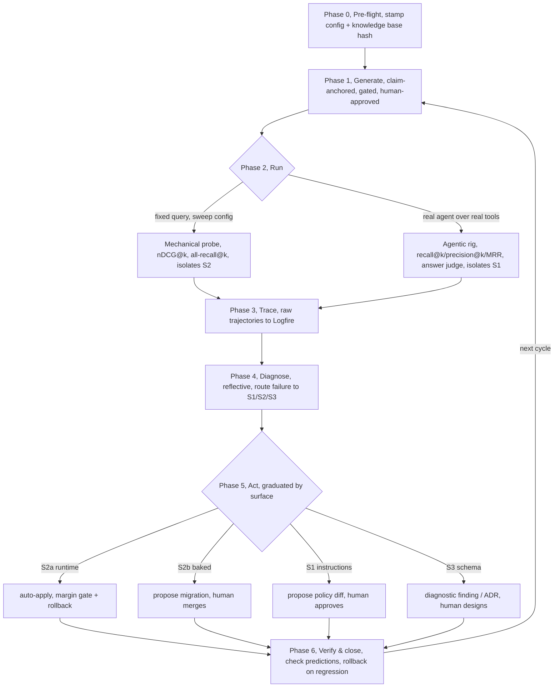

# The evaluation loop: workflow design and rationale

This is the **design rationale for the eval loop** (the process the loop runs, who owns each phase, what gates each step, and why). The loop is now **built**: it ships as the `evals` slice (see the [evals reference](../reference/evals.md)), so this document reconciles the original workflow design against what was implemented. Where the design has shipped, the prose is in present tense and cross-links the contract. Where an idea was deliberately not built, it is kept and labelled **roadmap**. Lens: the LLM-wiki design discipline.

**What this evaluates (one paragraph).** The knowledge base is a body of research notes indexed into Postgres/ParadeDB and served to AI agents over an MCP tool channel. Agents retrieve over engram's real retrieval tools, **hybrid BM25 keyword + vector** search, fused by **RRF** (reciprocal-rank fusion). This loop measures and improves that retrieval. Crucially, the agent-under-test is a real pydantic-ai `Agent` bound to engram's **real** retrieval tools through a single-source toolset shared with the MCP server ([ADR-0011](../adr/0011-single-source-retrieval-toolset.md)), so **evaluating the agent *is* evaluating the real retrieval surface**.

> **Where this sits.** This eval loop is the *controller half* of the **Vibe RAG** program (engram's self-tuning-retrieval thesis, in which the knowledge base's own structure seeds judge-free ground-truths and the tuning loop tunes retrieval against them). This document covers measure-and-improve. The full 6-phase program and roadmap live in [vibe-rag.md](vibe-rag.md).

**Terms used below, briefly:** *claim-anchored gold* names a test case whose correct answer is a specific claim in the knowledge base (a block-anchored sentence carrying a verbatim `quote::` and a source `loc::` into an immutable mirror). *The three surfaces* are **S1** retrieval instructions, **S2** retrieval config (mechanical knobs), and **S3** schema + ingestion/chunking/graph layering. *Golden core* names the approved, frozen test set the loop is graded on. *Candidate frontier* names gated-but-not-yet-approved cases. *RRF* and `hnsw.ef_search` name the rank-fusion method and the HNSW vector-index recall knob. *Logfire* is the trace store. *Goodhart* names optimizing a metric until it stops reflecting real quality. *Lint* is the LLM-wiki self-audit pass this loop succeeds quantitatively.

**How to read it:**

- *Orientation*: [section 1](#1-why-an-eval-loop-the-4th-loop-and-the-iron-law), [section 2](#2-design-forks-resolved-the-llm-wiki-lens), [section 3](#3-the-cycle-six-phases-at-a-glance).
- *The phases*: [section 4](#4-phase-0-pre-flight) to [section 10](#10-phase-6-verify-and-close).
- *A worked example*: [section 11](#11-one-eval-cases-journey-a-worked-example), the whole loop on one concrete case (if you read one section, read this).
- *Operating it*: [section 12](#12-cadence-homes-and-telemetry), [section 13](#13-standing-rules-hard-rules-and-counterexamples).
- *What's still open*: [section 14](#14-open-questions-carried-to-implementation-design).

---

## 1. Why an eval loop: the 4th loop, and the Iron Law

> **TL;DR:** The eval loop is the quantitative, externally-grounded successor to LLM-wiki's "lint." It measures retrieval against claim-anchored gold (the knowledge base's own verbatim `quote::`/`loc::`), not the model's opinion, and a change counts only if it beats the frozen held-out set by a measured margin.
<!-- load-when: framing, why evaluate, validation vs eval, fourth loop, ground truth, iron law, claim-anchored gold, self-audit, vision -->

The LLM-wiki discipline names three loops (**ingest, query, lint**) and flags its own softest spot: *"lint is self-audit, not verification"* (the model health-checks its knowledge base against itself, with no external ground truth). **The eval loop is the 4th loop: the quantitative, externally-grounded successor to lint.** Our ground truth is not the model's opinion. It is the **claim-anchored gold**: block-anchored claims carrying a verbatim `quote::` and a `loc::` into an immutable mirror. That converts "self-audit" into measurement against a fixed, human-approved yardstick, and makes the *govern-writes-behind-an-eval-gate* principle real, resolved per surface.

> **Iron Law: if a change can't beat the frozen held-out set by a measured margin, it didn't happen.** The golden core is a fixed yardstick the loop **never optimizes against**. Only the *runtime* config surface moves itself, and only through the gate. Everything else is **proposed** (instructions, baked config) or **diagnosed** (schema) for a human. Capture raw trajectories, never scalars. Gate on the whole held-out set. Roll back on any net regression.

Why this law and not "improve the metric": difficulty explains **19-91 %** of score variance vs **≤0.77 %** for any single config change. Without a frozen split and a variance-sized margin, the loop optimizes noise.

## 2. Design forks resolved: the LLM-wiki lens

> **TL;DR:** Against LLM-wiki's fork table: write-autonomy is eval-gated *per surface*. The knowledge base's role is an active self-improving substrate. Verification is adversarial (diagnoser ≠ change-author, judge ≠ agent-under-test). Confidence stays provenance-based. Contradictions are inherited from the knowledge base, never auto-resolved.
<!-- load-when: design forks, write autonomy, knowledge base role, confidence scores, adversarial verify, query path, contradictions, llm-wiki forks -->

| LLM-wiki fork | Our choice for the eval loop |
|---|---|
| **Write autonomy** | **Eval-gated, quarantined, per surface** (Option B, refined): runtime config auto-applies behind the gate. Baked config + instructions land as a *proposed* gated change. Schema is diagnose-only. |
| **Knowledge base's role** | **Active reasoning substrate**, the knowledge base measures and improves itself. |
| **Confidence** | **No stored confidence scores**, trust is provenance + *measured* deltas on a fixed benchmark. The loop still uses retrieval/judge *metrics* to gate. It just never attaches a confidence number to a claim. |
| **Verify adversarially** | The **diagnoser is separate from the change-author**. The answer-judge is never the agent-under-test. |
| **Query path** | Hybrid (already is, BM25 + vector RRF). The loop tunes it. It doesn't replace it. |
| **Contradictions** | Inherited from the knowledge base, a case from a `disputed` claim is *expected* to surface both sides. The eval tests that, never auto-resolves. |

## 3. The cycle: six phases at a glance

> **TL;DR:** One cycle is Pre-flight, Generate, Run (two harnesses), Trace, Diagnose, Act (graduated by surface), Verify. Generation is owned by the eval skill, running by the CLI, diagnosis by a reflective agent, and acting is auto/propose/diagnose depending on the surface.
<!-- load-when: overview, phases, cycle, pipeline, ownership, gates, at a glance, big picture -->

| #   | Phase          | Owner                                          | Gate                                                                                         | Output                                              |
| --- | -------------- | ---------------------------------------------- | -------------------------------------------------------------------------------------------- | --------------------------------------------------- |
| 0   | Pre-flight     | orchestrator (skill + CLI)                     | knowledge-base hash + full harness config stamped, golden + frozen held-out split exist              | a pinned run config                                 |
| 1   | Generate       | eval skill (Claude)                            | round-trip retrievability + critiques + quote-verify + dedup, human approval to golden           | candidate frontier / approved golden cases           |
| 2   | Run            | `studio evals` CLI (mechanical) + agentic harness | every row config + knowledge-base-hash stamped                                                       | scored cases (retrieval + answer + trajectory)      |
| 3   | Trace          | Logfire (automatic)                            | raw trajectories, content included                                                           | trace store, eval-case ↔ trace linked               |
| 4   | Diagnose       | reflective agent (Claude, ≠ change-author)     | difficulty-stratified, each failure routed to S1/S2/S3                                       | ranked findings, each a falsifiable change-manifest |
| 5   | Act            | per surface (see section 9)                    | config: margin on held-out, whole-set, + rollback. instr: human approve. schema: human ADR | applied config / proposed diff / design finding     |
| 6   | Verify & close | orchestrator                                   | manifest predictions checked, net regression leads to rollback                                      | cycle log + updated Pareto frontier                 |

**The three surfaces** the loop improves: **S1** = retrieval *instructions* the agent sees. **S2** = retrieval *config* (mechanical knobs). **S3** = *schema + ingestion/chunking/graph layering*.

> **As-built note (the run phase shipped richer than this design imagined).** Phase 2 below describes "two harnesses, one dataset" as a mechanical probe + an agentic rig. What shipped is a single agentic harness with two *backend* families plus two new *experiment axes* (retrieval-strategy and code-mode). The original mechanical/agentic split survives conceptually. The controlled experiment axes (section 6) recover the "isolate S2 by holding the query constant" intent, but the implementation unifies them under one scoring path. See section 6 and [ADR-0012](../adr/0012-retrieval-strategy-and-code-mode-axes.md).

> **As-built note (the controller half, diagnose then act, has now partly shipped).** This design's diagnose (section 8) and the S1 *act* governance (section 9) were roadmap when it was written. They ship as the **retrieval tuning loop** ([ADR-0018](../adr/0018-calibration-loop.md), the [evals reference](../reference/evals.md)), the controller that reads the error signal, proposes a revised policy, and converges on a better one, delivered **propose-only**. The section 9 S3 "diagnostic finding / ADR for human design" has now also shipped as the **recommendation loop** ([ADR-0026](../adr/0026-structural-advisor.md)): deterministic S3-signature detectors route section-split / missing-edge / over-expansion failures into a human-gated, evidence-ranked recommendation with a literal draft ADR, still **never auto-applied**, exactly as section 9 requires (the spec diff is inert until authorial migration, so `verify-recommendation` re-establishes the baseline mechanically afterwards). The auto-apply ladder (section 9 S2a/S2b) and the frozen-split governance (section 4, section 13) stay roadmap. The section 8/9/10/14 labels below are updated accordingly.

## 4. Phase 0: Pre-flight

> **TL;DR:** Pin the commensurability stamp (knowledge base hash, embedder, fusion config, k, judge + rubric, budget) and confirm the golden core and frozen held-out split exist. No run starts unstamped, because an unstamped leaderboard reports configurations, not capability.
<!-- load-when: pre-flight, commensurability, config stamp, knowledge base hash, held-out split, run setup, harness pinning -->

Pin the **commensurability stamp**: knowledge-base/source hash, embedder + dimensions, fusion config (`rrf_k`, any leg weights, `hnsw.ef_search`), `k`, named judge + rubric id, and the token/latency budget. Confirm the golden core and the **frozen held-out split** exist and are hash-stamped. Declare which surface(s) this cycle targets. *No run starts unstamped.*

As-built, the per-run pinning is carried by a frozen `EvaluationRunConfig` (model, instructions, retrieval strategy, code mode) and folded into the run's `variant` so runs are comparable in the history and Logfire ([ADR-0012](../adr/0012-retrieval-strategy-and-code-mode-axes.md)). The golden/held-out *split* discipline, carving a frozen held-out partition that the loop never optimizes against, **shipped in Vibe RAG Phase 7** ([ADR-0033](../adr/0033-frozen-split.md)): `studio evals freeze` carves a stratified salted-hash **frozen sidecar** (`<name>.frozen.v{M}.json` + a `.frozen.current` pointer, staleness-stamped at freeze) that the tuning loop excludes from every optimization pool (train, decision core, rotating tail, *and* validation) and scores exactly twice per run, the baseline and the winner, so the frozen delta is reported every run and gates only the machine-apply rung (section 9). A stale frozen split is frozen again by a human, never automatically.

## 5. Phase 1: Generate (claim-anchored, gated)

> **TL;DR:** Generate cases from real claims (statements-first, which our claims already are), to a per-type quota, then gate hard: round-trip retrievability, leakage/answerability/over-specificity critiques, quote re-verification, dedup, into a candidate frontier. Only a human approval promotes a case to the golden core.
<!-- load-when: synthetic generation, dataset, claim-anchored, gating, golden core, frontier, candidate, round-trip filter, question types, leakage, triggers, ingest phase 5 -->

Claim-anchored synthetic generation (statements-first, which our claims already are). This shipped as `studio evals gen-dataset --page PAGE_ID`. **Triggers:** automatically on indexing. The `QaGenerationSubscriber` observes the indexing slice's `CitingPagesChanged` event and enqueues changed digest pages for `gen-dataset` (the "compound at the close" shape), governed by `APP_EVALS__AUTOGEN` (`queue` | `inline` | `off`). And on **manual prompt** via the CLI. See the [evals reference](../reference/evals.md).

The non-negotiable gate that shipped is **quote-checked generation**: `gen-dataset` keeps a drafted case only when every cited id is a real page id of the paper *and* its `support_quote` appears verbatim in the `Sources/` mirror (`generation._accept`, reusing `wikinote.verify.quotes_in_mirror`, the same quote verifier the note grammar uses). The richer gate this design specified (**per-type quota** (fact_single / comparative / multi-hop / summary / unanswerable), round-trip retrievability as a difficulty signal, Stand-Alone / leakage / answerability / over-specificity / unambiguous-target critiques, embedding-dedup, and an explicit **candidate frontier** that runs in CI before promotion) is partly **roadmap**: the case schema does carry a closed-set `page_type`/`difficulty` (`QaCaseMeta`, `domain.py`), but quota enforcement, the round-trip filter, the critique battery, and the frontier-vs-golden two-track promotion are not yet implemented.

**Promotion to the golden core requires a human approval** (never automatic), and a human may *also* deliberately approve a round-trip-**failing** case: a question the retriever currently misses is exactly the regression target the golden set must keep (left to an auto-gate alone, a round-trip filter would hide your hardest current failures, a Goodhart guard). This approval-only governance remains the intended discipline. **Roadmap** insofar as it is not yet mechanized in the slice.

## 6. Phase 2: Run (two harnesses, one dataset)

> **TL;DR:** A mechanical probe calls search directly across a config grid (deterministic retrieval metrics, isolates S2). An agentic rig drives a real model through the real toolset with full trajectory capture (answer-correctness + trajectory metrics, isolates S1). Both stamp every row and record the two-layer (retrieval by answer) disagreement.
<!-- load-when: harness, mechanical probe, agentic rig, two harnesses, run, metrics, nDCG, all-recall, fixed-budget recall, answer judge, config sweep, two-layer disagreement, retrieval strategy, code mode, axes -->

**As-built.** The shipped harness assembles an *agent-under-test* (a pydantic-ai `Agent` = (model by instructions by the single-source retrieval toolset) returning a structured `RetrievalAnswer` (ordered `cited_source_ids`)) and scores it with pydantic-evals against the golden-core dataset, instrumented through Logfire. It is scored by the `RetrievalMetrics` evaluator on **recall@k / precision@k / MRR + n_tool_calls**. **Page-level recall is primary. The claim-anchor metric is secondary and not yet implemented** (`to_case` deliberately does not carry `expected_claim_anchors` onto the scored case, see the [evals reference](../reference/evals.md)). The original design's nDCG@k / all-recall@k / fixed-budget-recall metric names did not ship verbatim. The shipped evaluator is the reconciliation.

**"Two harnesses, one dataset" shipped over the Azure / network-free model-backend family:**

- **Azure / network-free backends**: `build_eval_model` dispatches a model spec to `TestModel` (hermetic, network-free, the agent synthesizes its `RetrievalAnswer` directly, no tool-loop flakiness) or an Azure chat deployment.

**Two new experiment axes, added since this design (recovering its "isolate S2 / hold the surface constant" intent), see [ADR-0012](../adr/0012-retrieval-strategy-and-code-mode-axes.md):**

- **A retrieval-strategy axis.** Each run resolves a named `RetrievalStrategy` (`full` | `search-hybrid` | `search-keyword` | `graph-only` | `keyword-graph`) to a **tool subset + a *forced* search leg**, built per-run from the `RetrievalHandlers` set. Forcing the leg (rather than letting the model choose `bm25_only` per call) makes the search mode a *controlled variable*, not agent judgement. This is exactly the design's "hold the query constant so a metric change is attributable to the knob" intent, realized as a factorial axis. Strategies are **code-owned, not config** (`core.ai.retrieval.strategy`, `STRATEGY_NAMES`).
- **A code-mode axis.** The `pydantic-ai-harness` `run_code` sandbox: with `--code-mode`, the agent orchestrates the tools by writing Python in **one turn** (loops / `asyncio.gather` over the tools), trading model round-trips for a sandbox. It is a per-run axis so it can be compared against a non-code-mode baseline. The Monty sandbox is a lazy, opt-in `pydantic-ai-harness[code-mode]` import.

Both axes are recorded on the run's `variant` so runs stay comparable. **Subtlety worth holding in mind:** recall@k / precision@k / MRR score off the agent's structured `cited_source_ids` (its *output*), so they are **strategy- and code-mode-agnostic**. Only `n_tool_calls` reads the span tree, and under code-mode it counts the `run_code` wrapper span **+1** above the inner sandboxed calls (so a code-mode run reads ≈ +1 vs the same calls made directly, documented, not a bug).

The design's **two-layer disagreement** (retrieval ok? by answer ok?) as the routing primitive remains the intended diagnosis input. It is not yet a first-class recorded field in the slice (**roadmap**), though the per-case `cited_source_ids` + judge output + span tree carry the raw material for it.

## 7. Phase 3: Trace (raw, to Logfire)

> **TL;DR:** Persist the raw per-query/per-step trajectory to Logfire (query, which legs fired, ranked candidates + scores + gold_rank, what the generator saw, answer, judge rationale, full tool-call sequence) and never pre-summarize before diagnosis, because compressed feedback collapses diagnostic power.
<!-- load-when: tracing, observability, logfire, trajectory, raw feedback, spans, what to log, feedback richness, include content -->

The non-negotiable feedback-richness mandate (full-trace beats scores-only, *summaries can hurt*). Persist the **raw per-query/per-step trajectory**: query as issued, semantic vs lexical, which legs fired, ranked candidates + per-leg ranks + fused score, gold_rank, what the generator saw, answer, judge verdict + rationale, the full tool-call sequence. **Never pre-summarize before diagnosis.**

**As-built (storage, D10):** Logfire is the deep trace store, and the agent is built instrumented so every tool call / token / latency lands in the span tree the evaluators read. Logfire is **optional**. A tokenless run still scores every case (the runner falls back to a local-only span recorder so `ctx.span_tree` records). It just persists no remote traces. Alongside the deep store, a **thin Postgres summary** persists each run the tune, recommend and verify-recommendation handlers make: `kb.evaluation_runs` / `kb.evaluation_case_results`, written through the owner session, which the `kb_reader` role cannot read. No command or route reads the summary back. An `evals run` keeps its cases in its results file instead. See the [evals reference](../reference/evals.md).

## 8. Phase 4: Diagnose (reflective, surface-routed)

> **TL;DR:** A reflective agent, separate from any change-author, reads the raw trajectories of failing cases, clusters them difficulty-stratified by (error-type by surface by facet by question-type), routes each failure to S1/S2/S3, and emits ranked findings, each a falsifiable change-manifest (predicted fix + at-risk regressions).
<!-- load-when: diagnosis, root cause, why it failed, reflective agent, failure clustering, surface routing, change-manifest, error taxonomy, pain points -->

A **reflective diagnostic agent** (separate from any change-author, adversarial separation) reads the *raw* trajectories of failing cases, **clusters by (error-type by surface by facet by question-type by difficulty), stratified by difficulty** (difficulty dominates variance, so an unstratified mean misleads), and routes each failure to **S1 / S2 / S3** via the error-to-surface table. At a glance: *gold missed* leads to S2 (ranking/weights/k) or S3 (gold not a retrievable unit, claim split across chunks, missing graph edge). *Gold retrieved but answer wrong* leads to S1 (instructions) or the generator. *Retrieval-noise / over-expansion* leads to S2 (k too high) or S3 (chunking). *Retrieval abandoned or offloaded to trivial queries* leads to S1 (query policy). Output: a *ranked* set of findings, each a **falsifiable change-manifest**, a predicted fix + the regressions it risks, to be scored next round (self-attribution is regression-blind, so predictions get measured, not trusted).

**As-built:** two shipped surfaces read the error signal at two depths. The Logfire-MCP-driven `studio evals rca` is the over-the-trace-store brief (it degrades gracefully, with no Logfire read token it emits the prompt for the Logfire-MCP path). And a structural `diagnose(report) -> Diagnosis` (`engram/src/engram/evals/rca/domain/diagnosis.py`) ships as the **tuning loop's error-signal reader** ([ADR-0018](../adr/0018-calibration-loop.md), the [evals reference](../reference/evals.md)): a pure fold over an eval report into per-`(archetype, difficulty)` bucket metrics, the worst-N failing cases, and a cost summary, feeding the proposer (section 9). **Vibe RAG Phase 7 built the reflective layer on top** ([ADR-0034](../adr/0034-reflective-diagnosis.md)): deterministic per-case detectors classify each failure's **error type** (`gold_missed` / `gold_buried` / `over_fetch` / `abandoned`) and route it to a surface via the error-to-surface table above. A **gated LLM reflector** (separate from the proposer, the adversarial separation this section demands) reads the structural diagnosis and drafts findings that a pure gate re-validates against the report's real buckets and metrics. The surviving findings **feed the proposer a recommendation** (a recommendation prompt section rendered only when findings exist, the measurements still decide acceptance alone), and each finding's **falsifiable predictions are graded against the next round's measured deltas**, so self-attribution is scored, never trusted. What remains beyond that shape: clustering across the full five-facet cross (facet by question-type are not yet clustering keys), a deliberate simplification, not a gap in the governance.

## 9. Phase 5: Act (graduated by surface)

> **TL;DR:** Config splits: runtime knobs (search_k/hybrid/facet defaults) auto-apply behind the gate with rollback, but owner-held knobs (the fusion constant, leg weights and budgets in the default tuning row, the tokenizer in a migration) land as a gated proposed change a human applies. Instructions become a proposed diff to the retrieval-policy page. Schema becomes a diagnostic ADR, never auto-applied.
<!-- load-when: act, apply changes, autonomy ladder, config split, runtime vs baked, S2a S2b, ef_search, RRF weights, reranker, instruction diff, retrieval-policy, schema ADR, Pareto, margin gate, rollback -->

> **As-built scope.** The graduated-autonomy *act* phase below is the design's intended governance ladder, and two rungs have now shipped. The **S1 propose-a-policy-diff-carrying-the-eval-delta governance** is built (and broadened) as the retrieval tuning loop ([ADR-0018](../adr/0018-calibration-loop.md)), see the S1 bullet below. And Vibe RAG Phase 7 built the **runtime-scoped slice of the auto-apply rung** ([ADR-0032](../adr/0032-runtime-policy-rung.md)): `studio evals tune --apply-runtime` (per-invocation consent, never a default) may write exactly one surface, the per-knowledge-base `_meta/active-policy.yaml`, and only when **four guardrails** all pass: a frozen sidecar exists (section 4). The **freshness check** holds on both the dataset and the frozen split (`apply_staleness_max`, default 0.0, unmeasured staleness *refuses*, the machine rung, unlike the human warn-only path, never applies on a signal it could not measure). The run's winner is an accepted non-incumbent, and the winner **beats the incumbent on the frozen split**. Every apply first snapshots the live policy append-only into `_meta/policy-history/active-policy.v{N}.yaml`, and `studio evals rollback-policy` restores the latest snapshot as a new (itself-snapshotted) apply. The tuned policy's `instructions` join the runtime surface (the `evals run` default and the FastMCP server instructions), so runs and the serve surface score/expose the same tuned agent. Everything above that rung stays human-gated **by decision**: shipped code (`DEFAULT_INSTRUCTIONS`, the skill's managed block) and S2b baked knobs are never machine-written. Alongside it ships the measurement and experiment infrastructure (factorial **experiments** via `studio evals experiment --hold model|instructions|dataset`, plus the strategy/code-mode axes) that *feeds* a human's act decision.

The autonomy ladder, with the **config split** the code reality forces:

- **S2a: runtime config** (`search_k`, `hybrid`, facet defaults): **auto-applies behind the gate.** Sweep, then keep the Pareto frontier (recall/nDCG by latency/token-cost by answer-quality, never collapse to one metric, greedy loses 6-11 %), then the candidate must beat baseline by a **variance-sized margin on the frozen held-out set, scored whole-set**, then apply, with auto-rollback armed. **(shipped, runtime-policy-scoped, ADR-0032:** the auto-applied surface is the per-knowledge-base `_meta/active-policy.yaml` (the strategy leg carries the runtime retrieval surface), gated on the frozen split with history + explicit rollback. A *live* metric-watching auto-rollback daemon is not built. Rollback is a verb, armed but human-invoked.**)**
- **S2b: owner-held config.** The fusion constant, the weight of each tier and leg, the leg budgets, the snippet length, the hits kept per page and the hits kept per document live in `kb.retrieval_tuning`, a default row plus a row per knowledge base for the hits kept per document and the folded snippet length, which the owner changes with SQL and the reader can neither read nor write ([ADR-0048](../adr/0048-search-legs-are-bounded-tuned-and-read-from-one-snapshot.md)). A change needs no migration, but no loop writes the row: it lands as a **gated proposed change** (same gate, human applies). The semantic leg ranks by exact distance, so `hnsw.ef_search` does not reach `api.search`. The tokenizer still lives in a migration, and the model re-ranker is the owner's `retrieval.rerank` settings block. *Lever:* let the loop sweep the default row and propose the winner. **(roadmap.)**
- **S1: instructions**: a **proposed diff** to the retrieval-policy doctrine (which indexes into `api.about`, so the loop edits *doctrine + exemplars*, not code), carrying the eval delta. **Human approves.** Accumulate **itemized deltas, never compress** (the brevity-collapse guard). This governance has **shipped, and broadened** ([ADR-0018](../adr/0018-calibration-loop.md), the [evals reference](../reference/evals.md)): `studio evals tune` proposes a revised unified `RetrievalPolicy` (instructions + strategy + tool descriptions, not instructions alone), carrying the measured recall delta, and `studio evals apply-policy` writes the winner into the working tree (the `DEFAULT_INSTRUCTIONS` constant, the `searching-the-knowledge-base` skill's managed block, and a per-knowledge-base `_meta/active-policy.yaml`) **for the human to review and commit**, the loop never commits and the read path is never auto-touched. The `experiment --hold model --instructions A --instructions B` axis remains the shipped tool for *measuring* a one-off instruction change.
- **S3: schema/ingestion**: a **diagnostic finding / ADR** for human design (chunking, embedding granularity, graph layering). **Never auto-applied**, it invalidates the baseline a margin-gate depends on.

## 10. Phase 6: Verify and close

> **TL;DR:** Re-run to score the change-manifest's predictions, roll back on any net held-out regression (the loop's own regression forecasts are unreliable), append one cycle log entry, update the Pareto frontier, and invalidate cached config wins whenever the model triple changes.
<!-- load-when: verify, close, regression, rollback, re-eval, change-manifest verification, perishable optima, model change, cycle log -->

Re-run to score the change-manifest's predictions (did the predicted fix land? any predicted/unpredicted regression?). **Any net regression on the held-out set leads to rollback** (self-attribution forecasts regressions only ~2 times random, gate on measurement, not the loop's forecast). Append one cycle entry to the eval log. Update the Pareto frontier. **Invalidate cached config wins if the (retrieval by generator by judge) model triple changed** (perishable optima).

**As-built:** re-run comparison is the results file of `studio evals run --results` and `studio evals compare`, which pairs two runs case by case. The `evaluation_runs` / `evaluation_case_results` summary the tune, recommend and verify-recommendation handlers write is a cycle log that no command reads back. The tuning loop ships an **in-loop accept-verify**: a candidate is accepted only on a measured margin (`TuningObjective.is_improvement`, accuracy gain ≥ `min_gain` within the cost guardrail, paired-bootstrap-guarded since [ADR-0029](../adr/0029-decision-core-subsampled-calibration.md)) and the run's winner is the accepted incumbent with the best accuracy on a held-out **validation** split, so a change that does not generalize loses the run ([ADR-0018](../adr/0018-calibration-loop.md)). Phase 7 added the two verify pieces this section asked for: **prediction scoring**, each round's gated reflective findings carry falsifiable predictions graded against the *next* round's measured deltas ([ADR-0034](../adr/0034-reflective-diagnosis.md)), and **apply-with-rollback** on the runtime rung: every `--apply-runtime` snapshots the prior policy into `_meta/policy-history/` and `evals rollback-policy` restores it ([ADR-0032](../adr/0032-runtime-policy-rung.md)). What stays **roadmap**: a *live* metric-watching auto-rollback (rollback is an armed verb, human-invoked) and Pareto-frontier maintenance.

## 11. One eval case's journey: a worked example

> **TL;DR:** Follow one case through all six phases: generated and approved, the gold claim buried at rank 8 so the agent answers wrong, diagnosed as an S2 ranking miss, fixed by a gated config change (runtime part auto-applied, the baked weight as a proposed migration), verified with no regression.
<!-- load-when: worked example, walkthrough, concrete case, one case's journey, end-to-end example, how it works in practice, illustration -->

A concrete trip through the loop (the ranks are illustrative. The act/verify steps describe the design's intended governance, see section 9 to section 10 for what is shipped vs roadmap).

1. **The claim.** *"GEPA beats GRPO by up to 19% with ~35 times fewer rollouts"* (on HotpotQA accuracy), carrying its `quote::` and `loc::`.
2. **Generate (section 5).** From that claim the generator writes a *comparative* case: **Q** = "On HotpotQA, how does GEPA's accuracy compare to GRPO, and at what rollout cost?" **Gold unit** = the claim's page id. **Reference answer** = "GEPA beats GRPO by up to ~19% using ~35 times fewer rollouts." Gate: the `support_quote` is re-verified verbatim against the `Sources/` mirror, target unambiguous. A human approves it into the golden core.
3. **Run (section 6).** With a controlled `search-hybrid` strategy and default config, the gold unit lands at **rank 8**, inside `k` (so `recall@12 = 1`) but with low MRR. The agent reads only its top-5, so the gold unit (rank 8) never reaches the generator. It answers from a weaker neighbouring claim, giving an **answer wrong** result.
4. **Trace (section 7).** Logfire records the query, both legs' ranks (BM25 had the unit at 4, the vector leg at 19, fused to 8), `gold_rank = 8`, the top-5 the generator actually saw, the wrong answer, and the judge's rationale. The thin `evaluation_case_results` row links to it.
5. **Diagnose (section 8).** Two-layer read: *gold effectively missed* (below the generator's top-5) **+** *answer wrong*, not the parametric-leak cell. The reflective diagnoser sees the vector leg buried the unit (rank 19) and dragged the fused rank down, so it routes to **S2 (ranking/fusion)** with a change-manifest: *"raising the BM25 leg weight (or `hnsw.ef_search`) should lift the unit into the top-5. Predicted to fix the comparative-QA cluster. No regression expected on `fact_single`."*
6. **Act (section 9).** The S2 sweep finds that a higher `k` plus BM25-favouring weights clears the **variance-sized margin on the frozen held-out set** (whole-set). The `k` change is **runtime (S2a), auto-applied, rollback armed**. The leg-weight change is **baked (S2b), a proposed migration a human merges**.
7. **Verify (section 10).** Re-run: the unit now at rank 3, inside the generator's top-5, answer correct. The manifest's prediction landed with no net regression, so it was kept. The cycle is logged and the Pareto frontier updated. *(Had the answer stayed wrong even with the gold now retrieved, the two-layer read would have flipped the finding to **S1**, an instruction/generator problem, instead.)*

## 12. Cadence, homes, and telemetry

> **TL;DR:** Generation is event-driven (indexing close) + on-demand. The run-diagnose-act loop is on-demand for v1, scheduled later. The `studio evals` CLI + datasets live in the engram repo, the knowledge-base-local skill orchestrates generate + diagnose, and the eval's Logfire store is the design-time analog of the runtime usage-audit loop.
<!-- load-when: cadence, schedule, triggers, where it runs, homes, CLI, eval skill, datasets location, telemetry, query_log, derivative doctrine -->

- **Generation:** event-driven (the indexing `CitingPagesChanged` event, which triggers `QaGenerationSubscriber`, governed by `APP_EVALS__AUTOGEN`) + on-demand (`studio evals gen-dataset`). Always into the gated set. Golden grows only by human approval.
- **Run, diagnose, act:** **on-demand** (after an indexing batch or a deliberate tuning session). A **scheduled** pass once stable is **roadmap**. Re-run whenever the knowledge base hash or the model triple changes.
- **Homes (as-built):** the engine is the **`studio evals` CLI** over the `engram.evals` package (`engram/src/engram/evals/`): `run`, `gen-dataset`, `experiment`, `rca` and the other `evals` commands. No HTTP route serves it. **Datasets** live in `evals/datasets/` (pydantic-evals golden YAML), with `evals.datasets_dir` configurable.
- **Telemetry relationship:** the eval Logfire store is the **design-time analog** of the runtime usage-audit loop. Both are "exhaust, not knowledge." Both feed retrieval-policy tuning. Whether they share a schema is open (section 14).

## 13. Standing rules, hard rules, and counterexamples

> **TL;DR:** Seven standing guards (frozen split, raw traces, no self-grading, variance-sized margins, perishable optima, itemized deltas, schema-diagnose-only) and six hard rules (approval-only golden, no unstamped row, one surface per finding, datasets are derivatives, bounded config autonomy, real-vs-scripted model modes).
<!-- load-when: rules, guards, anti-patterns, goodhart, do and don't, hard rules, counterexamples, governance, discipline -->

**Standing guards (the anti-patterns, inverted):** (1) **frozen held-out split**, never optimized against. Tripwire: diagnosed-gain ≫ held-out-gain means Goodhart. (2) **Raw trajectories only**, scalars land in the weak regime. (3) **Diagnoser ≠ change-author, judge ≠ agent-under-test**, no self-grading (the shipped invariant: the answer-judge is never the same model as the generator). (4) **Variance-sized margins** (bootstrap/paired CI), cheap headroom check before spending sweep budget. (5) **Perishable optima**, pin the model triple, invalidate on change, rollback is the net. (6) **Itemized deltas on instructions, never net-delete domain guidance.** (7) **Schema is diagnose-only.**

**Hard rules:** (1) the **golden core is append-by-approval-only**. The held-out split is carved once (shipped: `evals freeze` carves the frozen sidecar. Freezing again makes a new version, a human act, [ADR-0033](../adr/0033-frozen-split.md)). (2) **No row without a stamp** (shipped: every run carries its `variant` + model spec). (3) **One surface attributed per finding** (primary cause. Cross-surface effects noted, not double-counted. Shipped: the ADR-0034 detectors route each error type to exactly one surface). (4) **Datasets are derivatives.** They live in the engram repo (`evals/datasets/`), never the knowledge base. Eval traces are exhaust, never indexed. (5) **Config auto-apply is bounded to the runtime surface + the gate + rollback.** Shipped exactly in that bounded shape ([ADR-0032](../adr/0032-runtime-policy-rung.md)): the machine writes only `_meta/active-policy.yaml`, behind four guardrails (frozen split, freshness check, accepted non-incumbent winner, frozen-beat), with an append-only policy history and an explicit `rollback-policy` verb. Baked knobs and shipped-code instructions are human-merged forever. Schema is never auto-touched. (6) **Real model for signal, scripted (`test-model`) model in CI** for determinism, same dataset, two modes (shipped: `TestModel` is the hermetic, network-free backend).

| ✅ Workflow right                                                        | ❌ Workflow wrong                                           |
| ----------------------------------------------------------------------- | ---------------------------------------------------------- |
| Case from a real claim, gold = that unit id, quote re-verified          | Free-form Q&A with no gold target, judged "looks right"    |
| Config win clears a variance-sized margin on the frozen held-out set    | "+0.4 pts" on the same set the sweep optimized             |
| Diagnoser reads the trajectory, routes S2 (ranking) vs S3 (claim split) | "Recall dropped" leads to blindly retuning weights          |
| `ef_search` change ships as a gated proposed migration                  | Loop rewrites the migration and re-embeds the knowledge base       |
| S1 fix = an itemized delta to the policy page, human-approved           | Loop compresses the doctrine to "be concise" and ships it  |
| Net regression on held-out leads to auto-rollback                              | Targeted cases improved, untested cases silently regressed |

## 14. Open questions: carried to implementation design

> **TL;DR:** Resolved by the implementation: the single retrieval surface (single-source toolset), the model backends (test-model / Azure), harness reuse, and storage. Still open: exact metric thresholds + margin size, judge model + rubric + tuning-set size, the frozen-split governance, and whether eval telemetry shares the query_log schema.
<!-- load-when: open questions, deferred, implementation design, thresholds, judge model, dataset format, dependencies, harness reuse, next steps, resolved -->

**Resolved by the implementation:**

- **One retrieval surface, no harness/MCP drift.** Resolved, the agent-under-test binds the single-source toolset shared with the MCP server, so evaluating the agent *is* evaluating the real surface. [ADR-0011](../adr/0011-single-source-retrieval-toolset.md).
- **The model backend.** Resolved, `test-model` (hermetic) and Azure deployments.
- **The retrieval surface as a controlled variable + code mode.** Resolved (and net-new since this design), the retrieval-strategy and code-mode per-run axes. [ADR-0012](../adr/0012-retrieval-strategy-and-code-mode-axes.md).
- **The `pydantic-ai` / `pydantic-evals` reconciliation, harness reuse, dataset format.** Resolved, the slice is built on pydantic-ai + pydantic-evals. Datasets are pydantic-evals golden YAML under `evals/datasets/`, quote-verified at generation. The testcontainers harness backs the integration tier. See the [evals reference](../reference/evals.md).
- **Storage / telemetry home.** Resolved (D10), Logfire is the deep store (optional, with a local-span fallback) plus a thin Postgres `evaluation_runs` / `evaluation_case_results` summary the tune, recommend and verify-recommendation handlers write.
- **The propose-only policy controller (the diagnose, propose, accept, converge half).** Resolved (and net-new since this design), the **retrieval tuning loop** ([ADR-0018](../adr/0018-calibration-loop.md), the [evals reference](../reference/evals.md)): a structural `diagnose` reader, a unified `RetrievalPolicy` (instructions + strategy + tool descriptions), a `pydantic-ai` proposer (and Claude-over-MCP as a second brain), an accept-iff-better objective with a train/val overfitting guard, and **propose-only** delivery (`evals tune` proposes, `evals apply-policy` writes the working tree for a human to commit). This builds the section 9 S1 *act* rung and the section 10 in-loop accept-verify. The auto-apply rungs below stay open.

**Resolved since, by Vibe RAG Phases 5-7:** the *variance-sized margin* (ADR-0029's paired-bootstrap accept guard, mean gain ≥ `min_gain` **and** the CI lower bound above zero). The **frozen held-out split** governance (`evals freeze`, [ADR-0033](../adr/0033-frozen-split.md)). The reflective diagnosis with falsifiable graded predictions ([ADR-0034](../adr/0034-reflective-diagnosis.md), the five-facet clustering cross remains simplified to error-type by surface by archetype by difficulty). The S3 schema recommendation loop ([ADR-0026](../adr/0026-structural-advisor.md), human-gated). And the runtime-scoped slice of the **act** auto-apply ladder ([ADR-0032](../adr/0032-runtime-policy-rung.md), `_meta/active-policy.yaml` only, four guardrails, history + rollback verb. Shipped-code and S2b baked-knob auto-apply are *permanently human-gated by decision*, no longer open questions).

**Still open (roadmap):** the exact metric thresholds. The named judge model + rubric + the human tuning-set size (a gold-anchored answer judge is intended but the page-level `RetrievalMetrics` is what ships. The claim-anchor secondary metric is not yet implemented). The approval-only golden/candidate-frontier two-track promotion for *generation* (section 5, case-level approval remains unmechanized. The frozen split freezes a partition, not individual cases). A live metric-watching auto-rollback and Pareto-frontier maintenance. And whether the eval telemetry shares the runtime usage-audit `query_log` schema.
