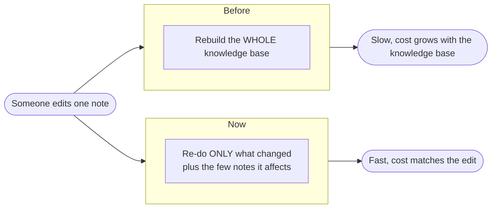

# Incremental refresh: Business view

> **One domain, three views.** This is the non-technical view. The same story is
> told for engineers in the [Software Engineering view](engineering-view.md) and for
> researchers in the [Research view](research-view.md). The [index](index.md) holds a
> concept concordance that maps the shared vocabulary across all three. The binding
> terms are defined once in the [engram glossary](../../../CONTEXT.md). Decision of
> record: [ADR-0019](../../adr/0019-true-incremental-ingestion.md).

## What engram does here, in one breath

engram keeps a **knowledge base**, the folder of notes a team writes, the single source of
truth, and turns it into a fast, searchable knowledge base that people and AI
assistants can query. Turning the notes into that queryable knowledge base is called
**indexing**. This document is about making indexing fast enough to keep up with
people as they write.

## The problem

Until now, every time someone changed a single note, engram rebuilt the **entire**
knowledge base from scratch, re-reading and re-processing every note in the knowledge base,
not just the one that changed. That is like a spreadsheet recalculating every cell in
the workbook because you edited one of them, or a builder re-pouring an entire house
because you moved one brick.

Three things follow, and none of them are good for the business:

- **Slow feedback.** Fix a typo, then wait while the whole knowledge base re-processes before
  you can see the result. The wait grows the more notes you have.
- **Cost that grows with the knowledge base.** Every rebuild costs the same whether the edit
  was tiny or large, and that cost climbs as the knowledge base grows. A bigger, more valuable
  knowledge base becomes *more* expensive to keep current, exactly backwards.
- **It does not scale.** A living research knowledge base is edited constantly. If each small
  edit triggers a full rebuild, the rebuilds dominate the day and the approach quietly
  hits a wall as the knowledge base grows.

The net effect is staleness: people edit less often than they should, because each
edit is expensive, so the queryable knowledge base drifts behind the actual work.

## The solution

engram now figures out **exactly what changed** and re-does only that, the so-called
**dirty set**, instead of rebuilding everything. It does this safely:

1. **Notice what changed.** engram keeps a lightweight record (a **manifest**) of
   every note from the last run. On the next run it compares the notes to that record
   and spots precisely which were added, removed, or edited.
2. **Follow the ripples.** Notes link to each other, so a change can affect a few
   neighbours, for example, renaming a note means links pointing at it must be
   re-checked. engram traces those ripples and adds exactly the affected notes to the
   dirty set, and no more. (It can prove it never misses one and never over-includes.)
3. **Re-do only the dirty set.** Just those notes are re-processed. Everything else is
   left untouched.

The familiar analogy is a build tool that re-indexes only the files you changed, or a
spreadsheet that recalculates only the cells your edit actually touched.

Crucially, a **full rebuild**, the original, guaranteed-correct "rebuild everything"
path, is always available with a single `--full` switch, and it is what the automated
quality checks (CI) always run. So the fast everyday path is backed by a slow,
trustworthy one that is provably identical in its result. The team gets speed without
giving up correctness.

## The value

- **Faster feedback loops.** Edits become queryable in seconds, not after a
  whole-knowledge-base rebuild, researchers see the effect of their work right away.
- **Lower compute cost.** The work, and therefore the cost, now matches the size of
  the edit instead of the size of the whole knowledge base.
- **Fresher knowledge.** Because keeping the knowledge base current is cheap, it stays
  current, the queryable knowledge base tracks the ongoing work instead of lagging it.
- **It scales with the knowledge base.** The everyday cost no longer climbs with the knowledge base, so
  the approach holds up as the knowledge base grows into its most valuable form.

## What it enables

This is the third step of **Vibe RAG**, engram's wider program for retrieval that
tunes itself. Cheap, fast indexing means researchers can iterate quickly and the
queryable knowledge base stays in step with the work as it happens. It also produces a
precise record of *what changed on each run*, a signal a later phase will use to flag
when an answer has gone stale because its underlying notes moved. In short: the
knowledge base stops being something you rebuild occasionally and becomes something
that keeps pace with the people using it.

---

*Companion views: [Software Engineering](engineering-view.md), [Research](research-view.md), [index + concordance](index.md). Glossary: [CONTEXT.md](../../../CONTEXT.md).*
