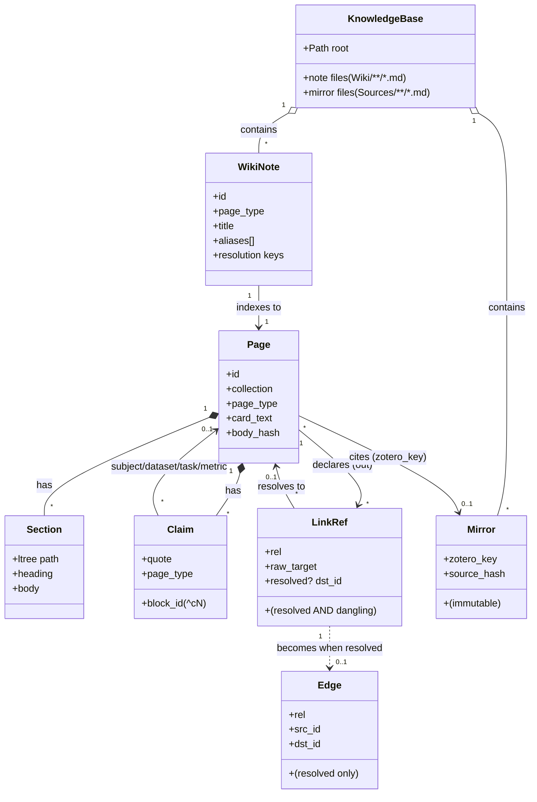
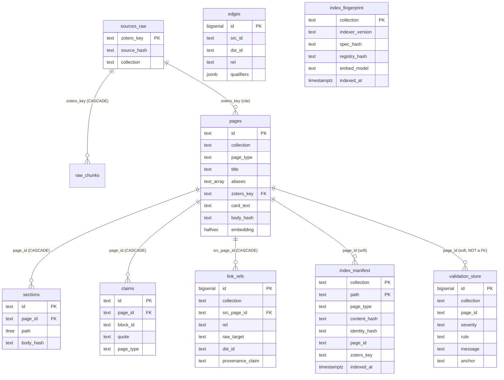
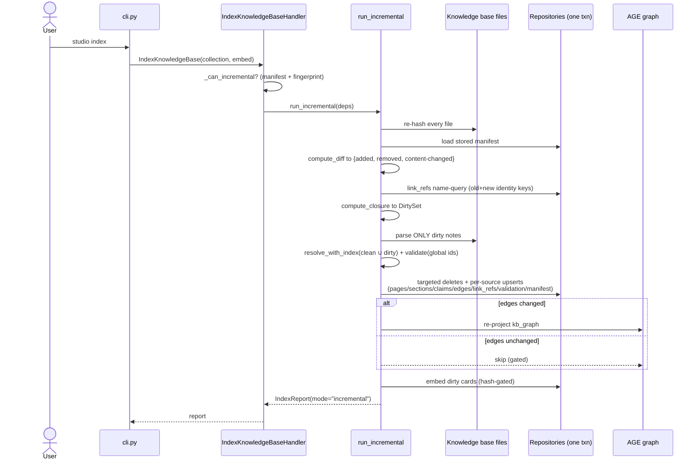
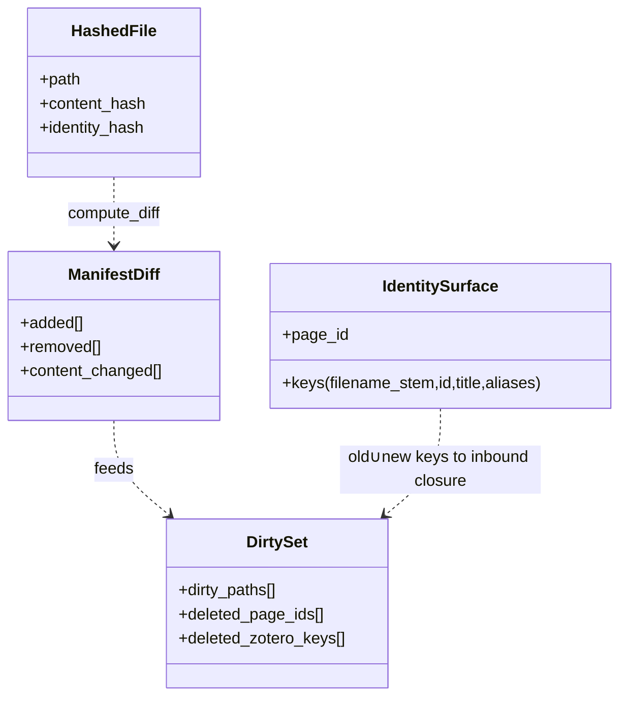

# Incremental refresh: Software Engineering view (SDD)

> **One domain, three views.** This is the engineer's view. The same story is told
> for non-technical stakeholders in the [Business view](business-view.md) and for
> researchers in the [Research view](research-view.md). The [index](index.md) holds a
> concept concordance that maps the shared vocabulary across all three. The binding
> terms (`KnowledgeBase`, `Index`, `Dirty set`, `Inbound closure`, `content_hash`,
> `identity_hash`, …) are defined once in the [engram glossary](../../../CONTEXT.md)
> and used here verbatim. Decision of record: [ADR-0019](../../adr/0019-true-incremental-ingestion.md).

This is an IEEE-1016-style **Software Design Description (SDD)** for **true incremental
ingestion** (Vibe RAG Phase 3): the re-architecture of `studio index` from a full
`O(knowledge_base)` rebuild into a change-driven incremental indexer whose output is provably
bit-for-bit identical to a full rebuild.

---

## 1. Introduction

### 1.1 Scope

`studio index` turns a [Knowledge base](../../../CONTEXT.md) (a folder of Markdown notes, the
single source of truth) into queryable Postgres state. Historically every run
re-parsed, re-resolved, re-validated, re-loaded and re-pruned the **whole knowledge base**,
with only embedding hash-gated. This SDD covers the design that makes a run touch only
what changed (the **dirty set**) while keeping a `--full` escape hatch and a
correctness oracle.

Out of scope (named, not designed here): the whole-engram domain model (see
[vision.md](../vision.md)), retrieval, evals, and the rest of the Vibe RAG roadmap.

### 1.2 Design drivers (decision D1)

Four pressures, all pointing the same way, a correctness-first re-architecture:

| Driver | Full-rebuild pain |
|---|---|
| **Latency** | Edit one note, wait for the entire knowledge base to index again. |
| **Precise change-set** | No machine-readable answer to "what did this edit actually affect?". |
| **Scale** | Cost grows `O(knowledge_base)` per run regardless of edit size. |
| **Churn** | A living research knowledge base is edited constantly. Full rebuilds dominate the loop. |

### 1.3 The one-line idea

> Hash every file each run. Diff against a stored **manifest** to get the raw change
> partition. Expand it through a persisted **link-reference graph** into the *minimal*
> set of pages whose indexed output could differ. Index that set again. Re-project
> the graph only if edges changed. A global **fingerprint** mismatch (spec / registry /
> embed-model / indexer change) auto-falls-back to `--full`.

---

## 2. Domain model (UML class diagram)

The knowledge entities an indexing run produces, and the link structure incremental
refresh reasons over. (Storage columns are in section 3. The algorithm's value objects are
in section 4.3.)



**Domain invariants**

- A `WikiNote`'s **resolution keys** are `{filename_stem, id, title, aliases}`
  (lower-cased). They, not the body, determine how *other* notes resolve links to it.
- `LinkRef` records **every** outbound target, resolved **and** dangling, with the raw
  (lower-cased) `raw_target`. `Edge` records **only resolved** links, id-keyed. This is
  why the inbound closure (section 4.3) is a `LinkRef` name query, not an `Edge` query.
- A `Mirror` is immutable. A `Page` may cite one via `zotero_key` (research profile).

---

## 3. Data model (ERD)

The physical schema. The four tables in the lower group are **new** in this work
([ADR-0019](../../adr/0019-true-incremental-ingestion.md)). The upper group is the
pre-existing indexed knowledge base (migration `0001`).



**Storage invariants**

- **Per-collection.** Every index-state table carries `collection`. Multiple
  collections coexist in one DB (D-19), and `--collection` scopes every read/write.
- **`edges` is not FK-constrained** and its `src_id` may be a page id *or* a
  `page_id#blockId` (claim/section anchor). The incremental delete therefore scopes
  edges by page-prefix (`split_part(src_id,'#',1)`), not by FK.
- **Index-private, no reader grant (D-20).** The four new tables get **no** grant to
  the `kb_reader` role and appear in **no** `api` view/function, `index` is their
  only writer. `link_refs.src_page_id` cascades from `pages`. `validation_store.page_id` is
  deliberately *not* a FK (parse-error issues exist before any page row does).

---

## 4. Behavioral design

### 4.1 Dispatch: full vs incremental (activity)

`IndexKnowledgeBaseHandler.handle()` chooses the path. The default is incremental. Three
conditions force a full rebuild, and a `--dry-run` always previews, never writes.

```mermaid
flowchart TD
    start([studio index]) --> dry{--dry-run?}
    dry -- yes --> preview[preview_dirty_set:<br/>compute dirty set, write NOTHING] --> exit0([report.dry_run, exit 0])
    dry -- no --> full{--full flag?}
    full -- yes --> FULL
    full -- no --> manifest{manifest empty?<br/>(cold start)}
    manifest -- yes --> FULL
    manifest -- no --> fp{fingerprint<br/>mismatch?}
    fp -- yes --> FULL[**Full path**<br/>whole knowledge base +<br/>rewrite manifest/refs/validation/fingerprint]
    fp -- no --> INC[**Incremental path**<br/>run_incremental over the dirty set]
    FULL --> gate
    INC --> gate{report.validation.n_errors > 0?}
    gate -- yes --> exit1([exit 1])
    gate -- no --> done([exit 0])
```

A **fingerprint** is `indexer_version + spec_hash + registry_hash + embed_model`. A
mismatch is a *global invalidator*: a spec or registry change moves every note's
parse/validate. An embed-model change invalidates every vector, so the only correct
response is `--full`.

### 4.2 The incremental run (sequence)



### 4.3 The dirty-set closure (the heart of the design)

The minimal set whose indexed output can differ is:

> **dirty set = content-changed ∪ added ∪ inbound-closure ∪ mirror-citers**

computed by the pure `compute_closure` over these value objects:



- **`content_hash`** = `card.content_hash(raw_file_text)`, "did anything in this file
  change?" Gates whether a file is re-parsed at all.
- **`identity_hash`** = `card.content_hash` of the normalized resolution-key set
  `{filename_stem, id, title, aliases}`, "did this file's effect on *how other files
  resolve* change?" Only an `identity_hash` change (or an add/remove) triggers the
  **inbound closure**: the unchanged pages that reference the affected name, found via
  `link_refs WHERE raw_target = :name` over the *old ∪ new* keys.

**Completeness lemma (why single-level).** Re-resolving an inbound-closure page cannot
change *its own* identity keys (those come from its frontmatter/filename, which did not
change). So it cannot itself trigger a further inbound wave, one level is provably
sufficient. This is the load-bearing argument that keeps the closure cheap.

---

## 5. Decision mechanics

How the contested choices were made (full cross-reference in
[product-decisions.md](../product-decisions.md) D-log and
[ADR-0019](../../adr/0019-true-incremental-ingestion.md)).

| # | Decision | Mechanic |
|---|---|---|
| **D2** | Detect changes by content-hash manifest, re-hashing every file each run | A missing manifest degenerates to a full rebuild, never silently partial. |
| **D3** | Split `content_hash` / `identity_hash`, closure via a persisted link-ref graph | Outbound-link edits are *local*. Only identity changes + add/remove trigger the inbound closure (single-level by the lemma). |
| **D4** | Persist validation per page | Whole-knowledge-base report = `stored(clean) ∪ recomputed(dirty)`, so the `n_errors` gate stays bit-identical to full. |
| **D5** | Incremental by default, `--full` escape hatch, **CI runs `--full`** | Dev loop is fast. CI keeps the guaranteed-correct whole-knowledge-base gate. |
| **D6** | Re-project the AGE graph only when edges changed | A body-only edit touches no edges, so the expensive `kb_graph` projection is skipped. |
| **D7** | Index-state lives in DB tables, index-private | Written inside the load transaction. Never granted to `kb_reader`, never in `api` (D-20). |
| **D8** | `link_refs` stores ALL targets incl. danglers, with `raw_target` | `kb.edges` is resolved-only/id-keyed and *cannot* answer the name-based closure. |

---

## 6. Correctness

The acceptance gate is a property test, **`incremental == full`, bit-for-bit**, that
replays a scenario matrix (body-only edit, title change, file rename, id rename,
add-satisfies-dangling, delete-target, changed-mirror, no-op) on the testcontainers
local Postgres and asserts:

- every `wiki.*` data table is byte-equal between an incremental run and a fresh full
  rebuild of the same end state, **and**
- the whole-knowledge-base `ValidationReport` (reassembled via `ValidationIssues.whole_report`) is
  identical, **and**
- the no-op run skips/embeds nothing.

It runs green (8/8) and additionally surfaced, and fixed, a *pre-existing* full-rebuild
non-idempotency (claim/section edges were never deleted when indexed again, now scoped by
page-prefix). The completeness lemma (section 4.3) is what lets the closure stay single-level
without sacrificing this equality.

---

## 7. Risks, limits, and deferred items

- **Returned `IndexReport.validation` is dirty-only.** The incremental path returns validation for
  the dirty pages. `cli.py` gates the exit code on it. The *persisted* `validation_store` and
  the reassembled whole-knowledge-base report are correct, and CI runs `--full` (D5), but a local
  incremental run can exit 0 while an unchanged page carries a pre-existing error. A
  deliberate dev-loop-vs-CI split. Wiring `whole_report` into the returned report is the
  open option.
- **Graph projection is whole-`kb_graph`** (gated on edges-changed), not yet incremental,
  deferred to a later phase.
- **Module coupling.** `service/incremental.py`, `service/ingest.py` and `service/index.py` share
  one row assembly, `service/_row_builder.py`, so no path reaches into another. The unit-of-work
  Protocols are not yet collapsed. (Quality-gate deferred finding, non-blocking.)

---

## 8. Traceability

| Concern | Code | Test |
|---|---|---|
| Change detection | `src/engram/indexing/domain/manifest.py` (`compute_diff`) | `tests/unit/engram/indexing/test_manifest.py` |
| Dirty-set closure | `domain/manifest.py` (`compute_closure`, `DirtySet`) | `test_manifest.py` (closure + lemma) |
| Incremental run | `src/engram/indexing/service/incremental.py` (`run_incremental`) | `tests/unit/engram/indexing/test_incremental_handler.py` |
| Full vs incremental dispatch | `src/engram/indexing/service/index.py` (`handle`, `_can_incremental`) | `tests/unit/engram/indexing/test_handlers.py` |
| Schema | `alembic/versions/0006_compile_state.py` | `tests/integration/indexing/test_index_state_migration.py` |
| **`incremental == full`** | (whole pipeline) | `tests/integration/indexing/test_incremental_equals_full.py` |
| CLI surface (`--full`/`--dry-run`/`status`) | `src/cli.py` | `tests/unit/test_cli_compile.py` |

---

*Companion views: [Business](business-view.md), [Research](research-view.md), [index + concordance](index.md). Glossary: [CONTEXT.md](../../../CONTEXT.md).*
