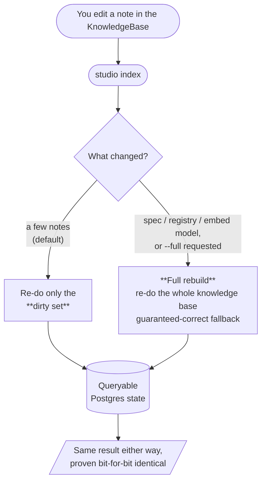

# Incremental refresh: one domain, three views

**True incremental refresh** (Vibe RAG Phase 3) re-architects `studio index`
from a full `O(knowledge_base)` rebuild into a change-driven indexer that touches only what
changed, yet stays provably identical to a full rebuild. This package explains that
one idea **three ways**, for three audiences:

- a [Business view](business-view.md): the value and the trade-offs, in plain terms,
- a [Research view](research-view.md): how it serves the day-to-day research workflow,
- an [Engineering view / SDD](engineering-view.md): the design, schema, and correctness proof.

**Why three views.** Different readers, one truth. A stakeholder, a researcher, and an
engineer each need the story in their own language, but it has to be the *same* story,
not three approximations that quietly disagree. This index exists to prove they don't:
the [concept concordance](#concept-concordance) below puts the same concept side by side
in all three framings.

## Shared domain: one glossary, three lenses

All three views speak the **engram domain language verbatim**. The binding terms:
`KnowledgeBase`, `Index`, `Dirty set`, `Inbound closure`, `content_hash`, `identity_hash`,
`Index fingerprint`, `Full rebuild`, are defined **once** in the
[engram glossary](../../../CONTEXT.md) and used unchanged across every view. Each view
applies its own *lens* (business value / research workflow / technical mechanism) to the
**same entities**. None of them redefines a term. When in doubt, the glossary wins.

## Reader's guide

| You are a… | Start with | It gives you |
|---|---|---|
| Non-technical stakeholder | [Business view](business-view.md) | the value, the cost, and the guarantee, no schema |
| Researcher / knowledge base author | [Research view](research-view.md) | how editing and re-indexing fits the research loop |
| Engineer / reviewer | [Engineering view / SDD](engineering-view.md) | the IEEE-1016 design: UML, ERD, algorithm, proof |

New to all three? Read the [Business view](business-view.md) first for the shape, then
follow your role.

## The core idea, for any reader

A `KnowledgeBase` edit triggers an `Index`. Instead of re-doing the whole knowledge base, an
incremental indexing run re-does only the **dirty set**, the notes whose indexed output
*could* have changed. A `--full` rebuild is always available as the guaranteed-correct
fallback, and certain global changes (a spec, registry, or embed-model change, detected
via the **index fingerprint**) auto-fall-back to it.

This is the accessible shape of the engineer's dispatch flow. The
[Engineering view section 4.1](engineering-view.md) gives the precise conditions, and section 6 the
`incremental == full` proof that makes "same result either way" a guarantee.

## Concept concordance

The centrepiece. Each row is one concept from the [glossary](../../../CONTEXT.md). Each
column phrases that **same** concept in one view's language. Reading a row across proves
the three views describe one domain, not three.

| Concept | Research (R&D) framing | Business framing | Software-Engineering framing |
|---|---|---|---|
| **Knowledge base** | Your knowledge base, the Markdown notes you author and curate. The single source of truth you actually edit. | The asset of record. Everything downstream is a disposable, rebuildable derivative of it. | A folder of Markdown (`Wiki/**/*.md` notes + `Sources/**/*.md` mirrors) at `knowledge_base_root`. The DB is a derived projection. |
| **Indexing** | The button that makes your latest edits searchable, turns notes into something the retrieval agent can read. | The build step that converts the asset into a queryable product. Its speed sets how tight the author loop feels. | `parse → resolve → validate → load (one txn) → embed (hash-gated)`. Turns the knowledge base into Postgres state. |
| **Full rebuild (`--full`)** | "Re-do everything from scratch", the safe option when in doubt. What CI runs so nothing is ever missed. | The insurance policy: always correct, always available. The cost ceiling you fall back to, never the everyday cost. | The whole-knowledge-base pipeline that also rewrites manifest / link-refs / validation / fingerprint. The oracle the property test compares against. |
| **Dirty set** | Just the notes your edit actually touched (plus the few that point at them), not the whole knowledge base. | Why the everyday indexing is cheap: work scales with edit size, not knowledge base size. | `content-changed ∪ added ∪ inbound-closure ∪ mirror-citers`, provably the minimal set whose indexed output can differ. |
| **Inbound closure** | When you rename or add a note, the other notes that link to it by name get re-checked so their links still point right. | The correctness guarantee on structural edits, a rename never silently breaks references elsewhere. | Unchanged pages referencing an affected name, found via `link_refs WHERE raw_target = :name`. Single-level by the completeness lemma. |
| **`content_hash` vs `identity_hash`** | Two different "did it change?" checks: one for *any* edit to a note, one for edits that change how *other* notes find it (its title, id, filename, aliases). | The mechanism that tells a cheap local edit apart from a structural one, so the system only does the expensive work when it must. | `content_hash` = hash of raw file text (gates re-parse). `identity_hash` = hash of the resolution-key set `{filename_stem, id, title, aliases}` (gates the inbound closure). |
| **Index fingerprint** | A safety catch: if you change the schema or the embedding model, everything is redone automatically, no stale results. | The guardrail that prevents a "fast but wrong" indexing run after a system-wide change. Protects trust in results. | Per-collection row `(indexer_version, spec_hash, registry_hash, embed_model)`. A mismatch is a global invalidator that auto-forces `--full`. |
| **Index manifest** | The record of what your notes looked like last time, so the system can spot exactly what you changed. | The bookkeeping that makes "only re-do what changed" possible and self-correcting. | Per-collection `kb.index_manifest` mapping each `path` to its `content_hash` / `identity_hash` (+ `page_id` / `zotero_key`). Re-hash-and-diff yields the change partition without parsing. |

The seven binding terms above are exactly the ones the glossary marks as engram
ADR-0019. An empty manifest or a fingerprint mismatch always degenerates to `--full`, so
incremental is never silently partial.

## See also

- [Business view](business-view.md), [Research view](research-view.md), [Engineering view / SDD](engineering-view.md): the three views of this package.
- [Knowledge base domain & vision](../vision.md): the whole-engram domain story this phase sits inside.
- [Vibe RAG](../vibe-rag.md): the self-tuning-retrieval program. Incremental refresh is its Phase 3.
- [ADR-0019: True incremental refresh](../../adr/0019-true-incremental-ingestion.md): the decision of record.
- [engram glossary](../../../CONTEXT.md): the shared vocabulary all three views use verbatim.
