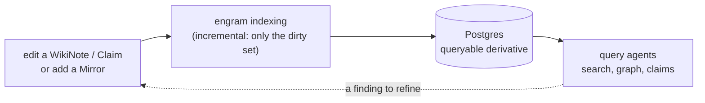

# Incremental refresh: Research (R&D) view

> **One domain, three views.** This is the researcher's view. The same story is told
> for non-technical stakeholders in the [Business view](business-view.md) and for
> engineers (the SDD) in the [Software Engineering view](engineering-view.md). The
> [index](index.md) holds a concept concordance that maps the shared vocabulary across
> all three. The binding terms (`KnowledgeBase`, `Mirror`, `WikiNote`, `Claim`, `Dirty set`,
> `Inbound closure`, `Link-reference graph`) are defined once in the
> [engram glossary](../../../CONTEXT.md) and used here verbatim. This phase serves the
> [Vibe RAG](../vibe-rag.md) program (whole domain: [vision.md](../vision.md)). Decision
> of record: [ADR-0019](../../adr/0019-true-incremental-ingestion.md).

This is the *why it matters for doing research* view of **true incremental refresh**
(Vibe RAG Phase 3). It explains how `studio index` keeps your queryable knowledge in
lock-step with the knowledge base you are actively editing, without re-reading the whole knowledge base
every time you save a note.

---

## The knowledge base is the living source of truth

When you do research in engram you work **in the [Knowledge base](../../../CONTEXT.md)**: you
author [WikiNotes](../../../CONTEXT.md) (papers, entities, comparisons, questions), you
write [Claims](../../../CONTEXT.md) with verbatim quotes pinned to a locator, you add
[Mirrors](../../../CONTEXT.md) of new papers under `Sources/`. The Markdown is the
single source of truth.

The indexed Postgres state, the cards, sections, claims, edges, and embeddings your
query agents read, is a **disposable derivative**. It exists only so the knowledge is
*queryable*: filters, scoreboards, hybrid search, the graph. Because it is derived, it
must stay in lock-step with the knowledge base, or an agent answers from a knowledge base that no longer
matches what you wrote. `studio index` is the step that re-derives it.

## Why incremental matters for research

A living knowledge base changes **constantly**, you rename a concept, fix a quote, queue a new
paper, split one note into two. Historically every `index` re-parsed, re-resolved,
re-validated and re-loaded the *whole knowledge base*, so the cost of one edit grew with the
size of everything you had ever written. On a large knowledge base that makes the
iterate-and-query loop slow: edit one note, wait for hundreds to index again before you
can ask a question against the change.

Incremental refresh makes a run cost **proportional to the edit, not the knowledge base**. It
hashes every file, diffs against a stored [Index manifest](../../../CONTEXT.md) to see
what actually changed, and indexes again only the [Dirty set](../../../CONTEXT.md), the
provably minimal set of pages whose indexed output could differ. Editing one note now
keeps the queryable knowledge current in seconds. (Incremental is the default.
`--full` is always there as the guaranteed-correct rebuild, and CI runs `--full`.)

## Precise change propagation, the research payoff

The real win is not just speed. It is that change-sets are **precise**, so
cross-references between your findings never silently rot. Three cases researchers hit
constantly:

- **Renaming a concept or paper, or changing its aliases** re-resolves the *other*
  notes that point at it. A WikiNote's identity, its `{filename_stem, id, title,
  aliases}`, is what every other note resolves links against. When that identity
  changes, engram walks the [Inbound closure](../../../CONTEXT.md) over the
  [Link-reference graph](../../../CONTEXT.md) (every page that referenced the old *or*
  new name) and re-resolves exactly those. A `[[lightrag]]` cross-reference in twenty
  other notes follows the rename instead of quietly going dangling.
- **A body-only edit stays local.** Tightening a claim's wording or fixing a typo
  changes that one note and nothing else, it cannot change how other notes resolve to
  it, so the closure is not triggered. The expensive graph re-projection is skipped
  entirely when no edge moved.
- **An add that satisfies a dangling reference is picked up.** A dangling
  `builds_on:: [[paper.vanilla-rag-2023]]` is engram's *source queue*, not an error.
  When you finally bring that paper in, the note that was waiting for it re-resolves and
  the edge becomes real, because the link-reference graph records dangling targets,
  not just resolved ones, so the new note's name finds its waiting referrers.

Correctness here is not assumed: an `incremental == full` property test proves an
incremental run is bit-for-bit identical to a fresh full rebuild of the same end state.
So you get the fast loop *and* the guarantee that what you query is exactly what a
clean rebuild would produce.

## The research loop

## How this feeds Vibe RAG

Incremental ingestion is Phase 3 of the [Vibe RAG](../vibe-rag.md) program, and it
serves the rest of it two ways. **Freshness:** keeping the indexed state current after
every edit is what makes the knowledge base a trustworthy yardstick, Vibe RAG reads its
evaluation ground-truths *off the structure of the indexed knowledge base* (a claim, a
comparison, a graph path), so a stale derivative would seed stale evals. **Precise
change-sets:** each run emits exactly which pages changed, the signal the program's
freshness detector (Phase 6 roadmap) consumes to tell when a generated eval case has
gone stale under a moved source. Keep the knowledge base current cheaply, and the
self-tuning loop tunes against knowledge that is actually current.

---

*Companion views: [Business](business-view.md), [Software Engineering (SDD)](engineering-view.md), [index + concordance](index.md). Glossary: [CONTEXT.md](../../../CONTEXT.md).*
