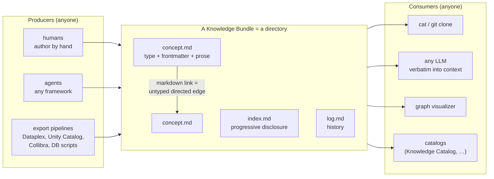
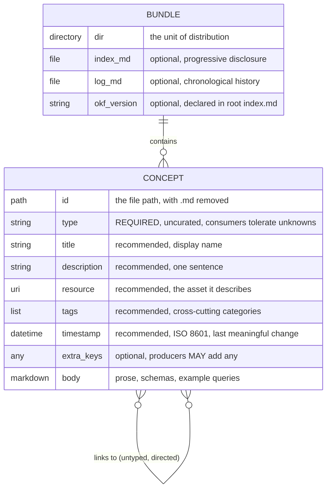
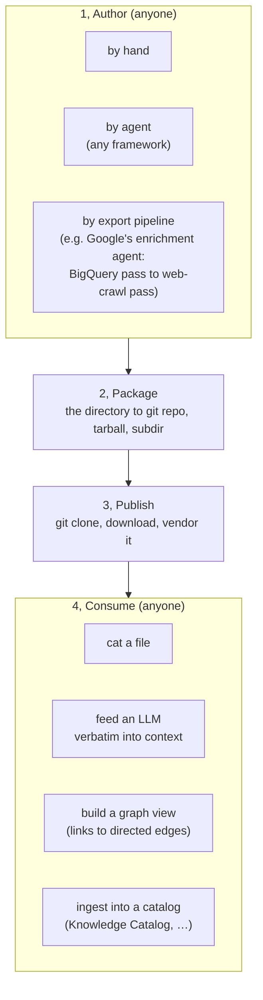
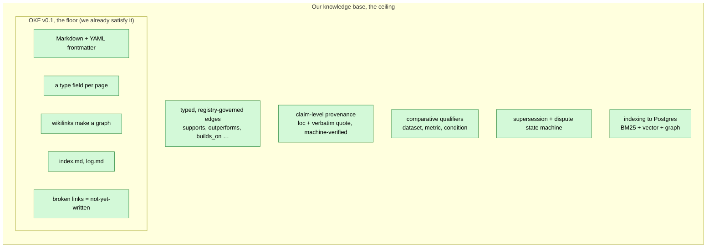

# The Open Knowledge Format (OKF): how it works, and how we leverage it

On 2026-06-12 Google Cloud published the [Open Knowledge Format](https://cloud.google.com/blog/products/data-analytics/how-the-open-knowledge-format-can-improve-data-sharing/) (OKF), described in its own announcement as *"an open specification that formalizes the LLM-wiki pattern into a portable, interoperable format."* That sentence is, almost verbatim, a description of this knowledge base. This document is the deep read: what OKF **actually** is (not what the words "knowledge format" suggest), how it works end to end, where it sits among the data-sharing standards, and, the part that earns its place here, how a knowledge base built on the engram schema can **emit and consume** OKF at near-zero cost while keeping every gram of rigor OKF deliberately leaves on the floor.

**The one-sentence correction up front:** despite the name and the "improve data sharing" framing, OKF is **not** a knowledge-graph / RDF / semantic-web standard, and it is **not** tied to Google Data Commons. It is a directory of Markdown files with YAML frontmatter and *untyped* links. That correction is the backbone of everything below, if it surprises you, read section 1 before anything else.

**How to read it:**

- *Just the verdict*: section 1 (the framing, the correction, the superset thesis).
- *What OKF is, precisely*: sections 2 to 5 (the picture, the data model, a real concept, the lifecycle).
- *How it compares*: sections 6 to 7 (vs the semantic web, governance and limits).
- *What it means for us*: sections 8 to 10 (the mapping, the leverage, the shipped decision).
- *Caveats and horizon*: sections 11 to 12.

---

## 1. Why this exists: Google standardized the pattern we live in

> **TL;DR:** OKF formalizes the exact pattern this knowledge base is built on: agent-readable Markdown with YAML frontmatter, linked into a graph. But it formalizes the **floor**, not the ceiling: one required field, untyped links, no claim-level provenance. And the verdict-changing correction: OKF is Markdown-plus-frontmatter, **not** RDF and **not** Data Commons. So the right mental model is not "Google built our thing" but "Google specified the *substrate* our thing sits on, and we are a rigor-maximal superset of it."
<!-- load-when: what is OKF, is this our idea, verdict, correction, RDF, Data Commons, semantic web, summary, executive summary, superset -->

The announcement's title ("How the Open Knowledge Format can **improve data sharing**") primes you to expect a semantic-interoperability standard: triples, ontologies, an RDF lineage, a tie to Google Data Commons. That expectation is wrong, and the wrongness is the most useful thing in this document.

**What OKF actually is.** A Knowledge Bundle, OKF's name for the unit which engram writes as its export directory, is a directory of UTF-8 Markdown files with YAML frontmatter. Each file is one "concept." The single hard rule is that every concept declares a `type`. Relationships between concepts are ordinary Markdown links, and what a link *means* is left to the surrounding prose. The spec says it plainly: *"There is no schema registry, no central authority, and no required tooling. If you can `cat` a file, you can read OKF; if you can `git clone` a repo, you can ship it."*

**Two myths the research killed** (high-confidence, verified against the primary [`okf/SPEC.md`](https://github.com/GoogleCloudPlatform/knowledge-catalog/blob/main/okf/SPEC.md)):

1. *OKF is RDF / a knowledge graph.* No. A full-text search of the spec finds **zero** occurrences of RDF, OWL, JSON-LD, Turtle, schema.org, PROV, or Croissant. The spec says it "intentionally avoids semantic web standards." Its "graph" is the informal graph of Markdown links, not a triple store.
2. *OKF is tied to Data Commons.* No. The spec, README, and announcement never mention Data Commons. OKF lives inside Google's **Knowledge Catalog** (formerly Dataplex) repo, and even that is named as just *one* of several export sources. Data Commons is a genuine RDF-style triple graph, it makes a perfect *foil* (see section 6), not a parent.

**Why this is good news for us, not deflating.** A hyperscaler looked at the problem of giving AI agents curated, portable knowledge and reached for *exactly the substrate this knowledge base already uses* (Markdown, frontmatter, links, a `type` field, `index.md` for progressive disclosure, a `log.md` of history, broken links treated as "not yet written"). Those are not coincidences. They are the convergent-evolution endpoints of the "LLM should maintain a knowledge base for you" thesis. OKF validates the bet. What it does *not* do is the hard part we chose to do: typed evidence, verifiable provenance, contradiction handling, indexing to a query engine. The rest of this guide pins down both halves: what OKF gives the world for free, and where our schema goes far beyond it.

---

## 2. OKF at a glance: a format, not a platform

> **TL;DR:** OKF targets the *re-modeling tax*: every agent, catalog, and tool re-models the same metadata into its own private shape, so knowledge never travels. OKF's answer is a **format, not another service**: a directory of Markdown concept files, one Concept per file, links make the directory a graph, and `cat` is a sufficient reader. Seven design principles, all pointed at zero lock-in.
<!-- load-when: overview, big picture, format not platform, problem, re-modeling tax, design principles, why okf, data sharing -->

The problem statement from the announcement: knowledge an agent needs (what a table means, how a metric is defined, which dashboard is canonical) exists, but it is scattered and every consumer re-models it. *"What's missing is a format, not another service."* OKF is that format, *"a universal, vendor-neutral format … not tied to any particular agent, framework, model provider, or serving system."*



**The seven design principles** (from the [README](https://github.com/GoogleCloudPlatform/knowledge-catalog/tree/main/okf)), every one an anti-lock-in stance:

| Principle | What it means |
|---|---|
| Human- **and** agent-readable | "No SDK or query language stands between a reader and the content." |
| Version-controllable out of the box | "Bundles live in git." |
| Portable and lock-in free | "A bundle is a directory." |
| Mixes structured + unstructured deliberately | frontmatter for facts, prose for everything else |
| Minimally opinionated, freely extensible | one required field, add any keys you like |
| Composes with existing tooling | it is just Markdown + git |
| Progressive disclosure built in | `index.md` lets a reader scan before descending |
| Graph-shaped, not just tree-shaped | "Concepts link to each other via normal markdown links." |

If those read like the design notes of this knowledge base, that is the whole point, and the subject of section 8.

---

## 3. The data model: concepts, one required field, untyped links

> **TL;DR:** A Knowledge Bundle holds Concepts, one `.md` file each. A concept's **identity is its file path** (minus `.md`). Frontmatter carries exactly one *required* field, `type`, an uncurated free string, plus recommended `title` / `description` / `resource` / `tags` / `timestamp`, plus any extra keys you want. Relationships are plain Markdown links: directed, but **untyped**, the *page_type* of relationship lives in prose, not in the link. Frontmatter is the part you query, the body is the part you read.
<!-- load-when: data model, concept, Knowledge Bundle, frontmatter, type field, fields, identity, links, edges, untyped, schema, properties -->



**The frontmatter contract**, verbatim from the spec's field table:

| Field | Status | Meaning |
|---|---|---|
| `type` | **REQUIRED** | "A short string identifying the page_type of concept" |
| `title` | recommended | "Human-readable display name" |
| `description` | recommended | "A single sentence summarizing the concept" |
| `resource` | recommended | "A URI that uniquely identifies the underlying asset" |
| `tags` | recommended | "A YAML list of short strings for cross-cutting categorization" |
| `timestamp` | recommended | "ISO 8601 datetime of last meaningful change" |
| any other key | optional | "Producers MAY include any additional keys" |

Three properties of this model carry almost all of OKF's character:

- **`type` is uncurated.** "Type values are **not** registered centrally. Producers SHOULD pick values that are descriptive and self-explanatory; consumers MUST tolerate unknown types gracefully." The spec's own examples: `BigQuery Table`, `BigQuery Dataset`, `Metric`, `API Endpoint`, `Playbook`, `Reference`. There is no enum, no registry, no validation that two producers mean the same thing by `Metric`. This is the deliberate opposite of our entity-type registry discipline.
- **Edges are untyped.** "A link from concept A to concept B asserts a *relationship*. The specific page_type of relationship (parent/child, references, joins-with, depends-on, etc.) is conveyed by the surrounding prose, not by the link itself. Consumers that build a graph view typically treat all links as directed edges of an untyped relationship." A reader (or an LLM) must read the prose to know what the link *means*.
- **Frontmatter vs body is a query/read split.** The README's guidance: *"Use frontmatter for the few fields you want to query, filter, or index on (`type`, `resource`, `tags`, `timestamp`); use the markdown body for the prose, schemas, and example queries that LLMs and humans actually read."* This is the same instinct as our facets/canonical-H2-sections split between structured filters and the read units, arrived at independently.

---

## 4. A real OKF concept, dissected

> **TL;DR:** The spec's own `Customer Orders` concept, in full: a `BigQuery Table` type, a schema table, a join expressed as a *prose link*, and citations. Plus the two reserved filenames (`index.md` for progressive disclosure, `log.md` for history), the Knowledge Bundle tree, the conformance rules (three MUSTs and a list of things a consumer MUST NOT reject over), and how `0.1` will version.
<!-- load-when: example, concept file, sample, conformance, index.md, log.md, bundle structure, versioning, real example, dissected -->

This is the complete example concept from `okf/SPEC.md`, reproduced verbatim:

```markdown
---
type: BigQuery Table
title: Customer Orders
description: One row per completed customer order across all channels.
resource: https://console.cloud.google.com/bigquery?p=example-project&d=sales&t=orders
tags: [sales, orders, revenue]
timestamp: 2026-05-28T14:30:00Z
---

# Schema

| Column        | Type      | Description                              |
|---------------|-----------|------------------------------------------|
| `order_id`    | STRING    | Globally unique order identifier.        |
| `customer_id` | STRING    | Foreign key into [customers](/tables/customers.md). |
| `total_usd`   | NUMERIC   | Order total in US dollars.               |
| `placed_at`   | TIMESTAMP | When the customer submitted the order.   |

# Joins

Joined with [customers](/tables/customers.md) on `customer_id`.
```

Read it the way a consumer must. The frontmatter is five recommended fields plus the one required `type`. The **edge** to the `customers` concept appears twice: once inside a schema row ("Foreign key into …"), once under a `# Joins` heading ("Joined with … on `customer_id`"). The link target `/tables/customers.md` resolves to concept id `tables/customers`. Nothing in the *link* says "this is a foreign key," that meaning is only in the words around it. To turn this Knowledge Bundle into a typed graph you would need to *read* the prose (an LLM job), which is precisely the trade-off section 7 flags as the chief critique.

**Two reserved filenames** give a Knowledge Bundle its shape, and both have direct analogues in this knowledge base:

- `index.md`: *"Optional. Directory listing for progressive disclosure."* The same role as the `index.md` this very guide generates.
- `log.md`: *"Optional. Chronological history of updates."* The same role as the knowledge base's `_meta/log.md`.

**The Knowledge Bundle tree** (from the spec):

```
path/to/bundle/
├── index.md          # optional — progressive-disclosure directory listing
├── log.md            # optional — chronological history
├── <concept>.md      # a concept at the bundle root
└── <subdirectory>/   # subdirectories group concepts (also a graph, not just a tree)
    ├── index.md
    └── <concept>.md
```

A Knowledge Bundle ships as a git repo, a tarball/zip, or a subdirectory of a larger repo.

**Conformance is deliberately tiny.** A Knowledge Bundle is conformant with OKF v0.1 if: (1) every non-reserved `.md` file has a parseable YAML frontmatter block. (2) every frontmatter block has a non-empty `type`. (3) reserved files follow their structure when present. Everything else is soft: *"consumers MUST NOT reject a bundle because of: missing optional frontmatter fields; unknown `type` values; unknown additional frontmatter keys; **broken cross-links**; missing `index.md` files."* That broken-links rule is worth pausing on: *"a link whose target does not exist in the bundle is not malformed; it may simply represent not-yet-written knowledge."* This knowledge base made the identical ruling, dangling `builds_on` targets are the **ingest queue, not an error** (the iron rule in the schema's Lint section and the claims design).

**Versioning:** this is `0.1`. Minor bumps add backward-compatible things (new optional fields, new conventional headings). A major bump may rename required fields or reserved filenames. A Knowledge Bundle may declare `okf_version: "0.1"` in its root `index.md`.

---

## 5. End-to-end: author, package, publish, consume

> **TL;DR:** Author by hand, by agent, or by an export pipeline (Dataplex, Unity Catalog, Collibra, a DB script). Package the directory as git / tarball / subdir. Publish by letting people `git clone` it. Consume by `cat`, by feeding it to an LLM, by resolving links into a graph view, or by ingesting it into a catalog. Google ships a reference **enrichment agent** (a two-pass BigQuery-then-web-crawl pipeline on its ADK + Gemini). The weak link is the *query-at-scale* story, that is left to the consumer.
<!-- load-when: end to end, lifecycle, authoring, enrichment agent, consume, query, publish, packaging, mechanics, how it works -->



**Authoring** is open to "humans authoring by hand, agents built on any framework … export pipelines from existing catalogs (Dataplex, Unity Catalog, Collibra, …), or scripts walking a database." To make the export path concrete, the repo ships a reference **enrichment agent** (`src/enrichment_agent/`, built on Google's ADK + Gemini): *"a reference agent that ingests metadata from a pluggable source and emits an OKF bundle."* It runs two passes: a "BQ pass" that writes concept docs from BigQuery metadata, then a "web pass" that runs the LLM as a crawler (a `fetch_url` tool) to enrich them:

```
.venv/bin/python -m enrichment_agent enrich \
    --source bq --dataset <project>.<dataset> \
    --web-seed-file <seeds.txt> --out ./bundles/<name>
```

The repo also ships three ready Knowledge Bundles (`ga4`, which is the Google Merchandise Store e-commerce dataset, plus `stackoverflow` and `crypto_bitcoin`), each with a `viz.html` graph visualizer.

**Consuming** is where OKF is intentionally thin. The spec promises that *"an engineer can `cat` a concept; an LLM can ingest it verbatim into context,"* and the bundled `viz.html` shows one richer pattern: a graph-plus-detail browser with a search box, a `type` filter, and switchable layouts. But how an *arbitrary* consumer indexes a large Knowledge Bundle, resolves untyped links into a queryable graph, and answers a question over it (versus just pulling files into an LLM context window) is **under-specified**. There is no query language, no index format, no standard resolver. In our terms: OKF specifies the *authoring artifact* but not the *retrieval surface*. That gap is exactly the half of the problem our indexing-to-Postgres contract exists to solve, and it is the seam where we add the most value (see section 9).

---

## 6. What OKF is deliberately not: the standards landscape

> **TL;DR:** OKF names RDF, OWL, JSON-LD, schema.org, W3C PROV, and Croissant exactly **zero** times and "intentionally avoids semantic web standards." Its real cousins are LLM-wiki repos, Obsidian/Notion, and "metadata as code": it "differs primarily in being **specified**." The standards the original framing reached for are real but separate: **Data Commons** is a true subject-predicate-object triple graph (serialized in MCF, schema a superset of schema.org). **Croissant** is JSON-LD on `schema.org/Dataset`. OKF trades all of their expressivity for "if you can `cat` a file, you can read it."
<!-- load-when: comparison, vs RDF, vs JSON-LD, vs schema.org, vs PROV, vs Data Commons, vs Croissant, MCF, standards, semantic web, landscape -->

The spec's own section 10, "Relationship to other formats," positions OKF against the *Markdown knowledge base* family, not the semantic web: LLM "wiki" repositories (Markdown + frontmatter agent knowledge bases, the `AGENTS.md` / `CLAUDE.md` lineage), personal knowledge tools (Obsidian, Notion), and "metadata as code." *"OKF differs primarily in being specified — pinning down the small set of rules needed for interoperability without dictating tooling."*

Set OKF beside the standards the "data sharing" title makes you expect, and the gulf is the point:

| Dimension | **OKF v0.1** | **Data Commons** | **MLCommons Croissant** |
|---|---|---|---|
| Core model | Markdown files + untyped links | directed labeled graph of `(subject, predicate, object)` triples | dataset description |
| Serialization | UTF-8 Markdown + YAML frontmatter | MCF (Meta Content Framework, an RDF ancestor) | JSON-LD |
| Vocabulary | uncurated free-string `type` | schema a **superset of schema.org** (RDF lineage), `dcs:` extensions | built on `schema.org/Dataset` |
| Typed relations | **no**, meaning is in prose | **yes**, every edge has a property label | yes, schema.org properties |
| Provenance | one optional `timestamp` + prose citations | a first-class `Provenance` type | schema.org provenance properties |
| Governance | single-vendor, Apache-2.0, v0.1 | Google + partners | multi-stakeholder (MLCommons) |
| Reader requirement | `cat` | a graph store / API | a JSON-LD parser |

The lineage that the framing conflated with OKF is genuinely the semantic-web one. Data Commons *"models the world as a directed labeled graph … made up of billions of triples,"* serialized in MCF, e.g. `Node: dcid:Median_Age_Person_Female / typeOf: dcs:StatisticalVariable / populationType: schema:Person / …`. Croissant is *"primarily a machine-readable format (in JSON-LD)"* built on `schema.org/Dataset`. OKF shares **none** of this machinery. That is not an oversight. It is the design. The bet is that for *agent* knowledge, the cost of RDF (schemas, parsers, ontology alignment) has outweighed its benefit, and that a format an LLM can read raw, and a human can edit in any text editor, wins on adoption. Whether that bet pays is section 7 and section 11.

---

## 7. Governance, status, and honest limits

> **TL;DR:** OKF is Apache-2.0, `v0.1`, explicitly *"not an official Google product"* and *"a starting point, not a finished standard,"* shipped by a single vendor "in the open." The honest limits: a folder is not yet a standard. Untyped edges need NLP to interpret. Provenance is a single optional timestamp. The open *file format* coexists with strong *ecosystem gravity* (Gemini + BigQuery + Knowledge Catalog). And at six days old, adoption beyond Google's own three Knowledge Bundles is unproven.
<!-- load-when: governance, license, status, limitations, critique, risks, lock-in, adoption, maturity, who made it, weaknesses -->

**Governance facts.** The canonical home is `github.com/GoogleCloudPlatform/knowledge-catalog` (OKF in the `okf/` subdir), Apache-2.0, with `CONTRIBUTING.md` and `CODE_OF_CONDUCT.md`. The README disclaims it is *"not an official Google product."* It was announced on the Google Cloud blog (2026-06-12). Crucially, *"open"* here means **publicly-published + Apache-2.0 from a single vendor**, not a multi-stakeholder standards body (contrast Croissant's MLCommons process).

**The honest limitations**: the ones that matter for whether we lean on OKF:

- **A spec, or a folder?** Critics (e.g. Marc Bara's ["A Standard, or Just a Folder?"](https://medium.com/@marc.bara.iniesta/googles-new-format-for-agent-context-a-standard-or-just-a-folder-82fb21d92041)) argue a v0.1 from one vendor is an *invitation* to standardize, not yet a standard. True today.
- **Untyped edges are a real cost.** Because a link's meaning lives in prose, a consumer cannot reliably build a *typed* graph without language understanding. For ad-hoc agent context this is fine. For anything that needs to know "is this a dependency or a duplicate?", it is a gap, the gap our typed relation registry closes.
- **Provenance is one timestamp.** The only structured temporal/trust signal in v0.1 is the optional `timestamp` ("last meaningful change"), plus free-prose citations. There is no claim-level attribution, no supersession, no dispute model. (Our claim-level `loc`+`quote` provenance and supersession exist precisely here.)
- **Ecosystem gravity vs. format openness.** The file format and license are genuinely open. The *path of least resistance* is Google's (Gemini + ADK enrichment agent + BigQuery + Knowledge Catalog). Openness of the artifact does not prevent lock-in of the workflow, a thing to watch, not a reason to avoid.
- **Adoption is unproven.** Six days old. The only Knowledge Bundles in the wild are Google's `ga4` / `stackoverflow` / `crypto_bitcoin` reference set. The spec self-describes as a starting point.

None of these are disqualifying, they are the expected shape of a brand-new, deliberately minimal spec. They simply set the altitude at which we should engage: treat OKF as a **portable interchange target**, not as an authoring contract to adopt.

---

## 8. OKF vs our knowledge base: same shape, different rigor

> **TL;DR:** Lay the two side by side and the resemblance is uncanny: concept ↔ page, `type` ↔ `type`/`entity_type`, links ↔ edges, body ↔ sections, `index.md` ↔ our index, `log.md` ↔ `_meta/log.md`, broken-links-tolerated ↔ dangling-`builds_on`-is-the-queue. The difference is **rigor**: we add typed registry-governed edges, claim-level `loc`+verbatim-`quote` provenance, comparative qualifiers, a supersession/dispute state machine, and indexing to a hybrid query engine. **OKF is the floor. Our schema is the ceiling.** We already satisfy OKF. OKF does not satisfy us.
<!-- load-when: mapping, comparison to our knowledge base, superset, our schema, parallels, floor ceiling, rigor, what we add, side by side -->



**The mapping, field by field:**

| OKF v0.1 | Our knowledge base (the schema) | The delta |
|---|---|---|
| Concept = one `.md` | Page = one `.md` (7 types) | same shape |
| identity = file path | immutable frontmatter `id` (survives renames) | we add rename-safe identity |
| `type` (uncurated string) | `type` (8 page types) + `entity_type` (registry) | we curate the vocabulary |
| Markdown link (untyped) | wikilink becomes **typed** edge (relation registry) | we type and validate every edge |
| `tags` (free) | `tags` (free) **plus** facets (typed, queryable columns) | we add a structured filter layer |
| `resource` (URI) | `zotero_key` / `source_note` / `artifacts` | we bind to an immutable source mirror |
| `timestamp` (last change) | `created` / `updated` + `superseded_by` | we add temporal truth, not just mtime |
| body prose | canonical H2 sections (per-type, retrieval-sized) | we make sections addressable units |
| (no equivalent) | **claims**: `loc` + verbatim `quote` + `page_type` + qualifiers | the entire evidence layer is ours alone |
| `index.md` (progressive disclosure) | the split-master `index.md` + summary ladder (D-8) | same idea, indexed |
| `log.md` (history) | `_meta/log.md` (per-session) | same idea |
| broken links tolerated | dangling `builds_on` = the ingest queue | identical ruling |

The convergence on `index.md`, `log.md`, the frontmatter/body split, and broken-links-as-queue is not imitation in either direction, both are the natural shape of "a knowledge base a machine reads." The divergence is the thesis of this whole project: OKF stops at *portable context*. We continue to *verifiable, queryable, self-pruning knowledge*. Everything green in the diagram, we already have. OKF is a strict, comfortable **subset** of what the schema mandates, which is exactly why the next section's export is nearly free.

---

## 9. How we can leverage it

> **TL;DR:** Four moves, ranked by value-per-effort. **(1)** Emit an OKF export directory as a read-only **export command**, near-zero cost (we are already Markdown + frontmatter), giving us the vendor-neutral *at-rest* wire format for D-19 sharing, complementing query-time federation. **(2)** Optionally **ingest** OKF export directories as a future source adapter (roadmap). **(3)** Bank the **validation**, a hyperscaler endorsed our substrate. **(4)** Steal the small good ideas (`resource`, consumer-tolerance) and refuse the big mistake (downgrading to untyped, prose-only knowledge).
<!-- load-when: leverage, opportunities, export, interchange, import, adapter, what to do, federation, recommendations, action -->

**(1) OKF export, the headline opportunity, now shipped.** The indexer already parses every page's frontmatter, sections, and typed edges. The OKF export **reuses that parse + resolve** as a thin projection. It is **not** an indexing stage, but a standalone read-only export command, `engram export okf --out <dir> [--collection research]` (see the [export reference](../reference/export.md) and [ADR 0009](../adr/0009-okf-export-interchange.md)). One concept file per page, grouped into `papers/` `entities/` `concepts/` … subdirs. `type` from our `entity_type` (entities) or page type (`moc` becomes `map`). `description` from `summary`. `resource` from a paper's `artifacts.code`. `timestamp` from `updated`. Body from the canonical sections with wikilinks rewritten to plain OKF links. The only real design choice is **edges**: OKF wants plain, *untyped* Markdown links, but throwing away our relation types + provenance is the one thing we must not silently do. The faithful move is a **lossless-superset projection**: rewrite each resolved wikilink to a plain `[text](/dir/slug.md)` link in the body *and* preserve the full typed graph in two extension keys a plain OKF consumer ignores (OKF mandates consumers tolerate unknown keys). **`okf_x_relations`**, `{relation: [concept-id, …]}` for page-level typed edges to exported targets, and **`okf_x_engram`**, the round-trippable overlay (`id`, `status`, `collection`, the non-empty facets, `aliases`, `superseded_by`, papers add `paper_type`/`year`/`zotero_key`/`source_hash`). The as-built shape:

```markdown
<!-- our wiki page: ent.lightrag (typed, claim-backed) -->
---
id: ent.lightrag
type: entity
entity_type: technique
alternative_to: ["[[graphrag]]"]
---
## Evidence
- LightRAG beats GraphRAG on UltraDomain win-rate (hybrid mode, GPT-4o-mini judge). ^c1
    - loc:: §5.1, Table 2
    - quote:: "LightRAG consistently outperforms ... across ... domains"
```

```markdown
<!-- projected OKF concept: entities/lightrag.md (plain-OKF + our lossless extras) -->
---
type: technique
title: LightRAG
description: Graph-indexed RAG with dual-level retrieval and incremental updates.
timestamp: '2026-06-10'
okf_x_relations:                 # extension keys — a plain OKF consumer ignores them
  alternative_to: [entities/graphrag]
  requires: [entities/dual-level-retrieval, entities/incremental-index-update]
okf_x_engram:                    # the lossless, round-trippable overlay
  id: ent.lightrag
  status: draft
  collection: research
  tasks: [long-doc-qa, sensemaking-qa]
  stages: [indexing, retrieval]
---
## Definition
A graph-enhanced RAG framework that beats [GraphRAG](/entities/graphrag.md) on
UltraDomain win-rate (hybrid mode, GPT-4o-mini judge).

## Relations
- **alternative_to** → [GraphRAG](/entities/graphrag.md)
```

A plain OKF consumer reads a valid, useful concept. An OKF-aware-of-us consumer (or a re-import) recovers the typed edge and the provenance from the extension key and the prose. This makes OKF the **interchange complement to D-19**: D-19's federation fans the *same `api.*` query* across live deployments at query time. An OKF export directory is the same knowledge **at rest**, shareable with anyone who has never heard of our Postgres contract (Obsidian users, Gemini/ADK agents, Knowledge Catalog, a collaborator's repo). The export runs read-only, it touches neither Postgres, embeddings, nor the knowledge base, and exports **485 conformant concepts** off the live knowledge base in ~1.9s.

**Fidelity: the projection is page-level, the claim layer is not.** The "round-trippable overlay" above is faithful at the **page + frontmatter-relation** layer, *not* at the claim layer, and the boundary matters. The unit of projection is the **page**: each knowledge base page becomes one OKF concept (`features/export/projector.py` projects one `OkfConcept` per exportable note), and a page's **frontmatter** typed relations (`ResolvedNote.edges`) become `okf_x_relations`. Engram's **claim layer is not projected as concepts**. The `Claim` aggregate never becomes its own OKF concept: a claim's text rides into the concept's body as ordinary prose under the canonical H2 sections (the projector renders `note.sections` verbatim, it does not emit claims separately), and the **claim-grounding graph** (the claim-level edges (`ResolvedClaim.edges`), each carrying its `loc`/`quote`/`page_type`/qualifiers and its `provenance_claim` anchor) **does not become OKF relations** (`okf_x_relations` is built only from page-level `ResolvedNote.edges`. Per-claim edges are never visited). The consequence: an OKF consumer **cannot round-trip or recover the claim-grounding graph** from the export directory. It sees the claim *prose* and the *page-level* typed edges, but not which claim grounds which edge, nor the per-claim `loc`+verbatim-`quote` provenance as structured relations. This is by design (OKF v0.1 has no claim or provenance primitive, section 8's "the entire evidence layer is ours alone"), but it bounds the "lossless" claim above: lossless for pages and frontmatter relations, **lossy for the claim layer**, which remains the knowledge base's alone (D-13, the knowledge base, not the export directory, is the source of truth).

**(2) OKF import, a future source adapter (roadmap).** The mirror image: treat an external OKF Knowledge Bundle like a `Sources/` input and synthesize knowledge base pages from it (resolving untyped links by *reading* the prose, an LLM extraction job we already do for papers). This **importer is deferred** behind a real need while our first domain is research literature, but it is the natural way to absorb a team's BigQuery catalog or another group's Knowledge Bundle, and it fits the "does this generalize?" arc of the architecture.

**(3) Validation and credibility.** "Index a knowledge base into agent-readable Markdown" is no longer an idiosyncratic bet, Google Cloud just shipped the same substrate. That is rhetorical and strategic cover for the project's thesis: when we explain why the knowledge layer is Markdown-canonical (D-13), we can now point at an industry format that agrees.

**(4) Small ideas to steal, the big mistake to refuse.** Worth considering: a generalized `resource` URI on entity pages (we have source bindings but not a uniform "the thing this page is about" URI), and Postel's-law **consumer tolerance** (tolerate unknown types / keys / broken links) *if* we ever ingest external Knowledge Bundles. The mistake to refuse, loudly: adopting OKF's minimalism as our *authoring* contract. Untyped links, prose-only relation semantics, and a single timestamp are a **downgrade** from typed edges, machine-verified `loc`+`quote` claims, qualifiers, and supersession. OKF is a floor to *export to*, never a ceiling to *retreat to*.

---

## 10. The decision: D-24, OKF as an interchange view

> **TL;DR:** OKF export is an additive surface on the indexer's parse+resolve (a lossy-but-faithful, extension-key-preserving projection of a collection), the authoring schema stays **unchanged**, and OKF is the at-rest interchange format that complements D-19's query-time federation. Shipped as `engram export okf` (knowledge base decision D-24, engram ADR 0009). An importer is a deferred follow-on (roadmap). Rejected: adopting OKF as the authoring schema. Ignoring OKF. Blocking on v1.0.
<!-- load-when: ADR, D-24, decision, proposal, export surface, schema change, recommendation, interchange -->

This decision is recorded as product decision [D-24](./product-decisions.md) and on the engram side as [ADR 0009](../adr/0009-okf-export-interchange.md). The rationale-rich form:

> **D-24: OKF is an export/interchange view, not a schema change.** Google's Open Knowledge Format (v0.1, Apache-2.0, Markdown + YAML frontmatter + untyped links) formalizes the same LLM-wiki substrate this knowledge base uses, at a strict subset of our rigor. We treat it as an **interchange target**, not an authoring contract. (a) An `engram`-side OKF export projects a collection into a conformant OKF export directory: one concept per page, `type`/`resource`/`timestamp`/body from our fields, typed edges emitted as plain Markdown links **plus** a non-standard extension key that preserves the relation type and claim provenance (OKF permits arbitrary keys and mandates consumers ignore unknowns, so the export directory stays conformant while we stay lossless). The export is a standalone read-only command that reuses the indexer's parse + resolve, not an indexing stage. The knowledge base stays the source of truth (D-13 holds, the export directory is a derivative, rebuildable from Markdown). (b) An OKF **importer** (external export directory becomes synthesized pages, resolving untyped links by LLM reading) is deferred behind a real need. *Why:* near-zero cost (we are already Markdown + frontmatter). It gives D-19 an at-rest, vendor-neutral wire format to complement query-time federation across the identical `api.*` contract. It lets non-Postgres consumers (Obsidian, Gemini/ADK, Knowledge Catalog, collaborators) use our knowledge. And it banks the credibility of a hyperscaler endorsing the substrate. *Rejected:* **adopting OKF as the authoring schema** (discards typed registry edges, `loc`+verbatim-`quote` claim provenance, qualifiers, supersession, contradictions, the entire value-add. OKF is a floor, not a ceiling). **ignoring OKF** (forgoes a cheap interop + credibility win on a format aimed at exactly our shape). **waiting for v1.0** (export is a thin, reversible projection. If the format shifts, the stage shifts with it, the cost of being early is trivial). **As built:** shipped as `engram export okf` (engram ADR 0009). The pinned extension-key convention is `okf_x_relations` (`{rel: [concept-id]}`, page-level edges to exported targets) + `okf_x_engram` (id/status/collection/facets/aliases/supersession, papers add provenance), and 485 concepts export conformant from the live knowledge base.

---

## 11. Open questions and what to watch

> **TL;DR:** From the research and from us: will OKF ever bridge to the semantic web it currently ignores? what is the query-at-scale story? will governance go multi-vendor? how will it handle provenance/versioning beyond one timestamp? and on our side, what remains now that the exporter has shipped (the `okf_x_relations` + `okf_x_engram` convention is pinned): chiefly whether to build the OKF *importer*.
<!-- load-when: open questions, risks, what to watch, future, roadmap, unknowns, horizon -->

**About OKF (carry into any re-read when v0.2 lands):**

- **Interop bridge?** As of v0.1 there is *no* documented mapping/converter between OKF and RDF / JSON-LD / schema.org / Data Commons MCF / Croissant. Will one appear, or is the semantic-web omission permanent? This decides whether OKF and the linked-data world ever meet.
- **Query at scale.** The spec defines the authoring artifact but not how a consumer indexes, resolves untyped links into a graph, and queries a large Knowledge Bundle (beyond `cat` + LLM context and Google's own pipeline). The retrieval surface is the unspecified half.
- **Governance trajectory.** Single-vendor Apache-2.0 today. Multi-stakeholder body, or de-facto Google standard via ecosystem gravity?
- **Provenance & versioning.** One optional `timestamp` and prose citations are the whole trust model. Will v0.x grow structured provenance (a PROV-like layer, a Data-Commons-like `Provenance`)? If so, it converges toward us.

**About our adoption (now that D-24 is built):**

- **Edge fidelity, RESOLVED.** The extension-key convention is pinned and shipped: **`okf_x_relations`** (`{relation: [concept-id, …]}`) + **`okf_x_engram`** (`id`/`status`/`collection`/facets/`aliases`/`superseded_by`, papers add provenance), round-trip-tested (engram ADR 0009). Plain links carry the readable graph in the body. The extension keys keep us lossless.
- **Timing, DONE.** The exporter shipped as `engram export okf` (485 conformant concepts off the live knowledge base, ~1.9s). Still open on our side (**roadmap**): an OKF **importer** (external export directory becomes synthesized pages) remains deferred behind a real need. And whether to expose export over AI Factory Studio/HTTP like index/sync (today there is no HTTP surface, export is a local, on-demand projection).
- **Watch the spec.** v0.1 is recent and self-described as provisional. Re-validate this guide's specifics (field set, reserved files, conformance) against `okf/SPEC.md` before extending the projection.

---

## 12. Primary sources and further reading

> **TL;DR:** The spec, README, and announcement this guide is built on (all primary), plus the standards OKF is contrasted with and the critiques cited. Grounding is high-confidence. OKF facts come from Google's own GitHub spec and blog, verified 2026-06-18.
<!-- load-when: sources, citations, references, links, further reading, bibliography, primary sources -->

**OKF (primary):**

- [OKF v0.1 specification, `okf/SPEC.md`](https://github.com/GoogleCloudPlatform/knowledge-catalog/blob/main/okf/SPEC.md): the authoritative data model, fields, conformance, and the `Customer Orders` example used in section 4.
- [OKF README + repo (`GoogleCloudPlatform/knowledge-catalog`)](https://github.com/GoogleCloudPlatform/knowledge-catalog): design principles, the enrichment agent, the three reference Knowledge Bundles (Apache-2.0, "not an official Google product").
- [Announcement: "How the Open Knowledge Format can improve data sharing" (Google Cloud blog, 2026-06-12)](https://cloud.google.com/blog/products/data-analytics/how-the-open-knowledge-format-can-improve-data-sharing/): the "format, not a platform" framing and the LLM-wiki positioning.

**The standards OKF is *not* (primary), for the contrast in section 6:**

- [Data Commons data model](https://docs.datacommons.org/data_model.html) and [MCF format](https://github.com/datacommonsorg/data/blob/master/docs/mcf_format.md): the genuine triple graph / schema.org-superset OKF is mistaken for.
- [Croissant spec](https://docs.mlcommons.org/croissant/docs/croissant-spec.html) and [paper (arXiv:2403.19546)](https://arxiv.org/pdf/2403.19546): JSON-LD on `schema.org/Dataset`, the multi-stakeholder counter-model of governance.

**Critique / commentary (secondary):**

- ["A Standard, or Just a Folder?" (Marc Bara, Medium)](https://medium.com/@marc.bara.iniesta/googles-new-format-for-agent-context-a-standard-or-just-a-folder-82fb21d92041): the single-vendor-v0.1 skepticism in section 7.
- [MarkTechPost coverage](https://www.marktechpost.com/2026/06/16/google-cloud-introduces-open-knowledge-format-okf-a-vendor-neutral-markdown-spec-for-giving-ai-agents-curated-context/) and [heise: "AI Knowledge as Markdown Files"](https://www.heise.de/en/news/Open-Knowledge-Format-AI-Knowledge-as-Markdown-Files-11332310.html): independent confirmations of the "Markdown, not RDF" reading.

**Internal companions:** the engram authoring schema (the knowledge base's `_meta/schema.md`), the indexing-to-Postgres contract (the retrieval surface OKF lacks), D-13, D-19 (Markdown-canonical, collections & federation), product decision [D-24](./product-decisions.md) and engram [ADR 0009](../adr/0009-okf-export-interchange.md) (this export), the [export reference](../reference/export.md) (the shipped CLI contract), the scholarly-schema lineage (Wikidata, nanopublications, ORKG) that informs why we out-rigor OKF.
