# Engram: vision & solution design

This is the **single source of truth for the design**. Everything else (the schema, the vocabulary, the ADRs, the Postgres target) is the *contract*, precise but scattered. This document is the *explanation*: what the system is, how a fact physically travels through it, why each piece is shaped the way it is, and how it serves the end goal.

**How to read it:**

- *5-minute orientation*: see [section 1](#1-why-this-exists-the-grand-vision), [section 2](#2-the-system-at-a-glance), [section 3](#3-one-facts-journey-the-research-schema-end-to-end-by-example) (the vision, the picture, one fact's journey).
- *Mechanics of a knowledge base*: see [section 4](#4-layer-0-sources-immutable-mirrors-the-research-profile-acquisition-path) to [section 10](#10-curation-the-tiering-policy) (the default `research` schema's instantiation: sources, pages, claims, vocabulary, disputes, ingest, curation).
- *The database side*: see [section 11](#11-indexing-from-knowledge-base-to-postgres) to [section 12](#12-retrieval-how-agents-query-the-indexed-knowledge-base) (indexing, retrieval).
- *Judging the design*: see [section 13](#13-the-design-decisions-digested) to [section 14](#14-how-this-generalizes-the-schema-and-the-plugin) + [section 15](#15-roadmap-the-vibe-rag-program) (decision rationale, generalization, the roadmap).
- *Lost on a term?*: see [section 16](#16-glossary) (glossary).

> **engram is a domain-general knowledge-base indexer.** What follows describes the *general* machinery: any markdown knowledge base to an indexer to Postgres to retrieval, through the lens of the default `research` schema, which is the worked example throughout (RAG/retrieval literature). The page-type ontology, the vocabulary, and the acquisition path are all per-knowledge-base [`KnowledgeBaseSchema`](#14-how-this-generalizes-the-schema-and-the-plugin) data (`knowledge-base-schema.json`). The `research` schema is just the shipped default a knowledge base falls back to when it has none (engram [ADR-0014](../adr/0014-domain-general-vault-spec-and-plugin.md) / D-25). Read the research mechanics below as *how the default schema instantiates the general machinery*, not as the definition of the product.

> The design-decision log referenced throughout as `D-1`…`D-25` now lives in the repo as [product-decisions.md](./product-decisions.md). The engram ADRs it points to live under [../adr/](../adr/). The `schema`, `purpose`, `retrieval-policy`, and `decisions` documents named below are the research knowledge base's `_meta/` contracts (the `research` schema's instances). A knowledge base initialised through [`/knowledge-base:init`](../reference/plugin.md) gets its own.

---

## 1. Why this exists: the grand vision

> **TL;DR:** Plain RAG re-reads raw documents on every query and never accumulates judgment. engram *indexes* any markdown knowledge base once into distilled, provenance-pinned, contradiction-aware knowledge, so agents can query verdicts, and still drop down to the raw source to verify. The index-over-retrieve thesis is **domain-general**: it works over any knowledge base (research papers, contracts, recipes, manuals). The flagship illustration throughout is the default `research` schema: agents that co-design RAG pipelines from "crème de la crème" evidence, not noise.
<!-- load-when: vision, mission, why a knowledge base, knowledge base vs plain RAG, Karpathy, index vs retrieve, goals, what is this project, domain-general, any knowledge base -->

### The problem plain RAG has over any knowledge base

Plain RAG re-reads raw documents on every query and never accumulates judgment, whatever the knowledge base. The failure is sharpest in the flagship case, a research-paper knowledge base, so take it as the running illustration. Ask a plain RAG system over 40 raw papers: *"Should I use GraphRAG or LightRAG for a legal knowledge base?"* It retrieves a few text chunks that mention both names, and the LLM improvises an answer from whatever happened to land in context. Three things are structurally wrong (and the same three recur over contracts, guidelines, or any knowledge base of documents that make evaluable, citable claims):

1. **Extraction is paid per query.** The model re-reads and re-interprets the same paragraphs every single time. Nothing it figures out is kept.
2. **Evidence never compounds.** Paper A says LightRAG wins. Paper B says it collapses on multi-hop QA. Chunk retrieval will happily serve you only one of them, and there is no place where "what do we actually believe about LightRAG?" accumulates.
3. **Contradictions are invisible.** Two contradictory results live in two different chunks. No mechanism ever puts them side by side, so answers silently blend them.

### The index move

engram applies Karpathy's "LLM wiki" idea to *any* knowledge base: **read the knowledge base once, carefully, and index what was learned into a structured index**, then let queries run against the index. Reading happens at *ingest time* (expensive, done once, quality-controlled). Answering happens at *query time* (cheap, structured, auditable). Nothing in that move is research-specific, it is the general thesis, and the research knowledge base is one instantiation of it.

The index is a knowledge base with very particular properties:

- Every substantive claim is **atomic and provenance-pinned**: it carries a locator (`§5.1, Table 2`) and a verbatim quote, machine-verified against the immutable source mirror.
- Evidence **compounds**: every new paper updates the pages of the techniques, datasets, and metrics it touches. The unit of growth is "the knowledge base got smarter about X", never "another chunk got appended".
- **Contradictions are first-class data**: conflicting claims are flagged in place (a claim *status*, surfaced via `api.contradictions`, not a graph edge) and preserved, and their resolution is an analysis of *conditions* ("GraphRAG wins on literary knowledge bases. LightRAG on cost."), not a coin flip.
- The whole thing **indexes into Postgres** (SQL + BM25 + vectors), so query agents work with filters, joins, scoreboards, and verified quotes rather than chunk soup.

Important nuance, verified during the design research: the knowledge base **complements** retrieval, it does not replace it. Agents still search (hybrid SQL search over cards/sections/claims) and still fall back to raw text spans, but they search a *distilled* space, and the raw fallback is for *verification*, not for primary reading.

### The end goal, concretely

Each knowledge base declares its own mission in its `KnowledgeBaseSchema` `purpose` and its `_meta/purpose.md`. The **flagship** mission, carried by the default `research` schema (the knowledge base's `purpose.md`): an indexed research knowledge base whose first domain is RAG/retrieval literature, feeding **agents that co-design RAG pipelines**, which strategy, when, how to combine, and *which strategies to prune* as evidence accumulates. That last clause drives more design than anything else: null results are first-class, trust is computed not asserted, superseded knowledge is kept as the audit trail of pruning. The standing curation policy has the same root: the knowledge base distills **what works**, not the literature's history (see [section 10](#10-curation-the-tiering-policy)). A different knowledge base sets a different mission ("what shaped this genre", "which clause wording wins in negotiation") but the *shape* of the goal (distill the crème de la crème, keep the pruning trail) is the same.

---

## 2. The system at a glance

> **TL;DR:** **Any markdown knowledge base to an indexer to Postgres to retrieval.** Three layers. Acquisition is knowledge-base/schema-dependent: *some* of the knowledge base's source documents arrive however the knowledge base sees fit (drag in `.md`, a crawler, an export). The default `research` schema adds an *optional* Zotero + `studio sync` mirror path. Authoring: a schema-governed Obsidian knowledge base (`Wiki/` + `_meta/`) where Claude ingests sources into pages and claims, validated against the knowledge base's `KnowledgeBaseSchema`. Serving: a Python indexer loads the knowledge base into Postgres, exposing a small retrieval surface to query agents over CLI + MCP + a local AI Factory Studio HTTP API. The knowledge base is always the source of truth. The DB is a disposable derivative.
<!-- load-when: overview, big picture, layers, what exists today, build status, components, end-to-end architecture, plugin, schema, any knowledge base -->

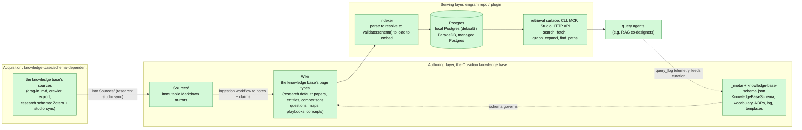

The entire pipeline is built: acquisition (knowledge-base-defined, the `research` schema's optional `studio sync`), the indexer (`studio index`, see [../reference/indexing.md](../reference/indexing.md)), the Postgres instance (the local Postgres locally by default with ParadeDB opt-in, and a managed Postgres with the same extensions through the dialect seam, see [../adr/0017-local-postgres-primary-testbed.md](../adr/0017-local-postgres-primary-testbed.md)), and the read-only retrieval surface over CLI + MCP + a local Studio HTTP API (`engram serve-http`, see [../reference/serve.md](../reference/serve.md)). The knowledge base remains the source of truth. The DB is a rebuildable derivative.

### The three layers and who owns them

| Layer | Location | Owner | Mutability |
|---|---|---|---|
| Raw sources | `Sources/` | The knowledge base's acquisition path (research schema: the `studio sync` script, Zotero to Markdown) | **Immutable**: no knowledge-base workflow ever edits them |
| The notes | `Wiki/` | Claude + human, under the `KnowledgeBaseSchema` contract | Maintained, versioned, append-mostly |
| Contract | `_meta/` + `knowledge-base-schema.json` | Human (mostly), schema co-designed via `/knowledge-base:init`, changes logged as ADRs | Slow-changing |

The ownership split matters throughout. Mirrors are immutable so that quotes verified once stay verifiable forever (in the research profile, see [../adr/0002-disposable-mirror-zotero-source-of-truth.md](../adr/0002-disposable-mirror-zotero-source-of-truth.md)). The knowledge base is where judgment lives, so it is the only layer agents write. The contract (the page-type ontology, the vocabulary, the acquisition switch) is the per-knowledge-base `KnowledgeBaseSchema` (D-25). It changes slowly and every contested *cross-knowledge-base* choice gets an ADR (see [product-decisions.md](./product-decisions.md), `D-1` … `D-25`), which is why this document can explain *why* and not just *what*.

### What exists today

- **Domain-general kernel:** the page-type ontology is per-knowledge-base data in a [`KnowledgeBaseSchema`](#14-how-this-generalizes-the-schema-and-the-plugin) (`wikinote/spec.py`, `knowledge-base-schema.json`). engram is packaged as a **Claude Code plugin** (`engram/plugin/`) installed into any knowledge base, with `/knowledge-base:init` co-designing the schema and `studio init` scaffolding `_meta/` + migrating the DB + loading vocab (configure-only). See [../reference/plugin.md](../reference/plugin.md) and [../reference/init.md](../reference/init.md). The default `research` 7+1 page types are the schema a knowledge base falls back to when it has no `knowledge-base-schema.json` (engram [ADR-0014](../adr/0014-domain-general-vault-spec-and-plugin.md)).
- **Flagship research knowledge base (the worked example):** 39 source mirrors. 24 ingested paper notes (~330 verified claims), 311 entity pages, 1 comparison (`graph-rag-architectures`, 11 systems by dimensions), 3 question pages, 3 maps, 2 formally flagged disputes. Contract: the `research` schema + 3 vocabularies + ADRs + templates.
- **Workflows:** the ingestion workflow (parallel extraction + serialized merge, proven on a 16-paper batch in the research knowledge base, 222/222 quotes machine-verified), quote verifier, stub generator, the research profile's Zotero write discipline.
- **engram repo (Python):** the indexer (parse to resolve to validate to load to embed, see [../reference/indexing.md](../reference/indexing.md)), the Postgres instance, embeddings, the retrieval surface (search/fetch/graph_expand/find_paths over CLI + MCP + the Studio's HTTP API, see [../reference/serve.md](../reference/serve.md)), and programmatic note authoring (the `wikinote` kernel: `engram note build/validate/verify`). The research profile's acquisition slice reconciles Zotero to `Sources/` (`studio sync`), including arXiv HTML to Markdown conversion, figure/SVG handling, and portable-GFM output. PDF to Markdown is the hybrid HTML-first pipeline with an Azure Document Intelligence fallback (see [../adr/0003-hybrid-html-first-conversion.md](../adr/0003-hybrid-html-first-conversion.md), [../adr/0001-pdf-to-markdown-via-azure-document-intelligence.md](../adr/0001-pdf-to-markdown-via-azure-document-intelligence.md)).
- **Vibe RAG: the self-tuning-retrieval program:** Phase 1 (structural evaluation-case generation, [ADR-0016](../adr/0016-structural-eval-generation.md)), Phase 2 (the propose-only tuning loop, [ADR-0018](../adr/0018-calibration-loop.md)), and Phase 3 (true incremental indexing, [ADR-0019](../adr/0019-true-incremental-ingestion.md)) are **shipped**. Phases 4 to 6 are **roadmap**. See [section 15](#15-roadmap-the-vibe-rag-program) and the [vibe-rag.md](vibe-rag.md) deep dive.
- **Still roadmap:** the query agents' usage-to-synthesis telemetry loop (the `query_log` table exists. The synthesis-into-pages loop does not), and the later Vibe RAG phases.

---

## 3. One fact's journey: the research schema end-to-end by example

> **TL;DR:** A worked toy example **in the `research` schema** (the fictional paper "SpeedRAG (2025)") traced through all eight stations: Zotero add, sync to mirror, curation tier proposal, parallel extraction, quote verification, merge, indexing to Postgres rows, an agent answering with a verifiable citation. If you read one section, read this one. A generic knowledge base (one whose schema sets `sources: {enabled: false}`) skips the Zotero and quote-verify stations and brings its sources in some other way. The index-to-Postgres-to-retrieval half is identical.
<!-- load-when: example walkthrough, how it works end to end, mechanics intuition, lifecycle of a paper, toy example, speedrag, research schema -->

This walkthrough follows the default `research` schema, because it exercises every station including the optional acquisition ones. Meet our toy paper: **"SpeedRAG: Caching Hot Passages for Faster Retrieval" (2025, arXiv 2501.00001)**. Its headline result: SpeedRAG beats VanillaRAG on the (equally fictional) TriviaToy dataset, 71.2 vs 64.5 exact match. Here is its full journey. (Stations 1-2 and 5 (Zotero, `studio sync`, quote-verify) are the research profile's. A cooking or legal knowledge base drops them and joins at station 3.)

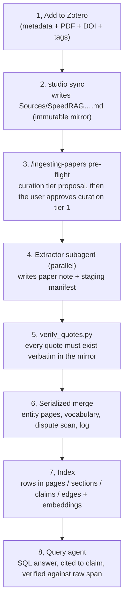

**Station 1: Zotero.** The paper is added to the Zotero group library (`zotero_add_by_url` with the arXiv URL), enriched (DOI, real arXiv category tags, code link), filed into the `RAG` collection. Zotero owns *reference management*. The knowledge base never duplicates it. The item key `AB12CD34` is the join key everywhere downstream (`D-14`).

**Station 2: the mirror.** `studio sync` notices the new item and writes `Sources/SpeedRAG - Caching Hot Passages for Faster Retrieval.md`:

```yaml
---
zotero_key: AB12CD34
title: "SpeedRAG: Caching Hot Passages for Faster Retrieval"
year: 2025
source_hash: 3f9c1a07…   # sha256 of the converted fulltext
converter: arxiv-html
status: active
---
## 1. Introduction
…
## 4. Experiments
### 4.1 Main results
Table 2 shows SpeedRAG reaches 71.2 EM versus 64.5 for VanillaRAG on TriviaToy…
```

The mirror is full text with the paper's **numbered headings preserved**: those `§4.1`-style headings are what claim locators will point at. From this moment the file is immutable: every later layer *points into it*, nothing edits it.

**Station 3: curation tier proposal.** `/ingesting-papers` pre-flight finds the pending mirror and tiers it: does it change a verdict, resolve or create a dispute, anchor an active comparison, or carry a transferable technique? SpeedRAG's caching result would change the cost-vs-quality verdict, becoming curation tier 1, proposed to the user, approved. (A historical survey would have stayed mirror-only, still searchable later, just never summarized into a note. See [section 10](#10-curation-the-tiering-policy).)

**Station 4: extraction (parallel).** One subagent gets exactly two files to write. File one, the paper note `Wiki/Papers/speedrag-2025.md`:

```markdown
---
id: paper.speedrag-2025
type: paper
title: "SpeedRAG: Caching Hot Passages for Faster Retrieval"
summary: Caches frequently-retrieved passages at index time; +6.7 EM over
  VanillaRAG on TriviaToy at equal latency budget.
status: draft
zotero_key: AB12CD34
source_hash: 3f9c1a07…
year: 2025
paper_type: method
tasks: [open-domain-qa]
stages: [retrieval]
proposes: ["[[speedrag]]"]
evaluates: ["[[vanilla-rag]]"]
uses_datasets: ["[[triviatoy]]"]
---
## TL;DR
…(≤150 tokens)…

## Findings
- SpeedRAG outperforms VanillaRAG on TriviaToy exact match (71.2 vs 64.5)
  with both systems given the same latency budget. ^c1
    - loc:: §4.1, Table 2
    - quote:: "SpeedRAG reaches 71.2 EM versus 64.5 for VanillaRAG"
    - kind:: benchmark-result
    - subject:: [[speedrag]]
    - outperforms:: [[vanilla-rag]]
    - on_dataset:: [[triviatoy]]
    - metric:: [[exact-match]]
    - condition:: equal latency budget; GPT-4o-mini generator
```

File two, the staging manifest `_meta/ingest-staging/speedrag-2025.json`: everything the extractor *wanted* to do to shared files but is forbidden to (proposed entities `speedrag`/`triviatoy` with aliases and definitions, facet proposals, contradiction candidates, lineage papers worth queueing). Many extractors run in parallel safely because none of them ever touches a shared file (`D-21`).

**Station 5: verification.** `verify_quotes.py` checks that every `quote::` is a verbatim (whitespace-normalized) substring of the mirror. Exit 0 means the note may claim `status: synthesized`. This is the anti-hallucination check: a claim whose quote isn't literally in the source never enters the knowledge layer. The same discipline is now available programmatically through the `wikinote` kernel (`engram note build/validate/verify`).

**Station 6: merge (single writer).** One serialized pass reads *all* manifests from the batch and: creates stub entity pages (`ent.speedrag`, `ent.triviatoy`), appends evidence bullets to existing pages (`ent.vanilla-rag` gets `- [[speedrag-2025#^c1]] — loses by 6.7 EM on TriviaToy`), adds any new vocabulary rows, runs the contradiction scan (same subject+object+dataset+metric, opposite direction, flagging both claims `disputed`), normalizes links, deletes the consumed manifests, writes ONE log entry. Knowledge has now *compounded*: SpeedRAG's result is visible from the paper, from both technique pages, and from the dataset page.

**Station 7: indexing.** The indexer (`studio index`, see [../reference/indexing.md](../reference/indexing.md)) parses the knowledge base and loads Postgres. Our claim becomes a row:

```text
kb.claims
  id          'paper.speedrag-2025#c1'
  text        'SpeedRAG outperforms VanillaRAG on TriviaToy exact match (71.2 vs 64.5)…'
  quote       'SpeedRAG reaches 71.2 EM versus 64.5 for VanillaRAG'
  loc         '§4.1, Table 2'      loc_path  's4.s1'
  page_type        'benchmark-result'   status    'active'
  subject_id  'ent.speedrag'  on_dataset 'ent.triviatoy'  metric 'ent.exact-match'
```

plus an `edges` row (`ent.speedrag —outperforms→ ent.vanilla-rag`, qualifiers attached, provenance = the claim id), section rows for each H2, a card embedding for the page, and a BM25+HNSW index over all of it.

 **Station 8: the payoff.** A query agent asked *"is there evidence SpeedRAG-style caching helps open-domain QA?"* doesn't need to know any exact strings, slugs, or enum spellings. The entry point is the `search` surface, fusing BM25 and vector ranking (typo- and synonym-tolerant: *"speed rag cachng"* still lands). The BM25 half runs through a dual-dialect seam so the identical query shape works on ParadeDB locally and `pg_textsearch` on the managed target (see [../adr/0006-dual-dialect-bm25-seam.md](../adr/0006-dual-dialect-bm25-seam.md)):

```sql
SELECT * FROM api.search('caching hot passages open-domain QA', k => 12);
-- top hit: paper.speedrag-2025#c1  (level 'claim', with snippet + score)
```

Exact-value filters are the *optional second step*, for precision and aggregation once the vocabulary is grounded, and grounding is a query, not memorization: `api.lookup_value('page_type', 'benchmark')` returns `benchmark-result` with its definition (the vocabulary indexes into a queryable table. Agents never guess `WHERE` strings), and entity `aliases` resolve surface names to ids. Grounded, the agent can ask the precise question: 
```sql
SELECT claim_id, paper, text, quote, loc
FROM api.claims
WHERE subject = 'speedrag' AND page_type = 'benchmark-result' AND status = 'active';
```

…gets the claim row, cites `paper.speedrag-2025#c1` in its answer, and (because it is about to *assert* the number) verifies at L4: fetch the raw chunk at `s4.s1` of mirror `AB12CD34` and confirm the quote is there. The answer ships with a citation that any human can click open in Obsidian and any agent can re-verify mechanically.

That is the entire system. Every section below zooms into one station.

---

## 4. Layer 0, Sources/: immutable mirrors (the research-profile acquisition path)

> **TL;DR:** Acquisition is schema-gated: the `KnowledgeBaseSchema` `sources: {enabled, quote_verify}` switch decides whether a knowledge base has this layer at all (research: on. A generic cooking, legal or manuals knowledge base: off, it brings its sources in some other way, or has none). When it is on, every source document becomes a full-text Markdown mirror with `zotero_key` + `source_hash` frontmatter and the original's numbered headings preserved. Mirrors are immutable (regeneration = frontmatter status flip + re-sync, never edits), because they are what quotes are verified against and what agents fall back to. A mirror is useful even without a knowledge-base note, it serves search and quote verification on its own.
<!-- load-when: sources, mirrors, zotero, sync, acquisition, immutability, source_hash, regeneration, arxiv conversion, engram CLI, schema gated, sources enabled, quote verify -->

> **This whole section is the `research` schema's acquisition path, not a universal core layer.** The Zotero mirror + `studio sync` + machine quote-verification are what the schema's `sources: {enabled: true, quote_verify: true}` turns on. A knowledge base with `sources` disabled has no Zotero, no `studio sync`, and no mirror immutability rule. It populates `Sources/` (or skips it) however it likes, and indexing simply does not run the quote check. Everything from [section 5](#5-layer-1-wiki-page-types-are-per-knowledge-base-schema-data) onward (pages, sections, claims, indexing, retrieval) is independent of how sources arrived.

### Why mirrors at all (instead of PDFs, or nothing)

Three jobs demand a plain-text, stable-layout copy of every source:

1. **Quote verification.** The contract requires every claim's `quote::` to be a verbatim substring of the source. You can only grep a text file.
2. **Locator targets.** Claims point at `§4.1, Table 2`. The mirror preserves the paper's numbered headings, so those locators resolve mechanically. Later, in Postgres, `§4.1` becomes the `ltree` path `s4.s1` into `raw_chunks`.
3. **The L4 fallback.** When an agent needs to verify or quote beyond what the knowledge base distilled, it reads the raw span, from the mirror, not from a PDF parse at query time.

### The sync pipeline (built, tested)

The `engram` repo's reconcile CLI (`studio sync --dry-run` for a preview, `studio sync` to apply) keeps `Sources/` consistent with the Zotero collection:

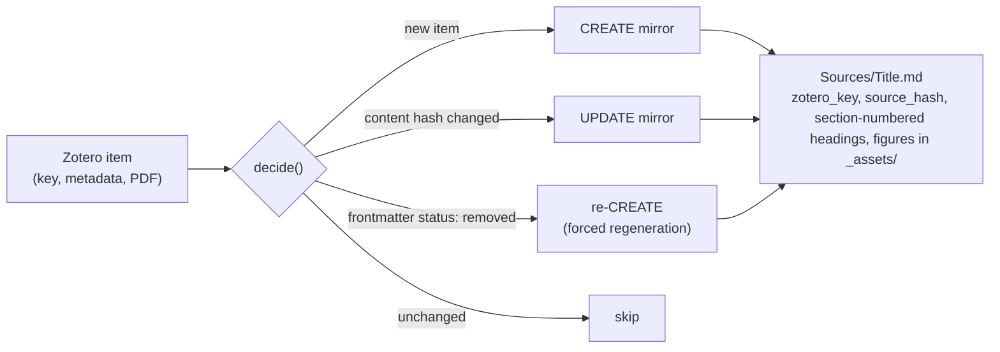

Notable mechanics: arXiv papers convert from the HTML rendering (figures downloaded into `Sources/_assets/<arxiv-id>/`, TikZ text boxes extracted as quotable blockquotes so prompts inside figures stay searchable). Non-arXiv PDFs fall back to Azure Document Intelligence (see [../adr/0003-hybrid-html-first-conversion.md](../adr/0003-hybrid-html-first-conversion.md) and [../adr/0001-pdf-to-markdown-via-azure-document-intelligence.md](../adr/0001-pdf-to-markdown-via-azure-document-intelligence.md)). Output is portable GitHub-flavored Markdown that renders outside Obsidian too. Regeneration is deliberately `rm`-free: flip the mirror's frontmatter `status: active → removed` and re-run `studio sync`. Quotes survive regeneration because locators are section-anchored and verification is substring-based.

### The immutability rule and its consequences

`Sources/` is owned by the sync script. Knowledge-base workflows never edit it, not to fix a typo, not to "clean up". Consequences worth internalizing:

- **A verified quote stays verifiable forever.** If mirrors could drift, every past verification would silently rot.
- **Freshness is computable.** The paper note copies `source_hash` at ingest. If the mirror later changes (arXiv v2), hash drift mechanically marks the note stale, no human memory involved.
- **A mirror needs no note to be useful.** Un-ingested mirrors (15 of 39 today) still index into `raw_chunks` for full-text search, and still serve as quote-verification anchors for claims that cite them from other notes. This is what makes the curation tiering policy ([section 10](#10-curation-the-tiering-policy)) cheap: declining to write a note loses *nothing* irreversible. (This is the disposable-mirror / Zotero-as-source-of-truth principle, [../adr/0002-disposable-mirror-zotero-source-of-truth.md](../adr/0002-disposable-mirror-zotero-source-of-truth.md).)

---

## 5. Layer 1, `Wiki/`: page types are per-knowledge-base schema data

> **TL;DR:** Page types are **per-knowledge-base data** declared in the `KnowledgeBaseSchema` (`page_types[]`: page_type, id_prefix, folder, frontmatter_fields, canonical_sections, edge_fields, claims_enabled), validated at index time exactly like vocabulary, amending D-1's "7 page types frozen across domains" (D-25 / [ADR-0014](../adr/0014-domain-general-vault-spec-and-plugin.md)). The **default `research` schema** declares seven (+1) with fixed jobs: `paper` (one source, claims with provenance), `entity` (one named thing, where evidence compounds), `comparison` (X-vs-Y matrix, the dispute-resolution venue), `question` (open gap), `playbook` (when-to-use-what guidance), `concept` (cross-cutting essay), `moc` (navigation map). Same canonical H2 sections per type. Every page carries a ≤400-char summary. Every H2 is a self-contained ≤600-token retrieval unit. A cooking or legal knowledge base declares its own types (cooking: `recipe`, `technique`, `ingredient`…, legal: `contract`, `clause`, `party`…), same machinery, different `page_types[]`.
<!-- load-when: page types, paper note, entity page, comparison, playbook, question, moc, maps, concepts, sections, summary ladder, canonical H2, folder structure, schema, per-knowledge-base types, schema data -->

### The cast, by job: the default `research` schema

| type | prefix | One-line job | Born when |
|---|---|---|---|
| `paper` | `paper.` | Distill ONE source: structured summary + atomic claims with provenance | a Tier-1 source is ingested |
| `entity` | `ent.` | Canonical page for one named thing (technique, dataset, metric, model, task, problem, tool, concept): **where evidence compounds** | stub at first mention. Full page at ≥2 papers |
| `comparison` | `cmp.` | First-class X-vs-Y matrix along explicit dimensions, where contradictions get resolved into conditions | ≥2 entities evaluated against each other |
| `question` | `q.` | An open gap or unresolved tension, tracked as a page | a gap surfaces that no page answers |
| `playbook` | `pb.` | Operational "in situation S, use X, avoid Y", later indexes into agent skills | evidence supports actionable guidance |
| `concept` | `con.` | Cross-cutting essay on a theme that isn't a single entity | a theme spans ≥3 pages and needs narrative |
| `moc` | `moc.` | **Navigation, not knowledge**: curated hub grouping a territory's pages | validation flags ≥12 pages sharing a theme with no map |

**Who owns this list:** the page-type *list* is now **per-knowledge-base `KnowledgeBaseSchema` data**, not a frozen cross-domain backbone (D-25 amends D-1). A knowledge base's `page_types[]` are co-designed once through the [`/knowledge-base:init`](../reference/plugin.md) onboarding interview and captured in its version-controlled `knowledge-base-schema.json`, the auditable record of that interview, re-runnable, validated at index time exactly as vocabulary is validated against `VocabularyIndex`. So *adding or shaping a page type for a knowledge base* is a schema edit (an `/knowledge-base:init` re-run or a hand edit to `knowledge-base-schema.json`), not necessarily a repo ADR. The research knowledge base simply has no `knowledge-base-schema.json` and falls back to the default `research` schema. What still takes a repo ADR is a change to the *machinery*: a new generic facet *column*, the claim grammar, layer boundaries, because that is cross-knowledge-base and touches the storage backbone and the single `api.*` contract (see the cost ladder in [section 14](#14-how-this-generalizes-the-schema-and-the-plugin)). The historical precedent for adding a type *within the research schema* is `D-18`: `moc` did not exist in schema v1. Validation kept flagging ≥12-page territories with no covering map, and it was added with its template, folder, and index mapping in one move (under the old ADR-gated regime, today that is a `research`-schema edit). Workflows never mint page types on their own. What they extend freely at ingest is the vocabulary *inside* the types (entity types, facet values, relations) as vocabulary rows ([section 7](#7-vocabulary-closed-values-open-growth)). The asymmetry that makes engram portable is now sharper: per-knowledge-base *types and vocabulary* are schema/vocabulary data, while the *machinery and single agent contract* stay frozen ([section 14](#14-how-this-generalizes-the-schema-and-the-plugin)).

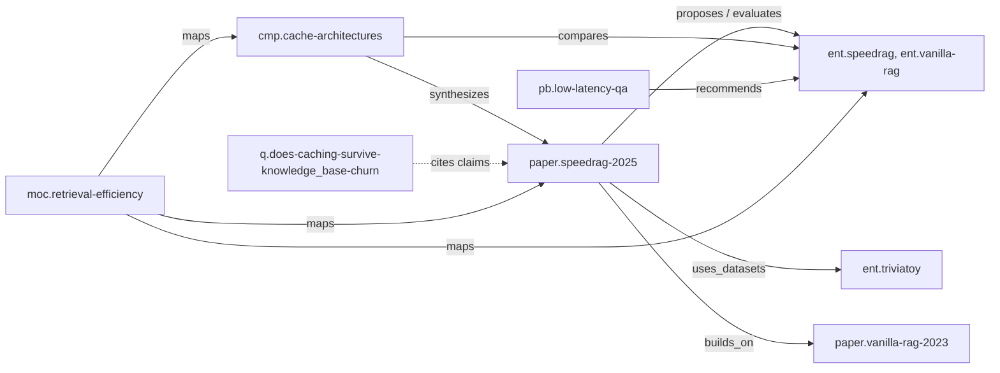

### Why this particular division of labor

The split mirrors how evidence actually flows. A **paper** note is write-once-ish: it holds what *that paper* showed, anchored to *that source*, claims live there because their provenance lives there. An **entity** page is the opposite: it accrues forever, one Evidence bullet per relevant claim from any paper, and is the page you read to learn "what do we know about LightRAG?". A **comparison** exists because "X vs Y" knowledge belongs to neither X's page nor Y's page, and because it is the designated venue where flagged contradictions get resolved into conditions ([section 8](#8-disputes-disagreement-as-data)). **Questions** make ignorance addressable (a gap with an id can be cited, searched, and eventually `answered_by`). **Maps** exist purely so neither humans nor agents have to navigate 300+ pages by search alone, they are curated tables of contents, explicitly *not* knowledge.

Real example of compounding, from the current knowledge base: `ent.naive-rag` (one page) now holds evidence bullets from a dozen papers that each used it as a baseline. Ask "how strong a baseline is naive RAG really?" and the answer is one page, with every bullet citing a specific claim block in a specific paper.

### Same-shaped pages: sections and the summary ladder

Two structural rules make pages machine-consumable:

1. **Canonical H2 sections per type** (paper: `TL;DR / Approach / Findings` + optional `Limitations`…, entity: `TL;DR / Definition / Evidence`, comparison: `TL;DR / Scope / Matrix / Verdict`). Because the section vocabulary is fixed, an agent can run one query across the knowledge base: *"give me the `Limitations` section of every paper that evaluates GraphRAG."* Each H2 must be self-contained and ≤ ~600 tokens, **chunking is decided by the author at write time**, not guessed by an indexer later (`D-7`).
2. **The summary ladder** (`D-8`): `summary` frontmatter (≤400 chars) to `## TL;DR` (≤150 tokens) to body sections. Every page is readable at three costs. An agent scans 20 candidate pages for ~50-150 tokens each, picks two TL;DRs, then reads one body section, instead of slurping whole pages.

---

## 6. Claims: the atomic unit of knowledge

> **TL;DR:** A claim is one self-contained sentence under a paper note's `## Findings`, block-anchored (`^c3`) so it is addressable from anywhere, carrying machine-readable fields: `loc::` (where in the source), `quote::` (verbatim, machine-verified), `kind::`, and typed evidential edges (`outperforms::`, `supports::`, `comparable_to::`…). Comparative edges are invalid without dataset + metric qualifiers: an unqualified "X beats Y" is the canonical silent-blend failure.
<!-- load-when: claims grammar, findings, block anchors, loc, quote, qualifiers, outperforms, comparable_to, null results, evidential edges, claim anatomy, atomic claims -->

> The claim grammar is **general machinery**, parameterised per knowledge base. The `KnowledgeBaseSchema` `claims` block declares the field-sets and rules (and `claims_enabled` per page type). A knowledge base whose schema disables `quote_verify` keeps the grammar but not the verbatim-quote check. The example below is the `research` schema's instantiation, a legal knowledge base keeps the *identical* grammar with different page_types and qualifiers ([section 14](#14-how-this-generalizes-the-schema-and-the-plugin)).

### Anatomy, field by field

This is the real claim grammar on the real LightRAG note (abridged):

```markdown
## Findings
- LightRAG (hybrid mode) beats GraphRAG on win-rate across all four UltraDomain
  domains when judged by GPT-4o-mini, with the largest margin on Legal. ^c1
    - loc:: §5.1, Table 2
    - quote:: "LightRAG consistently outperforms… across comprehensiveness, diversity and empowerment"
    - kind:: benchmark-result
    - subject:: [[lightrag]]
    - outperforms:: [[graphrag]]
    - on_dataset:: [[ultradomain]]
    - metric:: [[llm-judged-win-rate]]
    - condition:: hybrid retrieval mode; GPT-4o-mini as judge
```

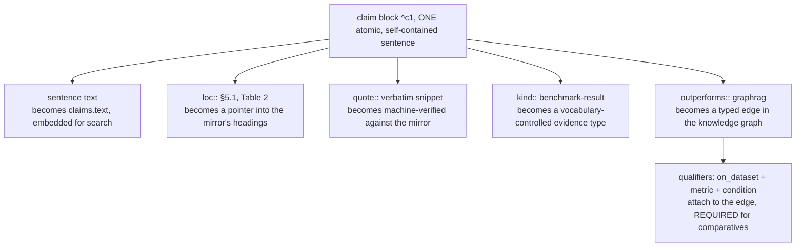

Each field exists because of a specific failure it prevents:

- **One sentence, self-contained** ("name the systems, never *the model*"), because the sentence will be retrieved *alone*, as a database row, with no surrounding paragraph to rescue an ambiguous pronoun.
- **`^c1` block anchor**: Obsidian-native addressability. `[[lightrag-2025#^c1]]` works in the editor today and becomes the primary key `paper.lightrag-2025#c1` in Postgres tomorrow. Anchors are never reused after deletion, so citations never silently re-point.
- **`loc::`**: the claim knows where it came from (`§`-paths resolve mechanically against the mirror's headings).
- **`quote::`**: the verbatim tether. Required for benchmark results, ablations, and anything carrying an evidential edge. Verified by script (whitespace-normalized, because converted mirrors contain non-breaking-space artifacts). This single rule is why the knowledge base can claim to be hallucination-resistant: *the extraction step cannot invent numbers and get away with it*. 222/222 quotes passed verification in the last 16-paper batch, and the verifier catches paraphrase the moment it happens.
- **`kind::`**: vocabulary-controlled evidence type (`benchmark-result`, `ablation`, `negative-result`, `observation`…), so SQL can ask "only ablations, please."
- **Evidential edges + qualifiers**: the rule with teeth (`D-4`): `outperforms::` / `comparable_to::` **fail validation without `on_dataset::` (or `on_task::`) plus `metric::`**. "LightRAG beats GraphRAG" is not knowledge. "…on UltraDomain win-rate, judged by GPT-4o-mini, in hybrid mode" is. When someone later asks "does that hold on multi-hop QA?", the qualified edge answers honestly: *this evidence doesn't cover that*.

### Null results are first-class

`comparable_to::` (no meaningful difference) with `kind:: negative-result` gets the same standing as wins. Reason: the end goal is **pruning** RAG strategies. "Fancy technique X showed no gain over the cheap baseline on Y" is exactly the evidence that lets an agent advise *against* something, most knowledge bases lose it because nobody writes down ties. Extractors are explicitly briefed to hunt for near-ties and no-effect ablations.

### Where claims live (and why not in their own files)

Claims stay inside paper notes (`D-2`) rather than one-file-per-claim (the nanopublication model): provenance stays physically adjacent, humans can actually read the note, the knowledge base avoids tens of thousands of micro-files, and synthesis pages *reference* claims (`[[lightrag-2025#^c1]]`) instead of restating them, one canonical text per fact, everywhere it appears.

---

## 7. Vocabulary: closed values, open growth

> **TL;DR:** Every classified value in the system (entity types, relation types, facet keys and values, evidence types) must exist as a row in `_meta/vocabulary/*.md`, each row with a one-line definition. Adding a row is cheap (do it at ingest). Adding a *key* or page type needs an ADR. This is "fixed backbone, open vocabularies": domains grow by adding vocabulary, never by redesigning structure.
<!-- load-when: vocabulary, controlled vocabulary, facets, entity types, relation types, adding values, tasks domains stages, growth rule, dangling links, ingest queue -->

> Vocabulary is **general machinery**: the `KnowledgeBaseSchema` declares `entity_types[]`, `relations[]`, `claim_kinds[]`, and `facets{}` (each facet key mapping onto one of the 5 generic `text[]` columns, or `null`, falling back to the `frontmatter` JSONB). The three vocabulary files below are the `research` schema's instances. The *mechanism* (closed vocabulary, one-line definitions, indexing to a queryable `vocab` table) is what every knowledge base gets.

### The three vocabulary files

| Vocabulary file | Governs | Examples (today) |
|---|---|---|
| `entity-types.md` | `entity_type` on entity pages | `technique`, `dataset`, `benchmark`, `metric`, `task`, `problem`, `tool`, `model`, `concept` |
| `relation-types.md` | every typed edge key, with domain to range | conceptual (`is_a`, `composes_with`, `addresses`…), paper-level (`proposes`, `evaluates`, `builds_on`…), synthesis (`synthesizes`, `maps`, `recommends`…), evidential (`supports`, `refutes`, `outperforms`, `comparable_to`, `replicates`) |
| `facets.md` | structured filter keys + values | `tasks` (`multi-hop-qa`, `episodic-qa`, …), `domains` (`legal`, `literary`, …), `stages` (`retrieval`, `reranking`, `training`, …), `modalities`, `scale_regimes`, `paper_type` |

Why closed vocabularies, concretely: facets index into **typed Postgres columns**, and an agent's first move on any query is a facet `WHERE` clause that shrinks the space *before* any text or vector search runs (`WHERE 'legal' = ANY(domains)`). That only works if `legal` means one thing. If one paper says `legal`, another `law`, and a third `juridical`, the filter silently misses two-thirds of the evidence. Same for relations: `outperforms` can power a computed scoreboard only because it is one spelling with one meaning and mandatory qualifiers.

The vocabulary is *also* the agent-legibility trick: an agent never guesses what values exist. It reads the vocabulary (today) or calls `api.lookup_value('tasks', 'memory')` (indexed). Each row's one-line definition is written for exactly that consumer.

### Growth without redesign

The growth rule (from the research `purpose.md`): *within* a knowledge base, new vocabulary arrives by **registering rows**, never by silently inventing new page types or facet keys. Page types and facet keys are now declared in the knowledge base's `KnowledgeBaseSchema` (a schema edit / `/knowledge-base:init` re-run). Only a new *generic facet column* or a machinery change is a repo ADR (D-25, the cost ladder in [section 14](#14-how-this-generalizes-the-schema-and-the-plugin)). Real trace from the last research batch: ingesting 16 papers added 16 facet *rows* (e.g. `episodic-qa`, `narrative-qa`, `training`, `prompt-optimization`, each with a definition and a pointer to the paper that forced it) and zero structural changes. The schema didn't move. The vocabulary grew. That asymmetry is `D-1` (as amended by `D-25`), and it is the single most important property for generalization ([section 14](#14-how-this-generalizes-the-schema-and-the-plugin)).

### Dangling links are a queue, not an error

A deliberate oddity: a `builds_on: [[paper.vanilla-rag-2023]]` link whose target doesn't exist is **not** a broken link, it is the *ingest queue*. Validation reports dangling source-ranged links as "wanted but not yet ingested." The queue is then *curated*, not drained ([section 10](#10-curation-the-tiering-policy)): only load-bearing lineage gets acquired (in the research profile, added to Zotero). Everything else about links is strict: unregistered relation keys, unknown facet values, and dangling non-source links are validation errors.

---

## 8. Disputes: disagreement as data

> **TL;DR:** When two claims share subject + object + dataset + metric but point in opposite directions, both get flagged (`status:: disputed`, `disputed_by:: [[the-other]]`) and both are preserved. Resolution is never deletion, it is a comparison page documenting the *conditions* under which each side holds. Most "contradictions" in RAG literature are condition splits, and the conditions are precisely the knowledge an agent needs. A dispute is a **claim-status mechanism**, not a graph edge: there is no `disputes` relation in the relation-types vocabulary, so disputes never appear in `graph_expand`/`find_paths`. They are surfaced through the `api.contradictions` view (disputed pairs with both quotes) and the Studio, not graph traversal.
<!-- load-when: disputes, contradictions, disputed claims, conflicting results, dispute resolution, status disputed, disputed_by, condition splits -->

> The dispute mechanic is **general machinery**: it needs only "two claims about the same thing pointing opposite ways", which any knowledge base with comparative claims produces. The `research` instance keys on subject + object + dataset + metric. A legal knowledge base keys on subject + object + dimension. Resolution-as-conditions-in-a-comparison-page is the same move in every domain.

### The mechanic

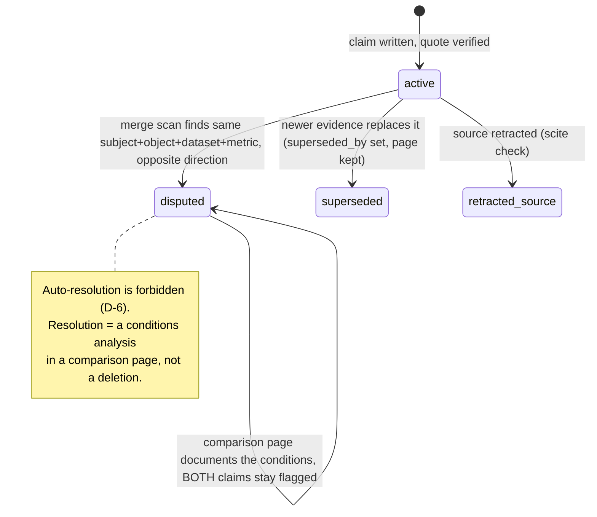

The contradiction scan runs at every merge: new claims are checked against all existing ones for the formal pattern (same subject and object, same dataset, same metric, conflicting direction). On a hit, **both** claim blocks get two appended fields (`status:: disputed` and `disputed_by:: [[other-paper#^cN]]`) and the dispute surfaces on the Studio until a comparison page addresses it.

### A real one, from the current knowledge base

LightRAG's paper claims its retrieval costs **fewer than 100 tokens in 1 API call** on UltraDomain. HiRAG's paper measures the same system at **~354 tokens across 2 calls** on the same benchmark. Formal dispute: same subject (LightRAG), same comparison target, same dataset family, same metric (retrieval token cost), opposite verdict. Both claims now carry the flags, and `cmp.graph-rag-architectures` opens its Analysis with the resolving condition: the numbers were measured under **different GraphRAG operating modes**, so each holds in its own regime.

That outcome is the design thesis in miniature: deleting either claim would have been wrong. *Averaging* them would have been worse. The valuable artifact is the condition that explains both. An agent advising on retrieval cost needs exactly that condition, not a winner.

Two adjacent mechanisms complete the truth-maintenance picture: **supersession** (`superseded_by`: newer knowledge replaces old, but old pages/claims are kept and filtered out of default queries. The graveyard is the pruning audit trail, `D-5`) and **condition splits that aren't formal disputes** (different metric or different dataset means not a contradiction at all. The difference just gets documented in the comparison or routed to a question page).

---

## 9. Ingest: parallel extraction, serialized merge

> **TL;DR:** The `/ingesting-papers` workflow turns mirrors into knowledge-base pages in five phases. The Iron Law: *extraction parallelizes. Merging never does.* Each extractor owns exactly two files (its paper note + a staging manifest). Every shared surface (entities, vocabulary, comparisons, log) is written by exactly one merge pass that consumes the manifests. No locks needed, ownership is partitioned by construction (`D-21`). Proven at 16 papers in one batch.
<!-- load-when: ingest workflow, ingesting-papers, extraction, merge, manifests, staging, parallel subagents, concurrency, D-21, quote verification, batch ingest, phases -->

> The ingest *shape* (parallel extract, serialized merge) is **general machinery** (it is also how the indexer runs the forward pipeline). The default `research` ingestion workflow below is one instantiation. A knowledge base initialised through `/knowledge-base:init` gets the same shape over its own page types, and the quote-verify check fires only when the schema's `sources.quote_verify` is on.

### The five phases

| # | Phase | What happens | Output |
|---|---|---|---|
| 1 | Pre-flight | Inventory pending mirrors, **sort them into curation tiers, propose the batch to the user** ([section 10](#10-curation-the-tiering-policy)). Mint slugs. Snapshot entity inventory | approved assignments |
| 2 | Extract (parallel) | One subagent per paper. Each writes its note + manifest. Quote verifier gates `synthesized` | N pairs of (note, manifest) |
| 3 | Merge (serialized) | Single writer absorbs all manifests: entity dedupe/stubs/evidence, vocabulary rows, link normalization, contradiction scan. Manifests deleted | compounded knowledge base |
| 4 | Synthesize | Where thresholds are met: extend/create comparisons, question pages, maps | synthesis pages |
| 5 | Close | ONE log entry, staging emptied, queue curated into Zotero, banner | auditable end-state |

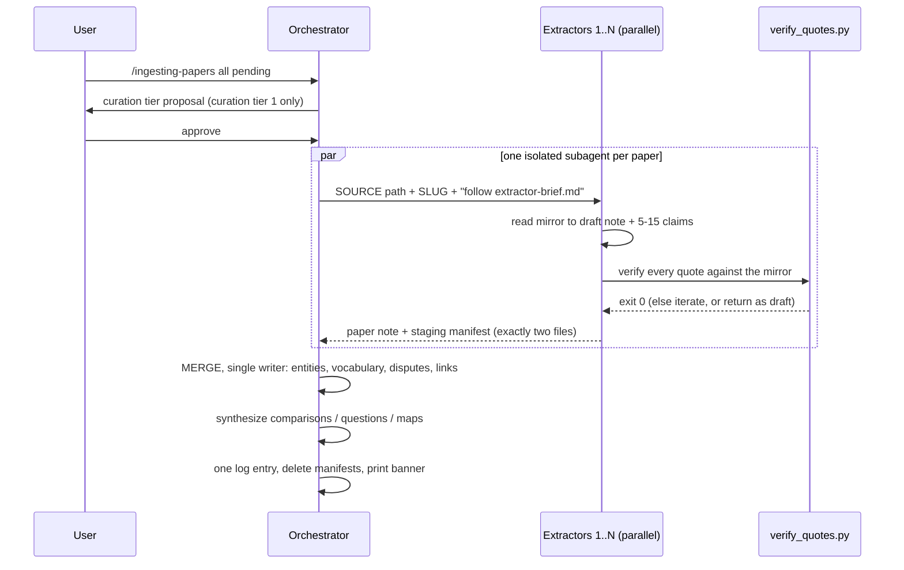

### Why this shape: the concurrency argument

The naive alternatives both fail concretely:

- **One agent reads N papers sequentially**: its context degrades paper by paper (the fourth paper is read with three papers' worth of residue), and a 16-paper batch simply doesn't fit one session.
- **N agents each write everything they learned**: two extractors meet the same new entity (`hipporag`, say) and both create its page. Last write silently wins. The vocabulary gets concurrent appends. The log interleaves. There is no usable file-lock primitive over a live-synced Obsidian knowledge base, so locking is not an option.

`D-21`'s resolution: notice that 90% of ingest (read, draft, claims, quote check) has **no shared state**: a paper note has exactly one natural writer. The remaining 10% (entity pages, vocabulary, comparisons, the log, exactly the *compounding* surfaces) is forced through a single serialized merge. Extractors communicate their proposals to the merge through **staging manifests**: JSON files that are *exhaust, not knowledge* (`D-17`), consumed and deleted at merge, never indexed, never lingering.

Two details with outsized value: the **entity inventory snapshot** at pre-flight (each extractor links existing entities by slug instead of re-proposing them. The merge dedupes the genuinely-new across manifests, e.g. two manifests proposing `rag-rl` and `rl-enhanced-rag` became one page after comparing definitions), and the **per-extractor verification check** (a note that fails quote verification never reaches the merge, failures stay isolated to one paper).

This same shape (parallel extract workers, one transactional merge) is exactly how the Python indexer runs the forward pipeline ([../reference/indexing.md](../reference/indexing.md)). The knowledge-base workflow is a rehearsal of the production architecture.

---

## 10. Curation: the tiering policy

> **TL;DR:** Not every mirror deserves a note. At pre-flight, pending mirrors are sorted into curation tiers and the batch is proposed to the user: **Curation tier 1 only** (changes a verdict, resolves/creates a dispute, anchors an active comparison, or carries a transferable technique) gets ingested. Curation tiers 2 and 3 (context, lineage, historicity) stay mirror-only, still searchable, still quotable, zero distillation cost. Same rule for the queue: only load-bearing lineage enters Zotero. Without this, transitive `builds_on` growth would ingest the entire literature.
<!-- load-when: curation tiering, curation policy, what to ingest, curation tier 1, queue discipline, builds_on growth, crème de la crème, selective ingestion, noise control -->

> Curation tiering is **general machinery with a per-knowledge-base definition of "curation tier 1"**. The *mechanism* (not every source deserves a note. Mirror-only is a first-class end state) is universal. What "changes a verdict" means is set by the knowledge base's `purpose.md` (research: "changes a verdict". A music knowledge base: "shaped the genre"). The `research` instance is below.

### The problem this solves

Every ingested paper cites lineage. Every lineage paper cites more. Empirically the queue compounds at ~1.5 to 2 times per cycle, the last batch of 16 papers surfaced ~30 dangling `builds_on` targets. Follow them all and within three cycles you are ingesting *the literature*, which is precisely what the knowledge base exists to distill away from. Completeness is the failure mode here: a knowledge base that contains everything ranks nothing.

### The decision rule

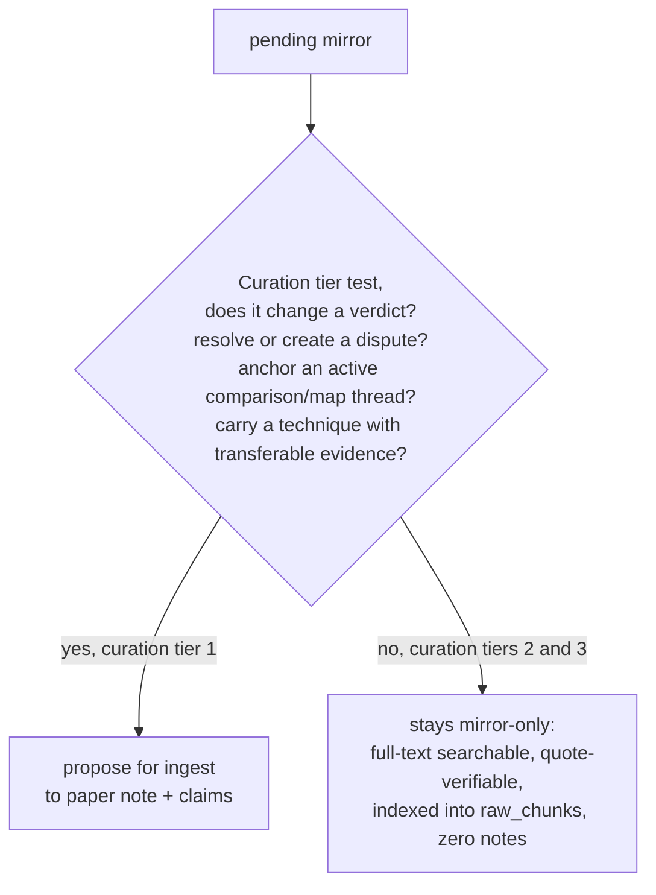

The asymmetry that makes this safe ([section 4](#4-layer-0-sources-immutable-mirrors-the-research-profile-acquisition-path)): a mirror is useful **without** a note. Foundational papers like Chain-of-Thought or DSPy sit in `Sources/` as quote-verification anchors and full-text search targets. Nobody needs the knowledge base to re-explain what its lineage already established. The system's leverage is reserved for evidence that changes what an agent would *recommend*.

Two checkpoints enforce it: **pre-flight** (sort pending mirrors into curation tiers, propose the batch, the user confirms before any extractor is dispatched) and **close** (the dangling-link queue is sorted into curation tiers the same way. Only targets wanted by ≥2 papers, party to a flagged dispute, or anchoring an active comparison get added to Zotero. Deferrals are named in the log). Today's standing: 39 mirrors, 24 with notes, 15 deliberately mirror-only.

---

## 11. Indexing: from knowledge base to Postgres

> **TL;DR:** A Python indexer (`studio index`) parses the knowledge base and loads Postgres + ParadeDB BM25 + pgvector: pages become `pages` (typed facet columns + card embedding), H2s become `sections`, claim blocks become `claims`, every typed link becomes `edges`, vocabulary becomes `vocab`, mirrors become `sources_raw`/`raw_chunks`. Agents never see base tables, only a curated `api.*` surface. The DB is a disposable derivative: rebuildable from Markdown at any time.
<!-- load-when: indexing, indexer, postgres, database schema, tables, embeddings, BM25, pgvector, api views, engram repo, what indexes to what, rebuild -->

### The mapping: every authoring rule becomes a database property

| You author (knowledge base) | It becomes (Postgres) | Which is why the authoring rule exists |
|---|---|---|
| frontmatter `id` (immutable) | primary key everywhere | renames never break identity |
| page + `summary` + facets | `pages` row. Facets as typed `text[]` columns. `card_text` embedding | L1 card scans. Facet `WHERE` before any ranking |
| each H2 section (canonical name, ≤600 tok) | `sections` row with `canon` + `ltree` path + embedding | cross-knowledge-base queries like `WHERE canon='limitations'`. No index-time chunking guesswork |
| claim block `^cN` + `key::` fields | `claims` row (`quote`, `loc`, `page_type`, subject/dataset/metric FKs, status) + embedding | every retrieved fact carries its provenance columns |
| typed links (frontmatter + claim fields + moc `## Map` links) | `edges` rows, vocabulary-validated, qualifiers in `jsonb`, claim-level provenance | the knowledge graph is *derived*, not hand-maintained (`D-13`) |
| `_meta/vocabulary/*.md` rows | `vocab` table | `api.lookup_value()`: agents never guess filter strings |
| `Sources/` mirrors | `sources_raw` + `raw_chunks` (cut at headings and to the chunk sizes, `ltree` paths) | the L4 verification layer |
| `_meta/log.md`, staging manifests | **nothing** | telemetry/exhaust is never knowledge (`D-17`) |

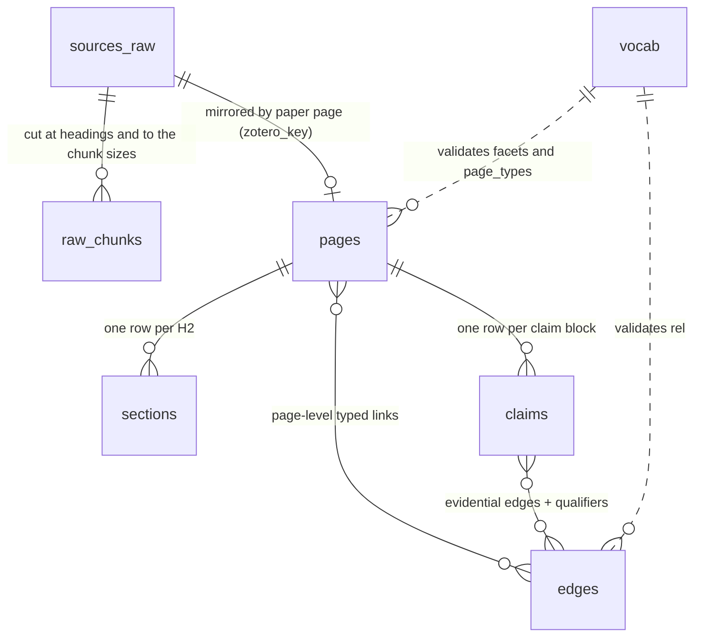

Retrieval machinery on top: **one BM25 index per searched table** (ParadeDB `pg_search`, routed through a dual-dialect seam so the same query shape indexes against ParadeDB locally and `pg_textsearch` on the managed target, see [../adr/0006-dual-dialect-bm25-seam.md](../adr/0006-dual-dialect-bm25-seam.md)), **HNSW vector indexes** on pages/sections/claims/raw_chunks (one embedding model, hash-gated re-embedding so unchanged text never re-embeds), and hybrid search = BM25 + vector distance, each leg stopped at a budget and fused with reciprocal-rank fusion, collapsed across levels (`D-9`: one index with a `level` column, agents *may* use the ladder, they are never forced to descend a tree).

The knowledge graph for multi-hop traversal is itself a **derived projection rebuilt from `kb.edges` on every index run**, the Markdown-canonical invariant holds (`D-13`). It ships with a **dual backend**, selected through `application_settings.json` (`APP_RETRIEVAL__GRAPH_BACKEND`): a recursive-CTE path and an Apache AGE in-Postgres graph path, both fed from the same edges (see [../adr/0007-age-multihop-dual-graph-backend.md](../adr/0007-age-multihop-dual-graph-backend.md)). The original design rejected a *separate* graph database. AGE is not that, it is an in-Postgres graph backend over the same projected edges, so rebuildability is preserved. Both backends walk over the set of nodes they have reached, one hop at a time, so a walk's work grows with the nodes it reaches and never with the number of paths, and `api.graph_reach` says how far a walk can go (see [../adr/0049-graph-walks-keep-the-set-of-reached-nodes.md](../adr/0049-graph-walks-keep-the-set-of-reached-nodes.md)).

Every embedded unit gets a **breadcrumb prefix** naming its container ("LightRAG paper > Findings > …"), the cheap version of contextual retrieval, free because the knowledge base's structure already knows every unit's address.

### The agent surface: `api.*`, nothing else

Base tables are not granted. Agents get a small curated surface (search/fetch/graph_expand/find_paths and supporting views, [../reference/serve.md](../reference/serve.md)), every object COMMENTed with units and example values, small enough that an agent can hold the *entire annotated schema* in context and skip schema-linking failures (`D-11`). Highlights: `api.cards` (L1 scan), `api.claims` (joined, names-not-ids), `api.search(query, level, task, …)` (hybrid RRF with facet pre-filters), `api.lookup_value(facet, term)` (value grounding: fuzzy term to registered value, agents never guess `WHERE` strings), `api.contradictions` (disputed pairs with both quotes), `api.facets` (one row per page, facet and value, for "what do we know about X and how well"), `api.fetch(id)` (any unit's full text), plus the graph traversal functions `graph_expand` and `find_paths`. Guardrails are hard floors (read-only role, `statement_timeout`, `k≤50`, fetch truncation, a check on every `run_sql` statement, a login role of its own for each private knowledge base), while *budgets* stay non-binding doctrine (`D-20`). See [../adr/0046-private-knowledge-base-read-through-its-own-login-role.md](../adr/0046-private-knowledge-base-read-through-its-own-login-role.md) and [../adr/0047-the-agents-sql-is-checked-before-it-runs.md](../adr/0047-the-agents-sql-is-checked-before-it-runs.md).

### Configuration

All of the above (dialect, graph backend, embedding settings, connection targets) is driven through a single `application_settings.json` with `APP_*` environment-variable overrides, see [../adr/0008-configuration-via-application-settings-json.md](../adr/0008-configuration-via-application-settings-json.md). (The dialect/backend selectors are `APP_RETRIEVAL__DIALECT` and `APP_RETRIEVAL__GRAPH_BACKEND`.)

### Status

The full forward pipeline is **built**: parse (frontmatter + markdown-it AST + wikilink/claim grammars) to resolve (filename/alias to id, `loc::` to `ltree`) to validate (the validation rules) to load (one transaction, hash-gated re-embeds) to embed, and the read-only retrieval surface over CLI + MCP + a local Studio HTTP API (`engram serve-http`). See [../reference/indexing.md](../reference/indexing.md) and [../reference/serve.md](../reference/serve.md). Incremental indexing is **shipped and the default** (`D-15`, [ADR-0019](../adr/0019-true-incremental-ingestion.md), Vibe RAG Phase 3): a persisted index manifest plus an `identity_hash` link-graph closure computes the dirty set ("files whose *indexed output* changed", not just files that changed) and indexes only that subset again, so an edit to one note no longer re-processes the whole knowledge base. A full idempotent rebuild stays as the `--full` fallback for global invalidation or a cold start.

Beyond the core pipeline, the knowledge base also projects into an interchange format: `engram export okf` writes a collection into an OKF v0.1 export directory on disk, read-only, never mutating the knowledge base or DB (see [../adr/0009-okf-export-interchange.md](../adr/0009-okf-export-interchange.md), and the deep design doc [okf.md](okf.md)). The matching OKF *importer* is **roadmap**.

---

## 12. Retrieval: how agents query the indexed knowledge base

> **TL;DR:** Query agents read a routing *doctrine* (a knowledge-base page indexed into `api.about`), not a hardcoded router: classify the question into an archetype, enter at the matching surface (SQL-first for facts, matrix for comparisons, playbook cards for design asks), escalate down the L0-L4 ladder only as needed, verify quotes before asserting, and log the session. Budgets are non-binding. Floors are hard. Telemetry retunes the doctrine.
<!-- load-when: retrieval, query agents, question archetypes, retrieval ladder, L0 L4, api.search, SQL queries, budgets, retrieval-policy, how agents answer -->

### The ladder: five costs of looking

| Level | Question it answers | Surface | Unit cost |
|---|---|---|---|
| L0 orient | "how does this knowledge base work?" | `api.about` + `api.schema_guide`, once per session | one read |
| L1 scan | "what pages might matter?" | `api.cards`, `api.search(level=>'card')` | ~50-150 tok/row |
| L2 read | "what does this page say?" | `api.sections` by `canon` (`tldr`, `verdict`, `limitations`) | ~200-600 tok |
| L3 relate | "how do things connect / who wins?" | `api.claims`, `api.edges` | rows |
| L4 verify | "is that literally what the source says?" | `api.raw_chunks` via `quote`/`loc` | a span |

The ladder is a **protocol agents may use, not a topology they must walk** (`D-9`), collapsed search can land an agent directly on a claim row.

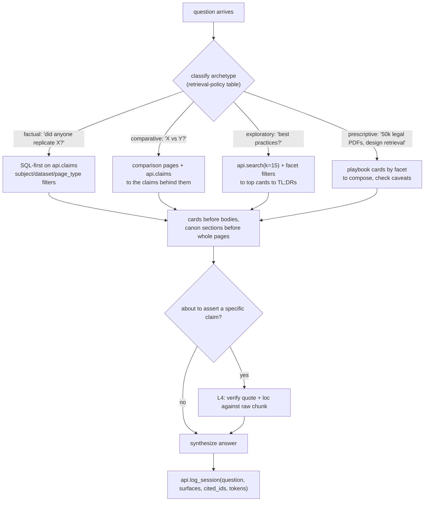

### Doctrine, not code

The routing table lives in the knowledge base's `retrieval-policy.md` (a Knowledge-base document), a *knowledge-base page* (draftable, supersedable, validated) indexed into `api.about`, not an `api.route()` function (`D-16`). Rationale: the consumers are heavy agentic models that write SQL natively. A frozen classifier would cap them at its author's imagination, while a doctrine page **compounds**: when telemetry shows an archetype chronically overspending, the policy gets edited like any other page. Standing rules an agent follows: orient once. **Filter before rank** (facet `WHERE` first). Cards before bodies. Always `LIMIT`. Stop on saturation. Verify only what you'll assert. Default `only_current => true` (superseded/stub/retracted filtered unless auditing). Leave a trace.

The trace closes the loop (`D-17`): sessions log question, surfaces touched, ids cited, tokens loaded. The `query_log` table that captures this is built. The synthesis half (answers crossing back into the knowledge base **as pages, rule-gated** (a `q.*` page iff the answer synthesized ≥3 pages and nothing existing answers it), and the usage digest telling curation what is hot/cold/over-budget) is **roadmap**: the design is fixed but the loop is not yet implemented.

> The retrieval *evaluation loop* (a fixed question set with known-good answers so search/doctrine changes are measured, not vibed) **is built**, via a single-source retrieval toolset (see [../adr/0011-single-source-retrieval-toolset.md](../adr/0011-single-source-retrieval-toolset.md), [../adr/0012-retrieval-strategy-and-code-mode-axes.md](../adr/0012-retrieval-strategy-and-code-mode-axes.md), the reference doc [../reference/evals.md](../reference/evals.md), and the deep design doc [eval-loop.md](eval-loop.md)).

---

## 13. The design decisions, digested

> **TL;DR:** All 25 product decisions in one table: the choice, the one-line why, and what was rejected. The recurring themes: provenance over confidence, computed over stored, preserved over deleted, doctrine over code, ownership partitioning over locks, Markdown as the only source of truth, and (D-25) per-knowledge-base *types* on a frozen agent contract. Each `D-NN` is realized by an engineering ADR (now 0001-0018). [product-decisions.md](./product-decisions.md) carries the full D-n to ADR cross-reference.
<!-- load-when: ADRs, design decisions, why was X chosen, rationale, rejected alternatives, D-1 through D-25 -->

> The full decision log (every `D-NN` below with its current as-built status) now lives in the repo at [product-decisions.md](./product-decisions.md), with a D-n to engineering-ADR table covering all 18 ADRs (the original digest below preserves `D-1`…`D-21`. `D-22`…`D-25` and ADRs 0013-0018 are summarised in the row beneath the table).

| ADR | Decision | Why (and what was rejected) |
|---|---|---|
| `D-1` | Fixed backbone, open vocabularies *(amended by `D-25`: page types are now per-knowledge-base schema data)* | Domains add vocabulary rows, never schema. *Rejected:* per-domain page schemas (ORKG-style): power we don't need, at the cost of agent legibility |
| `D-2` | Claims = block-anchored bullets inside paper notes | Provenance stays physically adjacent. Obsidian-addressable. No micro-file explosion. *Rejected:* one-file-per-claim (nanopub): correct but unusable for humans |
| `D-3` | Provenance over confidence. Trust is computed | Stored confidence numbers are unauditable vibes that go stale. Support is recomputed live from `api.claims` and `api.edges` |
| `D-4` | Comparative edges require dataset + metric qualifiers | Unqualified "X beats Y" is the silent-blend failure as an edge (SciFact-Open's documented failure mode) |
| `D-5` | Supersede, never delete | The graveyard and the why-pruned trail ARE the product, pruning is the mission |
| `D-6` | Disputes: preserve both + flag. Resolution = a comparison page | Most RAG contradictions are condition-dependent. Auto-resolution destroys the conditions, which are the knowledge |
| `D-7` | Canonical H2s. H2 = retrieval unit (≤600 tok) | Chunking decided at write time by the author. Same-shaped pages give cross-knowledge-base section queries. *Rejected:* algorithmic chunking at index time |
| `D-8` | Summary ladder (400 chars to 150 tok to sections) | Every page retrievable at three grains. Absorbs document-size variance structurally |
| `D-9` | Collapsed multi-level search | RAPTOR's collapsed-tree beat tree traversal. The ladder is optional protocol, never forced descent |
| `D-10` | PG + ParadeDB pg_search + pgvector + ltree, self-hosted | One engine: real BM25 + ANN + SQL-composable RRF. Typed columns beat EAV/jsonb for LLM-written SQL. Fallback: tsvector, same shape. (As-built: a dual-dialect BM25 seam now also targets a managed Postgres with `pg_textsearch`, see [../adr/0006-dual-dialect-bm25-seam.md](../adr/0006-dual-dialect-bm25-seam.md)) |
| `D-11` | Agent surface = curated `api` schema, ≤100 columns, COMMENTed | Small enough to hand agents the whole annotated schema (M-Schema evidence). Base tables ungranted |
| `D-12` | Free agent writes + mandatory log. No quarantine yet | Personal knowledge base, single writer, git/Sync as revert path. Revisit at multi-agent autonomy |
| `D-13` | Markdown-canonical. The graph is a derived table | Edges come only from typed keys. Recursive CTEs serve multi-hop. *Rejected:* a graph DB. (As-built: an Apache AGE backend was added, still an in-Postgres projection rebuilt from `kb.edges` every index run, so the principle holds, see [../adr/0007-age-multihop-dual-graph-backend.md](../adr/0007-age-multihop-dual-graph-backend.md)) |
| `D-14` | Zotero keys are the cross-system join | Knowledge base never duplicates reference management. `zotero_key` ties note ↔ mirror ↔ Zotero ↔ retraction checks |
| `D-15` | Incremental indexing *(as-built: shipped & default, [ADR-0019](../adr/0019-true-incremental-ingestion.md) / Vibe RAG Phase 3)* | Originally deferred (full idempotent rebuild is honest. Incrementality is the least-solved part of the pattern). Now realized: an index manifest + `identity_hash` link-graph closure drives a dirty-subset index run. Full rebuild is the `--full` fallback for global invalidation / cold start |
| `D-16` | Retrieval routing is a living document, not code | Heavy agents decide. Doctrine compounds with evidence. *Rejected:* enforced `api.route()`, per-agent forked doctrine |
| `D-17` | Telemetry is exhaust, knowledge is synthesis | `query_log` (and staging manifests) are disposable, never indexed. Answers become pages only through rule-gates |
| `D-18` | Maps: authored MOC hubs + computed coverage. Clustering deferred | Navigation ≠ knowledge. Promotion-gated (≥12 uncovered pages). Auto-communities unproven, deferred behind a trigger |
| `D-19` | Collections are a column. Federation at the agent layer | Multi-knowledge-base = logical partition on the same backbone. Separate deployments only at privacy boundaries. Identical `api.*` contract makes fan-out free |
| `D-20` | CE budgets: hard floors, non-binding doctrine, telemetry audit | Floors block degenerate behavior. Budgets advise judgment. The audit loop retunes whichever was wrong |
| `D-21` | Batch ingest = parallel extract + serialized merge | Ownership partitioning needs no locks (none exist over a live-synced knowledge base). The contention surface IS the compounding step. Same shape becomes the indexer's transaction |
| `D-22` | Notes are constructed + validated programmatically | One schema, two consumers: the `wikinote` kernel renders + validates a typed payload (`engram note build/validate/verify`) instead of trusting hand-typed prose. *Supersedes* `D-12`'s free-write. ADR-realized by the indexer's parser reuse |
| `D-23` | Multi-hop = two interchangeable graph backends (CTE + AGE) | *Amends `D-13`*: Apache AGE added as an in-Postgres openCypher backend beside recursive CTEs, both rebuilt from `kb.edges` every index run, so Markdown-canonical + rebuildable hold (see [../adr/0007-age-multihop-dual-graph-backend.md](../adr/0007-age-multihop-dual-graph-backend.md)) |
| `D-24` | OKF is an export/interchange view, not a schema change | Project a collection into a conformant OKF v0.1 export directory (typed edges + provenance preserved in `okf_x_*` extension keys). Near-zero cost, vendor-neutral wire format. *Rejected:* OKF as the authoring schema (see [../adr/0009-okf-export-interchange.md](../adr/0009-okf-export-interchange.md), [okf.md](okf.md)) |
| `D-25` | **Domain-general knowledge bases via a schema-driven ontology, engram as a Claude Code plugin** | *Amends `D-1`*: page types are per-knowledge-base `KnowledgeBaseSchema` data (`knowledge-base-schema.json`), validated like vocabulary. engram ships as a plugin with `/knowledge-base:init`. `studio init` is configure-only. The machinery + single `api.*` contract stay frozen. *Rejected:* runtime `create_model` + per-knowledge-base columns (XL cost, breaks the fixed agent surface) (see [../adr/0014-domain-general-vault-spec-and-plugin.md](../adr/0014-domain-general-vault-spec-and-plugin.md)) |

> **ADRs beyond the original table.** The decision log now spans ADRs 0001-0018. Besides those above: [ADR-0013](../adr/0013-design-and-vision-docs-in-repo.md) brought this vision doc and the decision log into the repo as governed `explanation` docs. The evaluation-loop stack is [ADR-0011](../adr/0011-single-source-retrieval-toolset.md)/[0012](../adr/0012-retrieval-strategy-and-code-mode-axes.md). [ADR-0015](../adr/0015-code-mode-on-the-mcp-retrieval-surface.md) added opt-in code-mode on the MCP surface. [ADR-0016](../adr/0016-structural-eval-generation.md) (Vibe RAG Phase 1, structural evaluation-case generation) and [ADR-0018](../adr/0018-calibration-loop.md) (Vibe RAG Phase 2, the propose-only tuning loop) are the self-tuning-retrieval program ([section 15](#15-roadmap-the-vibe-rag-program), [vibe-rag.md](vibe-rag.md)). [ADR-0017](../adr/0017-local-postgres-primary-testbed.md) made the local Postgres the default test bed.

Meta-pattern worth naming: wherever a number could be *stored* (confidence, trust, freshness, coverage), the design **computes** it from ground truth instead: scoreboard from edges, staleness from hashes and dates, coverage from counts. Stored judgments rot silently. Computed ones update themselves and can always show their work.

---

## 14. How this generalizes: the schema and the plugin

> **TL;DR:** Generalization is **shipped, not hypothetical** (D-25 / [ADR-0014](../adr/0014-domain-general-vault-spec-and-plugin.md)). engram is a domain-general indexer driven by a per-knowledge-base `KnowledgeBaseSchema` (`knowledge-base-schema.json`), distributed as a **Claude Code plugin**. You install it into any knowledge base, run [`/knowledge-base:init`](../reference/plugin.md) to co-design the schema, and `studio init` scaffolds `_meta/` + migrates the DB + loads vocab (configure-only). The schema declares the page types, vocabulary, claim grammar, the `sources` acquisition switch, and the retrieval profile *as data*, so a cooking, legal or personal knowledge base is a first-class engram knowledge base with the *identical machinery and single `api.*` agent contract*. What was a design wager in `D-1` ("structure frozen, vocabulary open") is now realized one level higher: the *types themselves* are per-knowledge-base data, the *machinery* stays frozen. Best fit: knowledge bases of documents that make *evaluable claims you must cite*. Poor fit: knowledge bases without claims or queried too rarely to amortize indexing.
<!-- load-when: generalization, other domains, beyond research, port to legal, domain specific or generic, reuse, new knowledge base, collections, schema, plugin, studio init, knowledge-base-schema.json, change the backbone, modify the schema, per-domain cost, books, music knowledge base, heterogeneous folder, random documents, ppt sources -->

### The shipped mechanism: a schema, a plugin, an init

Three pieces make any knowledge base first-class (all built, references: [../reference/init.md](../reference/init.md), [../reference/plugin.md](../reference/plugin.md)):

1. **The `KnowledgeBaseSchema`** (`wikinote/spec.py`, stored as `knowledge-base-schema.json`) declares `page_types[]` (page_type, id_prefix, folder, frontmatter_fields, canonical_sections, edge_fields, claims_enabled), `relations[]`, `entity_types[]`, `claim_kinds[]`, `facets{}` (key to one of the 5 generic `text[]` columns, or `null`, falling back to JSONB), the `claims` grammar field-sets, `sources: {enabled, quote_verify}` (the acquisition switch, research: on, generic: off), `retrieval.profile`, plus `purpose` and `slug_conventions`. The index *validate* stage loads it and validates each note against its schema entry exactly as it validates vocabulary against `VocabularyIndex`.
2. **The plugin** (`engram/plugin/`) packages the retrieval MCP server and the `/knowledge-base:init` onboarding skill. The knowledge base carries no hardcoded engram paths (the binary resolves via `${ENGRAM_BIN:-engram}`).
3. **`/knowledge-base:init` to `studio init`**: the skill interviews the user to co-design the schema, writes `knowledge-base-schema.json`, then calls `engram init scaffold` to `db` to `spec`. It is **configure-only**: it scaffolds `_meta/`, runs `alembic upgrade head`, and loads vocab, assuming a reachable CLI and Postgres. It does **not** provision Docker or a cloud DB.

The research 7+1 page types are the **default** schema. The live research knowledge base has no `knowledge-base-schema.json` and falls back to it, byte-for-byte (parity-gated). So "porting to a new domain" is no longer "swap the vocabulary instance in code", it is *author a schema through an interview*, and the storage backbone + `api.*` SQL + M-Schema are untouched.

### What is frozen vs what is per-knowledge-base data

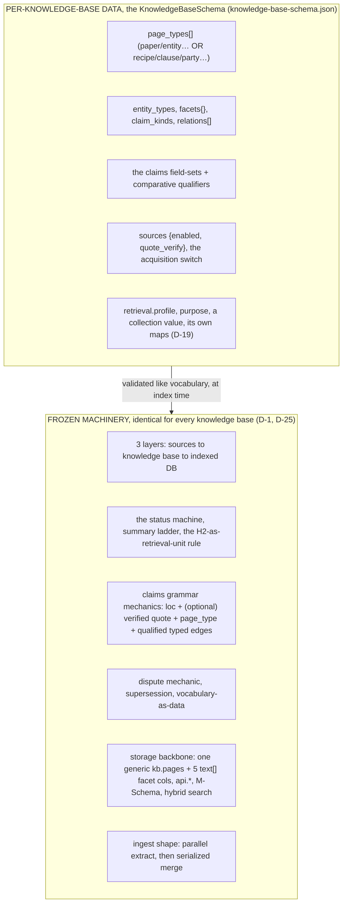

Notice what the machinery *doesn't know*: nothing in "a page has an immutable id, a 400-char summary, self-contained H2 sections, and (optionally) block-anchored claims whose quotes are machine-verified" mentions science. The dispute mechanic needs only "two claims about the same thing pointing opposite ways." `kb.pages` is keyed by a generic `page_type` column with 5 generic `text[]` facet columns. The `api.*` views degrade to *empty, not broken* when pages of an unknown type are absent. Even the research page types read as generic shapes: `paper` is "one source document," `comparison` is "X vs Y along dimensions," `playbook` is "situational guidance." The audit behind D-25 found engram was ~95% domain-agnostic. The page-type layer was the only real coupling, now lifted into the schema. Add to that `D-19`'s `collection` column for keeping knowledge bases logically separate on the same backbone. (As-built note: the `collection` column exists today. Multi-collection **federation across separate instances** is **roadmap**.)

### A 60-second port: a vendor-contracts schema

You install the plugin into a contracts knowledge base and run `/knowledge-base:init`. The interview produces a `knowledge-base-schema.json` whose `page_types[]` declare `contract` (one source), `clause`, `party`, `comparison`, `playbook`. `sources.enabled` is on but pointed at the document-management system (or `false`, if contracts are dropped in as `.md` directly). Entity types are `party`, `clause-type`, `jurisdiction`, `regulation`, `product`. Facets: `contract_type`, `jurisdiction`, `effective_year`, `risk_area`. No code changes, it is all schema data the index validate stage reads. A claim keeps the *identical grammar*:

```markdown
## Findings
- NimbusCloud's 2025 MSA caps aggregate liability at 12 months of fees,
  excluding data-breach claims, which are capped at 3x. ^c1
    - loc:: §9.2
    - quote:: "aggregate liability shall not exceed the fees paid in the twelve (12) months preceding"
    - kind:: contract-term
    - subject:: [[nimbuscloud-msa-2025]]
    - stricter_than:: [[betacloud-msa-2024]]
    - on_dimension:: [[liability-cap]]
    - condition:: excludes data-breach; 3x carve-out
```

`stricter_than` with a mandatory `on_dimension` qualifier is the same validation rule as `outperforms` + `metric`, one vocabulary row away. A comparison page becomes "liability caps across ten vendors," cells citing claim blocks. The dispute mechanic now catches "the renewal amendment contradicts section 9.2". A playbook becomes negotiation guidance. The query agent asks `api.claims WHERE on_dimension='liability-cap' AND jurisdiction='de'` and verifies quotes against the contract mirror before asserting anything to a lawyer, the exact same L4 move, with higher stakes.

The same exercise works for clinical guidelines (claims = recommendations, qualifiers = population/evidence-grade, disputes = guideline bodies disagreeing), engineering RFC/ADR knowledge bases, security bulletins, market research. The common precondition is visible in the example: **documents that make discrete claims worth citing precisely**.

### Where it does NOT pay

- **No evaluable claims**: nothing for the claims grammar to grip: fiction, marketing, brainstorm notes. (The knowledge base `purpose.md` already excludes these even *within* research.)
- **Too volatile**: dashboards, prices, tickets: indexing assumes sources worth reading once and citing for months. Operational truth belongs in operational systems.
- **Too rarely queried**: index cost amortizes over many queries. A knowledge base you'll question twice should just be RAG'd raw.
- **One honest caveat**: the curation lever assumes a *judge*: tiering and dispute adjudication are editorial acts. The backbone ports cleanly. The "crème de la crème" property only follows if some authority (human or well-briefed agent) keeps applying taste.

So: **generic by architecture, specialised by schema**, and the configuration surface (the `KnowledgeBaseSchema`: page types, vocabulary rows, facet values, the acquisition switch) is deliberately the cheap part, co-designed once through `/knowledge-base:init`.

### The cost ladder: what is a schema edit vs a repo ADR

D-25 redrew this ladder. Per-knowledge-base *types and vocabulary* are now schema/vocabulary data (no repo ADR). Only changes to the shared *machinery and single agent contract* are ADR-priced. The ladder, cheap to constitutional:

| Change | Costs | Who does it |
|---|---|---|
| New facet **value** (e.g. `episodic-qa`) | a vocabulary row with a definition | the ingest workflow itself, at merge |
| New entity type / relation type | a vocabulary row + one-line definition | merge, from extractor proposals |
| New **page type** *for a knowledge base* | a `KnowledgeBaseSchema` edit (an `/knowledge-base:init` re-run or a hand edit to `knowledge-base-schema.json`), no repo ADR (D-25) | human, in the knowledge base |
| New generic facet **column** (a 6th `text[]` slot) | a repo ADR + an alembic migration, it touches the storage backbone + `api.*` SQL shared by every knowledge base | human, in the repo |
| Claims grammar, identity rules, layer boundaries, the single `api.*` contract | near-constitutional: every existing page, the extractor brief, the verifier, and the indexer parser assume them, so the cost is retroactive. Some are effectively change-never. Drop quote verification and every past verification's trust story dies. Make `id` mutable and every citation can silently re-point | human, reluctantly |

Why the machinery default is frozen: consumers discover *types and vocabulary* per knowledge base (the schema, vocabulary, `api.lookup_value`) but the agent reads **one** `api.schema_guide` and **one** M-Schema regardless of what a knowledge base's ontology contains, that single discoverable surface is D-1's core wager, preserved by D-25. The pending-ADR queue ([section 15](#15-roadmap-the-vibe-rag-program)) is proof the mechanism is alive: friction at scale accumulates into recorded decisions, not workarounds.

### What a new domain actually costs: books about music, or a folder of random docs

Suppose you start adding converted-to-Markdown music books instead of papers. The work splits into three tiers:

- **Zero per-domain work (domain-blind already):** mirror storage and hashing, hybrid search over `raw_chunks` (the moment mirrors land, you have a competent classic RAG over the knowledge base with no notes written), plus quote verification, the ingest orchestration, the indexer, and the `api.*` surface.
- **Once per domain, the `/knowledge-base:init` interview (one session, mostly agent-draftable for human approval):** the whole `KnowledgeBaseSchema` falls out of it: (1) `page_types[]` and the knowledge base's `purpose`, the mission, and what curation tier 1 *means* here ("changes a verdict" might become "shaped the genre"). (2) starter vocabulary: entity types (`artist`, `work`, `genre`, `instrument`…), relations (`influenced_by`, `member_of`…), facets (`era`, `tradition`…), claim types (`historical-fact`, `musicological-analysis`…), and the comparative-qualifier analog (research's `on_dataset` + `metric` becomes e.g. `on_dimension` where there are no benchmarks), and the vocabulary is *designed* to grow from extractor proposals, so batch 1 can propose most of it. (3) the `sources` switch: `enabled`/`quote_verify` on, pointed at the acquisition path, or off if the docs are dropped in directly. This is a **schema edit, not a repo ADR** (D-25). `studio init` writes `knowledge-base-schema.json` and migrates the DB. No code change.
- **Ongoing, by design rather than limitation:** the editorial judge, tier approval ([section 10](#10-curation-the-tiering-policy)) and dispute adjudication stay human-or-briefed-agent calls. Remove them and you have an inbox, not a knowledge base.

The "connect a random folder" scenario degrades gracefully: heterogeneous documents (book chapters, slide decks, one-off notes) all become searchable mirrors essentially for free, and the knowledge-base layer stays **opt-in per document**, the tiering test filters which ones carry claims worth distilling. The rest serve retrieval as raw chunks forever. Two honest stress points: conversion to `.md` must preserve *addressable structure* (headings), or `loc::` has nothing to point at (a prose-less slide deck converts fine but yields few claims and simply stays mirror-only), and very long sources (a 400-page book) stress the 5-15-claims-per-note guidance. Chapter-level notes or a raised per-type claim budget in the schema is the fix when it bites.

---

## 15. Roadmap: the Vibe RAG program

> **TL;DR:** The roadmap is organised as **Vibe RAG**, the self-tuning-retrieval program: the system bootstraps its own evaluation ground-truths from the indexed knowledge base *structure* (gold ids correct by construction, not model-guessed) and self-tunes retrieval against them. Eight phases (0-7), **all shipped**: the vibe schema, structural ground-truth generation, the tuning loop, true incremental indexing (ADRs 0014/0016/0018/0019), the recommendation loop, coverage-based scaling, freshness, and the Phase-7 loop governance, the runtime policy rung, the frozen split, reflective diagnosis (ADRs 0026, 0027-0029, 0030-0031, 0032-0034). The deep dive is [vibe-rag.md](vibe-rag.md). Honest limits of what exists are listed after the table.
<!-- load-when: limitations, gaps, roadmap, next steps, what's missing, open questions, risks, future work, vibe rag, phases, self-tuning retrieval -->

> The serving layer described in [section 11](#11-indexing-from-knowledge-base-to-postgres) to [section 12](#12-retrieval-how-agents-query-the-indexed-knowledge-base) (the indexer, Postgres, embeddings, the retrieval surface, the evaluation harness) is **built**. The program is Vibe RAG. The full design lives in [vibe-rag.md](vibe-rag.md) and this section is the summary.

### The phase program, 0-7 (all shipped)

| Phase | What | Status |
|---|---|---|
| **0: vibe schema** | `/knowledge-base:init` co-designs the per-knowledge-base `KnowledgeBaseSchema`. engram ships as a plugin (configure-only `studio init`) | **Shipped** ([ADR-0014](../adr/0014-domain-general-vault-spec-and-plugin.md) / D-25) |
| **1: structural ground-truth generation** | five archetypes (pinpoint / contrast / survey / trace / synthesis). The gold-from-seed inversion (gold ids read off knowledge-base structure before any model runs). A quote check (every support quote verbatim) | **Shipped** ([ADR-0016](../adr/0016-structural-eval-generation.md), [../reference/evals.md](../reference/evals.md)) |
| **2: the tuning loop (controller)** | diagnose, propose a unified `RetrievalPolicy` (instructions + strategy + tool descriptions), accept-iff-better on accuracy within a cost guardrail (train/val overfitting guard), converge. **propose-only** delivery + explicit `evals apply-policy`. CLI + MCP over one shared core | **Shipped** ([ADR-0018](../adr/0018-calibration-loop.md), [eval-loop.md](eval-loop.md)) |
| **3: true incremental indexing** | an index manifest + `identity_hash` link-graph closure drives a dirty-subset index run (`D-15`). The full idempotent rebuild stays as the `--full` fallback | **Shipped** ([ADR-0019](../adr/0019-true-incremental-ingestion.md) / D-15) |
| **4: the recommendation loop** | the loop proposes *schema* edits (chunking, graph layering, page types) as gated, simulated, human-applied recommendations, schema changes stay out of the tuning loop's own hands | **Shipped** ([ADR-0026](../adr/0026-structural-advisor.md)) |
| **5: coverage-based scaling** | scale generation + tuning to knowledge-base size: the coverage report, stratified salted-hash seed draws, immutable dataset version chains, the decision-core + rotating-tail accept basis | **Shipped** ([ADR-0027](../adr/0027-stratified-salted-hash-seed-selection.md), [ADR-0028](../adr/0028-immutable-dataset-versions-and-case-identity.md), [ADR-0029](../adr/0029-decision-core-subsampled-calibration.md)) |
| **6: freshness via mirror-hash invalidation** | the `evals freshness` check recomputes every case's anchors against the live knowledge base: era-aware verdicts, a warn-never-gate staleness fraction, staleness-aware top-up + the retirement record | **Shipped** ([ADR-0030](../adr/0030-freshness-via-mirror-hash-invalidation.md), [ADR-0031](../adr/0031-staleness-aware-dataset-maintenance.md)) |
| **7: loop governance (closeout)** | the machine rung: `tune --apply-runtime` may write exactly one artifact, the per-knowledge-base `_meta/active-policy.yaml`, behind four guardrails (frozen sidecar, freshness check, winner-beat-incumbent, frozen-beat) with append-only `_meta/policy-history/` + `evals rollback-policy`. `evals freeze` carves the frozen held-out yardstick. Reflective diagnosis (deterministic detectors, gated LLM findings, next-round prediction grading). Freshness read surfaces (HTTP + Studio) | **Shipped** ([ADR-0032](../adr/0032-runtime-policy-rung.md), [ADR-0033](../adr/0033-frozen-split.md), [ADR-0034](../adr/0034-reflective-diagnosis.md)) |

### Honest limits of what exists

- **The tuning loop's one machine-writable surface is the per-knowledge-base `_meta/active-policy.yaml`**, and only behind the four [ADR-0032](../adr/0032-runtime-policy-rung.md) guardrails with per-invocation consent (`tune --apply-runtime`). Every apply first snapshots the outgoing policy into an append-only `_meta/policy-history/`, and `evals rollback-policy` restores the previous one. Everything else stays human-gated: `evals tune` emits a winning-policy file + report, `evals apply-policy` writes the working tree (and never commits), and structural-schema proposals (the [ADR-0026](../adr/0026-structural-advisor.md) recommendation loop) are recommendations only.
- **Validation is an indexer stage, not a standalone daemon.** The validate stage of `studio index` makes the schema/grammar rules mechanical (see [../reference/indexing.md](../reference/indexing.md)). Ad-hoc edits between index runs can still drift until the next index run re-validates.
- **Quote verification ≠ truth verification.** The verifier proves the quote exists in the source, not that the claim *interprets* it correctly, and not that the source itself is sound (scite retraction checks partially cover the latter). The `verified` status tier (adversarial review by a different model) exists for exactly this and is mostly unused so far.
- **Synthesis coverage is thin by design but watch it** (in the research knowledge base): 1 comparison, 3 questions, 0 concepts, 0 playbooks. Playbooks are the highest-value page type for the research mission and the threshold ("evidence supports actionable guidance") hasn't been called yet.
- **The usage-to-synthesis loop is roadmap.** The `query_log` table captures sessions, but the loop that turns the usage digest into new pages (and into curation signals: hot/cold/over-budget) is **not yet built** (`D-17`).
- **Multi-collection federation is roadmap.** Single-instance collection filtering works. The `collection` column exists. Fanning a query across *separate* instances is **not yet built** (`D-19`). Algorithmic MOC/community clustering (`D-18`) and the OKF importer ([../adr/0009-okf-export-interchange.md](../adr/0009-okf-export-interchange.md)) are likewise **roadmap**.
- **Incremental indexing is the default, but global invalidation still falls back to a full rebuild.** An index manifest + `identity_hash` link-graph closure indexes only the dirty subset again (Phase 3, [ADR-0019](../adr/0019-true-incremental-ingestion.md) / `D-15`). A schema/vocabulary change or a cold start still re-processes the whole knowledge base via the `--full` path.
- **Single-judge curation.** Tiering and dispute adjudication are one mind's calls (user + Claude). Fine at this scale. `D-12` already names the revisit point (multi-agent writes to quarantine gates).

---

## 16. Glossary

> **TL;DR:** Every term of art in this document, one line each.
<!-- load-when: glossary, terminology, what does X mean, definitions -->

Universal terms apply to any knowledge base. Terms marked *(research schema)* are specific to the default `research` schema.

| Term | Meaning |
|---|---|
| **Schema** | The per-knowledge-base contract (`KnowledgeBaseSchema`, `wikinote/spec.py`): page types, vocabulary, the claim grammar, the `sources` acquisition switch, the retrieval profile, `purpose`, validated at index time like vocabulary. Amends D-1 (D-25 / [ADR-0014](../adr/0014-domain-general-vault-spec-and-plugin.md)) |
| **`knowledge-base-schema.json`** | The schema serialized at the knowledge base root: version-controlled, the auditable record of the `/knowledge-base:init` interview, re-runnable. Absent, it falls back to the default `research` schema |
| **plugin** | engram packaged as a Claude Code plugin (`engram/plugin/`): the retrieval MCP server + the `/knowledge-base:init` skill, installed into any knowledge base with no hardcoded engram paths |
| **`/knowledge-base:init`** | The onboarding skill that interviews the user to co-design the schema, writes `knowledge-base-schema.json`, then calls `studio init` (scaffold to db to schema). Configure-only: does not provision infra |
| **page type** | A page_type of knowledge-base page declared in the schema's `page_types[]` (id_prefix, folder, frontmatter, canonical sections, edge fields, claims_enabled). Per-knowledge-base data, not a frozen list (D-25) |
| **mirror** *(research schema)* | Immutable full-text Markdown copy of a source in `Sources/`, owned by the sync script (`zotero_key`, `source_hash` frontmatter). Produced when the schema's `sources` is enabled |
| **claim block** | One atomic finding as a block-anchored bullet (`^cN`) under a note's claims section, with `key:: value` provenance fields. General machinery. The `research` `## Findings` is one instance |
| **`loc::` / `quote::`** | A claim's locator into the source (`§5.1, Table 2`) and its verbatim snippet. The quote is machine-verified when the schema's `sources.quote_verify` is on |
| **page_type** | Vocabulary-controlled evidence type of a claim (research: `benchmark-result`, `ablation`, `negative-result`, …). The value set is schema vocabulary |
| **qualifier** | Field scoping an evidential edge (research: `on_dataset::`, `metric::`, `condition::`…, legal: `on_dimension::`…). Mandatory for comparative edges |
| **entity** *(research term)* | Canonical page for one named thing. Its `Evidence` section is where claims from many sources compound (the schema's "one named thing" page type) |
| **stub** | Auto-created minimal entity page (id, type, one-line definition). Promoted when ≥2 sources reference it |
| **facet** | Flat, vocabulary-controlled frontmatter filter key (research: `tasks`, `domains`, `stages`…) that indexes to one of the 5 generic typed columns (or JSONB) |
| **vocabulary** | `_meta/vocabulary/*.md`, the closed vocabularies (entity types, relations, facet values), schema-as-data. The schema declares which exist |
| **dispute** | Two claims, same subject+object+qualifiers, opposite direction, both flagged and preserved. Resolved as conditions in a comparison. General machinery |
| **supersession** | `superseded_by` replacement that keeps the old page/claim queryable. The pruning audit trail |
| **moc / map** | "Map of content" navigation hub, curated grouping, explicitly not knowledge (a page type in the `research` schema) |
| **manifest** | Transient per-source JSON carrying an extractor's proposals for shared surfaces. Consumed and deleted at merge (exhaust, never indexed) |
| **merge** | The single-writer ingest phase that absorbs manifests into entities, vocabulary, disputes, synthesis pages, and the log |
| **curation tier 1** | A pending source worth distilling, the only tier that gets a note. What qualifies is set by the knowledge base's `purpose` (research: changes a verdict / touches a dispute / anchors a comparison / carries a transferable technique) |
| **summary ladder** | `summary` (≤400 chars) to `## TL;DR` (≤150 tok) to H2 sections: three retrieval grains per page |
| **canon section** | A canonical H2 name fixed per page type in the schema (research: `tldr`, `findings`, `limitations`, `verdict`…), queryable across the knowledge base |
| **card** | The L1 retrieval unit: id + type + title + summary + facets (~50-150 tokens) |
| **L0-L4** | The retrieval ladder: orient to scan cards to read sections to relate claims/edges to verify raw spans |
| **RRF** | Reciprocal-rank fusion: how BM25 and vector rankings merge in `api.search` |
| **scoreboard** | Computed per-entity trust (supports/refutes/wins/losses/nulls), never stored. The `api.scoreboard` view was dropped in migration 0052, and an agent aggregates `api.claims` instead. |
| **collection** | Logical knowledge-base partition (`D-19`): a column + its own purpose/maps on the shared backbone |
| **Vibe RAG** | The self-tuning-retrieval program ([vibe-rag.md](vibe-rag.md)): structural ground-truth generation + a propose-only tuning loop + true incremental indexing (phases 0-3 shipped, 4-6 roadmap) |
| **slug / id** | `<prefix>.<slug>` immutable page identity (`paper.lightrag-2025`). Filename = slug, folder = prefix (prefix/folder come from the schema's page type) |
