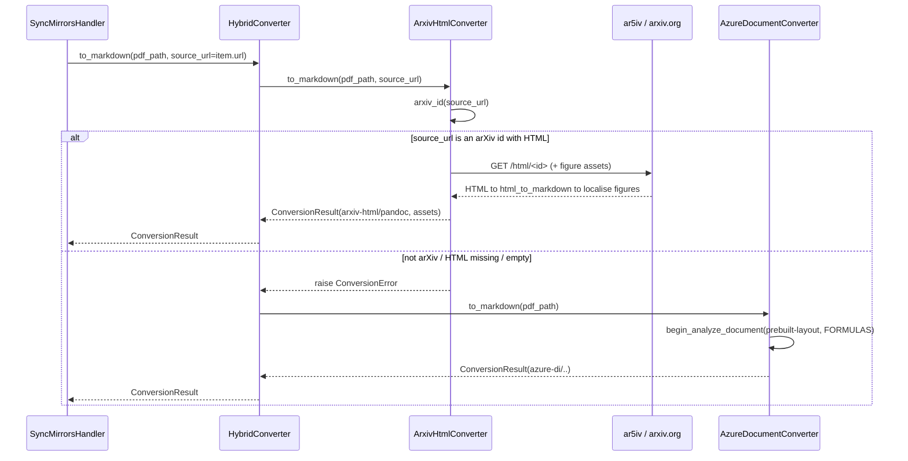

# conversion, PDF/HTML to Markdown for a Mirror's body

> **Where the code lives.** engram owns the `DocumentConverter` port
> (`engram/src/engram/sources/internal_contracts.py`) and ships no converter of its own. The adapters
> described here live in the sibling `connectors` project, under
> `connectors/src/engram_connectors/conversion/`, behind the `engram-connectors[conversion]` extra,
> and reach a host through the `engram.sources.converters` entry-point group
> ([root ADR-0018](../../../docs/adr/0018-corpus-bundles-and-provider-packages.md)). This page is
> the contract for the port and its adapters together.

## Purpose

Conversion turns one source attachment into the Markdown body of a
`Sources/` mirror. It is the **arXiv-HTML-first, Azure-Document-Intelligence
fallback** step (ADRs [`0003`](../adr/0003-hybrid-html-first-conversion.md),
[`0001`](../adr/0001-pdf-to-markdown-via-azure-document-intelligence.md)): the
author's ar5iv/LaTeXML HTML carries exact LaTeX and prose so it is the preferred
(and free) source, with OCR over the PDF as the universal fallback.

The adapters own **how** to convert one file (fetching the HTML, driving pandoc, localising
figures, OCR over the PDF) and engram's `DocumentConverter` port names that
capability. Conversion does **not** decide **when** to convert (that is `sync`'s
`decide`, which classifies CREATE / RECONVERT / REFRESH / SKIP per item, see
[sync.md](sync.md)), it does **not** read a source library or write mirrors (a `Connector` and
the `mirror` slice), and it does **not** persist anything. It returns an in-memory
`ConversionResult`. It is the most **host-coupled** corner of the
ingestion context (arXiv ids, ar5iv HTML, PDFs), none of which a domain-general
knowledge base need have (ADR [`0014`](../adr/0014-domain-general-vault-spec-and-plugin.md)), which is why
it ships behind an optional extra rather than in the indexer.

## Entry points

| Surface | Entry | Defined in |
|---|---|---|
| Programmatic (port) | `DocumentConverter.to_markdown(pdf_path, *, source_url=None) -> ConversionResult` | `engram/src/engram/sources/internal_contracts.py` |
| Caller | `SyncMirrorsHandler._resolve_body` then `converter.to_markdown(item.pdf_path, source_url=item.url)` | `engram/src/engram/sources/service/sync.py` |
| Registration | one factory per connector name under the `engram.sources.converters` entry-point group (`zotero`, `youtube`, `intake`) | `connectors/pyproject.toml`, `connectors/src/engram_connectors/conversion/infrastructure/factories.py` |
| Resolution | `converter_factory(name)` loads that one entry point and calls it with the `DocumentIntelligenceSettings` | `engram/src/engram/sources/registry.py` |
| DI wiring | `document_converters_provider` resolves every name in `spec.sources.connectors` and returns them as a `DocumentConverterMap` (wireup singleton) | `studio/src/studio/knowledge_base/wiring/conversion.py` |

There is **no CLI, HTTP, or bus surface of its own**: conversion is a pure capability invoked
*inside* the sync reconcile. A knowledge base's declared connector names decide which converters exist, and
the wireup module carries no name-to-factory dict of its own, so adding a converter is publishing a
package that registers the entry point. The only caller in the tree is
`SyncMirrorsHandler`, which converts on a CREATE / RECONVERT (and a body-less
REFRESH) and ignores conversion on a dry run.

## Public contract

- **Port:** `DocumentConverter` (`engram/src/engram/sources/internal_contracts.py`), a `Protocol` with the single
  coroutine `to_markdown(self, pdf_path: Path, *, source_url: str | None = None)
  -> ConversionResult`, raising `ConversionError`. `source_url` is an *optional
  hint* (the item's web URL) for converters that can prefer a web source. PDF-only
  converters ignore it.
- **Result:** `ConversionResult` (same module), a pydantic `BaseModel` (note:
  **not** `frozen`) with `markdown: str`, `page_count: int` (0 for the HTML route,
  which has no pages), `converter: str` (a provenance label stamped into the
  mirror's frontmatter, e.g. `"arxiv-html/pandoc"`,
  `"azure-di/prebuilt-layout+formulas"`), and `assets: dict[str, bytes]` (binary
  figures keyed by a `Sources`-relative `_assets/<arxiv-id>/<name>` path the body
  links to. Empty for converters without figure support).
- **Error:** `ConversionError(Exception)` (same module), the single documented
  signal. The HTML adapter raises it to mean "this is not an arXiv HTML I can
  convert". The composite catches *only* this to fall back.
- **Implementers**, all in `connectors/src/engram_connectors/conversion/infrastructure/`, all bound to the one port:
  - `HybridConverter(html, di)` (`hybrid.py`), the composite the `zotero` factory
    returns.
  - `ArxivHtmlConverter(client: httpx.AsyncClient | None = None)`
    (`arxiv_html/converter.py`), drives off `source_url`, fetches
    `https://arxiv.org/html/<id>`, runs `html_to_markdown`, then localises every
    figure (downloads it into `assets`, rewrites the body to the `_assets/` path).
  - `AzureDocumentConverter(settings, *, client_factory=None)`
    (`azure_converter.py`), Azure DI `prebuilt-layout` + `FORMULAS` over the PDF,
    Managed-Identity auth via an injectable `client_factory`.
  - `ArticleConverter` (`article.py`), a general web article through trafilatura, over core's
    SSRF-guarded fetcher (`core/src/core/net.py`), whose `FetchError` surfaces as a
    `ConversionError` naming the URL.
  - `PassthroughConverter(name)` (`passthrough.py`), reads back markdown the connector already
    rendered, the `intake` and `youtube` factories' answers.
- **Invariants:** the converter is **pure-read** over the source and the network,
  it persists nothing (the `mirror` store writes the result). The HTML route is
  **figure-fault-tolerant** (a figure that fails to download degrades to an
  absolute arXiv URL, never fatal) and **SSRF-guarded** (figures are fetched only
  from `arxiv.org` / `.arxiv.org` over https.
  `connectors/src/engram_connectors/conversion/infrastructure/arxiv_html/fetch.py::_is_arxiv_image_url`). The
  general article route uses core's address guard instead
  (`core/src/core/net.py`), shared with the watch-list slice.

## Runtime flow

The behavioral sequence of one conversion (the **structural** C4-L3 component
diagram + the domain-model class diagram live in the arc42 master section 3 Ingestion,
[index.md](../architecture/index.md), section
[`03-ingestion-bounded-context.md`](../architecture/sections/03-ingestion-bounded-context.md).
This view is the *call sequence*, not a duplicate of those):



Source: connectors/src/engram_connectors/conversion/infrastructure/hybrid.py, connectors/src/engram_connectors/conversion/infrastructure/arxiv_html/converter.py, connectors/src/engram_connectors/conversion/infrastructure/arxiv_html/fetch.py, connectors/src/engram_connectors/conversion/infrastructure/azure_converter.py, connectors/src/engram_connectors/conversion/infrastructure/factories.py, engram/src/engram/sources/internal_contracts.py, engram/src/engram/sources/service/sync.py

Only `ConversionError` from the HTML route triggers the fallback. **Any other
exception propagates unchanged** so `sync` records it as a per-item error. If the
Azure fallback *also* raises `ConversionError`, the composite re-raises the DI
error chained from the HTML one (`raise di_err from html_err`).

## Examples

```python
# How sync invokes it (engram/sources/service/sync.py::_resolve_body):
result = await self._converter.to_markdown(item.pdf_path, source_url=item.url)
return result.markdown, result.converter, result.assets  # body, provenance label, figures

# The composite, built by the "zotero" entry point
# (connectors/src/engram_connectors/conversion/infrastructure/factories.py::zotero_converter_factory):
HybridConverter(ArxivHtmlConverter(), AzureDocumentConverter(document_intelligence))
```

```python
# arXiv-id parsing accepts abs / pdf / html URLs and the 10.48550/arXiv.* DOI form
from engram_connectors.conversion.infrastructure.arxiv_html.fetch import arxiv_id
arxiv_id("https://arxiv.org/abs/2412.15605v2")   # -> "2412.15605"
arxiv_id("https://example.com/paper.pdf")         # -> None  (HTML route raises ConversionError)
```

## Patterns used

- **Composite / Chain-of-Responsibility over the `DocumentConverter` port**,
  `HybridConverter` holds two converters (`_html`, `_di`) behind the same port and
  selects by *exception fallback* (try HTML, fall back to Azure DI on
  `ConversionError`). It is **not** the project's strategy-registry pattern: there
  is no frozen dataclass over a `Mapping[Enum, Converter]` and no enum dispatch, so
  adding a third converter is a `HybridConverter` rewrite, not a one-entry registry
  diff. Only the dual-dialect BM25 seam (`SearchDialects`, ADR 0006) and the dual
  graph backend (ADR 0007) are genuine `Mapping[Enum, Adapter]` strategy registries.
  Conversion is deliberately not one.
- **Port / adapter + DI seam, fakes-over-mocks**, one `DocumentConverter`
  Protocol in engram, several adapters in `connectors`, resolved by entry point in
  `studio/src/studio/knowledge_base/wiring/conversion.py`. See
  `../../../docs/explanation/design-patterns.md#di-seams-and-fakes-over-mocks`.
- **Narrow boundary port for an un-mockable SDK**, `AzureDocumentConverter`
  narrows the Azure DI client to local `_AnalyzeClient` / `_AnalyzePoller` /
  `_AnalyzeResult` Protocols, adapting the concrete SDK at exactly one boundary
  (`_managed_identity_client`, a single `cast`), so tests inject a structural fake
  rather than monkeypatching the SDK namespace.
- **HTTP-boundary convention, only partially applied here.** The codebase's
  response-model convention (inbound shapes as `BaseModel(frozen=True,
  extra="ignore")`) is **not** followed in this slice: `ConversionResult` is a
  plain non-frozen `BaseModel`, the Azure path validates nothing inbound (it reads
  `result.content` / `result.pages` through the narrow port + cast), and the arXiv
  path consumes **raw HTML text** (regex + pandoc) with no ar5iv response models or
  request `TypedDict`s at all. See
  `../../../docs/explanation/design-patterns.md` for the convention this departs
  from.

See the glossary at `../../CONTEXT.md` for slice, port, and mirror definitions.

## Testing seams

- **Protocol port**, `DocumentConverter` (`engram/src/engram/sources/internal_contracts.py`) is the substitution point.
  `sync` takes it by the port, so reconcile tests inject a fake converter without
  touching the network or Azure.
- **Fakes:** `FakeDocumentConverter` (`engram/src/engram/testing/fakes/conversion.py`, shipped in
  the `engram[testing]` toolkit), counts
  `to_markdown` calls, records the paths + last `source_url`, scripts a per-item
  failure via `error_on`/`exc`, and lets tests assert the provenance `converter`
  label and `assets` thread through. `connectors/tests/unit/conversion/test_hybrid.py` uses a
  local `FakeConverter` for the HTML/DI legs.
- **Adapter seams without a real backend**, `ArxivHtmlConverter` accepts an
  injected `httpx.AsyncClient` (tests wrap `httpx.MockTransport`). The HTML route
  thus runs end-to-end with no real arXiv call. `AzureDocumentConverter` accepts an
  injected `client_factory`, so neither the Azure SDK nor a credential is exercised
  in tests.
- **Tests:** the composite's fallback control flow (HTML success skips DI. A
  `ConversionError` falls back to DI. Non-`ConversionError` propagates. The
  chained-error case) in `connectors/tests/unit/conversion/test_hybrid.py`. The HTML route
  (id parsing, chrome stripping, figure localisation, SSRF guard) in
  `connectors/tests/unit/conversion/test_arxiv_html.py`. The Azure adapter (Managed-Identity
  factory, empty-content error) in `connectors/tests/unit/conversion/test_azure_converter.py`. The
  article route including the SSRF refusal in `connectors/tests/unit/conversion/test_article.py`.
  The entry-point resolution and the wireup binding in
  `studio/tests/unit/knowledge_base/test_document_converter_wiring.py`.
