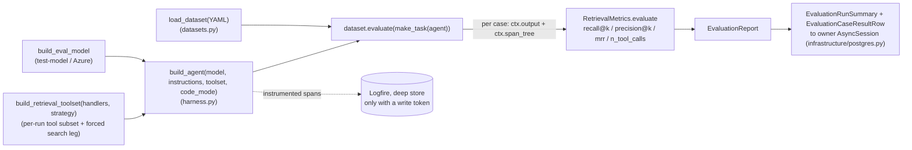

# evals, scoring engram's retrieval against a QA dataset

## Purpose

The `evals` slice measures how well engram's retrieval performs. It assembles an
*agent-under-test*: a pydantic-ai `Agent` = (model by instructions by the single-source
retrieval toolset) returning a structured `RetrievalAnswer`, and scores it with
pydantic-evals (recall@k / precision@k / MRR plus tool-usage telemetry) against a QA
dataset, with the run instrumented through Pydantic Logfire. On top of that single
run it adds factorial **experiments** (hold one axis constant, vary the rest) and
Logfire-MCP-driven **root-cause analysis**. It *evaluates* the [serve](serve.md) slice's
retrieval. It reuses serve's query handlers via the single-source toolset (ADR-0011) and
**never modifies the read path**. Dataset generation reuses `engram.kb.domain.verify` for
verbatim quote-checking. Authoring the knowledge base belongs to [indexing](indexing.md).

## Entry points

| Surface | Entry | Defined in |
|---|---|---|
| CLI | `studio evals run [--model M] [--dataset YAML] [--instructions S] [--retrieval-strategy S] [--code-mode] [--thinking low\|medium\|high\|xhigh] [--disclosure] [--max-concurrency N] [--max-tool-calls N] [--results PATH [--resume]]` | `studio/src/studio/knowledge_base/cli_evals.py` (`evals_run_cmd`) |
| CLI | `studio evals gen-dataset [--archetype A …] [--collection C] [--count N] [--page PAGE_ID] [--model M] [--out YAML] [--top-up current\|PATH] [--dry-run] [--salt S] [--push]` | `studio/src/studio/knowledge_base/cli_evals.py` (`evals_gen_dataset_cmd`) |
| CLI | `studio evals coverage [--collection C] [--dataset PATH\|current] [--out DIR]` | `studio/src/studio/knowledge_base/cli_evals.py` (`evals_coverage_cmd`) |
| CLI | `studio evals freshness [--collection C] [--dataset PATH\|current] [--out DIR]` | `studio/src/studio/knowledge_base/cli_evals.py` (`evals_freshness_cmd`) |
| CLI | `studio evals freeze [--collection C] [--dataset PATH\|current] [--fraction F]` | `studio/src/studio/knowledge_base/cli_evals.py` (`evals_freeze_cmd`) |
| CLI | `studio evals rollback-policy [--knowledge-base .]` | `studio/src/studio/knowledge_base/cli_evals.py` (`evals_rollback_policy_cmd`) |
| CLI | `studio evals experiment --hold model\|instructions\|dataset\|retrieval_strategy [--model … --instructions … --dataset … --retrieval-strategy …]` | `studio/src/studio/knowledge_base/cli_evals.py` (`evals_experiment_cmd`) |
| CLI | `studio evals rca [--query NAME …] [--focus F] [--prompt]` | `studio/src/studio/knowledge_base/cli.py` (`evals_rca_cmd`) |
| CLI | `studio evals tune --dataset YAML [--model M] [--collection C] [--out YAML] [--max-rounds N] [--token-budget N] [--knowledge-base .] [--apply-runtime]` | `studio/src/studio/knowledge_base/cli_evals.py` (`evals_tune_cmd`) |
| CLI | `studio evals apply-policy --policy YAML [--knowledge-base .]` | `studio/src/studio/knowledge_base/cli_evals.py` (`evals_apply_policy_cmd`) |
| CLI | `studio evals recommend --dataset YAML [--model M] [--collection C] [--policy YAML] [--out YAML] [--simulate]` | `studio/src/studio/knowledge_base/cli_evals.py` (`evals_recommend_cmd`) |
| CLI | `studio evals apply-spec --recommendation YAML --id P1 [--id P2 …] [--knowledge-base .]` | `studio/src/studio/knowledge_base/cli_evals.py` (`evals_apply_spec_cmd`) |
| CLI | `studio evals verify-recommendation --recommendation YAML [--model M] [--dataset YAML]` | `studio/src/studio/knowledge_base/cli_evals.py` (`evals_verify_recommendation_cmd`) |
| HTTP | `POST /api/evals/run` gives **202** `{run_id}`, `GET /api/evals/runs`, `GET /api/evals/runs/{run_id}`, `GET /api/evals/options`, `GET /api/evals/freshness`, `GET /api/evals/freshness/{dataset}` | `studio/src/studio/knowledge_base/http/evals.py` |
| Bus | `CitingPagesChanged` event triggers `QaGenerationSubscriber` (enqueues changed digest pages for `gen-dataset`) | `src/engram/evals/generation/service/subscriber.py` |
| MCP (opt-in) | `propose_eval_seeds`, `submit_eval_cases`, the gold-from-seed authoring flow over MCP. Enable with `studio mcp --authoring` (off by default) | `src/engram/retrieval/infrastructure/mcp_server.py` |
| MCP (opt-in) | `diagnose`, `evaluate_policy`, `submit_tuning`, the tuning-loop controller-brain over MCP (Claude Code *is* the proposer by hand). Enabled alongside the seed tools by `studio mcp --authoring` | `src/engram/evals/tuning/infrastructure/mcp_tuning.py` (`register_tuning_tools`) |
| MCP (opt-in) | `diagnose_structure`, `what_if_edges`, `submit_recommendation`, the recommendation brain loop over MCP (Claude Code drafts the recommendation. The server re-validates every op via `apply_op` before saving, an integrity trust boundary, ADR-0026). Enabled by `studio mcp --authoring` | `src/engram/evals/recommendation/infrastructure/mcp_recommendation.py` (`register_recommendation_tools`) |

The `run` CLI command and `POST /api/evals/run` both delegate the run flow to one shared
service, `run_eval` (`src/engram/evals/harness/service.py`). The HTTP route wraps it in a
`JobRegistry` job (`JobKind.EVAL`, `studio/src/studio/knowledge_base/http/jobs.py`).

`studio evals run --max-tool-calls N` (`EvaluationRunConfig.max_tool_calls`) is the tool-call budget,
pydantic-ai's `UsageLimits(tool_calls_limit=N)`. Before the model's next tool calls run, pydantic-ai
adds them to the calls that already ran without failing, and a total above `N` fails the case with
`UsageLimitExceeded`, which is not a transient failure. The output tool that carries the answer never
counts. With `--code-mode` on, the agent's code mode is `ModelCallsCodeMode`
(`src/engram/evals/harness/code_mode.py`): each `run_code` call counts once, like any tool the model
calls directly, and the tool calls its program makes never count, because each `run_code` call
records them on a usage of its own. A program's calls are bounded instead by code mode's own limit of
100 per `run_code` call. So a code-mode run and its twin without code mode are held to the same count
of the model's own calls, and the results-file header records the same `max_tool_calls` for both, so
`studio evals compare` still pairs them. A code-mode results file written before 2026-10-16 counted
the program's calls too, under the same header, so a code-mode variant is run again from scratch
rather than resumed from such a file.

`studio evals run --results PATH` writes the results file: a header line that records how the run
was set up, then one line per case. The header's `search_date_range` says whether `search` took
`since` and `until`. Every run writes true. A header written before the key was recorded reads it as
the opposite of `pinned_search`, because a pinned search then took no date range, so `studio evals
compare` refuses an older pinned run beside a pinned run now, and `--resume` refuses to continue an
older pinned file. A failed case is written as incorrect, and its `transient` key
says whether it was a transient failure: a model connection error, a model request timeout, an
HTTP 429 or 5xx from the model, or a database connection failure. A database connection failure is
a connection to the knowledge base's database that was refused, could not be opened or closed under
a statement, or a database shutting down or starting up. It is matched by the error's type
(Python's connection errors and asyncpg's connection and shutdown errors, raised alone or wrapped
by SQLAlchemy) and by asyncio's text for a failed connection attempt, such as
`OSError: Multiple exceptions: [Errno 61] Connect call failed ('::1', 5434, 0, 0), [Errno 61] Connect call failed ('127.0.0.1', 5434)`.
A tool-call limit, a refused answer, an error the agent's own SQL statement causes (a syntax error,
an undefined column, a refused permission, a statement timeout) and every other error are not
transient. The rule lives in `engram.evals.harness.transient_failures`, which reads database
connection failures through `engram.evals.harness.infrastructure.database_failures`.

`--resume` continues that file after a run lost cases to transient failures. When the file exists
and its header matches the run on every field the paired comparison holds (strategy, SQL switch,
code mode, model, thinking level, instructions hash, tool-call budget, search pinning, search date
range, dataset hash and knowledge base), the run keeps every case line that was not a transient failure, runs only the
missing cases and the transient failures, and rewrites the file under the earlier header in
dataset order, every kept line exactly as it was. A header that differs is refused before any case
runs, and the message names each differing field with both values. With no file there yet, every
case runs. Without `--resume`, an existing file is replaced. The file is always replaced whole,
never truncated in place. After a resumed run the CLI prints how many cases it kept and ran and a
summary over every case in the file, and the `--source-level` line covers every case too. A resume
reads the current knowledge base fingerprint and prints one warning line when it differs from the
header's, without refusing. A source lookup that fails on a resumed run leaves the header and the
kept lines as they were, and only the lines run now carry null sources and scores, which the CLI
says. A later resume does not run them again for that alone. A line written before transient
failures were recorded reads whether it was one from its error text. A line that recorded its
`transient` key before 2026-10-18 recorded a database connection failure as not transient and
keeps that value, so a resume runs that case again only once its line is dropped from the file.

## Public contract

- **Inputs:** the frozen value objects in `src/engram/evals/shared/domain.py`: `QaInput`
  (the agent's input: `question` + optional `task` hint), `ExpectedQa` (ground truth:
  `answer`, `expected_source_ids` page ids, optional `expected_claim_anchors`), and
  `QaCaseMeta` (`anchor_page_id`, a file saying `paper_id` still loads, + closed-set `page_type`/`difficulty`). The HTTP body is
  `EvalRunRequest` (`dataset`, `model`, `instructions_id?`, `variant?`, the retrieval-surface axes
  `retrieval_strategy?` + `code_mode`, plus `reasoning_effort?`)
  in `studio/src/studio/knowledge_base/http/evals.py`.
- **Outputs:** the agent's structured output `RetrievalAnswer` (ordered
  `cited_source_ids`, `domain.py`), the scorer `RetrievalMetrics` Evaluator
  (`src/engram/evals/harness/domain/evaluators.py`), and the persistable frozen DTOs
  `EvaluationRunSummary` / `EvaluationRunDetail` / `EvaluationCaseResultRow`
  (`src/engram/evals/shared/read_models.py`). HTTP `POST` returns `EvalRunAccepted` (`run_id`).
  `GET /api/evals/options` returns `EvalOptions` (`datasets` discovered on disk under
  `evals.datasets_dir`, the curated `models` list, `reasoning_efforts`, and `retrieval_strategies`,
  the registry-owned surfaces), the choices AI Factory Studio's run form's dropdowns are built from, so
  valid values stay server-owned.
- **Invariants:**
  - **Page-level recall is primary, claim-anchor secondary (D3).** Both the agent's and
    the expected citations are normalized to page ids before scoring (a `paper.x#^c3` anchor
    collapses to its `paper.x` page), so recall/precision/MRR are measured at page
    granularity. The secondary claim-anchor metric is not yet implemented: `to_case`
    (`datasets.py`) deliberately does not carry `expected_claim_anchors` onto the scored
    `Case`. `RetrievalMetrics` is the **citation layer** of three (citation / surfaced /
    ranking), each scored from its own explicit input rather than one blended number, detailed in
    [Layered evidence metrics](#layered-evidence-metrics).
  - **Single-source toolset (ADR-0011, D1):** the eval toolset is built from the very same serve
    query-handler singletons the MCP server uses (`engram.retrieval.tools`, wired in
    `studio/src/studio/knowledge_base/wiring/evals.py`). Evaluating the in-process agent *is* evaluating the real retrieval
    surface.
  - **The run's `search` narrows by the knowledge base's own facets:** the toolset build passes the facet
    keys the knowledge base's schema declares (`KnowledgeBaseSchema.facets`), so `search` takes `facets`, a
    facet key mapped to a list of values (any value of one key matches, every key given must match), and its
    shipped description names those keys. A key the schema does not declare is refused with a `ModelRetry`
    naming the declared keys, before any read. A pinned search (`--pinned-search`) drops `collection` alone and
    keeps `since`, `until` and `facets`, so it reads the knowledge base's own collection with the full search
    surface. A raw chunk passes `facets` and a date range when a live page made from its source passes them.
  - **Retrieval strategy + code mode are per-run experiment axes (ADR-0012):** `run_eval` builds the
    toolset *per run* from the `RetrievalHandlers` group and the chosen `retrieval_strategy`, a
    `engram.evals.tuning.strategy.RetrievalStrategy` (`full` | `search-hybrid` | `search-keyword` |
    `graph-only` | `keyword-graph`) resolves to a tool subset + a *forced* search leg (so the search
    mode is a controlled variable, not agent-chosen). `code_mode` adds the `pydantic_ai_harness`
    `CodeMode` capability, collapsing the tools into one sandboxed `run_code` turn. Both are recorded
    on the run's `variant` so runs are comparable. Recall@k/precision@k/MRR score off the agent's
    structured `cited_source_ids` (output), so they are strategy- and code-mode-agnostic. Only
    `n_tool_calls` reads the span tree. Under code mode it counts the `run_code` wrapper span **plus**
    each sandboxed inner call (so a code-mode run reads ≈ +1 vs the same calls made directly).
  - **Progressive disclosure is an opt-in per-run capability (Task 11, `core.ai.disclosure`):**
    `--disclosure` (`EvaluationRunConfig.disclosure`) threads the run's `EnvelopeHandler` into the
    toolset build, so `fetch` becomes the leveled read (the SAME `leveled_fetch` + composed
    `fetch_description(collection, mode=...)` the MCP server's own `fetch` uses when an
    `EnvelopeHandler` is wired). There is no separate `disclose` tool, on this surface or any
    other. `--disclosure` additionally adds a `ProgressiveDisclosure` capability to the agent, so
    the run is instructed on the descent protocol and metered against a per-run envelope-token
    budget (`core.ai.disclosure.capability.ProgressiveDisclosure`). `RetrievalMetrics`
    (`domain/evaluators.py`) reports two telemetry counts read off the same span tree `n_tool_calls`
    reads: `n_disclosure_calls` (how many disclosure exchanges the run made) and
    `disclosure_budget_reached` (`1.0`/`0.0`, whether any exchange was replaced by the
    budget-reached stub). Both are `0.0` throughout for a run without `--disclosure`. They exist
    because recall alone cannot distinguish a run that descended the ladder from one that fetched
    everything flat. `--max-concurrency` (`EvaluationRunConfig.max_concurrency`, `None` = pydantic-evals'
    default of every case at once) caps how many cases run in parallel, useful against a
    rate-limited deployment regardless of whether disclosure is enabled.
  - **Owner-session only (D10):** the summary tables `kb.evaluation_runs` / `kb.evaluation_case_results`
    carry no `kb_reader` grant (migration 0003 walls the reader off `memory.*`), so eval
    reads *and* writes go over the primary/owner `AsyncSession` (the indexing slice's engine),
    never the reader gateway. `PostgresEvaluationRuns` owns one `commit` per run. It is not a
    wireup singleton (a shared session is not concurrency-safe, each request/job opens its own).
  - **Quote-checked generation by construction (ADR-0016):** `gen-dataset` is structural, it does not
    let the model pick gold ids. The gold `expected_source_ids` are read off the indexed graph's
    structure *before any model runs* (the gold-from-seed inversion): a `SeedQueries`
    (`infrastructure/seeds.py`) draws a `Seed` for each `Archetype` (`pinpoint` | `survey` | `trace` |
    `synthesis`) whose contributing node ids *are* the gold ids. The drafting agent writes
    only the question, answer, and verbatim `support_quotes`. The pure `accept` gate
    (`domain/drafting.py`, via `engram.kb.contracts.quotes_in_mirror`) keeps a case only when every support
    quote is verbatim in the seed's source bodies. Difficulty is **derived** from the seed's shape
    (`derive_difficulty(n_sources, n_hops, n_sections)`, `domain.py`), never a written label, and
    each kept case carries an `AnchorHash` per gold page (its `body_hash`) for future staleness
    checks.
  - **The tuning loop tunes one unified controlled variable, propose-only (ADR-0018):** a
    frozen `RetrievalPolicy` (`src/engram/evals/tuning/policy.py`) gathers the whole edit surface a
    tuning run may move into one policy record: `instructions` (the agent-under-test system prompt,
    the consolidated `DEFAULT_INSTRUCTIONS`), `strategy` (a name validated against the eval-valid set
    `EVAL_STRATEGY_NAMES`, so an unknown name is a contract violation rejected at construction and
    `code-mode` is refused as a no-op eval axis), and `tool_descriptions` (per-tool MCP description
    overrides, an empty mapping meaning the shipped `serve/tools.py` descriptions verbatim).
    `baseline_policy()` is the shipped incumbent the loop improves on (the `full` strategy, the
    canonical instructions, no overrides). `studio evals tune` hill-climbs this policy against a
    dataset and is **propose-only**: it emits a winning-policy YAML file (`save_policy`)
    plus a `TuningReport`, never mutating the live system. The accept rule is a measured gain:
    a candidate beats the incumbent iff its accuracy gain on the primary metric clears `min_gain`
    **and** its cost stays within the `cost_budget_pct` guardrail (`TuningObjective.is_improvement`),
    and the **winner** of the run is the accepted incumbent with the highest accuracy on a held-out
    **validation** split (a stratified train/val split is the overfitting guard: candidates are
    accepted on train, the winner is picked on validation). A separate explicit `studio evals
    apply-policy` writes the winner into its three channels in the **working tree only and never
    commits**: the `policy.py` `DEFAULT_INSTRUCTIONS` default, the `searching-the-knowledge-base` skill's
    managed instructions block, and a per-knowledge-base `<knowledge_base>/_meta/active-policy.yaml` the serve layer
    reads through the description-override seam, so the operator reviews the diff and commits.
  - **Coverage-driven seed selection is judge-free and structural (Phase 5, ADR-0027):**
    the sampling unit is a **stratum** `(archetype × derived difficulty band × anchor kind)` measured
    from knowledge base structure alone, and `gen-dataset` draws each stratum's quota by a deterministic
    salted-hash order pushed into SQL (`md5(stable_key ‖ salt)` under a per-stratum `LIMIT`), so a draw
    is reproducible from `(knowledge_base, salt, budget)`, carries no low-id bias, and never materializes the
    combinatorial seed space in Python. `studio evals coverage` reports that coverage read-only. It
    never mutates the DB or a dataset, extending the ADR-0016 gold-from-seed inversion from *scoring*
    to *sampling*. Detail below in [Coverage-based scaling](#coverage-based-scaling-vibe-rag-phase-5).
  - **Datasets are immutable versions with seed-derived case identity (Phase 5, ADR-0028):** a dataset
    is a `<name>.v{N}.yaml` chain, each carrying a `<name>.v{N}.stamp.json` sidecar (salt, knowledge base
    fingerprint, budget, `parent_version`, coverage summary, retirement record) with a one-line
    `<name>.current` pointer at the live version. A case is named `{seed_key}#{ordinal}` (stable across
    inserts, retirement, and version chains). Pre-coverage datasets keep their legacy positional
    `{anchor_page_id}-{index}` names and load with no stamp. `gen-dataset --top-up` writes the next version
    and retires the deterministically displaced cases into the new retirement record. It never mutates the parent,
    so a run that recorded which version it scored can always re-run exactly that baseline.
  - **The tuning loop decides on a fixed decision core with a paired-bootstrap guard (Phase 5, ADR-0029):**
    the loop carves one stratified **decision core** out of the train split (never "golden core") and
    measures every accept decision on it, so the incumbent is scored once and comparisons are
    apples-to-apples. A rotating tail feeds `diagnose` but never acceptance. A candidate is accepted iff
    its mean per-case gain clears `min_gain` **and** the paired-bootstrap CI lower bound over the
    per-case deltas is strictly above zero (an all-zero delta vector rejects). The stratified validation
    split still picks the highest-validation winner, now scored only on accept events (a cost fix).
  - **Freshness is a read-only, judge-free, warn-never-gate signal (Phase 6, ADRs 0030/0031):** a
    dataset drifts as the knowledge base under it is edited, renamed, or deleted, so `studio evals freshness`
    sweeps a dataset version against the live `memory.*` rows and grades each case with an era-authoritative
    verdict (`fresh` | `page_drifted` | `mirror_stale` | `gold_gone` | `unanchored`), a hash/existence
    comparison, never LLM-scored, and independent of `CitingPagesChanged` timing. Nothing gates on it:
    `tune` and `verify-recommendation` record a `dataset_staleness` (the stale fraction of the version they
    scored) on their reports and print a warning when it is nonzero, but never refuse to run, the
    propose-only discipline leaves the call to the human, and `verify-recommendation` legitimately re-runs stale
    baselines for apples-to-apples diffs. Detail below in
    [Freshness and staleness-aware maintenance](#freshness-and-staleness-aware-maintenance-vibe-rag-phase-6).
- **Errors:** the run service (`service.py`) raises plain exceptions (`TypeError` on a
  broken container contract, `ValueError` on an unconstrained dataset path). Each caller
  owns its UX. The CLI `evals` commands exit 1 with a clean message (no traceback), the
  HTTP job captures the failure on the `Job`. A missing run is HTTP 404 (`UnknownIdError`).
  The `POST` body's `dataset` is constrained to `evals.datasets_dir` (a `..`/absolute path
  is rejected before `load_dataset`).
- **Config:** `APP_EVALS__AUTOGEN` (`evals.autogen` ∈ `queue`|`inline`|`off`, default
  `queue`, the index-to-QA-gen mode. `queue` enqueues an indexing run's changed digest pages at
  `<knowledge_base root>/evals/pending_pages.<collection>.json`, each knowledge base's own queue under its own
  root, an absolute `datasets_dir` instead makes its parent the one shared queue home),
  `evals.datasets_dir` (dataset YAML location, default
  `evals/datasets`), `evals.rca_queries_path` (saved-SQL file, default `evals/rca/queries.sql`),
  `evals.models` (`APP_EVALS__MODELS`, the curated model specs the Studio run form offers,
  default `("gpt-4.1", "test-model")`).
  `evals.generation` (`APP_EVALS__GENERATION__*`, the structural `gen-dataset` knobs, ADR-0016):
  `target_distribution` (the per-archetype share of the dataset, keyed by archetype name. Default
  weights `pinpoint 0.6 / survey 0.2 / trace 0.1 / synthesis 0.1`, and an unknown archetype is refused by name), `total_cases`
  (the case budget, default 50), `target_per_seed` (cases drafted per structural seed, default 3),
  `dedup_threshold` (the question-embedding cosine ceiling above which two cases collapse, default
  0.92), and `difficulty` (the `derive_difficulty` band cutoffs: `single_source`, `deep_path_hops`,
  `wide_fanout_sources`, `cross_section_sources`, `cross_section_sections`). Two presets are exposed
  on `GenerationSettings`: `anchor()` (a small pinpoint-weighted set, `total_cases=10`) and
  `diagnostic()` (the default balanced distribution at `total_cases=80`). Plus the Phase-5
  `generation.coverage` sub-settings (ADR-0027): `coverage.salt` (the default sampling salt the
  stratified seed draw hashes with, default `None`, i.e. one generated at the command boundary and
  recorded in the version stamp. A per-command `--salt` overrides it) and `coverage.min_pool_warn` (the
  seed-pool floor below which the coverage report flags a thin stratum, default `3`, a `Field ge=1`
  bound). Plus the Phase-7 **frozen-carve knobs** (ADR-0033) `frozen_fraction` (the fraction of an
  immutable dataset version `evals freeze` sets aside as the held-out sidecar, default `0.2`,
  `0 < x < 1`. A per-command `--fraction` overrides it) and `frozen_min_per_stratum` (the floor below
  which a thin carve stratum folds into its parent difficulty band, default `3`, a `Field ge=1` bound).
  `evals.tuning` (`APP_EVALS__TUNING__*`, the tuning-loop knobs, ADR-0018): the
  objective and convergence fields mirror `TuningObjective`'s frozen defaults exactly:
  `primary_metric` (the accuracy metric the loop maximizes, default `recall@5`), `cost_metric` (the
  cost metric the guardrail watches, default `total_tokens`), `cost_budget_pct` (the fraction by
  which a candidate's cost may exceed the incumbent's, default `0.10`), `min_gain` (the minimum
  accuracy gain that counts as an improvement, default `0.01`), `max_rounds` (the hard round cap,
  default `10`), `patience` (stop after this many rounds with no new best, default `3`),
  `token_budget` (an optional cumulative-token cap, default `None` = disabled), and `val_split` (the
  validation hold-out fraction, default `0.3`. `0` disables the split). The Phase-5 **decision-core
  knobs** (ADR-0029) `core_size` (the fixed decision-core size every accept decision is measured on,
  default `100`), `tail_size` (the rotating-tail size drawn fresh each round for `diagnose`, never for
  acceptance, default `25`), `min_core_per_stratum` (the floor below which a core stratum folds into
  its parent difficulty band and is flagged, default `5`), `bootstrap_resamples` (the paired-bootstrap
  resample count, default `1000`, a `Field ge=100` bound), and `bootstrap_confidence` (the two-sided
  confidence level of that interval, default `0.95`, `0 < x < 1`). The Phase-7 **freshness
  check** (ADR-0032, D5) `apply_staleness_max` (the stale fraction above which `tune
  --apply-runtime` refuses to write the runtime policy, dataset and frozen-split legs both, an
  unmeasured staleness also refuses. Default `0.0`, `0 ≤ x ≤ 1`. Machines refuse where humans get a
  warning, the ADR-0030 asymmetry). Plus `policies_dir` (the
  on-disk location winning-policy files are written under, default `evals/tuning`,
  project-root-relative like `datasets_dir`), a delivery concern the CLI reads rather than a
  `TuningObjective` field. The CLI `--max-rounds` / `--token-budget` flags override the
  configured objective per run.
  `evals.recommendation` (`APP_EVALS__RECOMMENDATION__*`, the recommendation knobs, ADR-0026):
  `section_token_budget` (a section is an over-budget offender above this, default `600`),
  `max_hops` (the counterfactual reachability horizon, default `3`), `min_cases_per_proposal` (the
  evidence floor a proposal must clear the gate with, default `2`), `max_proposals` (the recommendation's
  ranked-proposal cap, default `5`), and `recommendations_dir` (where `recommend` writes the recommendation YAML +
  its `.adr.md` / `.verify.md` siblings, default `evals/recommendations`, project-root-relative).
  `infrastructure.logfire.{write_token,read_token,base_url}` (`APP_INFRASTRUCTURE__LOGFIRE__*`). The
  **retrieval strategies are not config**: they are code-owned by `engram.evals.tuning.strategy`
  (`STRATEGY_NAMES`), since exposing a name outside the registry would break. The options endpoint
  serves them directly. `code_mode` requires the `pydantic-ai-harness[code-mode]` extra (its Monty
  sandbox), declared in `pyproject.toml`, imported lazily only on a code-mode run. The
  Logfire tokens are **optional**, a tokenless run still scores every case (the runner falls
  back to a local-only span recorder so `ctx.span_tree` records). It just persists no remote
  traces, and `rca` degrades to emitting the prompt for the Logfire-MCP path.

## Coverage-based scaling (Vibe RAG Phase 5)

Phase 5 scales generation and tuning from a small knowledge base to thousands of documents with one idea:
**coverage**, measured judge-free from knowledge base structure (ADRs
[`0027`](../adr/0027-stratified-salted-hash-seed-selection.md) /
[`0028`](../adr/0028-immutable-dataset-versions-and-case-identity.md) /
[`0029`](../adr/0029-decision-core-subsampled-calibration.md)). Everything here is read-only or writes
new files only, no verb auto-applies anything, matching the propose-only boundary of the rest of the
slice.

### The stratum and the salted-hash draw

The coverage unit is a **stratum** `(archetype × derived difficulty band × anchor kind)`, all three read
off knowledge base structure: archetype is the seeder's shape, difficulty is `derive_difficulty(shape)`, and the
**anchor kind** is the seed's anchor-node page kind (pinpoint gives the claim's page, survey gives the
hub, trace gives the path start, synthesis gives the fanning page). Selection is a
deterministic **salted-hash draw pushed into SQL**: within a stratum, rows are ordered by
`md5(stable_key ‖ salt)` under a per-stratum `LIMIT`, so a draw is reproducible from
`(knowledge_base, salt, budget)`, carries no low-id bias, and never materializes the combinatorial seed space in
Python (survey / synthesis become `GROUP BY … HAVING`. Trace becomes a staged first-hop-then-extend draw
rather than a self-join over every 2-hop path). The SQL difficulty predicate mirrors `derive_difficulty`
through the single `infrastructure.seeds.band_case` helper, so a drawn seed's SQL band always equals
`derive_difficulty(shape)`.

### `studio evals coverage`, the read-only coverage verb

`ComputeCoverage` (`commands.py`) censuses the knowledge base per stratum through the `StratumInventoryQueries`
(aggregate SELECTs over `memory.*` on the owner session, SELECT-only, the same posture as `SeedQueries`)
and computes the target allocation from `evals.generation`. It has two modes:

- **inventory-only** (no `--dataset`), reports the full per-anchor-kind census (`available` per stratum,
  `covered = 0`): what the knowledge base *offers*.
- **audit** (`--dataset PATH` or `--dataset current`), overlays a dataset's actual coverage and
  classifies each tracked stratum into `gaps` (feasible, under target), `over_represented` (over target),
  or `infeasible`, a band the archetype cannot structurally produce (the **feasibility manifest**, so a
  structural zero is never misread as a gap).

It writes a `CoverageReport` YAML (`<out>/<collection>.coverage.yaml`) plus a rendered
`<collection>.coverage.md` sibling, and prints the gaps, the **coverage-debt** scalar, the infeasibility
manifest, the **thin seed pools** (feasible strata whose available-seed count sits below
`coverage.min_pool_warn`), and the dataset **version chain**. Coverage debt is the one trendable number: the weighted L1
shortfall from target plus the share of feasible strata sitting at zero, `0.0` exactly when every
targeted stratum meets target, monotone in gaps (over-representation is reported, never counted as debt).

> **Caveat: audit granularity.** A persisted case (`QaCaseMeta`) records only its
> `(archetype, difficulty)`, never the seed's anchor kind, so an honest recount from a dataset can reach
> only `(archetype × difficulty)` granularity, audit mode collapses the inventory to those bands and
> overlays that recount (the same key the tuning core carves on). **Full per-anchor-kind coverage
> lives in the generation-time stamp**, not in an after-the-fact audit. Inventory-only mode keeps the
> full per-anchor-kind census.

### Immutable dataset versions and stable case identity

`gen-dataset` no longer writes one mutable file. A dataset is a **version chain**:

- `<name>.v{N}.yaml`, an immutable version (plus pydantic-evals' own JSON-schema sidecar).
- `<name>.v{N}.stamp.json`, the **dataset stamp** sidecar: `salt`, `knowledge_base_fingerprint` (the
  `kb.index_fingerprint` spec hash + the collection name), `budget`, `parent_version`, the `coverage`
  summary (case counts keyed by the `archetype/difficulty/page_type` stratum label), and the `retired`
  **retirement record**. It is a JSON sidecar rather than part of the dataset YAML because pydantic-evals
  owns the dataset file format.
- `<name>.current`, a one-line pointer file naming the live version.

Case identity is **seed-derived**: `case_name(seed_key, ordinal)` = `{seed_key}#{ordinal}` (e.g.
`survey:builds_on:page.x#2`), stable across inserts, retirement, and version chains (the `#` cannot
collide with a seed key's `:` / `>`). **Legacy positional names (`{anchor_page_id}-{index}`) persist on
pre-coverage datasets**, `load_stamp` returns `None` for an unstamped dataset, so old
`kb.evaluation_case_results` history joins are left unbroken and the new scheme applies from the first
coverage-stamped version forward.

### Top-up and the retirement record

`gen-dataset --top-up current` (or a version path) maintains a chain instead of a fresh draw: it
recomputes the inventory, drafts cases only for the under-covered strata, re-applies the salted-hash
selection under the new inventory, writes the next `<name>.v{N+1}.yaml` + stamp, and moves
`<name>.current`, **never mutating the parent**. Retirement is deterministic and recorded in the retirement record
with a reason:

- **`displaced`**, the case's seed is no longer selected under the new inventory (a higher-ranked
  newcomer took its salted-hash slot). Because hash order is stable per key, only genuinely displaced
  cases churn, consistent-hashing-like minimal churn, the rest of the dataset is untouched.
- **`gold_gone`**, the case's gold pages have left the knowledge base (checked against the live page-id set), so
  it cannot be re-drawn at all.

The salt **defaults to the parent stamp's** on a top-up so retirement stays minimal-churn. Passing an
explicit `--salt` re-orders every stratum and so deliberately changes which cases churn. `--dry-run`
prints the per-stratum generate / retire plan (a `TopUpPlan` carried on the report) and writes nothing.

### Decision-core tuning and the accept guard

At thousands of cases the tuning loop's cost is dominated by eval rounds, so Phase 5 subsamples
(ADR-0029). The loop carves a fixed **decision core**, one stratified subset of the train split (over
`(archetype × difficulty)`, salted-hash drawn, size `core_size`), once per run, and **every accept
decision is measured on that same core**, so the incumbent is scored once and comparisons stay
apples-to-apples. A **rotating tail** (a fresh stratified sample of the non-core train cases each round,
fresh salt per round) feeds `diagnose` new failure examples and reports a core-vs-tail divergence for
overfit visibility, but **never** contributes to acceptance. The core's salt is fresh per run (recorded
on the result, overridable to reproduce) so successive runs cannot slowly overfit one frozen subset. A
stratum below `min_core_per_stratum` folds into its parent difficulty band and is flagged
(`FoldedStratum`) rather than silently trusted. This is a **decision core**, never a "golden core",
that term stays reserved for the eval-loop's approval-governance concept.

The **accept guard** (`TuningObjective.accepts`) replaces the fixed-scalar `min_gain` rule for core
decisions: a candidate is accepted iff its **mean per-case gain ≥ `min_gain` AND the paired-bootstrap
confidence-interval lower bound over the per-case (candidate − incumbent) deltas is strictly > 0**, within
the same cost guardrail as `is_improvement`. Pairing removes the between-case variance that dominates a
scalar round mean. The bootstrap is pure arithmetic over per-case scores the report already carries (no
model calls, judge-free) and its resampling is seeded deterministically from the paired case names. An
**all-zero delta vector rejects**: its lower bound is exactly zero, and no evidence is not improvement,
as does an empty pairing (no shared cases). The winner rule is unchanged: the stratified validation split
(now keyed `(archetype × difficulty)`) is untouched by core/tail sampling and still picks the
highest-validation accepted incumbent, but it is now **scored only on accept events** (it was scored every
round before Phase 5, a deliberate cost fix).

### Measured scale envelope

The mechanisms are proven by exact **structural bounds** (rows fetched per draw ≤ `f(quota)`, not
`f(knowledge_base)`, the anti-materialisation assertions in `tests/integration/evals/test_coverage_scale.py`,
which also verify the census recomputes the constructed ground truth and every drawn trace seed is a
genuine acyclic 2-hop path), while the wall-clock envelope is measured and printed, never asserted, so
there is no flaky time gate. Measured on a synthetic row-level knowledge base:

```text
SCALE ENVELOPE @ 5083 pages (2056 edges, 720 2-hop paths, 2000 claims):
  pinpoint   draw    21.2 ms   max rows   10   selection   10   (knowledge base metric 2000)
  survey     draw    13.2 ms   max rows   47   selection   10   (knowledge base metric 2056)
  trace      draw    14.8 ms   max rows   40   selection   40   (knowledge base metric 720)
  synthesis  draw    14.2 ms   max rows   24   selection   10   (knowledge base metric 2056)
  inventory  census   48.7 ms   max rows    6   (strata 15)
```

> **Caveat: extrapolation boundary.** This envelope is *measured* at 5,083 synthetic pages (the
> 10k-page run is available via `WIKI_SCALE_PAGES=10000` on that test). The mechanisms hold by structural
> bound at any size, but behaviour beyond ~10k pages is **extrapolated from those bounds, not measured**.

## Freshness and staleness-aware maintenance (Vibe RAG Phase 6)

Phase 6 closes the loop against **knowledge base drift**, a dataset whose sources were edited, renamed, or
deleted keeps scoring tuning runs as if its ground truth still held. Detection is judge-free and
timing-independent, and maintenance retires-and-redrafts what drifted (ADRs
[`0030`](../adr/0030-freshness-via-mirror-hash-invalidation.md) /
[`0031`](../adr/0031-staleness-aware-dataset-maintenance.md)). Like the rest of the slice it is read-only
or writes new files only, nothing auto-applies and nothing gates.

### `studio evals freshness`, the read-only freshness check

`CheckFreshnessHandler` (`handlers.py`) loads a dataset version, diffs each case's baked anchors and gold
ids against the live knowledge base through the SELECT-only `SqlFreshnessQueries` (`generation/infrastructure/freshness.py`, the
owner-session posture of `StratumInventoryQueries`), and runs the pure verdict core in
`generation/domain/freshness.py`. It resolves the swept version the way `coverage` does, the `.current` pointer by default,
`--dataset current`, or an explicit `--dataset PATH` for a historical baseline, and writes two report files
under `<out | evals.datasets_dir/../freshness>/` (default `evals/freshness/`, a sibling of `datasets/` and
`coverage/`): a `<version>.freshness.yaml` `FreshnessReport` and a rendered `<version>.freshness.md`. The
CLI prints the per-verdict counts, the **staleness fraction**, the most-invalidating pages, and the swept
version. It is **read-only** (it never mutates the DB or a dataset) and **always exits 0 on a completed
check**, staleness is a reported condition, not an error, so it is safe to run as a CI signal.

### Verdicts and anchor eras

A case's `AnchorEra` is fixed at generation time by the provenance it carries, and each case is judged only
by the **strongest signal its era supports** (era-authoritative), so a coarse-era case is never
over-claimed against:

| Anchor era | Provenance carried | Strongest signal |
|---|---|---|
| `legacy` | positional `{anchor_page_id}-{index}` name, no anchors | existence is uncheckable, becomes `unanchored` |
| `page_anchored` (Phase 5) | per-gold-page card-hash `AnchorHash`es | `page_drifted` |
| `mirror_anchored` (Phase 6+) | anchors + a `mirror_hash` of the drafting text | `mirror_stale` |

The verdict ladder runs in precedence order, so a case stale on several axes reports its most severe
reason:

| Verdict | Fires when | Retired by top-up? |
|---|---|---|
| `gold_gone` | a gold page has left the knowledge base | always |
| `mirror_stale` | a mirror-era case whose mirror recomputes to a different hash, or cannot be rebuilt at all (D10, the drafting basis is gone) | yes |
| `page_drifted` | an anchored page's card `body_hash` moved | only page-anchored cases (report-only for a mirror-era case whose mirror is intact) |
| `fresh` | nothing detectable moved | no |
| `unanchored` | a legacy case with no checkable anchors | no (also excluded from the staleness-fraction denominator) |

The **staleness fraction** is the era-authoritative retiring set (`gold_gone` + `mirror_stale` +
page-anchored `page_drifted`) over the **verdict-able** cases (all but `unanchored`), so a report-only
mirror-era drift never inflates it and a legacy-only dataset reports `0.0`. Freshness measures
**drafting-basis drift**, not arbitrary content drift: the mirror hash covers the exact text a case's
support quotes were verified against (fixing the latent defect that non-pinpoint seeds carried empty
`source_bodies` from Phase 1 through Phase 5), assembled by one shared `generation/domain/mirror.py` recipe used
by both generation and the check so the two recompute paths cannot drift.

### Staleness-aware top-up

`gen-dataset --top-up` (Phase 5, ADR-0028) becomes **staleness-aware by default** (ADR-0031): the handler
runs the same freshness check as a pre-pass and passes the era-authoritative stale set into `plan_top_up`.
Retirement precedence widens to `gold_gone` > `stale` > `displaced` (`RetirementRecord.reason`), and stale
cases leave the survivor competition before the salted-hash ranking exactly like `gold_gone`. Two ADR-0028
seams are repaired alongside it:

- **Deficit cells reopen exactly the drafting retirement closed.** `plan_top_up` keeps the stamp-based
  stratum gap and adds a per-`(archetype × difficulty)` band deficit: `band quota − survivors after
  retirement`, distributed over the band's feasible cells within pool headroom, so retiring a stale (or
  gold-gone) case redrafts its slot from the current knowledge base in the same version transaction. This also
  heals the pre-existing `gold_gone` monotonic-shrinkage defect. `merge_top_up`'s per-band caps still
  bound over-fill.
- **Case names are historically unique.** The handler walks the version chain through `parent_version`
  links (`used_case_names`) and unions every stamp's retired names with the parent's live names, and the
  pipeline allocates the **next free ordinal** per seed, a retired `{seed_key}#0` redrafts as `#1`, so a
  name is never reoccupied by different QA content and `kb.evaluation_case_results` / `verify-recommendation` joins
  stay sound across redrafts.

`--dry-run` prints the per-stratum plan, the `reason="stale"` retirement rows plus the matching deficit
generate cells, and writes nothing. The consistent-hashing minimal-churn property holds: only stale,
gone, or displaced cases move.

### Structural integrity, the report-only premise check (Phase 7, D12)

The check additionally recomputes each seed-derived case's **structural premise**, the graph shape its
seed key encodes, against the live `kb.edges`, via three SELECT-only additions
on `SqlFreshnessQueries`: a `trace:a>b>c` case checks every consecutive edge pair still exists. `survey` /
`synthesis` check the hub's fan-in / fan-out against the seeder thresholds (`MIN_SURVEY_FANOUT` /
`MIN_SYNTHESIS_FANOUT`, imported from `domain/seed_shapes.py` so the check can never drift from the draw).
`pinpoint` is always intact (the
mirror hash already covers its basis). A legacy/unparseable name is skipped. The result is **report-only**:
`FreshnessReport` gains an additive `structural: tuple[CasePremise, ...]` + `n_premise_broken` (old
report files still load), the markdown gains a `## Structural integrity (report-only)` section, and the CLI
echoes `structural premises (report-only): checked N, broken M`. A broken premise never changes the
freshness verdict and never retires a case, the verdict ladder stays era-authoritative. The premise says
the question's structural *ground* moved, which is a human's re-generation signal, not a machine's.

### The freshness read surface, HTTP and the Studio (Phase 7, D13)

Two **GET-only report-file readers** serve the check's output to the Studio. The check itself stays
CLI-only (there is no HTTP trigger). `GET /api/evals/freshness` returns one `FreshnessDatasetSummary` per
dataset chain found in the output directory (the same `<datasets_dir>/../freshness` the CLI writes):
`dataset`, `latest_version`, `staleness_fraction`, string-keyed verdict `counts`, `n_premise_broken`, and
`generated_at` (the report file's mtime. The report itself is deliberately wall-clock-free).
`GET /api/evals/freshness/{dataset}` returns the chain's latest full `FreshnessReport` payload plus a
`history` trend (one `{version, generated_at, staleness_fraction}` point per swept version, oldest first).
An unknown chain is a 404, and the path parameter is matched against scanned chain names, never joined
into a filesystem path. The studio-client evals page renders these as the **FreshnessPanel** (per-chain
staleness pill, verdict counts, premise tally, and the per-version trend behind a disclosure), zod-validated
at the boundary like every other route.

### Staleness on `tune` and `verify-recommendation`

`tune` and `verify-recommendation` run the cheap check when they load a dataset version and record a
`dataset_staleness: float | None` on `TuningReport` / `VerifyReport` (`None` when the reader is
unwired). The CLI prints a `WARNING` when it is above zero, pointing at `evals gen-dataset --top-up`, but
**never gates**: the propose-only boundary leaves the decision with the human, and `verify-recommendation`
deliberately re-runs the retained (possibly stale) baseline so its post-migration diff is apples-to-apples.
The one exception is the Phase-7 **machine rung**: `tune --apply-runtime`'s staleness guardrail (below)
*refuses* rather than warns, humans may knowingly proceed on a stale yardstick. The machine may not.

## Loop governance (Vibe RAG Phase 7)

Phase 7 ships the eval-loop design's remaining governance rungs (ADRs
[`0032`](../adr/0032-runtime-policy-rung.md) / [`0033`](../adr/0033-frozen-split.md) /
[`0034`](../adr/0034-reflective-diagnosis.md)).

### `studio evals freeze`, carve the frozen held-out split

`FreezeDatasetHandler` (`handlers.py`, the coverage-verb shape) resolves a dataset version (`.current`
pointer or an explicit path), carves a stratified salted-hash **frozen split** (`generation/domain/frozen.py`
`carve_frozen`: per-`(archetype × difficulty)` stratum, `--fraction` of each with a min-n floor, the
ADR-0027 hash-order discipline so the carve is deterministic from `(cases, salt)`), runs the freshness
check to stamp `staleness_at_freeze`, and persists an append-only versioned sidecar
`<name>.frozen.v{M}.json` + a `<name>.frozen.current` pointer beside the dataset versions. Freezing again
writes `v{M+1}` and moves the pointer, a **human act**, never automatic. A stale frozen split is a
prompt to freeze again, not a machine decision. Tuning excludes the frozen case names from **every**
optimization pool, train, decision core, rotating tail, *and* the validation split, and scores the
frozen subset **exactly twice per run** (incumbent baseline + winner), reporting
`frozen_baseline_recall` / `frozen_winner_recall` / `frozen_beat` on every `TuningReport` whether or
not apply was requested.

### `studio evals tune --apply-runtime`, the four-guardrail machine rung

Propose-only stays the default: a bare `tune` emits the winning-policy file and report and
mutates nothing. With `--apply-runtime` (per-invocation consent, never a config default), the handler may
write **exactly one surface**, the per-knowledge-base `_meta/active-policy.yaml`, and only when all four
guardrails pass, checked in order (D4): **(1)** a frozen sidecar exists for the dataset chain.
**(2)** the freshness check, both the dataset's staleness and the frozen split's
`staleness_at_freeze` must be ≤ `apply_staleness_max` (`TuningObjective`, default `0.0`), and an
*unmeasured* staleness (freshness reader unwired) **refuses**. **(3)** the run's winner is an accepted
non-incumbent (there is something to apply). **(4)** the winner **beats the incumbent on the frozen
split** (the paired-bootstrap `accepts` arithmetic with cost unconstrained, `frozen_beat`). Any refusal
is a reported outcome, not an error: the exact reason lands in `TuningReport.apply_refusal`, the CLI
echoes it, and the exit code stays 0. Every apply first snapshots the live policy into the append-only
`_meta/policy-history/active-policy.v{N}.yaml`. The human `apply-policy` verb snapshots the same history.
The incumbent baseline a tuning run measures against is now `effective_baseline_policy(knowledge_base)`: the
knowledge base's active policy when one exists, the shipped defaults otherwise, so successive runs climb from the
last applied rung instead of re-fighting the shipped baseline.

### `studio evals rollback-policy`, the armed rollback verb

Restores the latest `_meta/policy-history/` snapshot as a **new apply** (itself snapshotted first, so the
history is a complete, append-only chain and a rollback is undoable). Errors (exit 1) when no history
exists. Rollback is deliberately a *verb*, not a daemon, the loop arms it. A human invokes it.

### Reflective diagnosis, recommendation findings + graded predictions

The structural `diagnose` reader (`rca/domain/diagnosis.py`) now classifies each failing case's **error type**
(`gold_missed` / `gold_buried` / `over_fetch` / `abandoned`, first-match precedence) and routes it to a
surface (`abandoned` gives S1, all else gives S2), folding per-bucket `error_counts` into the `Diagnosis`. When a
reflector model is configured, a `PydanticAiReflector` (`rca/infrastructure/reflector.py`, the recommendation loop's
detectors to LLM to pure-gate shape) drafts `ReflectiveFinding`s that `gate_reflection` re-validates against
the report's real buckets and metrics. Survivors are handed to the proposer as a **recommendation prompt
section** rendered only when findings exist (with no reflector the proposer prompt is byte-identical to
the Phase-6 loop). Findings **recommend, never decide**, the accept guard is untouched, and each finding's
falsifiable predictions are graded against the *next* round's measured candidate-core deltas
(`grade_predictions`), landing as `prediction_outcomes` on the following round's record and as
`n_findings` / `n_predictions_graded` / `n_prediction_hits` on the report, so the reflector's
self-attribution is scored, never trusted.

### The instructions runtime surface (D2)

The tuned policy's `instructions` join the runtime surface alongside strategy and tool descriptions:
`evals run` without `--instructions` defaults to the knowledge base's active policy (stamping
`instructions: active-policy` on the run's `variant`, with a stderr note on the CLI), and the FastMCP
server carries the active policy's instructions as its server-level `instructions`, so evaluation runs score,
and the serve surface exposes, the same tuned agent.

## Case custody and independent-holdout governance

`engram.evals.outcomes.domain.governance` layers case-custody governance on top of the general
outcome-evaluation kernel (`core.ai.evaluation`, `TaskCase` and `Provenance`). Every task case is
either `author_visible` (an ordinary development case, usable in author prompts, examples, tuning
and development feedback) or `independently_withheld` (held out from all of that, its label is
usable only to grade a trial after the fact). A `CaseSeal` records who authored and sealed a case,
when, and against which frozen implementation. A `LabelExposure` records every recorded instance
of an actor seeing a sealed case's label.

`audit_cycle(cases, seals, exposures, implementation_fingerprint, implementation_frozen_at,
implementation_authors, freshness=(), premises=())` folds one cycle's inputs into a
`MethodologyAudit`. It raises `ValueError` on a duplicate `case_id` in `cases` or `seals` (both
would silently collide keying the audit's own lookups) and on a timezone-naive
`implementation_frozen_at`. Every other finding is reported, never raised: a case moves from
`valid_case_ids` to `invalid_case_ids`, without being removed from the cycle's history, on any of:
a `split="test"` case carrying no seal, a normalized-input collision with another case, a
label-fingerprint collision with another seal, an audit-invalidating freshness verdict, or a broken
structural premise. `freshness.is_audit_invalidating` is era-aware (it reuses `_is_retiring`'s
rule): `gold_gone` and `mirror_stale` invalidate under any era, `page_drifted` invalidates only a
page-anchored case, a mirror-anchored case's intact mirror hash already covers the exact drafting
text a seal's label was fingerprinted against, so a page move alone never touches it. Every
invalidity leaves the cycle's acceptance comparison incomplete, recorded in `reasons`. Case inputs
are compared after Unicode NFC normalization, whitespace folding and casefolding. NFC leaves
compatibility variants alone (full-width forms, roman numerals, superscript digits), where NFKC
would additionally collapse them onto a shared form, so formatting alone never merges two inputs a
person would read as meaningfully different. `casefold` already handles case-sensitive ligatures on
its own. Every actor name (`authored_by`, `sealed_by`, `implementation_authors`, an exposure's
`actor`) is separately folded, whitespace collapsed and casefolded, before any custody comparison.

A held-out claim (an `independently_withheld` seal) is checked against six independent rules, and
every one that fails lands as its own `reasons` entry naming it: `visibility` (a `split="test"`
case sealed `author_visible`, flagged as a development case wearing the test split, an
`author_visible` seal on any other split makes no claim and is never flagged), `freeze timing`
(`sealed_at` not strictly after `implementation_frozen_at`), `fingerprint mismatch` (against the
exact frozen implementation fingerprint), `no recorded implementation authors` (an empty
`implementation_authors` fails the claim closed rather than passing disjointness vacuously),
`authorship not disjoint` (`authored_by` or `sealed_by` overlaps `implementation_authors`, folded),
or `exposure` (a recorded exposure, matched by either the seal's label fingerprint or its case id,
whose `role` is `author`/`implementer`, or whose `actor` is a recorded implementation author
regardless of its role tag). A `grader` or `custodian` exposure whose actor is not an implementation
author, at any time, is never a violation. `independent_holdout_verified` is true only when the
cycle declares at least one held-out claim (an `independently_withheld` seal, or a seal-less
test-split case counted as a failed claim) and every declared claim passes all of the above.
`verified_case_ids` names the specific cases that did, so the cycle-level boolean is attributable
even when another case in the same cycle failed. Recorded custody is a good-faith record, not
cryptographic proof of identity, the audit verifies internal consistency, never who actually held
the keyboard.

`DatasetStamp` (`generation/domain/datasets.py`) carries two defaulted governance fields so every sidecar
written before this layer still loads: `held_out_case_ids` (empty by default) names the version's
independently-withheld cases, and `independent_holdout_verified` (`None` by default) records the
last audit's verdict for them.

## Delivered evidence and the guarded trial toolset

`GuardedTracingToolset` in `engram.evals.outcomes.contracts` is what an outcome-evaluation trial runs its retrieval behind.
`GuardedTracingToolset` wraps the run's `RetrievalToolset` and does two things in one place, because
both must happen at the same moment: after each tool has bounded its own answer, and before that
answer reaches the model.

Per call, in order: it refuses outright when the call's own arguments name a withheld reference,
runs the wrapped tool otherwise, refuses a result that is itself a withheld unit, removes withheld
rows from a structured result, rebuilds that result's next-move block from what is left, checks the
finished payload names nothing withheld, stores those bytes through `DeliveredEvidenceStore`,
records a `ToolCallTrace`, and only then returns the scrubbed value. The bytes stored and the value
returned are the same result, so a grader reads what execution read.

The payload is produced by the framework's own rendering of a tool return, not by a second
serialization of the same object, which is what makes the stored bytes the model-visible bytes. That
one serialization is also what the leak check reads, so what gets checked is exactly what would have
reached the model.

### What withholding actually removes

`WithheldRefs(collection, refs)` matches a reference by either spelling a result or an argument can
carry: the collection-qualified handle, and the bare id resolved within the trial's own collection
through the same `qualify_ref` grammar the retrieval surface reads. A call cannot reach a withheld
unit by naming it the other way round.

| Result | What removal means |
|---|---|
| `SearchResult` | The withheld hits drop out, `status` is recomputed from the hits that remain, and `window.returned_items` is corrected |
| `GraphResult` | The withheld nodes drop out, and so does every edge that touched one or that a withheld claim asserts |
| `GraphPathsResult` | A route that reaches a withheld node, or rests on a relation a withheld claim asserts, is dropped whole, because a route missing a node is not a shorter route |
| `DisclosureEnvelope` | The child stubs naming withheld units drop out |
| `FetchResult`, `DisclosureEnvelope` naming a withheld unit | Refused, because a single unit has no partial form |

**Removal is not only the rows.** Every retrieval result carries a next-move block written from those
rows, and the shipped builders write a top hit's reference, a reached node's reference, the claim
behind a relation, and a child stub's reference and title straight into it. Leaving that block in
place would hand the model the exact reference the row was removed to hide, and the model would then
fetch it in good faith. So a result that lost a row has its block rebuilt from the rows that remain,
by the same builders that wrote the original one, reading the call's own arguments, the leg the run
fixed its `search` to, and the tools the surface actually serves. A result that lost nothing is
returned untouched.

The last step before storing is a check over the finished payload: if it still names a withheld
reference as a whole handle, the call raises `WithheldEvidenceLeakError` and the trial fails. A
reference found inside a longer identifier is a different unit, so a match counts only when neither
side of it continues the reference, and free text is searched only for handle-shaped spellings.

A refusal returns plain text to the model saying the reference is unavailable, stores that text as
the call's evidence, and records `status="refused"` with `withheld_exposure=True`. That flag marks
**any refused call the model aimed at a withheld unit**, whether its arguments named the unit or the
inner tool resolved to it. Removing a row is never an exposure, and after removal the model can reach
a withheld unit only if something leaked, so the flag is the contamination signal that invalidates
the trial.

### What a delivered payload records as its sources

Sources are extracted from the typed result in payload order, first mention only, and canonicalized:
search hits, fetched units, disclosed units with their child stubs, graph nodes, and each node along
each returned path. No result in this retrieval surface carries a content hash or a version, so
every `DeliveredSource` records only `source_ref` and leaves `source_content_sha256` and
`source_version` as `None`. Neither is ever derived from a snippet or a fetched body. A grade that
depends on source integrity therefore reads `unknown` instead of assuming the source was intact.

### Failing closed

Storage failure, a leaked reference and either size bound are not refusals. They raise, the call and
the trial fail, and the payload never reaches the model. A reference is never recorded for a payload
that was not stored.

| What went wrong | What is raised |
|---|---|
| A payload or the trial crossed a size bound | `DeliveredEvidenceBoundError` |
| The trial and ordinal already name different content | `DeliveredEvidenceConflictError` |
| The evidence could not be written or read at all | `DeliveredEvidencePersistenceError` |
| The trial's own record no longer parses or no longer matches | `DeliveredEvidenceUnreadableError` |
| The finished payload still named a withheld reference | `WithheldEvidenceLeakError` |

The first four are `DeliveredEvidenceError` subclasses, so a filesystem or validation error never
escapes the store as itself. A tool that raises on its own is recorded as `status="failed"` with no
delivered evidence, and the exception passes through unchanged so the agent still sees its retry
prompt.

### Turning it on

`EvaluationRunConfig.delivered_evidence_root` is the state root a run's trials store under. Set, every
case runs as its own trial: its own `GuardedTracingToolset` over the shared retrieval toolset, its
own `TracingModel` over the run's model, its own `TraceRecorder`, and its own agent.
`EvaluationRunConfig.withheld_refs` names what those trials must not read, empty by default.
`run_traced_eval_on_dataset` returns a `TracedEvaluationRun` carrying the report and one `ExecutionTrace`
per trial, keyed by trial id.

**A trial is identified by its case's own name**, which reaches the task through a `CaseLifecycle`
the guarded run passes to `Dataset.evaluate`. Two cases asking the same question are therefore two
trials with two evidence records. A case carrying no name is refused with `UnnamedCaseError` rather
than identified from its content, because a trial named after what it asks cannot stay distinct from
another trial asking the same thing. A trial that fails still files whatever its trace recorded
before the failure, which is the trace a reader most wants.

**`EvaluationRunConfig.repeat` and a state root are refused together**, the same way code mode is.
pydantic-evals' `Dataset.evaluate(repeat=N)` runs each case `N` times but folds every repetition into
one report case sharing that case's one name, so a guarded run (whose trial id *is* the case name)
could not tell two repetitions of one case apart, one's evidence would silently overwrite the other's.
`repeat` stays available for an unguarded run, where pydantic-evals' own report already keeps
repetitions apart.

Left unset (the default), a run is exactly the untraced, unguarded one it has always been and
`traces` is empty. There is no third state: a guarded trial with nowhere to store its evidence fails
rather than dropping it. `run_eval_on_dataset` is `run_traced_eval_on_dataset` without the traces,
for a caller scoring a dataset rather than grading trials.

**Code mode and a state root are refused together.** `CodeMode` mounts above the toolset: the tools
collapse into one sandboxed `run_code` program, and what the model reads is that program's output,
which never passes through the guard. The individual retrieval results would still be scrubbed and
stored, so the leakage guarantee would hold, but the stored bytes would no longer be the
model-visible bytes and the trial's byte bound would not bound what the model read. `EvaluationRunConfig`
raises rather than producing a record that quietly means something else.

## Layered evidence metrics

`engram.evals.outcomes.domain.evaluators` separates recall@k / precision@k / MRR into three layers, each
scored from its own explicit input rather than one number blended from whatever citations happen to
land. `ranked_metrics` (`RankedMetrics`: `recall`, `precision`, `reciprocal_rank`, each keyed by cutoff
`k` except `reciprocal_rank`) is the one arithmetic core every layer calls:

* **citation**: the agent's own `cited_source_ids` against the case's expected ids. Reads nothing
  about tool calls, so it is always `measured`, computed by
  `engram.evals.harness.contracts.RetrievalMetrics` itself (`citation_source_metrics`) and readable
  under both its legacy unprefixed keys and the namespaced `citation_` ones.
* **surfaced**: the union of `returned_unit_refs` across the trial's *ok* tool calls, in first-seen
  order, each ref resolved back to its bare unit id (`bare_unit_id`, off the
  `{kind}:{collection}/{unit_id}` qualification `returned_unit_refs` is stored under) before scoring.
  `not_applicable` with no tool call at all, `unknown` when every call failed or was refused,
  `measured` (`SurfacedSourceMetrics`) otherwise.
* **ranking**: each `search` call's own ordered hits, parsed back from its immutable
  `DeliveredEvidence` payload (`SearchResult.model_validate_json`) through a `DeliveredEvidenceReader`,
  call boundaries never merged (`SearchRankingMetrics.calls`, one `SearchCallRanking` per `search`
  call). A call that is not `ok`, stored no evidence, or whose payload the reader refuses reads
  `unknown` for that call alone. A trial with no `search` call at all is `not_applicable` (`calls == ()`).

A search hit's folded units carry an id, a level and a ref, never any of the unit's text. A pointer the model was not
shown the content of is not a unit it saw, so the surfaced layer and each `search` call's ranking count a hit's own
unit alone and never its folded units, and so does any count of the units a trial saw.

Granularity (`"page"` collapses a reference to everything before its first `#` anchor delimiter,
`"unit"` scores it exact) is a named argument on every layer function, applied identically to `got`
and `want` so the two stay comparable. `layered_evidence_metrics` (in `engram.evals.outcomes.service`, beside
`search_ranking_metrics`) computes all three together for one trial. It is the one function that needs both a trial's `ExecutionTrace` and a `DeliveredEvidenceReader`,
so it is called separately from pydantic-evals scoring (which hands an `Evaluator` neither), once both
are in hand, after `run_traced_eval_on_dataset`, keyed by the trial id.

**The ranking rollup** (`SearchRankingMetrics.rollup`, a `SearchRankingRollup`) is what the
`ranking_recall@{k}` / `ranking_precision@{k}` / `ranking_mrr` keys actually name: a trial can make
more than one `search` call, and those keys are trial-level scalars, not one per call. The policy is
the mean, per key, over the calls whose own `SearchCallRanking.status` is `measured`, a call that
could not be measured contributing to neither the sum nor the count (left out, never read as a
zero). `not_applicable` when the trial made no `search` call at all (`calls == ()`), `unknown` when
it made calls but none reached `measured`, `measured` otherwise. The per-call table (`calls`) is
never collapsed away, the rollup sits beside it.

| Metric key | Layer | Input | Denominator |
|---|---|---|---|
| `recall@{k}` (legacy) | citation | Agent's `cited_source_ids` vs the case's expected ids | `max(1, \|want\|)` |
| `precision@{k}` (legacy) | citation | Agent's `cited_source_ids` vs the case's expected ids | `max(1, min(k, \|got\|))` |
| `mrr` (legacy) | citation | Agent's `cited_source_ids` vs the case's expected ids | rank of first relevant citation |
| `citation_recall@{k}` / `citation_precision@{k}` / `citation_mrr` | citation | identical to the legacy keys above, namespaced | identical to the legacy keys above |
| `surfaced_recall@{k}` / `surfaced_precision@{k}` / `surfaced_mrr` | surfaced | Union of `returned_unit_refs` across the trial's *ok* tool calls, first-seen order, debased to bare ids | same formulas, over the surfaced sequence. `unknown`/`not_applicable` per `SurfacedSourceMetrics.status` rather than a value |
| `ranking_recall@{k}` / `ranking_precision@{k}` / `ranking_mrr` | ranking | `SearchRankingMetrics.rollup`: the mean of every measured `search` call's own `RankedMetrics`, per key, over the calls whose `SearchCallRanking.status` is `measured` | mean over the measured calls (`sum / count of measured calls`, unmeasured calls excluded from both). `unknown`/`not_applicable` per `SearchRankingRollup.status` rather than a value |

The legacy keys and their `citation_`-namespaced twins are always equal (same core, same page
granularity), kept apart only so old artifacts and the RCA reader (`primary_at_k_key`, matching the
bare `recall@` / `precision@` prefix) never need to change. `TuningObjective.primary_metric` is
validated against this whole key vocabulary (`engram.evals.shared.metrics.is_known_metric_key`) at
construction, so a policy can name any layer (its default stays the legacy `recall@5` for
compatibility) and a misspelled or unknown metric name fails immediately rather than silently reading
`0.0` at accept time.

## Blind trials and answer grading

`engram.evals.outcomes.domain.answers` and `engram.evals.outcomes.infrastructure.answer_grader` grade what an answer is
worth, which is a different question from the recall the layers above measure.
`engram.evals.harness.service.BlindTrialRunner` is the `TaskRunner`
(`core.ai.evaluation.contracts.TaskRunner`) that produces the answer to grade.

**Entry points.**

| Name | Module | What it is |
|---|---|---|
| `AnswerCriterion`, `EvidenceRequirement` | `outcomes.domain.answers` | what a case expects of an answer, held back from execution |
| `AnswerAssessment`, `ClaimAssessment` | `outcomes.domain.answers` | the graded verdict and the per-claim record behind it |
| `AnswerGrader` | `outcomes.internal_contracts` | the port: `(criterion, answer, evidence) -> AnswerAssessment` |
| `AnswerGradeDeps` | `outcomes.domain.answers` | the whole of what the grading model is given |
| `measured_usage` | `core.ai.evaluation.contracts` | the `RunUsage` to `ResourceUsage` mapping both the runner and the grader use |
| `build_answer_grader_agent(model)` | `outcomes.infrastructure.answer_grader` | the grading agent: structured verdict, **no tools** |
| `PydanticAnswerGrader(agent, reader)` | `outcomes.infrastructure.answer_grader` | the shipped `AnswerGrader`, holding a `DeliveredEvidenceReader` and no source |
| `answer_grade_request(deps)`, `claim_key(claim)`, `unreadable_assessment(...)` | `outcomes.infrastructure.answer_grader` | the request text, the claim-matching identity, and the all-unknown verdict |
| `BlindTrialRunner`, `trial_id_for(case_id, identity, repetition)`, `TracedRetrievalExecution` | `harness.runner` | one guarded, traced trial per case, and the id its evidence is filed under |

**Blind execution.** A trial receives only `EvaluationInput(case_id, input)`. Its `AnswerCriterion`
never leaves the case. Each trial runs behind its own `GuardedTracingToolset` over that case's
withheld set, its own `TracingModel`, and its own delivered-evidence record named by
`trial_id_for`, which carries the case id, the repetition and a fingerprint of the `RunIdentity` and
so names no arm of a comparison. The trace is filed however the trial ends, including inside a tool
call or a store write, so the row naming what went wrong always reaches the caller. A recoverable
agent failure surfaces as `core.ai.evaluation.contracts.EvaluationError` carrying the usage already spent.

**The grader sees the record and nothing else.** It holds no retrieval tools, never learns the
variant, and reads every payload back through the reader, which refuses anything whose bytes, byte
count or hash differ from the reference naming them. A source that changed after the trial cannot
change the verdict, because nothing rereads it. The request carries the criterion, the answer and the
exact `payload_json` of each retained payload in ordinal order. No variant name, no discovery score,
no case metadata and no function tools.

**The five dimensions, and which of them a criterion asks for.** Applicability is fixed by the
criterion, never by the answer. Every other dimension reads `not_applicable`, which is the only place
that status is legal, and a dimension the criterion does ask for is `pass`, `fail` or `unknown`,
never `not_applicable`. Enforcement runs both ways: a dimension outside the asked set is forced to
`not_applicable` whatever the model returned, and one inside it that the model returned as
`not_applicable` becomes `unknown`.

| Dimension | Graded when |
|---|---|
| `correctness` | `answerability` is `answerable` or `ambiguous` |
| `support` | always |
| `coverage` | the criterion names at least one required condition |
| `contradiction_handling` | at least one `EvidenceRequirement` carries the `counterevidence` role |
| `abstention` | `answerability` is `unsupported`, or the criterion carries an `abstention_requirement` |

**One claim assessment per requirement.** Every entry of the criterion's `evidence` expects one
`ClaimAssessment` answering it, and the grader instructions ask for exactly that with the claim text
copied verbatim. A claim answers a requirement when the two texts match under `claim_key`
(whitespace collapsed, ends trimmed, casefolded), so wording alone never decides whether a
requirement was checked. Requirements match in their declared order and a claim answers at most one,
so two requirements stating the same claim take the first and second assessment of it in that order.

**The fold.** `overall` is `fail` when any graded dimension or critical claim fails, `pass` only when
every one of them passes, and `unknown` otherwise. The model's own `overall` is always discarded and
recomputed.

**Everything that reads `unknown`.**

| Situation | What goes unknown |
|---|---|
| The reader refuses a payload (missing file, wrong byte count, wrong hash, unfiled reference) | every dimension the criterion asks for, and `overall`. **No model request is made** and `usage` stays zero |
| A claim cites a reference this trial did not retain, matched on `(evidence_id, payload_sha256)` | that claim's support. Checked on every claim, including one answering no requirement |
| A requirement pins `source_version` and no retained `DeliveredSource` for that `source_ref` carries both that version and a `source_content_sha256` | the support of the claim answering it. A requirement with `source_version` unset is graded from the payload alone |
| A claim graded `pass` for a requirement cites no retained payload carrying that requirement's own `source_ref` | that claim's support. A claim graded `fail` needs no citation, so an honest rejection is never erased |
| A `required` requirement no claim answered | a synthesized `critical` claim naming the source that would have decided it, so silence never folds to `pass` |
| A `required=False` requirement no claim answered | the same synthesized claim, left non-critical, so the verdict shows the requirement was not addressed and the fold is unchanged by it |
| The grading model times out or returns something the output type refuses | every dimension the criterion asks for, and `overall`, keeping the usage it spent |

**Testing seam.** `tests/support/fakes/outcome_grader.py` ships `FakeAnswerGrader` (scriptable
`assessment`, `error` and a recorded `calls` list), `assessment_at(criterion, status, ...)` and
`claim_at(claim, status, ...)`, so a caller of the `AnswerGrader` port is tested without a model.
`build_answer_grader_agent` takes a `FunctionModel` or `TestModel` directly for grader-side tests.

## Comparing retrieval strategies, and what graph value requires

The retrieval surface is the fourth experiment axis. `ExperimentAxes` carries
`retrieval_strategy` beside `model`, `instructions` and `dataset`, `ExperimentVariant` carries the
strategy it ran under (defaulting to `full`, so a run that names no strategy behaves exactly as it
did before the axis existed), `--hold retrieval_strategy` pins it at its first value, and the CLI's
repeatable `--retrieval-strategy` supplies its values. Every axis, the strategy included, is tagged
on the variant's Logfire span, so two runs differing only in their surface are never read as one
variant run twice. An axis value must be one of `EVAL_STRATEGY_NAMES`, checked when the axes are
built rather than when the run reaches the toolset.

Running two strategies is not the same as attributing a difference to one of them.
`engram.evals.outcomes.domain.comparison` and `assess_strategy_comparison` in `engram.evals.outcomes.service` are that second question.

**One variable.** `StrategyComparisonPlan` holds two `StrategyArm`s and refuses, before a single
trial runs, any pair whose model, model version, instructions, dataset fingerprint, budget
(`EvaluationLimits`) or grader fingerprint differ. The strategy is the implementation under test, so
it rides the candidate's `implementation_fingerprint`, which is the one fingerprint
`core.ai.evaluation`'s own comparability check lets differ.

**Fair pairs.** `graph_pair_verdict(baseline, candidate)` derives fairness from the strategy
registry rather than from a list: the baseline must expose `search` and no graph tool, the candidate
must be exactly the baseline plus `graph_expand` and `find_paths`, and both must share one search
leg.

| Baseline to candidate | Verdict |
|---|---|
| `search-hybrid` to `full` | fair, the graph leg is the only difference |
| `search-keyword` to `keyword-graph` | fair, the same pair on the keyword search leg |
| `search-hybrid` to `keyword-graph` | rejected, the search leg changes with the graph leg |
| `search-keyword` to `full` | rejected, the search leg changes with the graph leg |
| `search-hybrid` to `graph-only` | rejected, endpoint-discovery confound |
| `graph-only` to `full` | rejected, endpoint-discovery confound |
| `full` to `search-hybrid` | rejected, the baseline already exposes the graph leg |
| `search-hybrid` to `search-keyword` | rejected, the candidate exposes no graph leg |

A `graph-only` run exposes no `search` tool, so an id to traverse from has to come from the task
itself. Its result measures whether a model can guess entry points, not what traversal added. That
surface keeps its own question under the `endpoint_discovery_ablation` kind, which reports every
measure and recommends nothing. `descriptive_only` is the same for any other pair. Only
`graph_incremental_value` can reach an `accepted` verdict.

**What earns a graph credit.** Everything below, from the candidate trial's own record, on a case
the plan declared in `graph_eligible_case_ids` (declared up front, never inferred from which cases
the candidate happened to win):

1. a payload a `graph_expand` or `find_paths` call delivered in that exact trial,
2. a claim the independent answer grader marked `pass` that cites that payload, matched on evidence
   id and payload hash,
3. a payload the `DeliveredEvidenceReader` reads back byte-identically. A reference it refuses earns
   nothing and makes graph usefulness `unknown`, with no live reread of the source,
4. at least one source in that payload the baseline never surfaced on that case, compared at page
   granularity against the surfaced layer over the baseline's own trace.

`GraphIncrementalValue.status` is `not_applicable` when the candidate exposes no graph leg,
`unknown` when a cited payload could not be read back or when a supported claim cited a payload no
tool call in that trial delivered at all (the record and the verdict disagree, named in
`unmatched_evidence_ids`), and `measured` otherwise, including a measured zero. A claim citing a
payload some other tool delivered is ordinary and simply earns nothing. Zero credits is a rejection,
not an unknown.

**The run has to be the run the plan declared.** A plan is a declaration about text until it is
held against what actually ran, so `assess_strategy_comparison` reads the paired comparison's two
`RunIdentity` values before it grades anything. Both arms must agree on model, model version,
prompt, conditions and grader (`run_conditions_differ`), their implementation fingerprints must
differ or nothing was varied at all (`implementation_unchanged`), and the model, model version,
grader and dataset the plan declared must be the ones recorded (`plan_does_not_match_run`). A run
failing any of those is rejected on that alone, with no threshold graded, because a run whose
variable was not isolated has nothing to conclude from. A comparison the general kernel itself
rejected carries `core_comparison_rejected` and its own text in `comparison_reasons`, so it can
never read accepted either.

**The conservative gate.** `EvaluationThresholds` ships the defaults, each one a rejection when it
is not met. Every unknown blocks acceptance rather than passing quietly. The arm column says where
each one reads: a failure, a contaminated trial or an unknown required grade invalidates the pairing
itself, so those count on either arm, while the gates on what an answer claimed read the candidate,
whose acceptance is the question.

| Threshold | Default | Arm | What it rejects |
|---|---|---|---|
| `repetitions` | 3 | both | A comparison declaring fewer paired repetitions |
| `max_failed_trials` | 0 | either arm | Any trial that failed |
| `max_contaminated_trials` | 0 | either arm | Any trial whose tool call named a withheld reference |
| (answer verdicts) | known | either arm | An overall answer verdict of unknown, or none at all, on a completed trial |
| `max_task_regressions` | 0 | paired | Any case the candidate graded worse on, by task success or by the answer verdict in any repetition |
| `require_strict_task_gain` | true | paired | A candidate that ties or loses on repeated task successes |
| `min_required_source_recall` | 1.0 | candidate | A candidate trial missing evidence the case marks required, or an unmeasured recall |
| `max_unsupported_critical_claims` | 0 | candidate | A critical claim the grader did not mark supported |
| `require_workflow_design_pass` | true | candidate | A failing, unknown or ungraded workflow-design dimension. A retrieval trial states `not_applicable`, which passes |
| `require_all_no_answer_abstentions` | true | candidate | A trial whose criterion asked it to abstain that did anything else |
| `resource_budget_pct` | 0.10 | paired | A candidate over the allowance on input tokens, delivered tool bytes, requests or duration, compared per case as the mean over repetitions |
| `max_dataset_staleness` | 0.0 | the case set | A case set the freshness check found stale, or one whose staleness was never recorded |

Each rejection is a `StrategyRejection` member, not free text, so a caller branches on the reason
instead of matching a sentence. `StrategyComparisonReport` carries all of it: the core comparison it
folds, every measure, the reasons and the verdict, which is `accepted`, `rejected`, or `reported`
for a kind or an objective this gate does not decide. `statistical_claim` stays `descriptive_only`:
these are the observed results of the declared repetitions, never a population-level claim.

**What the objective is called.** `objective_reading` names every objective a report may carry, and
the pricing scope its label admits to.

| Objective | Label | Pricing scope |
|---|---|---|
| `task_success` | task success | not applicable |
| `measured_generative_model_cost` | measured generative-model response cost | measured generative-model response charges only, never embeddings or third-party calls |
| `cost` (legacy) | legacy cost | unknown |

The legacy spelling stays readable under its own label and is never relabeled as the measured one.
The measured cost comparison itself reads `unknown` the moment one model turn on either side carries
no price, and an unknown price is never read as zero. Deciding a comparison on money is not done
here: the measure is reported, and a plan carrying that objective reports rather than recommends.

## Runtime flow



The model dispatch, toolset resolution, best-effort Logfire-or-local-span fallback,
agent build, dataset evaluate, and per-metric averaging all live once in `run_eval` /
`average_metrics` (`service.py`). The CLI and HTTP job both call it.

## Examples

```bash
# Score the network-free TestModel against the seed dataset (no Azure, no token needed)
studio evals run --model test-model --dataset evals/datasets/seed.yaml

# Restrict the retrieval surface (the experiment axis) — e.g. keyword-only search, or graph-only;
# add --code-mode to have the agent orchestrate the tools by writing sandboxed Python (one run_code turn)
studio evals run --model gpt-4.1 --dataset evals/datasets/seed.yaml --retrieval-strategy search-keyword
studio evals run --model gpt-4.1 --dataset evals/datasets/seed.yaml --retrieval-strategy graph-only --code-mode

# Run under the progressive-disclosure protocol (fetch becomes the leveled read + adds the
# ProgressiveDisclosure capability; the report's n_disclosure_calls / disclosure_budget_reached
# evidence the descent), capped at 4 cases in parallel against a rate-limited deployment
studio evals run --model gpt-4.1 --dataset evals/datasets/workdocs_coldstart.yaml --knowledge-base ../docs --disclosure --max-concurrency 4

# Generate a structural golden dataset (gold-from-seed, ADR-0016): seed → draft → quote check
# gate → curate → YAML. Default = all four archetypes across the whole `research` collection.
studio evals gen-dataset --model test-model
# Cover only two archetypes, cap the budget, and scope to one page
studio evals gen-dataset --archetype pinpoint --archetype trace --count 20 --page paper.lightrag-2025

# Coverage (Phase 5, read-only): census the knowledge base per stratum (inventory-only), then audit the live
# dataset version against it — both write <collection>.coverage.yaml + .coverage.md and print the debt
studio evals coverage --collection research
studio evals coverage --collection research --dataset current

# Fresh versioned draw with a fixed salt → research.v1.yaml + research.v1.stamp.json + research.current
studio evals gen-dataset --collection research --salt s1
# Maintain the chain (Phase 5 ADR-0028 + Phase 6 ADR-0031): top up under-covered strata into the next
# version, now staleness-aware by default — retire stale/gold-gone/displaced cases into the ledger and
# redraft the freed deficit cells under fresh ordinals; --dry-run previews the plan and writes nothing
studio evals gen-dataset --top-up current --dry-run
studio evals gen-dataset --top-up current

# Freshness (Phase 6, ADR-0030, read-only): sweep the current dataset version for drift against the live
# knowledge base, writing <version>.freshness.yaml + .md under evals/freshness/ — exits 0 even when all are stale
studio evals freshness --collection research
studio evals freshness --dataset current   # or an explicit historical version path for a past baseline

# Factorial experiment: hold the model, vary instructions across the seed dataset
# (--hold names the constant axis; repeat --instructions to supply the varied values)
studio evals experiment --hold model --instructions "prompt A" --instructions "prompt B" --dataset evals/datasets/seed.yaml

# The retrieval surface is the fourth axis: hold everything else and vary the strategy. This measures
# the two surfaces, it does not by itself attribute a difference to the graph leg (see below)
studio evals experiment --hold model --retrieval-strategy search-hybrid --retrieval-strategy full

# Print the root-cause-analysis brief for the Logfire-MCP-driven model (no network)
studio evals rca --prompt

# Tune the retrieval policy against a golden dataset (propose-only — writes a winning-policy
# YAML + report, never the live system); the network-free TestModel keeps it Azure-free
studio evals tune --model test-model --dataset evals/datasets/research-structural.yaml --out evals/tuning/research.yaml
# Cap the search to two rounds (overrides the configured objective's round cap)
studio evals tune --model test-model --dataset evals/datasets/research-structural.yaml --max-rounds 2

# Apply a winning policy into its three channels in the working tree (review the diff + commit yourself)
studio evals apply-policy --policy evals/tuning/research.yaml --knowledge-base .

# Recommendation loop (ADR-0026, propose-only): diagnose one baseline run structurally and write the
# recommendation YAML + a MADR-shaped draft ADR beside it; nothing is applied. --simulate additionally
# rank-scores each restructure proposal's paragraph-split sections against the live collection
# (index-free shadow evidence, slice G) and stamps the measured movement onto the evidence
studio evals recommend --model test-model --dataset evals/datasets/research-structural.yaml [--simulate]
# Fold selected proposals onto knowledge-base-schema.json in the working tree (inert until you migrate content
# per the briefs and reindex; idempotent; never indexes/commits)
studio evals apply-spec --recommendation evals/recommendations/research.yaml --id add-relation-extends-on-paper --knowledge-base .
# After migrating + reindexing: re-run the retained dataset, judge every prediction, attribute drift
studio evals verify-recommendation --recommendation evals/recommendations/research.yaml --model test-model
```

```bash
# Trigger an eval over HTTP — returns 202 {run_id}; poll GET /api/evals/runs/{run_id}
curl -X POST localhost:8100/api/evals/run -d '{"dataset": "seed.yaml", "model": "test-model"}'
```

## Patterns used

- **Single-source retrieval toolset**, one `RetrievalToolset` shared by the eval agent
  and the MCP surface, so the eval scores the real read path. ADR
  [`0011`](../adr/0011-single-source-retrieval-toolset.md).
- **Strategy/registry (model backends)**, `build_eval_model` (`service.py`) dispatches a
  model spec to `TestModel` / an Azure chat deployment. See
  `../../../docs/explanation/design-patterns.md#strategy-registry`.
- **JobRegistry async job**, `POST /api/evals/run` runs as the one-at-a-time
  `JobKind.EVAL` background job (`studio/src/studio/knowledge_base/http/jobs.py`), mirroring indexing/sync.
- **Structural gold-from-seed generation:** `gen-dataset` seeds gold ids from the indexed
  graph's structure (`infrastructure/seeds.py`, one seeder per `Archetype`), the model writes only
  question/answer/quotes, and the `accept` gate keeps a case only when every quote verifies
  verbatim against the seed's source bodies (`domain/drafting.py`, reusing
  `engram.kb.contracts.quotes_in_mirror`), quote-checked by construction, the `studio note build` discipline.
  The seeders read the knowledge base's relations from its `KnowledgeBaseSchema` (spec-driven, ADR-0014). The
  archetype registry (`archetypes.py`) is the project's strategy-registry shape. ADR
  [`0016`](../adr/0016-structural-eval-generation.md).
- **Opt-in MCP authoring tools:** the same seed + gate core is exposed over MCP as
  `propose_eval_seeds` / `submit_eval_cases` (`engram/retrieval/infrastructure/mcp_server.py`), gated exactly like
  `run_code` (ADR-0015) so the default `studio mcp` surface stays read-only (**off by default**).
  Enable them for a serving session with `studio mcp --authoring`, which wires the seed-repository
  factory + `evals.datasets_dir` + the difficulty thresholds and adds the authoring token to the
  profile. The tools are hardened: `submit_eval_cases` rejects a `dataset` name that is not a single
  safe path segment (no traversal outside `datasets_dir`) and `propose_eval_seeds` caps `count` at a
  server-side maximum. The quote check runs server-side, so a fabricated quote is dropped
  regardless of the client.
- **Retrieval-policy tuning loop**, diagnose to propose to accept-iff-better to converge over one
  shared core, driven by **two brains**: an in-code `pydantic-ai` proposer reached through `engram
  evals tune` (`engram/evals/tuning/infrastructure/proposer.py`), and Claude Code itself over MCP via the `diagnose`
  / `evaluate_policy` / `submit_tuning` authoring tools (`engram/evals/tuning/infrastructure/mcp_tuning.py`),
  so an operator can *be* the proposer by hand. Both surfaces run the identical diagnose, evaluate,
  accept, and converge core (`engram/evals/rca/domain/diagnosis.py` + `engram/evals/tuning/{domain/objective,service}.py`) over one unified
  `RetrievalPolicy`, and **delivery is propose-only**: the loop emits a winning-policy file for a
  human to apply explicitly. ADR
  [`0018`](../adr/0018-calibration-loop.md).
- **CQRS event subscriber**, `QaGenerationSubscriber` observes indexing's `CitingPagesChanged`
  and enqueues changed digest pages (`subscriber.py`). See
  `../../../docs/explanation/design-patterns.md#cqrs-message-bus`.
- **DI seams / fakes over mocks (owner-session)**, the toolset/handlers come from wireup
  (`studio/src/studio/knowledge_base/wiring/evals.py`). The repository takes the injected owner `AsyncSession`, and
  the HTTP router takes injectable `job_registry_key` / `repository_provider` seams. See
  `../../../docs/explanation/design-patterns.md#di-seams-and-fakes-over-mocks`.
- Glossary terms (`kb_reader`, `api` schema, page id, claim anchor): see `../../CONTEXT.md`.

## Testing seams

- **Hermetic model:** `build_eval_model("test-model", …)` returns `TestModel(call_tools=[])`
  (`service.py`), the agent synthesizes its `RetrievalAnswer` directly, network-free, with
  no tool-loop flakiness. A tokenless run records spans locally so cases still score.
- **Seams:** `RetrievalHandlers` ports (`engram/retrieval/tools.py`) accept fakes.
  `create_evals_router(job_registry_key=…, repository_provider=…)` and the
  `SupportsJobStart` / `SupportsLogfireQuery` / `QaGenerationQueue` protocols are the
  substitution points. `RetrievalMetrics`' pure helpers are unit-testable against
  hand-computed values.
- **Fakes/factories:** `FakeSqlGateway` (`tests/support/fakes/gateway.py`). Slice-local
  recording fakes/stubs in the eval test modules. Polyfactory factories under
  `tests/support/factories/`.
- **Tests:** the outcome-evaluation modules are tested under `tests/unit/engram/evals/outcomes/`
  (`test_comparison.py`, `test_evaluators.py`, `test_answer_grader.py`, `test_toolset.py`,
  `test_governance.py`). Unit suite `tests/unit/evals/` (`test_evaluators.py`, `test_agent.py`,
  `test_runner.py`, `test_datasets.py`, `test_generation.py`, `test_subscriber.py`,
  `test_rca.py`, `test_experiments.py`, `test_http.py`, `test_instrumentation.py`,
  `test_orm.py`, `test_deps.py`, `test_domain.py`, plus the Phase-6 verdict/recipe cores
  `test_freshness.py` and `test_mirror.py`). Integration `tests/integration/evals/`
  (`test_repository.py`, `test_run.py`, `test_gen_dataset.py`, testcontainers (local Postgres)),
  plus the Phase-6 freshness check at `studio/tests/integration/knowledge_base/evals/test_freshness_check.py`.
  e2e `tests/e2e/test_evals_run.py`. The Phase-5 scale envelope is
  `tests/integration/evals/test_coverage_scale.py`: it builds a synthetic row-level knowledge base
  (`tests/support/synthetic_knowledge_base.py`, 5,000 pages by default, `WIKI_SCALE_PAGES=10000` for the larger
  run) on the migrated DB, asserts each draw's rows-returned bound and census exactness against the
  constructed ground truth, and prints (never asserts) the wall-clock envelope. It skips without Docker.
