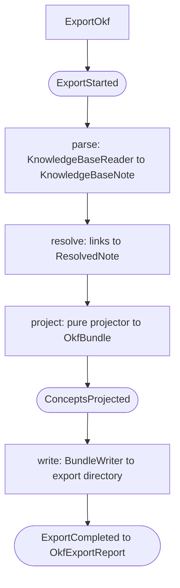

# export, knowledge base to OKF v0.2 interchange directory

## Purpose

The `export` slice projects an indexed collection into a portable
[Open Knowledge Format](https://github.com/GoogleCloudPlatform/knowledge-catalog/blob/main/okf/SPEC.md)
(OKF) v0.2 **export directory** (OKF's own name for it is Knowledge Bundle), a directory of Markdown files with YAML frontmatter
(knowledge base ADR D-24, engram [ADR 0009](../adr/0009-okf-export-interchange.md), upgraded to
v0.2 by [ADR 0037](../adr/0037-okf-v02-projection.md)). It owns a
small, read-only pipeline, **parse, then resolve, then project, then write**, that turns the
authored knowledge base into a vendor-neutral, at-rest export directory a plain OKF consumer
(`cat`, an LLM context, Obsidian, Gemini/ADK, Knowledge Catalog) can read, while
preserving our typed edges + provenance in OKF extension keys (`okf_x_*`) that
consumers ignore. It does **not** touch Postgres, embeddings, or the knowledge base, the export directory
is a rebuildable derivative (the DB-is-disposable stance of
[ADR 0002](../adr/0002-disposable-mirror-zotero-source-of-truth.md), applied at rest).
It is the at-rest complement to D-19's query-time federation.

## Entry points

| Surface | Entry | Defined in |
|---|---|---|
| CLI | `studio export okf --out <dir> [--collection <name>]` | `studio/src/studio/knowledge_base/cli.py` (`export_okf_cmd`) |
| Bus | `ExportOkf` command to `ExportOkfHandler` | `src/engram/export/handlers.py` |

The CLI dispatches the `ExportOkf` command through the shared CQRS `MessageBus` exactly
like `index`/`sync`, runs it inline, and prints a report. There is no HTTP surface (an
export is a local, on-demand projection, not a tracked job).

## Public contract

- **Inputs:** `ExportOkf` (`src/engram/export/domain.py`), carries `collection` (the
  knowledge base partition. The CLI resolves it from the knowledge base's schema's `retrieval.collection`
  when `--collection` is omitted) and `out_dir` (the export directory's root).
- **Outputs:** `OkfExportReport` (`domain.py`), counts (`concepts`, `skipped_meta`,
  `relations`, `dangling`, `files_written`) and `duration_seconds`. Pure stage models:
  `OkfConcept` (one `.md`: rel-path + frontmatter dict + body) and `OkfBundle` (the
  concepts + the root `index.md`).
- **Ports:** `BundleWriter` (`domain.py`) decouples the handler from the filesystem and
  `SourceLinkReader` (`domain.py`, implemented by `ObsidianMirrorStore.load_source_links`) reads
  each mirrored source's own deep link once per export. The slice reuses the index slice's
  `KnowledgeBaseReader` port (no duplicated knowledge-base-reading).
- **Invariants:** read-only, never mutates the knowledge base or the DB. Conformance: every
  emitted concept has parseable YAML frontmatter with a non-empty `type`. The root
  `index.md` declares `okf_version: "0.2"` (and nothing else, the pinned v0.2
  reserved-file structure). Fault-tolerant like indexing, a note that fails to parse
  is logged and skipped, never aborting the export.
- **Config:** knowledge base path via `KnowledgeBaseSettings` (resolved by wireup in `deps.py` /
  `container.py`). The export reads the knowledge base from settings/env (like `index`/`sync`),
  there is no `--knowledge-base` override on this command.

## Runtime flow



The projection (the pure `projector.py`) is **spec-driven** (engram ADR-0014): it skips `meta`
pages and exports every page type the knowledge base's `KnowledgeBaseSchema` declares, grouped by page_type into a
subdir taken from that page_type's own declared `folder` basename (`Wiki/Papers` becomes `papers/`), or the
page_type name when it declares no folder, maps each page's frontmatter (`type` from the page page_type
verbatim, OKF's `type` being an uncurated free string, `title` / `description` / `tags`), emits
the v0.2 trust + lifecycle families (`status` from the QA ladder folded into
`draft | stable | deprecated` with supersession winning, `generated` from
`{by: engram/<version>, at: updated}`, `verified` from one machine-confirmation event for
QA-`verified` pages, `sources` from the one entry a page carries when its frontmatter holds a value
under the knowledge base's declared `sources.key_field`, whose `resource` is the deep link that source's
own mirror supplies, ADR 0037), preserves typed edges + provenance in
`okf_x_relations` / `okf_x_engram`, rewrites body wikilinks **fence-aware** (resolved becomes
a relative `.md` link, dangling becomes plain text, code-fence content untouched), and appends a
`## Relations` section. The root `index.md` is a progressive-disclosure listing grouped
by subdir. No page type, field name or connector is named in the projector: the spec supplies all
of them, so a knowledge base's own vocabulary reaches the export directory without the indexer knowing it.

## Examples

```bash
# Export the knowledge base spec's own collection to ./bundles/research
studio export okf --out ./bundles/research

# Export a specific partition instead
studio export okf --out ./bundles/research --collection research
```

One projected concept (a `paper` page becomes `papers/lightrag-2025.md`):

```markdown
---
type: paper
title: "LightRAG: Simple and Fast RAG"
description: Graph-indexed RAG.
tags: [retrieval, graph]
status: stable
generated:
  by: engram/0.0.1
  at: '2026-06-10'
sources:
  - id: 8QXFXYMI
    title: "LightRAG: Simple and Fast RAG"
    resource: zotero://select/library/items/8QXFXYMI
okf_x_relations:
  proposes: [entities/lightrag]
okf_x_engram:
  id: paper.lightrag-2025
  status: synthesized
  collection: research
  source_id: 8QXFXYMI
  source_hash: bd72
  fields:
    paper_type: method
    year: 2025
    artifacts:
      code: https://github.com/HKUDS/LightRAG
---

## TL;DR

LightRAG beats [GraphRAG](/entities/graphrag.md) on long-context QA.

## Relations

- **proposes** → [LightRAG](/entities/lightrag.md)
```

A plain OKF consumer reads a valid, useful concept. An OKF-aware-of-us consumer recovers
the typed edge (`okf_x_relations`) and the provenance (`okf_x_engram`) from the extension
keys.

## Patterns used

- **Vertical-slice DDD**, slice owns its domain, handlers, projector, writer, and deps.
  See `../../../docs/explanation/design-patterns.md#vertical-slice-ddd`.
- **CQRS message bus**, `ExportOkf` dispatched through the shared bus. The route is
  registered by the composition root (`container.export_handler_provider`), the same
  lazy-route arrangement as sync. See
  `../../../docs/explanation/design-patterns.md#cqrs-message-bus`.
- **DI seams / fakes over mocks**, the `BundleWriter` port and the reused `KnowledgeBaseReader`
  port are the substitution points. The CLI's `ctx.obj` factory seam is the dispatch
  test seam. See `../../../docs/explanation/design-patterns.md#di-seams-and-fakes-over-mocks`.
- **Immutable mirror**, the export directory is a disposable derivative. The knowledge base stays the
  source of truth. See `../../../docs/explanation/design-patterns.md#immutable-mirror`.
- Decision records: [ADR 0009](../adr/0009-okf-export-interchange.md) (the slice),
  [ADR 0037](../adr/0037-okf-v02-projection.md) (the v0.2 projection target).

See the glossary at `../../CONTEXT.md` for slice, port, and collection definitions.

## Testing seams

- **Wireup container**, `bundle_writer_provider` (`studio/src/studio/knowledge_base/wiring/export.py`) and
  `export_handler_provider` (`studio/src/studio/knowledge_base/container.py`) bind the ports. Tests bypass them by
  injecting fakes.
- **`ctx.obj` factory seam**, `_build_container` (`studio/src/studio/knowledge_base/cli.py`) uses the `ctx.obj`
  factory when set (via `CliRunner.invoke(..., obj=...)`), the env-backed default
  otherwise, no monkeypatching.
- **Protocol ports**, `BundleWriter` (`domain.py`) and the reused `KnowledgeBaseReader`.
- **Fakes:** shipped under `engram/src/engram/testing/fakes/`: `kb_reader.py` (`FakeKnowledgeBaseReader`, in-memory knowledge base
  documents), `bundle_writer.py` (`RecordingBundleWriter`, captures the written export directory), `source_links.py`
  (`FakeSourceLinks`, the mirror links a projection reads).
- **Tests:** unit tests in `tests/unit/engram/export/`, `test_projector.py` (the pure
  projection, tested hardest: paths, frontmatter, extension keys, fence-aware link
  rewriting, the `## Relations` section, `meta`-skip, conformance), `test_handlers.py`
  (the pipeline over fakes: report counts, parse fault-tolerance, event sequence),
  `test_writer.py` (the serialiser round-trip + the on-disk adapter). CLI dispatch in
  `tests/unit/test_cli_export.py`.
