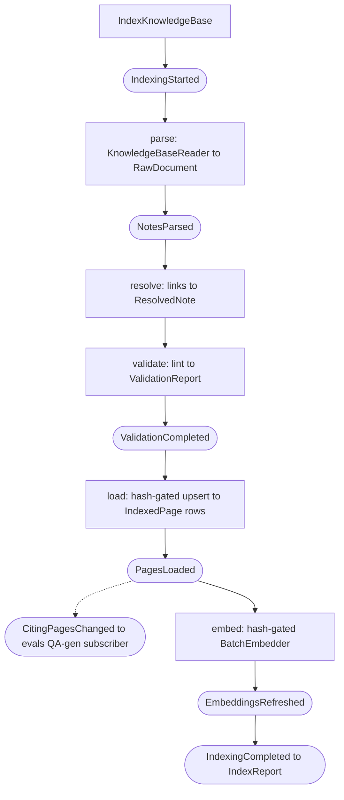

# index, the pipeline from knowledge base to Postgres

## Purpose

The `index` slice is the knowledge base's admin engine: it reads the Obsidian knowledge base and
rebuilds the queryable Postgres surface. It owns the five-stage pipeline,
**parse, then resolve, then validate, then load, then embed**, that turns immutable Markdown
mirrors and knowledge base notes into rows the `search` and `fetch` slices read. It is the
*only* writer of the derived tables. The database is a disposable derivative of
the knowledge base, fully reconstructable from a clean rebuild. It does **not** serve
queries (that is the `search` slice) and does **not** mutate the knowledge base (that is
the `sync` slice, which owns the source mirrors).

Indexing is **incremental by default**: a content-hash manifest detects which
files changed, and only the files whose indexed output can differ, the dirty
set, are re-parsed, re-resolved, re-validated, and re-loaded. `--full` is the
guaranteed-correct escape hatch (today's rebuild of the whole knowledge base) and the oracle the
`incremental == full` property test compares against. An incremental run is proven
bit-for-bit identical to a full rebuild (ADR
[`0019`](../adr/0019-true-incremental-ingestion.md), Vibe RAG Phase 3).

## Entry points

| Surface | Entry | Defined in |
|---|---|---|
| CLI | `studio index [--full] [--dry-run] [--no-embed] [--summaries] [--collection <name>]` | `studio/src/studio/knowledge_base/cli.py` (`index_cmd`) |
| CLI | `studio summaries list [--collection <name>]`, `studio summaries approve [--collection <name>]` | `studio/src/studio/knowledge_base/cli.py` (`summaries_app`) |
| HTTP | `POST /api/jobs/compile` (body `{embed, full}`) | `studio/src/studio/knowledge_base/http/api.py` (`start_index`) |
| Bus | `IndexKnowledgeBase` command to `IndexKnowledgeBaseHandler` | `src/engram/indexing/service/index.py` |

Both surfaces dispatch the same `IndexKnowledgeBase` command through the CQRS
`MessageBus`. The CLI runs it inline and prints a report, while the HTTP route
wraps it in a `JobRegistry` job (`JobKind.INDEX`) for async tracking.

## Public contract

- **Inputs:** `IndexKnowledgeBase` (`src/engram/indexing/domain/models.py`), carries
  `collection` (knowledge base partition, CLI default `"research"`), `embed` (toggles the
  paid embedding stage. `--no-embed` sets it `False`), `full` (forces the
  whole-knowledge-base rebuild. `--full` sets it `True`), and `dry_run` (computes and
  reports the dirty set but writes nothing. `--dry-run` sets it `True`).
- **Outputs:** `IndexReport` (`src/engram/indexing/domain/models.py`), counts,
  embedding metadata, duration, an embedded `ValidationReport` of `ValidationIssue`s, the run
  `mode` (`"incremental"` | `"full"`), `skipped` (pages the manifest hit left
  untouched this run), `cut_plans` (the cut plans reused and chosen and the heading sections filled, see
  [The chunk planner and cut plans](#the-chunk-planner-and-cut-plans)), and a `dry_run` preview
  (`DryRunPreview`, `None` on a real run). Internal stage models: `RawDocument`, `ResolvedNote`, `IndexedPage`.
- **Events:** the handler emits the pipeline `Event`s as it advances. After `PagesLoaded`
  it emits `CitingPagesChanged{page_ids}` (`src/engram/indexing/domain/models.py`), consumed by the
  evals QA-generation subscriber to enqueue papers whose datasets may need
  (re)generation, see [evals.md](evals.md). On an incremental run the set is **narrowed**
  to only the `page_type == "paper"` pages whose indexed output changed. A full rebuild or a
  cold start still emits every paper id (the precise changed-set feeds Vibe RAG Phase 6
  freshness, ADR [`0019`](../adr/0019-true-incremental-ingestion.md)).
- **Ports:** `KnowledgeBaseReader` and `BatchEmbedder` protocols (`domain.py`) decouple
  the handler from the filesystem and the embedding provider.
- **Invariants:** **incremental equals full**, an incremental run is bit-for-bit
  identical to a `--full` rebuild over every `memory.*` data table plus `validation_store`
  (proven by `tests/integration/indexing/test_incremental_equals_full.py`, whose matrix covers
  removing a section, renaming a heading, removing a claim anchor,
  stripping a page of every child, and removing a page's introduction prose).
  Idempotent, re-running on an unchanged knowledge base is a no-op at the row level
  (every row upsert is **hash-gated** in `src/engram/indexing/infrastructure/repository.py`, and
  the incremental path skips a clean file entirely on a manifest hit). Embedding is
  hash-gated too, so only changed pages/sections/claims/chunks re-embed. Single
  writer of the derived tables. Every read, write, and prune the incremental path
  issues is **scoped to `--collection`** (the new index-state tables each carry a
  `collection` column, and the full-rebuild prune `DELETE`s filter by it or a
  parent-collection subquery), so indexing one collection never touches another's
  rows, multiple collections coexist in one DB (D-19). Every statement that filters on a set of
  ids, names or paths binds the whole set as one `text[]` parameter, joined through `unnest`, so
  no set size passes asyncpg's limit of 32,767 bind parameters. A bulk upsert splits its rows into
  several insert statements under the same limit, and the `kb.pages.superseded_by` key is checked
  at commit (migration 0067), so a page may name a page a later statement of the same index writes.
- **Errors:** validation errors do not abort the load (rows still upsert), but any
  validation error standing in the knowledge base makes the CLI exit 1, a dirty knowledge base fails CI.
  An incremental run validates only the dirty set, so its report also carries `standing_validation`,
  every issue stored for the collection once the load committed, and the exit code reads that.
- **Config:** knowledge base path via `KnowledgeBaseSettings`. Embedding provider via
  `EmbeddingProviderSettings` (both resolved by wireup in `deps.py`). Chunk sizes via
  `IngestionSettings.chunk_target_tokens` and `chunk_max_tokens`, and the chunk planner via
  `IngestionSettings.chunk_planner_model` and its three limits, see
  [Chunking source mirrors](#chunking-source-mirrors).

## Runtime flow



The embed stage is skipped entirely when `embed=False`. Only rows whose embed-gate
hash changed are re-embedded (`rows_needing_embedding` / `chunks_needing_embedding`).

The **load** stage also refreshes the link graph: after the edge set settles it
calls `kb.refresh_graph()` to re-project the graph backend's traversal structure from the
new edges. Under the `cte` backend this is a no-op (its walks read `kb.visible_edges` live).
Under the Apache AGE backend it rebuilds the `kb_graph` property graph, so the read-only
`api.graph_expand` / `api.graph_paths` functions the `serve` slice exposes traverse a current
projection while staying pure-read (the write happens here, at index time, ADR
[`0007`](../adr/0007-age-multihop-dual-graph-backend.md)). On an incremental run the
re-projection is **gated on an edge change**, if no edge was inserted or deleted, the
graph is left as is (the projection is cheap SQL, but a no-edge-change run skips it
entirely, ADR [`0019`](../adr/0019-true-incremental-ingestion.md)).

After every real run (never a dry run) the **switch stage** stores the retrieval switches and the
schema's `retrieval.private` flag on `kb.index_fingerprint`, as
[auto-retrieval-mode.md](auto-retrieval-mode.md) describes. Given a `ReaderScopes` port
(`SqlReaderScopes`, wired by the studio's `reader_scopes_provider`), it then gives a private
knowledge base its own login reader role: `kb_reader_` and 20 hex digits of the collection's hash, a
member of `kb_reader` carrying `kb_reader`'s settings, whose password is derived from
`infrastructure.database.reader_secret`, and a row in `kb.reader_scopes`. A knowledge base that is no
longer private loses its row. With no reader secret the stage logs a warning and creates no role, so
no reader can read the private knowledge base (engram ADR-0046).

## Chunking source mirrors

The load stage cuts each source mirror into `kb.raw_chunks` rows with `chunk_mirror`
(`src/engram/indexing/domain/mirror_chunks.py`). One rule serves every mirror, and the mirror's own
shape picks the step:

1. **Whole.** A mirror with no heading that fits the maximum chunk size stays one chunk.
2. **Headings.** A mirror with headings (`#` to `####`) is cut at them into heading sections. Every
   heading opens one, even with an empty body, and the text before the first heading is one when it
   holds text. A heading section within the maximum is one chunk. A short mirror with several
   headings is still cut at each of them, so every section keeps its own locator. A `#` line inside a
   code fence (between two lines opening with three backticks) is text, never a heading, so a shell or
   Python comment in a fenced block opens no heading section. Indexer version 7 brought this in, so an
   index stored at 6 rebuilds in full.
3. **Chunk planner.** Text over the maximum, a mirror with no heading or one heading section, of at
   least two paragraphs and within the planner ceiling (12,000 tokens by default), is cut where the
   chunk planner says its topic changes. The planner is shown the text as paragraphs numbered from 1
   and answers the numbers of the paragraphs where a new chunk starts, never text, so every chunk is
   the mirror's own text. An answer that is not strictly increasing paragraph numbers is refused and
   the text is filled. A chunk of an accepted answer that passes the maximum is filled on its own.
4. **Filling.** Any other text over the maximum is filled, and so is text the chunk planner gave no
   accepted answer for: whole paragraphs (split at blank lines outside code fences) go into a chunk
   until the next would pass the target. A paragraph over the maximum is cut at its sentence ends, a
   sentence over it at its line breaks, so table rows and code lines stay whole, a line over it at its
   last word break within the maximum, and a single word over it inside the word. No chunk passes the
   maximum.

Every chunk of a heading section keeps its heading and section path, so claim locators and the
`raw_chunks.section_path` join keep working, and its embed input keeps the source title and heading
breadcrumb. Every chunk body is the mirror's own text with only edge whitespace removed, so the
chunks hold every word of the mirror in order. `api.raw_chunks` serves each chunk's `seq`, its place in
the mirror's reading order (migration 0068), so a SQL reader reads a mirror in order with `ORDER BY seq`.

The sizes are `IngestionSettings.chunk_target_tokens` (400 by default) and `chunk_max_tokens` (800
by default, at most 7,500, the embedding budget less room for the breadcrumb). The studio's index
handler reads them from the `ingestion` settings section. A library caller passes `ChunkSizes` to
`IndexKnowledgeBaseHandler`, or gets `DEFAULT_CHUNK_SIZES`. The fingerprint stores the indexer version
with the sizes and the chunk planner (`indexer_version`, such as `7+400-800`, or
`7+400-800+12000+gpt-6-luna/prompt-1/thinking-low/paragraphs-1` with a chunk planner), so the next index
after a change of sizes, of chunk planner (its deployment, prompt version or thinking level), of the
paragraph numbering or of the planner ceiling is a full one, and `studio status` names it stale until
then. `indexer_version` is the one place the version is put together: the handler calls it with its
`CutPlanStage`'s identity and ceiling, and the studio (`ingestion_indexer_version`) with the identity it
reads from the settings, with no model built.

### The chunk planner and cut plans

The chunk planner is a port, `ChunkPlanner` (`src/engram/indexing/internal_contracts.py`): its
`identity` names its model, prompt version and thinking level (`PydanticAiChunkPlanner.identity_for(deployment)`
gives it with no model built), and `chunk_starts(paragraphs)` answers paragraph numbers. Plans are stored
under the cut plan identity, `cut_plan_identity(identity)`, which adds the paragraph numbering version
(`PARAGRAPH_NUMBERING_VERSION`, kept beside the code that splits paragraphs). `CutPlanStage` (`src/engram/indexing/service/cut_plan_stage.py`) runs on the full and the
incremental path before the rows are built, and only when the schema stores source chunks. For each
heading section the chunk planner may cut (`heading_sections_for_planner`) it reads the cut plan stored
under the knowledge base, the sha256 of the section's text and the cut plan identity, and shows the
planner only the heading sections with none, at most `chunk_planner_concurrency` at once. Each accepted answer is stored in `kb.cut_plans`
(migration 0069), so indexing the same text again with the same chunk planner calls no model and cuts it
the same way. A planner call that raises, runs past `chunk_planner_deadline_seconds` or answers refused
numbers fills its text, is not stored, and never fails the index, so the next index asks again. The
report carries how many cut plans the index reused and chose, and how many heading sections it filled for
want of an accepted answer (`IndexReport.cut_plans`, distinct section texts), and `studio index` prints
them as `Cut plans: 3 reused, 5 chosen, 1 filled` whenever one is not zero. The plans reach the chunker on the mirror itself
(`MirrorDoc.cut_plans`, by text hash), so the raw chunk rows and their embed inputs are cut alike.

The chunk planner is off by default. To turn it on, set `ingestion.chunk_planner_model` to a chat
deployment on the Azure OpenAI resource `infrastructure.azure_openai.endpoint` names (this project runs
`gpt-6-luna`), or `APP_INGESTION__CHUNK_PLANNER_MODEL`. The next plain index is then a full one, since
the stored indexer version names the planner. The studio wires `PydanticAiChunkPlanner`
(`src/engram/indexing/infrastructure/chunk_planner.py`) over that deployment, on the resource the
disclosure summaries use, at a low thinking level. Its prompt asks for the paragraphs
that open a new topic and its structured output is a list of paragraph numbers. An empty
`chunk_planner_model`, or no `infrastructure.azure_openai.endpoint`, indexes with no chunk planner, and
every such heading section is filled. A library caller passes `cut_plan_stage=CutPlanStage(planner, plans, queries)`
to `IndexKnowledgeBaseHandler`, with `SqlAlchemyCutPlans(engine)` as both stores, or passes nothing.

| Setting | Default | What it does |
|---|---|---|
| `ingestion.chunk_planner_model` | empty | The Azure OpenAI deployment the chunk planner runs on. Empty, the default, leaves the chunk planner off. |
| `ingestion.chunk_planner_ceiling_tokens` | 12,000 | The most tokens of text the chunk planner is shown at once. Longer text is filled. |
| `ingestion.chunk_planner_deadline_seconds` | 60 | How long one chunk planner call may take before its text is filled. |
| `ingestion.chunk_planner_concurrency` | 4 | How many chunk planner calls may run at once in one index. |

`kb.cut_plans` is never pruned: a plan for text the knowledge base no longer holds stays until the table
is cleared by hand, which only makes the next index ask the planner again.

`read_source` answers a mirror's `chunk_count` and its `section_count`, the heading sections it holds,
counted as the chunks whose heading or section path differs from the chunk before. The schema's
`sources.digest_sections_over` threshold is compared with `section_count`, so smaller chunks never
change `split_recommended`. Two adjacent heading sections with the same heading text and section path
count as one.

## Incremental ingestion

Indexing is incremental by default (ADR
[`0019`](../adr/0019-true-incremental-ingestion.md), Vibe RAG Phase 3). The crux is
that resolve is *global*: `resolver.py::build_link_index` keys each page by
filename stem, `id`, `title`, and `aliases` (lower-cased), so a one-file edit can
flip how *unchanged* files resolve. The dirty set is therefore never "files that
changed" but "files whose indexed output can differ," which needs link-graph
reasoning. Four index-private tables in the `kb` schema hold exactly the state
needed to compute that closure cheaply (created by
`alembic/versions/0006_compile_state.py`, **not** granted to `kb_reader` and
**not** referenced by any `api` view or function, written inside the single load
transaction so the manifest can never desync from the rows it describes):

| Table | Holds | Used for |
|---|---|---|
| `kb.index_manifest` | one row per indexed file, its `content_hash`, `identity_hash`, and the `page_id` / `source_key` it produced | re-hashing every file and diffing against it yields the raw `{added, removed, content_changed}` partition **without parsing** |
| `kb.link_refs` | **every** outbound link target a page or one of its claims declares, resolved **and** dangling, with the raw lower-cased `raw_target` and the resolved `dst_id` (NULL if dangling) | the inbound closure as a name query (`WHERE raw_target IN <names>`), which `kb.edges` (resolved-only, id-keyed, no raw target) cannot answer |
| `kb.validation_store` | each page's validation findings | the whole-knowledge-base report = `stored(clean pages) ∪ recomputed(dirty pages)`, so the `n_errors` CI gate stays bit-for-bit identical |
| `kb.index_fingerprint` | a single per-collection row, `indexer_version + spec_hash + registry_hash + embed_model` | a **global invalidator**: a mismatch auto-forces a `--full` rebuild |

**The content/identity-hash split.** `content_hash` (`card.content_hash` of the raw
file text) answers "did anything in this file change?" and gates whether the file
is re-parsed at all. `identity_hash` (`card.content_hash` of the normalized, sorted
resolution-key set `{filename_stem, id, title, aliases}`) answers "did this file's
effect on how *other* files resolve change?". A body-only edit changes `content_hash`
but not `identity_hash`, so it re-does that one file and nothing else. Only an
identity change (or an add/remove) triggers the inbound closure. The `identity_hash`
of a changed note is computed from a frontmatter-only read
(`core.markdown.split_frontmatter`), so the full `engram.kb.domain.parser.parse` runs only
for files in the dirty set.

**The dirty set** the incremental path re-parses, re-resolves, re-validates, and
re-loads is `content_changed ∪ added ∪ inbound-closure ∪ mirror-citers`. The
**inbound closure**, the unchanged pages that reference (by any old-or-new
resolution key) a page whose `identity_hash` changed or that was added or removed,
is found through `kb.link_refs`, which records every claim's subject, declared link
fields and `disputed_by` targets beside the page links and claim edges, resolved or
dangling, so adding a page a claim names re-resolves that claim. The pages whose claims
cite a removed page as their subject or in a claim qualifier are also read from
`kb.claims` and `kb.claim_qualifiers`. The closure is **single-level** (the completeness
lemma): a closure page is included only because it references an affected name, and
re-resolving it updates its edges but cannot change its own identity, so no
second-level expansion is needed, which is what makes incremental provably equal to
full. **Load** then upserts only the dirty pages, replaces their claim qualifiers and
prunes their stale claims, deletes by vanished id (the vanished pages' claims first,
because a claim's subject and qualifiers cite a page with no cascade, then unsets
`superseded_by` on every page naming a vanished page, then the pages,
cascading `sources_raw`), reconciles each rebuilt page's other child rows, replaces edges,
link-refs, and lint per source, and re-projects the
AGE graph only when an edge changed. A persisted per-page validation store lets the
whole-knowledge-base `n_errors` gate be reassembled exactly.

**Reconciling a rebuilt page's children.** An upsert alone cannot shrink a page: a
section, a claim or a disclosure summary the page no longer
produces stays in the database forever. A full rebuild removes those with the
whole-collection `NOT IN` prune, which an incremental run cannot issue. It re-read
only part of the knowledge base, so its keep-set names only part of the collection.
The incremental load therefore reconciles **per page**: for each page it actually
rebuilt, it deletes that page's `kb.sections` and `kb.claims`
rows the fresh load did not re-produce, and the `kb.unit_summaries` rows describing a
section that went away or a page that was deleted. Every one of those `DELETE`s carries
three predicates (the row's own `collection`, the owning page set, and the keep-set),
so a second knowledge base holding the same child id is never a candidate, and a page
nobody re-read keeps everything it had. A dirty note that failed to parse produces no
rows, so it is left out of the owning page set and keeps its children rather than having
them reconciled against an empty load. `claim_qualifiers` needs no reconcile of its own:
its rows cascade from `kb.claims` and are replaced per owning page. The whole reconcile
rides the single load transaction, so a failure mid-way rolls back the deletes with the
upserts, and the rows removed are reported as the run's `pruned` count.

**Repairing a database indexed before the reconcile landed.** The reconcile only removes
what a *later* run finds stale. A row already orphaned by an earlier incremental index is
never named by any page set again. A full rebuild is the supported repair, and the only
way to guarantee those rows are gone:

```bash
cd studio
uv run studio index --knowledge-base ../docs --collection repo-docs --full
```

`--full` is the guaranteed-correct escape hatch: today's whole-knowledge-base pipeline
(unchanged behavior, including the belt-and-braces whole-set `NOT IN` prune)
additionally rewriting all four tables fresh. It is auto-forced by a missing or empty
manifest (a cold start) or a fingerprint mismatch (a spec, registry, or embed-model
change), and CI runs it. The `incremental == full` property test
(`tests/integration/indexing/test_incremental_equals_full.py`) is the correctness
oracle: it replays a scenario matrix end to end and asserts the two DBs are identical
over every `memory.*` data table plus `validation_store`, claim
qualifiers and unit summaries included.

`--dry-run` previews the dirty set and writes nothing: it re-hashes the knowledge base, expands
the diff into the dirty set with every write suppressed, and prints each partition's
count and first few paths plus `pages_to_reembed`, `edges_to_rebuild`, and whether the
graph would be re-projected. It always exits 0 (it is a preview and does not run lint),
and leaves every `memory.*` table, `index_manifest` included, byte-identical.

## Disclosure summaries (`--summaries`)

`compile --summaries` runs `SummaryStage` (`src/engram/indexing/service/summary_stage.py`, spec section 5) after
the embed stage: for every page and section of `--collection` whose `body_hash` has no matching
`active`/`pending` `kb.unit_summaries` row yet, it calls the injected `Summarizer` port and
writes a `status='pending'` row (the same hash-gated "needs work" shape `EmbedStage` uses for its
`embedding IS NULL` queues, applied to summaries instead of vectors). A summary this stage writes
is **never disclosed** until a human reviews it, `EnvelopeHandler`
([serve.md](serve.md#public-contract)) reads `unit_summaries` filtered to `status = 'active'` in
the join predicate, so a `pending` row falls back to the page's own frontmatter `summary`, never
its drafted text. Once promoted to `active`, a summary is what the leveled `fetch` tool serves as
that page's or section's one-line `ChildSummary` in its parent's child listing, so `--summaries` +
`approve` is how a knowledge base's disclosure-surface summaries get written, reviewed, and go live. There
is no `rejected` status: the only vocabulary is `pending` becomes `active` (`studio summaries approve`),
and a unit falls back into the pending queue solely when its `source_hash` no longer matches the
current row (the body changed since the last summary), not via any reject verb.

The index never writes an `active` summary and never rewrites one, but it does remove the ones
whose unit is gone: `kb.unit_summaries` carries no foreign key to `kb.pages` or `kb.sections`, so a
page or section the knowledge base no longer has would otherwise leave its summary behind. A full
rebuild keeps the summaries of its own pages and sections and drops the rest. An incremental run
drops the summaries of the sections a rebuilt page stopped producing and of the pages it deleted.
A summary whose unit still exists is left alone however stale its `source_hash` is, which is the
pending queue's business, not the prune's.

`studio summaries list --collection X` prints every `pending` row for `X`, oldest first
(read-only). `studio summaries approve --collection X` promotes every `pending` row of `X` to
`active`, the human half of the governance quarantine, run after reviewing the corresponding
source diff (the indexed pages/sections, in git). It flips DB state only, re-reading nothing from
the knowledge base and re-running no summarization (re-run `compile --summaries` to refresh a summary
whose source changed). `IngestionSettings.summary_model` (`APP_INGESTION__SUMMARY_MODEL`, default
`"gpt-4.1"`) is the Azure chat-deployment name the stage summarizes through, a separate deployment
from the embedding one, since summarizing is a chat/completion call.

## Examples

```bash
# Incremental rebuild including embeddings (default collection "research"):
# only the changed files (and the unchanged files whose link-resolution flips) re-compile
studio index

# Force the whole-knowledge-base rebuild (the escape hatch + property-test oracle)
studio index --full

# Preview the dirty set without writing anything (added/removed/changed/closure/citers + would-re-embed counts)
studio index --dry-run

# Fast dev/CI loop — skip the paid embedding stage (composes with --full / --dry-run)
studio index --no-embed

# Compile a specific knowledge base partition
studio index --collection research

# Inspect compile drift: last-run mode, files tracked (manifest), the fingerprint,
# and a "manifest stale ⇒ next run is --full" hint on a cold start or indexer-version change
studio status --collection research

# Compile-time disclosure summaries (spec §5): write pending kb.unit_summaries rows, review,
# then promote them to active (never disclosed until approved)
studio index --knowledge-base ../docs --summaries --collection repo-docs
studio summaries list --knowledge-base ../docs --collection repo-docs
studio summaries approve --knowledge-base ../docs --collection repo-docs
```

```bash
# Trigger a compile job over HTTP (returns a Job to poll at /api/jobs/{id});
# `full` defaults false (incremental)
curl -X POST localhost:8000/api/jobs/compile -d '{"embed": false, "full": false}'
```

## Patterns used

- **Vertical-slice DDD**, slice owns its domain, handlers, repository, uow, and
  deps. See `../../../docs/explanation/design-patterns.md#vertical-slice-ddd`,
  ADR `../adr/0001-*.md`.
- **CQRS message bus**, `IndexKnowledgeBase` command dispatched through the shared bus.
  See `../../../docs/explanation/design-patterns.md#cqrs-message-bus`.
- **DI seams / fakes-over-mocks**, `KnowledgeBaseReader` / `BatchEmbedder` ports and the
  `ctx.obj` factory seam. See
  `../../../docs/explanation/design-patterns.md#di-seams-and-fakes-over-mocks`.
- **Immutable mirror**, the DB is a disposable derivative. Sources stay
  read-only. See `../../../docs/explanation/design-patterns.md#immutable-mirror`,
  ADR `../../../docs/adr/0002-*.md`.
- App placement & docs standard: ADRs
  `../../../docs/adr/0001-wiki-app-placement-and-core.md`,
  `../../../docs/adr/0005-docs-as-code-standard.md`.

See the glossary at `../../CONTEXT.md` for slice, port, and mirror definitions.

## Testing seams

- **Wireup container**, `kb_reader_provider` / `embedder_provider`
  (`studio/src/studio/knowledge_base/wiring/indexing.py`) bind the ports to concrete adapters. Tests
  bypass them by injecting fakes.
- **`ctx.obj` factory seam**, `_build_container` (`studio/src/studio/knowledge_base/cli.py`) uses the
  `ctx.obj` factory when set (via `CliRunner.invoke(..., obj=...)`), the
  env-backed default otherwise, no monkeypatching.
- **Protocol ports**, `KnowledgeBaseReader`, `BatchEmbedder` (`domain.py`) and the
  uow's repo ports are the substitution points.
- **Fakes:** `tests/support/fakes/embedding.py` (`FakeEmbedding`),
  `tests/support/fakes/uow.py` (`FakeKnowledgeBaseUnitOfWork`). Local doubles in
  `tests/unit/engram/indexing/test_handlers.py` (`FakeValidationReportSink`, `BusSpy`,
  `FakeEmbedRow`).
- **Tests:** unit tests in `tests/unit/engram/indexing/` (the pure manifest diff +
  closure scenarios incl. the completeness lemma in `test_manifest.py`, the
  `run_incremental` and full-vs-incremental branch logic over the fake UoW in
  `test_incremental_handler.py`). The **`incremental == full` correctness oracle**
  in `tests/integration/indexing/test_incremental_equals_full.py` and the
  writes-nothing `--dry-run` check in `test_dry_run_writes_nothing.py`
  (testcontainers analog). Full index, then search, then fetch round-trip in
  `tests/e2e/test_compile_and_search.py`. Golden fixture
  `tests/fixtures/golden/lightrag-2025.md`. Disclosure summaries: `SummaryStage` over the
  `Summarizer` Protocol and a `FakeSummarizer`/fake `SummaryUnitOfWork`
  (`tests/unit/engram/indexing/test_summary_stage.py`), the `--summaries` index-handler wiring
  (`tests/unit/engram/indexing/test_index_summaries_flag.py`), `PydanticAiSummarizer` against
  `TestModel`/`FunctionModel` (`tests/unit/engram/indexing/test_summarizer.py`), `studio summaries
  list|approve` over the `ctx.obj` seam (`tests/unit/test_cli_summaries.py`), and the real
  `kb.unit_summaries` DDL (`tests/integration/indexing/test_unit_summaries_table.py`,
  testcontainers). The chunk planner: `FakeChunkPlanner` and `FakeCutPlans` (`engram.testing.fakes.chunk_planner`)
  drive `CutPlanStage` through the handler with no model (`tests/unit/engram/indexing/test_cut_plans_in_the_index.py`),
  the domain's cut plans are pinned in `test_mirror_chunks.py`, `PydanticAiChunkPlanner` runs against
  `TestModel`/`FunctionModel` (`test_chunk_planner.py`), and `kb.cut_plans` with a real index on top
  of it runs in `tests/integration/indexing/test_cut_plans_db.py` (testcontainers).
