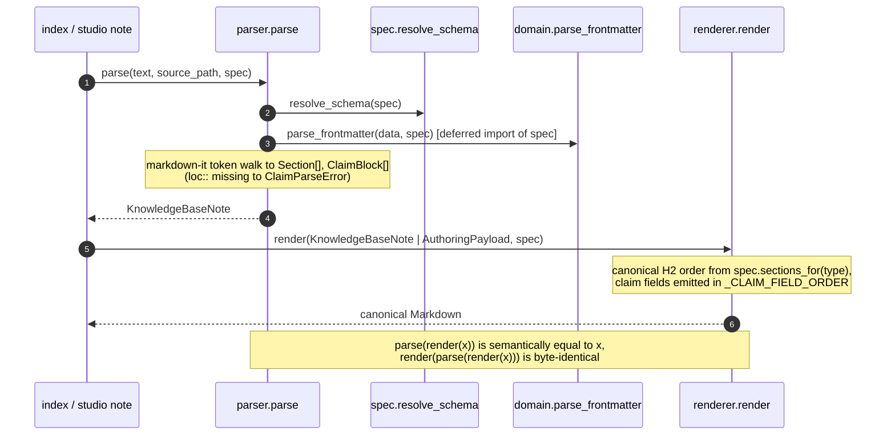

# kb, the shared note-grammar kernel

## Purpose

The `engram.kb` kernel (`src/engram/kb/`, **not** a `features/` slice) is engram's
shared note grammar: it turns a knowledge base's Markdown into typed domain objects
(`parse`) and turns domain objects back into canonical Markdown (`render`), and
it verifies that a claim's `quote::` appears in its source mirror (`verify`). It
encodes `_meta/schema.md` **once** (Decision P7) so the two callers bind to one
contract: the `index` slice takes the **parse path** (knowledge base to `KnowledgeBaseNote` to
loaded `pages`), and the `studio note` CLI takes the **construct path**
(`AuthoringPayload` to canonical note). The knowledge base's schema is data-driven
(page types, frontmatter fields, canonical sections, claim grammar) through a
`KnowledgeBaseSchema` per knowledge base (the `research` template's schema is the default).

It is deliberately narrow. It enforces only the **structural, always-true**
invariants (id prefix matches type, closed `status` literal, the one required
claim field `loc::`, frozen immutability). It does **not** do I/O (it operates
on file text it is handed, file reads/writes are the CLI's job), touch the
database, resolve cross-note wikilinks to ids (the indexing resolve stage), or
enforce vocabulary membership and validation thresholds (the indexing validate stage
against a `VocabularyIndex`). A not-yet-clean note must still parse so it can be
reported on. The package is stdlib + pydantic (+ `markdown-it-py`,
`core.markdown`, `text_unidecode`) only. It never imports sqlalchemy, typer, or
app wiring.

## Entry points

| Surface | Entry | Defined in |
|---|---|---|
| Programmatic (parse) | `engram.kb.contracts.parse(text, *, source_path, spec=None) -> KnowledgeBaseNote` | `src/engram/kb/domain/parser.py` |
| Programmatic (render) | `engram.kb.contracts.render(source, *, spec=None) -> str` | `src/engram/kb/domain/renderer.py` |
| Programmatic (payload of a page) | `engram.kb.contracts.payload_of(text, *, source_path, spec) -> dict` (the page parsed into the `write_note` payload that renders back the same frontmatter values and the same body, refusing a page a payload cannot carry whole. In the payload each heading is a section of its own while that renders the page back. When it does not, a section the page type does not declare comes inside the body of the section before it, heading included and as written, but only when the renderer would move it (it sits before a declared section) or change it (such as a heading with no blank line under it). Every other section stays a section of its own. Such a section with nothing before it to carry it (before the first declared section, or right after a claims section that holds claims) is refused) | `src/engram/kb/domain/renderer.py` |
| Programmatic (verify) | `engram.kb.contracts.quotes_in_mirror(value, mirror_text) -> bool` | `src/engram/kb/domain/verify.py` |
| Programmatic (spec) | `engram.kb.contracts.load_knowledge_base_schema(knowledge_base_path) -> KnowledgeBaseSchema` (raises `KnowledgeBaseSchemaMissingError` when the knowledge base declares none) | `src/engram/kb/infrastructure/schema_file.py` |
| Programmatic (test fixtures) | `engram.testing.specs.minimal_spec()`, `research_spec()` | `src/engram/testing/specs.py` |
| Programmatic (vocab) | `engram.kb.contracts.parse_vocabulary(documents) -> RegistryParseResult` | `src/engram/kb/domain/vocabulary.py` |
| Programmatic (authoring schema) | `engram.kb.contracts.payload_json_schema(page_type, spec=None) -> dict` | `src/engram/kb/domain/payload.py` |
| Programmatic (claims read back) | `engram.kb.contracts.claims_not_read_back(payload, note) -> tuple[UnreadClaim, ...]` (every payload claim the note parsed from its rendering lacks or reads differently, each with the first part that differs, each written part read the way the parser reads it) | `src/engram/kb/domain/renderer.py` |
| CLI | `studio note validate PATH` | `studio/src/studio/knowledge_base/cli_note.py` (`note_validate_cmd`) |
| CLI | `studio note build --payload P --out O [--verify-quotes] [--force]` | `studio/src/studio/knowledge_base/cli_note.py` (`note_build_cmd`) |
| CLI | `studio note build-batch --manifest M` | `studio/src/studio/knowledge_base/cli_note.py` (`note_build_batch_cmd`) |
| CLI | `studio note verify PATH` | `studio/src/studio/knowledge_base/cli_note.py` (`note_verify_cmd`) |
| CLI | `studio note normalize PATH --frontmatter F` | `studio/src/studio/knowledge_base/cli_note.py` (`note_normalize_cmd`) |
| CLI | `studio note schema --type TYPE [--knowledge-base .]` | `studio/src/studio/knowledge_base/cli_note.py` (`note_schema_cmd`) |

The CLI commands compose the kernel with the index slice's `validate_note` (the
single-note validation) and `cli_support` knowledge-base-resolution helpers. The kernel itself
has no CLI dependency. Public symbols are re-exported from `engram/kb/contracts.py`
(`__all__`).

## Public contract

The domain types other code depends on (all frozen pydantic models,
`src/engram/kb/domain/note.py` unless noted):

- `KnowledgeBaseNote`, one parsed file: `frontmatter: BaseFrontmatter`,
  `sections: tuple[Section, ...]`, `claims: tuple[ClaimBlock, ...]`,
  `source_path: str`. The kernel's central aggregate.
- `BaseFrontmatter`, `id`, `type` (a plain `str`, not the `PageType` literal,
  so any schema-declared page type is accepted), `title`, `summary`, `status: Status`,
  `aliases`, the five facet tuples. `extra="allow"` keeps unmodelled long-tail
  keys verbatim and per-page-type fields live in `__pydantic_extra__`.
- `Section`, one addressable body section (the retrieval unit): `kind`
  (`heading` | `preamble`), `heading`, `level: Literal[0, 2, 3]`, `path` (ltree-safe
  slug), `canon`, `body`, `ord`. A note's prose before its first H2/H3 is a section
  too: the parser emits one synthetic `preamble` section (`level=0`, `heading`
  `Introduction`, `path` `__preamble__`, `ord` 0) whenever meaningful text remains
  there once an optional H1 and comments are removed, so an introduction is
  searchable and fetchable rather than dropped. `heading_slug` strips leading and
  trailing underscores, so no authored heading can collide with `__preamble__`.
- `ClaimBlock`, a `^cN`-anchored provenance-carrying claim. It carries engram's own
  fields whatever the schema lists: `anchor`, `text`, the **required** `loc`, optional
  `quote`, `kind`, `subject`, typed `edges`, and the validation-set lifecycle keys
  (`status`, `disputed_by`). Every other field comes from the knowledge base's claims
  grammar. A declared text field (`text_scalar_fields`, `plain_fields`) lands in
  `fields`, keyed by field name with the value as written. A declared link field
  (`multilink_fields`, `link_scalar_fields`) lands in `links`, keyed by field name
  with its targets in written order. A key that is none of these raises
  `ClaimParseError` naming the key and the declared fields. An edge
  relation is many-valued: one grammar line carrying several `[[…]]` tokens
  (`supports:: [[a]], [[b]]`) appends one `edges` entry per token, in written
  order. `subject` and a link field listed in `link_scalar_fields` but not in
  `multilink_fields` are one-valued.
  A value carrying more than one token there raises `ClaimParseError` rather
  than picking or merging targets ([ADR-0045](../adr/0045-multi-target-claim-links-refuse-or-split.md)).
- `UnitLink`, an Obsidian wikilink value object (`target`, `alias`, `heading`,
  `block`) with `UnitLink.parse(raw)`. Its body can never contain `]]`, so a
  value carrying two adjacent links never parses as one link with a corrupted
  target.
- `AuthoringPayload` / `AuthoringClaim` / `AuthoringSection`
  (`src/engram/kb/domain/payload.py`), the extractor JSON contract `render` consumes.
  The frontmatter dict is validated through `parse_frontmatter` at construction
  (build-time, not render-time), and `assign_anchors` fills `c1..cN`.
- `KnowledgeBaseSchema` (`src/engram/kb/domain/schema.py`), the per-knowledge-base schema. There is **no default
  schema**: `resolve_schema(None)` raises rather than guessing a domain, and `load_knowledge_base_schema` raises
  `KnowledgeBaseSchemaMissingError` naming `studio init --template <slug>` and the known templates when a knowledge
  base carries no `knowledge-base-schema.json`
  ([root ADR-0018](../../../docs/adr/0018-corpus-bundles-and-provider-packages.md)).
- `VocabularyIndex`, the indexed controlled vocabulary (`entity_types`,
  `relations`, `facets`, `claim_types`) the validate stage references.
- Errors: `NoteGrammarError` (base), `FrontmatterError` (bad/unknown `type`),
  `ClaimParseError` (a Findings claim missing `loc::`, or a link-scalar field
  given more than one link token).

## Runtime flow

The behavioral parse to render round-trip (the structural component + domain-model
diagrams live in the arc42 master section 4 Knowledge bounded context,
[note-grammar kernel](../architecture/sections/04-knowledge-bounded-context.md). Do not
duplicate them here):



`Source: src/engram/kb/domain/parser.py, src/engram/kb/domain/renderer.py, src/engram/kb/domain/schema.py, src/engram/kb/domain/note.py`

## Examples

```bash
# Validate a single note (parse + the index-stage single-note validation; exit 1 on errors)
studio note validate Wiki/Papers/lightrag-2025.md

# Render an authoring payload to a canonical note, linting before the write (fail-before-write)
studio note build --payload payload.json --out Wiki/Papers/lightrag-2025.md --verify-quotes

# Emit a page type's authoring JSON schema for the extractor brief (any knowledge base's spec)
studio note schema --type paper --knowledge-base .
```

```python
from engram.kb import contracts as kb

note = kb.parse(text, source_path="Wiki/Papers/lightrag-2025.md")  # → KnowledgeBaseNote
markdown = kb.render(note)                  # KnowledgeBaseNote | AuthoringPayload → str
payload = kb.payload_of(text, source_path="Wiki/Papers/lightrag-2025.md", spec=spec)  # → write_note payload that renders `text` back
ok = kb.quotes_in_mirror(claim.quote, mirror_text)
```

## Patterns used

- **Shared kernel (DDD)**. One grammar bound by both `index` and authoring.
  See the arc42 master section 4 and `../../../docs/explanation/design-patterns.md`.
- **Parser and renderer inverse pair**. `render` is the inverse of `parse`. The
  coupling is real and named, not incidental:
  - **Field-ordering pact (F24):** a claim's fields are emitted in the fixed
    `_CLAIM_FIELD_ORDER` tuple (`renderer.py`). The parser absorbs the same keys
    from schema-derived field-sets (`_ClaimFields`). Adding a claim field means
    touching both ends.
  - **Quote (de)quoting three-way pact (F25):** `parser._unquote` strips a single
    wrapping `"…"` pair only when there is no interior quote.
    `renderer._render_quote` re-wraps under the same condition. `verify`'s
    `split_quote_snippets` treats interior-quote (table-derived) values as
    multiple snippets. All three must agree or a quote stops round-tripping or
    stops verifying.
  - **Whitespace-normalized verbatim match:** `verify.normalize_whitespace`
    collapses Unicode whitespace runs (neutralizing pandoc NBSP artifacts) before
    a case-sensitive substring test, no glyph folding (the schema contract is
    silent on it).
- **Data-driven schema**. `KnowledgeBaseSchema` drives page types,
  sections, and claim grammar. `resolve_schema` is the single `spec-or-default`
  resolution shared by parser, renderer, and payload. ADR-0014.
- **Deferred import to break a cycle (F23):** `domain.parse_frontmatter` imports
  `engram.kb.domain.schema` at **call time** (`parser.py` defers it too). The graph is
  acyclic (spec never imports domain), but the sibling import must be deferred
  because Python resolves it only after the package `__init__` completes.
- **Collision-proof slugs**. `slug.heading_slug` transliterates to ASCII with a
  hash fallback so a non-Latin or empty heading is never an invalid/colliding
  ltree label. The parser suffixes `_2`/`_3` on a repeat within a note.
- **Fault-tolerant vocabulary parse**. `registry.parse_vocabulary` skips a
  malformed row as a `VocabularyWarning` rather than raising.

> **Dual vocabulary source (F27).** Controlled vocabulary lives in **two** typed
> forms with overlapping concepts: `KnowledgeBaseSchema` (relations, claim types,
> facets, declared in `knowledge-base-schema.json`) and `VocabularyIndex`
> (`parse_vocabulary` over `_meta/vocabulary/*.md`). The validate stage reads the
> `VocabularyIndex`. The parser/renderer read the schema. They are loaded
> independently and can drift. Document what *is*. Keeping them consistent is
> the knowledge base author's responsibility today.

## Testing seams

- **Schema seam**. Every entry point takes an optional `spec: KnowledgeBaseSchema`, and an absent one is a
  caller defect rather than a domain to guess at. Tests take a fixture schema from
  `engram.testing.specs`: `minimal_spec()` (two generic page types, built in code, no template
  involved) for grammar cases, `research_spec()` (the research template read by path) for the parity
  cases that need the full schema
  (`tests/unit/engram/kb/test_spec_threading.py`, `test_generic_frontmatter.py`).
- **Round-trip property tests**. Example-based round-trip + idempotency cases in
  `tests/unit/engram/kb/test_renderer.py` assert
  `parse(render(payload))` is semantically equal and `render(parse(render(x)))`
  is byte-identical, covering the hard claim cases (interior-quote, subject-only,
  lifecycle-key), the guard on the parser and renderer pact above.
- **Pure functions, no fakes needed**. The kernel does no I/O, so its unit suite
  (`tests/unit/engram/kb/test_{domain,parser,renderer,payload,registry,verify,spec,slug}.py`,
  plus the research-parity check `test_research_parity.py`) feeds strings/models
  directly. The mirror-resolution and `validate_note` composition is exercised at the
  CLI layer (`tests/unit/` for `cli_note`), not in the kernel.

See the glossary at `../../CONTEXT.md` for grammar, claim, mirror, and schema
definitions, and the master section 4 Knowledge bounded context for the structural view.
