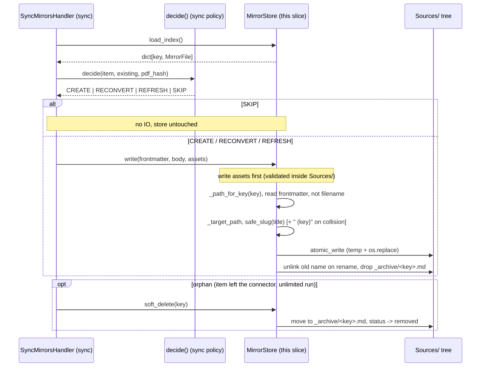

# mirror, the knowledge base's `Sources/` mirror store

## Purpose

The `mirror` slice owns the knowledge base's `Sources/` tree, the converted bodies a connector's
`SourceItem` projects into, one Markdown note per item. `MirrorStore`
(`ObsidianMirrorStore` is the sole implementer) **writes, reads back, and
soft-deletes** those mirror notes, with each note's YAML frontmatter as the
**only** persisted state (the store keeps no database of its own, ADRs
[`0002`](../adr/0002-disposable-mirror-zotero-source-of-truth.md),
[`0004`](../adr/0004-title-named-mirrors.md)). A note carries the converted body
plus vendor-neutral provenance back to its source item (`source_id`, `provider`, `provider_key`,
`source_key`, `source_version`, `source_link`, `source_hash`, `converter`, `pdf_path`). Nothing in
the model names a host: `source_link` carries whatever deep link the item's own connector filled in,
and is empty for a connector that owns none
([root ADR-0018](../../../docs/adr/0018-corpus-bundles-and-provider-packages.md)).

What it does **not** do: it does **not** decide *when* to write. The
CREATE / RECONVERT / REFRESH / SKIP decision is the `sync` slice's reconcile policy
(`decide`, see [sync.md](sync.md)). The store is a mechanical, idempotent knowledge base
port that converges what it is told to. It also does not read any connector's library, convert
PDFs, or build the queryable Postgres surface (that is `index`, which reads the
mirrors this store writes).

**Mutability: state precisely.** The on-disk mirror is **not immutable** in the
never-overwrite sense: `MirrorStore.write` **overwrites** the title note on a
re-sync and **renames** it on a title change. The immutable record is the
upstream **`kb.sources_raw`** DB row (`SourceRawORM` / `SourceDoc`, owned by
`index`, arc42 master section 9), not the file. Equally, `source_hash`
(`sha256` of the PDF bytes) is **change-detection / provenance**, it is *not* the
filename basis (`safe_slug(title)` is), so mirrors are **not** content-addressed.

## Entry points

The mirror slice has **no CLI/HTTP surface of its own**, it is a programmatic
port driven by `sync` along the reconcile path. Its surface is the `MirrorStore`
operations.

| Surface | Entry | Defined in |
|---|---|---|
| Programmatic (port) | `MirrorStore.load_index / read_body / write / soft_delete` | `engram/src/engram/sources/internal_contracts.py` |
| Programmatic (adapter) | `ObsidianMirrorStore(settings: KnowledgeBaseSettings)` | `engram/src/engram/sources/infrastructure/mirror.py` |
| DI | `mirror_store_provider(knowledge_base) -> MirrorStore` (wireup singleton, no mirror-local `deps.py`) | `studio/src/studio/knowledge_base/wiring/mirror.py` |
| Driven by | `SyncMirrorsHandler` (`decide` then `write` / `soft_delete`) | `engram/src/engram/sources/service/sync.py` |

## Public contract

`MirrorStore` (`domain.py`) is a `Protocol`, four async operations keyed by the
permanent `source_key` (never the filename). `source_key` is the one field name the store reads a
note's identity from. A note under `Sources/` carrying anything else, or whose frontmatter does not
satisfy `MirrorFile`, is skipped rather than guessed at, and the indexer reports it against its own
path:

```python
async def load_index() -> dict[str, MirrorFile]:          # key -> state, incl. _archive/
async def read_body(key: str) -> str | None:              # active body below frontmatter, or None
async def write(*, frontmatter: MirrorFrontmatter,        # create/overwrite, atomic
                body: str, assets: Mapping[str, bytes] | None = None) -> None
async def soft_delete(key: str) -> bool:                  # move to _archive/, status->removed
```

The two value objects (`domain.py`, both `pydantic.BaseModel`, no entity, no
SQLAlchemy):

- **`MirrorFrontmatter`**, the full YAML block `write` serialises atop a note:
  `title`, `authors`, `year`, `item_type`, `doi`, `url`, `source_id`, `provider`, `provider_key`,
  `source_key`, `source_version`, `source_link`, `collections`, `keywords`, `date_added`,
  `date_modified`, `pdf_path`, `source_hash`, `converter`,
  `status: MirrorStatus = ACTIVE`, `synced`, plus the optional connector-supplied `channel` and
  `published`, which are omitted from the YAML entirely rather than written `null` when unset.
- **`MirrorFile`**, the thin reconcile-relevant slice `load_index` reads back:
  `source_key`, `source_version`, `source_hash`, `converter` (defaults to
  `"unknown"` so a note naming no provenance label still loads), `provider` (required, with no
  default: it is what a sync run's orphan pass narrows by, so one connector's run never archives
  another's mirrors and a guessed name would), `status`, and the source's own `url` and `doi`
  (`None` when it has none), which a sync matches a new item against so one source gets one mirror.
- **`MirrorStatus`**, `StrEnum`: `ACTIVE` (lives in `Sources/`) | `REMOVED`
  (soft-deleted to `Sources/_archive/`).

## Runtime flow

A representative reconcile of one item: `sync` decides, the store converges. This
is the **behavioral** view. The **structural** C4-L3 component diagram lives in
the arc42 master section 3 ([`mirror` component diagram](../architecture/sections/03-ingestion-bounded-context.md)).



Source: engram/src/engram/sources/service/sync.py, engram/src/engram/sources/infrastructure/mirror.py, engram/src/engram/sources/domain/mirror.py, engram/src/engram/sources/internal_contracts.py

The **store-vs-policy split** is load-bearing: every `CREATE/RECONVERT/REFRESH/SKIP`
branch is `sync`'s. The store only knows how to atomically converge a single
identity. `write` writes referenced figure assets *before* the note, so a reader
never sees a note whose images are still missing.

## Examples

```python
# Programmatic write of one mirror (what SyncMirrorsHandler does per item):
fm = MirrorFrontmatter(
    title="LightRAG: Simple and Fast Retrieval-Augmented Generation",
    item_type="preprint",
    source_id="ABCD1234",
    provider="example-library",
    provider_key="ABCD1234",
    source_key="ABCD1234",
    source_version=42,
    source_link="example-library://items/ABCD1234",  # filled in by the connector, not here
    source_hash="<sha256 of the PDF bytes>",
    converter="arxiv_html",
    pdf_path="/abs/path/to/paper.pdf",
    date_added=now, date_modified=now, synced=now,
)
await store.write(frontmatter=fm, body=markdown, assets={"figs/f1.png": png_bytes})
# -> Sources/LightRAG Simple and Fast Retrieval-Augmented Generation.md (atomic)
```

The store is exercised end-to-end by the `studio sync` CLI (sync slice, see
[sync.md](sync.md)), there is no `studio mirror` command.

## Patterns used

- **Port / adapter (hexagonal)**, `MirrorStore` Protocol in `domain.py`, the
  single `ObsidianMirrorStore` adapter in `store.py`. Collaborators depend on the
  port, never the adapter.
- **Value objects over frontmatter**, `MirrorFrontmatter` / `MirrorFile` are
  frozen-ish pydantic models. The slice has **no** entity and **no** ORM.
- **Atomic write + single-active identity**, temp-file + `os.replace`
  (`core.files.atomic_write`). `_path_for_key` resolves identity by *reading*
  frontmatter, so a key maps to exactly one active note (rename on title change,
  ` (key)` suffix on cross-item collision). These are the store's guarantees: **no
  half-written and no duplicate notes**, *not* a mutation policy.
- **Disposable mirror**, the file is a derivative. Immutability is the
  `kb.sources_raw` row's property, joined on the source key + `source_hash`
  (ADR [`0002`](../adr/0002-disposable-mirror-zotero-source-of-truth.md)).
- App placement & docs standard: ADRs
  [`0001`](../../../docs/adr/0001-wiki-app-placement-and-core.md),
  [`0005`](../../../docs/adr/0005-docs-as-code-standard.md).

See the glossary at [`../../CONTEXT.md`](../../CONTEXT.md) for mirror, port, and
source-of-truth definitions.

## Testing seams

- **Protocol port**, `MirrorStore` (`domain.py`) is the substitution point.
  Production binds `ObsidianMirrorStore` via `mirror_store_provider`
  (`studio/src/studio/knowledge_base/wiring/mirror.py`), tests inject a fake.
- **Fake:** `FakeMirrorStore` (`engram/src/engram/testing/fakes/mirror.py`), dict-backed and
  structural (no mocks): `index` / `bodies` / `assets` hold state, `written` and
  `deleted` are public recorder lists tests assert against. Seed via the
  constructor. It mirrors the real `write`'s converter-preservation so a later
  REFRESH reads back the right provenance.
- **Factory:** `engram/src/engram/testing/factories/mirror.py` builds `MirrorFrontmatter` /
  `MirrorFile` fixtures (polyfactory).
- **Tests:** the real adapter's title-naming, collision suffix, atomic rename,
  asset-path rejection, the skip of a note with no `source_key` and soft-delete in
  `engram/tests/unit/engram/sources/mirror/test_store.py`. The
  value objects in the sibling `test_domain.py`. The `decide` policy that
  drives the store in `engram/tests/unit/engram/sources/sync/test_handlers.py` (over
  `FakeMirrorStore`).
