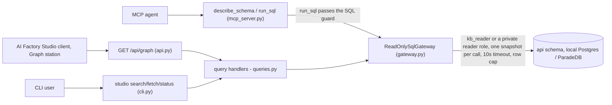

# serve, read-only retrieval over the indexed knowledge base

## Purpose

The `serve` slice is the read side of the library: it answers retrieval queries
against the indexed knowledge base through the read-only `api` schema, the local Postgres
by default (ParadeDB opt-in, engram ADR-0017), and a managed Postgres with the same
extensions through the dialect seam. It serves
three callers, the CLI, an MCP agent over stdio, and the AI Factory Studio client's Graph
station over a localhost FastAPI (one route: `GET /api/graph`), all funnelling into the same
query handlers and gateway. It is read-only by construction: it does not index, embed, or
sync. Writing the knowledge base belongs to the [index](indexing.md) slice (`studio index`).
Converging `Sources/` mirrors belongs to the [sync](sync.md) slice (`studio sync`).

## Entry points

| Surface | Entry | Defined in |
|---|---|---|
| CLI | `studio search QUERY [-k N] [--level/--task/--stage/--domain/--collection] [--bm25-only]` | `studio/src/studio/knowledge_base/cli.py` |
| CLI | `studio fetch UNIT_ID` | `studio/src/studio/knowledge_base/cli.py` |
| CLI | `studio status` | `studio/src/studio/knowledge_base/cli.py` |
| CLI | `studio mcp [--authoring] [--doc-authoring]` (FastMCP stdio: tools `describe_schema`, `run_sql`, `graph_expand`, `find_paths`, `search`, `fetch`. `--authoring` also exposes the opt-in eval-authoring, tuning, and recommendation tools. `--doc-authoring`, or the schema's `retrieval.doc_authoring`, also exposes the documentation-authoring tools `knowledge_base_profile`, `skeleton`, `write_note`, `decide_page`, `resolve_entities`, `read_page`) | `studio/src/studio/knowledge_base/cli.py` |
| CLI | `studio serve-http [--host 127.0.0.1] [--port 8100]` | `studio/src/studio/knowledge_base/cli.py` |
| HTTP | `GET /api/graph` (the client's Graph station read, the only HTTP route) | `studio/src/studio/knowledge_base/http/api.py` |
| Bus | `Search`, `Fetch`, `Graph`, `GraphExpand`, `GraphPaths`, `DescribeSchema`, `Status`, `LookupValue` | `src/engram/retrieval/queries.py` |
| MCP | `describe_schema`, `run_sql`, `graph_expand`, `find_paths` tools. `run_sql` checks each statement with the SQL guard, runs it as `SELECT * FROM (<statement>) AS q LIMIT n`, and replaces each `vector_query => '<text>'` inside `api.search(...)` with a server-side-embedded `query_vec` and the `query_model` that made it. It runs BM25 only, with a note, when no embedder is wired or the embedding fails or runs past 10 s (ADR-0047). `graph_expand` / `find_paths` walk the knowledge base graph one hop at a time over the set of reached nodes (ADR-0007, ADR-0049) | `src/engram/retrieval/infrastructure/mcp_server.py` |
| MCP | `search`, `fetch`, the **single-source** structured retrieval tools (ADR-0011 / D1), registered when the whole retrieval handler set is wired. They are the same functions the eval agent binds, so evaluating the in-process agent evaluates this surface | `src/engram/retrieval/infrastructure/mcp_server.py`, `tools.py` |
| MCP | `fetch` (leveled), when an `EnvelopeHandler` is wired, `fetch` stops being a flat full-text read and becomes the progressive-disclosure read (`core.ai.disclosure` provider conformance): `fetch(unit_id)` renders one `DisclosureEnvelope` from `EnvelopeHandler`, the unit's own content plus one-line summaries of everything directly inside it. There is no separate `disclose` tool. Leveling rides `fetch`'s own registration on the SAME open-surface gate as `graph_expand`/`find_paths` (no separate opt-in token or profile widening) | `src/engram/retrieval/infrastructure/mcp_server.py`, `envelope.py`, `tools.py` |
| MCP (opt-in) | `propose_eval_seeds`, `submit_eval_cases`, eval-authoring tools (gold-from-seed dataset generation, ADR-0016), registered **only** under `studio mcp --authoring` and gated exactly like `run_code`. The default surface exposes neither. Owned + documented in [evals.md](evals.md) | `src/engram/retrieval/infrastructure/mcp_server.py` |
| MCP (opt-in) | `diagnose`, `evaluate_policy`, `submit_tuning`, the tuning loop (Claude Code hill-climbs a retrieval policy by hand, ADR-0018), same `--authoring` opt-in on its own deps-presence gate. Owned + documented in [evals.md](evals.md) | `src/engram/retrieval/infrastructure/mcp_server.py` |
| MCP (opt-in) | `knowledge_base_profile`, `skeleton`, `write_note`, `decide_page`, `resolve_entities`, `read_page`, the documentation-authoring tools over the served knowledge base's own `AuthoringTools`: `knowledge_base_profile` answers the knowledge base's purpose, vocabulary and every page type's authoring guidance, `skeleton(page_type)` hands back a `write_note` payload with each canonical section seeded with its guidance, `write_note` validates against the knowledge base grammar and indexes again in-process, `decide_page` moves one page to one of its page type's declared statuses, `resolve_entities` answers each name's entity page id, creating a page for a name that matches none, and `read_page` answers one indexed page's path and its file parsed into a ready `write_note` payload, by its id. Registered when the schema sets `retrieval.doc_authoring` or the CLI passes `--doc-authoring`, on a deps-presence gate like the tuning tools. The read-only default registers none | `src/engram/retrieval/infrastructure/mcp_server.py`, `authoring.py` |
| MCP (opt-in) | `diagnose_structure`, `what_if_edges`, `submit_recommendation`, the recommendation brain loop (Claude Code drafts human-gated `KnowledgeBaseSchema` edits, the server re-validates every op via `apply_op` before saving, ADR-0026), same `--authoring` opt-in on its own deps-presence gate. Owned + documented in [evals.md](evals.md) | `src/engram/retrieval/infrastructure/mcp_server.py` |

## Public contract

- **Inputs:** the frozen query messages `Search` / `Fetch` / `Graph` / `GraphExpand` /
  `GraphPaths` / `DescribeSchema` / `Status` / `LookupValue` (`src/engram/retrieval/domain.py`).
  `Search` carries the query, `k` (server hard-caps at 50), `hybrid`, and the facet pre-filters
  (`level`/`task`/`stage`/`domain`/`collection`). `GraphExpand` / `GraphPaths` carry the
  seed/endpoint ids, the hop bound (`hops`, at most 6, or `max_hops`, at most 8), an optional
  `rel_types` filter, `include_superseded`, and `k`.
- **Outputs:** `SqlResult`, `SearchHit` (its fused `score`, `rerank_score` when a model
  re-ranked it, and `folded_units`, the other matching units of its document as `FoldedUnit`s, each with a short snippet), `FetchResult`, `GraphResult` (+ `GraphNode` / `GraphEdge`), `GraphPath` and
  `GraphPathsResult` (ranked multi-hop routes from `find_paths`), `GraphReach` (how far a walk's
  seeds reach, carried on graph results as `reach`), `SchemaDescription` (+ `ObjectInfo` /
  `ColumnInfo`), `StatusReport` (`src/engram/retrieval/domain.py`).
- **Invariants:** every read is row-capped (default 50, `SqlResult.truncated_message`
  flags overflow). The knowledge base API binds `127.0.0.1:8100`, opens CORS to exactly
  `http://localhost:3031`, and serves exactly one route (`GET /api/graph`), every other
  entry point onto the knowledge base is the CLI or MCP.
- **One snapshot per tool call:** every read tool call runs inside `read_snapshot()`
  (`src/engram/retrieval/infrastructure/gateway.py`), so all its reads of one engine and collection
  share one read-only `REPEATABLE READ` transaction. An index run that lands between two of its
  statements cannot mix two versions into one answer. A re-ranked search reads its hits and their
  texts first and releases the snapshot before the model call, so no transaction stays open while
  the model answers (ADR-0048).
- **MCP retrieval surface:** alongside `describe_schema` / `run_sql` / `graph_expand` /
  `find_paths`, the MCP server also registers `search` / `fetch` (ADR-0011), defined once in
  `src/engram/retrieval/tools.py` and shared with the eval agent, when the full retrieval handler
  set is wired. Which pair it registers depends on how many knowledge bases the host handed it. With
  no `read_surfaces`, the single-source pair, scoped to this server's own collection: its `search`
  refuses a `collection` other than that one, naming it. With them, the
  **routed** pair (`register_routed_mcp_tools`): `search`'s `collection` selects one of the
  registered knowledge bases and `fetch` reads the one its `unit_id` names, each answering through
  its own handlers, its own envelope and its own freshness stamp, so every ref an answer carries is
  readable verbatim by the same `fetch`. A collection no registered surface serves is refused naming
  the ones that are, whatever else the database holds: a row in a shared database is not a grant.
  The `run_code` sandbox binds whichever pair the server registered
  (`add_routed_read_tools` for the routed one), so one `search` means one thing on a server,
  inside the sandbox and out. Every `search` takes `facets`, a facet key mapped to a list of values
  (any value of one key matches, every key given must match), over the keys the searched knowledge
  base's schema declares. The single-source pair is given them as `create_mcp_server(facet_keys=...)`.
  The routed pair reads each surface's own `ReadSurface.facet_keys`, which `studio mcp` fills from
  each knowledge base's schema, so a key filters only a base that declares it. A key the searched
  base does not declare fails the call naming that base's keys, and the shipped description names
  every served base's keys.
- **Every id form `fetch` takes:** whichever `fetch` a surface registers (the flat read
  `flat_fetch`, the leveled read `leveled_fetch`, the routed pair, or `RetrievalKnowledgeBase` under
  either dial) reads a `page:<collection>/<id>`, `section:<collection>/<id>` or
  `unit:<collection>/<id>` ref exactly as `search`, a listing or a graph answer returned it, and the
  bare id, and both read one unit. No surface hands out a ref its own `fetch` refuses: a
  single-source `search` reads only its own collection, a `search` offers the map only when the
  `fetch` beside it opens one (never beside the flat read, never on a `search_only` knowledge base),
  and the eval guard rebuilds a search answer under the same rule. The flat read refuses a
  `collection:` or `group:` ref. A ref naming another collection is refused naming both on a
  single-source surface, and on the routed pair opens in that knowledge base when it is registered,
  else is refused naming the registered ones. An id that names no unit is refused, and the refusal
  names the forms `fetch` takes. Every refusal sends the agent only to tools the surface registers
  (`reground_phrase`). The tool descriptions name the forms too (`fetchable_forms`,
  `src/engram/retrieval/envelope.py`).
- **Facets over several knowledge bases:** `RetrievalKnowledgeBase` (the capability
  `embedded_read_tools` builds, each surface's keys read from its spec) checks `facets` against the
  bases a call searches. A call naming one base is refused a key that base does not declare, naming
  its keys. A call that searches several (`cross_search` on, `knowledge_base` omitted or `"all"`)
  takes a key only when every searched base declares it, and the refusal names each base's keys and
  asks for one knowledge base. A filter is never applied to a base that does not declare its key.
- **Freshness stamp:** every `search` and `fetch` answer carries a `KnowledgeBaseStamp`, the
  knowledge base that answered (`slug`), when its indexed copy was last written (`indexed_at`), and
  how many source files differ from it (`changed_since`). Each route carries its own
  (`ReadSurface.stamp`), resolved fresh per answer, so one server's two answers are never measured
  through each other's files. `changed_since=0` means that route's source tree matches its manifest.
  `changed_since=None` means freshness was not measured, the host being able to name the indexed
  partition but having no authoritative source tree to compare it with. It never means unchanged.
- **Progressive disclosure (leveled `fetch`):** `EnvelopeHandler`
  (`src/engram/retrieval/envelope.py`) is engram's provider of `core.ai.disclosure`'s
  `DisclosureEnvelope`, given a ref (`collection:<collection>` | `group:<collection>/<value>` |
  `page:<collection>/<id>` | `section:<collection>/<id>`), it
  returns that unit's own disclosed body plus one-line `ChildSummary` stubs of its children,
  never their bodies. The same ref grammar (`parse_ref` / `qualify_ref`,
  `src/engram/retrieval/tools.py`) also carries `unit:<collection>/<id>` for a unit below the
  leveled surface (a claim, a raw chunk), which `fetch` answers from the flat read. Every ref an
  answer carries, its own and its children's, is collection-qualified and fetchable exactly as
  returned. The legacy unqualified forms (a bare `search`-hit id, `page:<id>`, `section:<id>`,
  `group:<collection>/`, `group:<collection>//<page-type>`) are still accepted and come back
  canonical. There is no separate `disclose` tool: when an `EnvelopeHandler` is wired, the
  ordinary `fetch` tool becomes this leveled read. `fetch(unit_id)` returns the unit's own content
  plus one-line summaries of everything directly inside it, each carrying the id to fetch next.
  Calling `fetch` with no argument opens the knowledge base map (`collection:<collection>`). Ids
  copied from a `search` hit work as-is (`#` in the id becomes a section, else a page), and so does
  the hit's own `ref`, which additionally says which knowledge base to open it in. An id outside the leveled
  surface (e.g. a claim) falls back to the flat full-text read, so nothing an agent could
  previously fetch became unreadable. `fetch` (MCP) is
  the entry point onto the handler. A bad ref fails the call (MCP `ToolError`) rather than succeeding
  with an error-shaped result. Reads go through
  `api.envelope_collection` / `api.envelope_page` / `api.envelope_section`, `SECURITY DEFINER`
  functions (migration `0012`, mirroring `api.search`/`api.fetch`) that let the `kb_reader`
  role answer a disclosure query without a grant on `memory.*` directly (a query naming
  `kb.pages`/`kb.sections`/`kb.unit_summaries` over the reader gateway raises
  `permission denied for schema memory`). Each function is a thin `SELECT * FROM
  api.envelope_*(:param)` wrapper the handler calls, same `WHERE`/`LEFT JOIN`/`COALESCE`/`ORDER
  BY` shape as the handler used before the fix. A `collection:<name>` ref for an unknown or
  empty collection is NOT an error, it returns a well-formed envelope with `children=()` (a
  fresh knowledge base or a not-yet-indexed partition is a legitimate state, not a caller mistake). A
  row-capped read that hits its cap surfaces a synthetic `truncated:<ref>` sentinel child
  (`page_type="truncated"`) carrying the same truncation note `run_sql` uses, rather than silently
  dropping it. The leveled `fetch`'s tool description is composed per knowledge base and mode
  (`fetch_description(collection, mode=...)`, `envelope.py`), under `strict` it names the knowledge base's
  own `retrieval.collection` as the descent starting ref. `collection` is required on every function that
  builds the surface (`fetch_description`, `build_retrieval_toolset`, `register_mcp_tools`,
  `create_mcp_server`): there is no default collection to fall back to, so no server can advertise a
  knowledge base it was never given. A `search_only` knowledge base advertises no browsable map at all and leads
  with `search` instead.
  **The knowledge base's schema declares what is disclosed and how**, and `EnvelopeHandler` enforces it: a page
  type with `"disclosed": false` in `knowledge-base-schema.json` never appears as a collection child (the page_type
  set is bound into `api.envelope_collection(text, text[])`, migration `0013`), and
  `retrieval.disclosure_mode` sets the collection's presentation, `strict` (the default) serves the
  root map and descent. `search_only` withholds the root map entirely (no query runs) while
  `page:`/`section:` refs still serve, so search hits re-enter as disclosable refs. Every envelope
  is stamped with the declared `mode`. The declarations reach the handler through
  DI (`envelope_handler_provider(gateway, spec)`), so the HTTP entry point, the MCP entry point, and the eval
  harness enforce identically with no wiring needed for each. The root map's `content` is the collection's
  own about text (`api.collection_about(text)`, migration `0018`: the collection's indexed
  `meta.about` card, collection-scoped where `api.about` is database-wide), with
  `KnowledgeBaseSchema.orientation()`, the structure grammar, composed after it by the embedded capability.
  a collection that indexed no about serves the orientation alone. The bundled `research` spec
  declares `entity` and `paper` `"disclosed": false`, so its map lists the navigation layer (mocs,
  comparisons, questions, concepts, playbooks) and the flood page_types stay reachable through `search`.
- **Read dials (`ReadDials`, `src/engram/retrieval/dials.py`):** a host that owns the read modes
  hands `RetrievalKnowledgeBase` / `embedded_read_tools` a `dials_source` callable, read afresh on every
  call. `search: keyword|hybrid` forces the BM25-only leg or runs each surface's own (a dial never
  conjures a vector leg a surface has no embedder for). `fetch: flat|leveled` switches between flat
  full-text-by-id reads (no browsable map, map requests are refused toward `search`) and the
  leveled descent. With a source set, `get_toolset()` returns a prepared view that swaps the two
  tools' descriptions per request to match the dial, so a mode never advertises another mode's
  behavior. Hiding a tool entirely is the host's toolset-filter concern, deliberately not a dial.
- **The library's default scope (`default_knowledge_base_source`, `src/engram/retrieval/capability.py`):** a
  `RetrievalKnowledgeBase` over several surfaces (`embedded_read_tools`) takes an optional
  `default_knowledge_base_source: Callable[[], str | None]`, read on every call like `k_source` and
  `dials_source`. With `knowledge_base` omitted, a name the source returns that is one of the surfaces scopes
  the search to that surface. No source, `None`, or a name that is not a surface keeps the fan-out
  over every surface, and the literal `knowledge_base="all"` always fans out. An unknown name is refused
  with the list of surfaces. Every hit the library returns carries `SearchHit.collection`, the name
  of the surface it came from (a single-surface knowledge base stamps its own name), and the `search`
  description says what an omitted `knowledge_base` does in the mode the host chose. engram only knows
  "the host prefers this base right now". Which base that is (a session's project, a station's
  selection) is the host's policy.
- **MCP authoring surface (opt-in, off by default):** `studio mcp --authoring` wires the
  eval-authoring deps (the seed-repository factory, the `evals.datasets_dir` write target, and the
  difficulty thresholds) and adds the `propose_eval_seeds` token to the profile, so the two authoring
  tools register. A bare `studio mcp` wires none of them and exposes neither (the read-only default,
  engram ADR-0016, gated like `run_code` ADR-0015). The tools are defensive: `submit_eval_cases`
  rejects a `dataset` name that is not a single safe path segment (no traversal outside
  `datasets_dir`) and `propose_eval_seeds` caps `count` at a server-side maximum, and the
  quote check runs server-side. The same `--authoring` flag also registers, each on its own
  deps-presence gate, the three tuning tools (`diagnose` / `evaluate_policy` /
  `submit_tuning`, ADR-0018) and the three recommendation tools (`diagnose_structure` /
  `what_if_edges` / `submit_recommendation`, ADR-0026), every submit path is server-side re-validated
  and safe-name guarded. The surface is owned + documented in [evals.md](evals.md).
- **MCP documentation-authoring surface (opt-in, off by default):** `retrieval.doc_authoring` in the served
  knowledge base's `knowledge-base-schema.json`, or `studio mcp --doc-authoring`, wires an `AuthoringTools` for that one knowledge base
  (an admin engine on `NullPool`, a read-only gateway, the knowledge base's source queue, and the studio's own
  `IndexKnowledgeBase` command as the port that indexes again) and registers `knowledge_base_profile`, `skeleton` and `write_note`.
  `skeleton` is the template: every canonical section of the page_type comes back seeded with the guidance the
  schema declares, and a `write_note` refusal names every finding at once. A bare `studio mcp` on a
  knowledge base that does not opt in registers none of the three.
- **Private knowledge bases (`retrieval.private`, defaults `false`):** a knowledge base sets `retrieval.private: true` in its own
  `knowledge-base-schema.json` to keep itself out of any host's library across several knowledge bases (harness ADR-0012's
  `registry_targets`), regardless of what a host's own per-machine registered knowledge base says. The database hides it
  too: `api.visible_collection` shows a private collection only to a session whose login role has a row for it in
  `kb.reader_scopes`, a table no reader can read or write. The `app.collection` setting a gateway announces only routes
  `api.search`'s default collection and grants nothing. The index run gives each private knowledge base its own login
  role, `kb_reader_` and 20 hex digits of the collection's hash, a member of `kb_reader` with its settings, whose password
  is an HMAC-SHA256 of the role name under `infrastructure.database.reader_secret`. The gateway opens that role for a
  collection the anonymous reader cannot see (`PrivateReaders`, `src/engram/retrieval/infrastructure/reader_roles.py`), so
  this knowledge base's own `serve` surface answers `search`, `fetch` and the opt-in tools for it as before. With no reader
  secret set, the index run creates no role and a private knowledge base reads as empty (engram ADR-0046).
- **The page date (`retrieval.date_field`, defaults `created`):** a search's `since` and `until` keep a page by its
  page date, the day the page is about. The schema's `retrieval.date_field` names the frontmatter field the index
  reads it from, `created` (the day the page was written) when it names no other, and the schema refuses a name that
  is neither `created` nor a scalar frontmatter field a page type declares, naming the allowed ones. The index stores
  it in `kb.pages.page_date` with the same date reading as `created`, so a value that is not a date, or a page without
  the field, leaves it empty and the page falls outside every range. `created` keeps the day the page was written for
  every other reader, such as `list_recent_digests` and the compounding windows. Migration 0066 fills the column from
  `created` for every page indexed before it, so a knowledge base naming another field gets its page dates on its
  next index.
- **Errors:** HTTP failures are uniform `{error, detail}` bodies, `JobBusyError` gives 409,
  unknown job/unit id gives 404, anything else gives 500 (no traceback over the wire). The MCP
  `run_sql` tool fails the call with a `ToolError` that says what to write instead, both for a
  statement the SQL guard refuses and for one the read-only role rejects (the latter pointing at the
  `api.*` views and functions), rather than crashing the session. CLI `search`/`fetch` surface a
  clean exit-1 message.
- **Config:** the gateway connects as the `kb_reader` Postgres role over the reader URL
  (`infrastructure.database.reader_url` in `application_settings.json`, env override
  `APP_INFRASTRUCTURE__DATABASE__READER_URL`, ADR-0008), SELECT/EXECUTE on `api` only,
  `default_transaction_read_only`, server-side `statement_timeout=10s` and `lock_timeout=5s`
  (migration 0056, copied onto every private reader role). Where the reader engine is built,
  `verify_reader_role` refuses a connection that can do more than read `api`: transactions not
  read-only by default, a role attribute, membership of any role but `kb_reader`, use of a schema
  but `api` and `public`, the right to create in one, or a privilege on a relation outside `api`
  beyond what PUBLIC holds. The refusal (`ReaderRoleOverprivilegedError`) names the role, each
  problem and the setting to fix (engram ADR-0046). `infrastructure.database.reader_secret` (env
  `APP_INFRASTRUCTURE__DATABASE__READER_SECRET`) is the secret every private reader password is
  derived from. The indexer and the reader must read the same value. `StatusHandler`
  uses a second admin-URL gateway for the ungranted `kb.*` counts.
- **Dialect:** the BM25 backend is selected by `retrieval.dialect` in
  `application_settings.json` (env override `APP_RETRIEVAL__DIALECT`, default
  `pg_textsearch` (the extension the local Postgres ships), with `pg_search` (ParadeDB) opt-in, ADR-0017). It changes only the lexical
  grammar emitted by the migrations and the `api.search` body, the read path's
  call signature, the vector legs, and RRF are identical on both (ADR
  [`0006`](../adr/0006-dual-dialect-bm25-seam.md),
  [retrieval-concepts.md](../retrieval-concepts.md)).
- **Graph backend:** the link-graph traversal behind `api.graph_expand` / `api.graph_paths`
  is selected by `retrieval.graph_backend` (env `APP_RETRIEVAL__GRAPH_BACKEND`, default
  `age` for Apache AGE openCypher as on the managed target, `cte` for the relational walk the ParadeDB bed
  uses, ADR-0007). Both backends project the same result columns. The AGE `kb_graph` graph is projected at index time by the
  writer-only `kb.refresh_graph()`, so the read functions stay pure-read for the
  `kb_reader` role. Both backends render one generated plpgsql walk per function, and only the
  one-hop read differs: the edge relation under `cte`, a single-hop cypher match under `age`
  (engram ADR-0049).
- **Generated retrieval SQL:** the `api.search` / `api.graph_expand` / `api.graph_paths` /
  `api.graph_reach` bodies are not hand-written per dialect/backend. They are generated from
  declarative `SearchSchema` / `GraphSchema` descriptors (engram supplies `KB_SEARCH_SCHEMA` /
  `KB_GRAPH_SCHEMA` as data) by the shared `core.ai.retrieval` SQL builders, so engram is one
  adapter. Every generated function pins `search_path` to `pg_catalog`, its own schemas, then
  `pg_temp` (migration 0054, engram ADR-0047). The `/api` contract, its
  result columns, and its behaviour are unchanged, the no-regression gate is result parity on every
  DB bed, not text identity (engram ADR [`0035`](../adr/0035-retrieval-sql-from-descriptors.md),
  [`0036`](../adr/0036-behavioral-parity-generated-sql.md)).

### Result budgets and windows

Every read tool answers with the largest complete answer that fits a character budget, measured on
the **whole serialized answer** (its items, its window, its next steps and its freshness stamp
together), never on the items alone. One fitter does the measuring for all of them
(`fits_budget`, `src/engram/retrieval/budget.py`).

| Budget | Value | What it bounds | Where it is measured |
|---|---|---|---|
| `SEARCH_SNIPPET_CHARS` | 480 | One hit's `snippet`, one folded unit's `snippet`, and any `page_title` a bounded result shortens | The generated `api.search` body cuts the excerpt at the default tuning row's `snippet_chars` (480 by default, held to 80..2,000), so a raw SQL caller is bounded too. `search_hits` cuts it again at 480 per hit and per folded unit (`src/engram/retrieval/tools.py`) |
| `SEARCH_RESULT_CHARS` | 12,000 | The complete `SearchResult` a `search` call answers with | `src/engram/retrieval/tools.py` |
| `GRAPH_RESULT_CHARS` | 16,000 | The complete `GraphResult` and the complete `GraphPathsResult` | `src/engram/retrieval/queries.py` |
| `SCHEMA_RESULT_CHARS` | 12,000 | The rendered `describe_schema` document, catalog or detail | `src/engram/retrieval/queries.py` |
| `SQL_CELL_CHARS` | 2,000 | Every string a `run_sql` cell carries, including the strings nested inside a JSON cell | `src/engram/retrieval/sql_tools.py` |
| `SQL_RESULT_CHARS` | 16,000 | The complete `{"rows": ..., "note": ...}` envelope, its `note` counted in | `src/engram/retrieval/sql_tools.py` |

**Folded units go first.** When a `search` answer does not fit whole, its hits' folded units give way one at a time,
from the lowest-ranked hit's last one up: each keeps the longest snippet that lets the answer fit, never its ellipsis
alone, keeps no snippet when only that fits, and is dropped when not even that fits. Only after every folded unit has
given way is any hit's title or snippet cut or any hit left out.

**Identity never shortens.** Only display text is cut: a hit's `page_title` and `snippet`, a graph
node's `title`, the strings inside a `run_sql` cell. An `id`, a `ref`, a `provenance_ref` and a score
come back whole or their item does not come back at all, so every handle an answer carries reads
back verbatim through `fetch`. A hit whose snippet was cut says so on `snippet_truncated`, a
`run_sql` answer says so in its `note`, and rows are dropped whole, never half-read.

**`window` (`ResultWindow`) says how complete the answer is.** `returned_items` is what came back.
`omitted_items` is what else exists: `0` is a complete answer, a positive number is an exact count
of what was left out, and `None` means more exists but was never counted (a one-past-the-cap probe
found it), so read `None` as "more, exact count unknown", never as zero. `truncated` is true whenever
the answer is short of the underlying total. `refused` is true when not even the first item's
identity fit, in which case the answer carries zero items and `reason` names the narrower call to
make instead, never a partial item.

**`status` says what a search found**, read from the hits themselves: `no_hits`,
`lexically_supported_candidates` (at least one hit the keyword leg selected),
`semantic_candidates_only` (nearest-meaning hits with no keyword match behind any of them),
`budget_refused` (the refusal above), or `unassessed` when the database published no per-leg ranks.
Every non-refused status is still a list of unverified candidates: fetch before relying on one.

**`support` says which legs selected a hit**: `lexical_and_semantic`, `lexical_only` or
`semantic_only`, read from rank presence alone, never from a threshold on a score or a distance. It
is leg presence, not a judgment that the hit answers the question.

**`describe_schema` is catalog first, detail second.** Called with no arguments it answers a compact
catalog: every `api` object, its kind and its one-line purpose. Called with `objects=[...]` it
answers those objects' COMMENTs, columns and types, up to `SCHEMA_OBJECT_LIMIT` (8) names per call.
Naming more than eight, or naming one the surface does not have, fails the call with the valid names
rather than quietly answering something else.

**Graph traversals answer with the current knowledge base.** `graph_expand` and `find_paths` take
`include_superseded`, default `false`: a page a newer page replaced is skipped at every hop, so
nothing reachable only through a superseded page comes back either. `include_superseded=true` keeps
both, for reading how two pages used to connect. Both backends apply the rule inside the walk, and
both apply `rel_types` to every hop, so a node reachable only across an excluded relation is out on
either.

**Graph walks visit each node once and say how far they can go** (engram ADR-0049). Every walk keeps
the set of nodes it reached and takes one hop at a time from the newest of them, so its work grows
with the nodes and edges it reaches, never with the number of paths between them.

- `graph_expand` walks at most `GRAPH_EXPAND_HOP_LIMIT` (6) hops, whatever `hops` asks for. Each node
  comes back once, at its fewest hops, with every edge that first reached it. The walk stops early once
  it has reached more nodes than `k` selects.
- `find_paths` takes `max_hops` (default 4) and looks for routes of at most `GRAPH_PATHS_HOP_LIMIT` (8)
  hops. It walks back from `to_id` to learn each node's hops to it, then lists every route of at most 1
  hop, then 2, and so on, extending a route only to a node it has not visited from which `to_id` is
  still within the bound. It stops once it has found more routes than `k` selects. Routes are ranked by
  length, then by their nodes, relations and payloads.
- `api.graph_reach(p_collection, seed_ids, rel_types, target_id, include_superseded)` walks with no hop
  limit under the same filters and returns one row: `reached_nodes` (the seeds included), `deepest_hop`,
  `target_hop` (NULL when `target_id` was not reached or none was given) and `complete` (true when the
  walk took in every node it could reach). It stops at `target_id` once it reaches it and at
  `GRAPH_REACH_NODE_LIMIT` (10,000) nodes, and `complete` is false then.
- An expansion whose nodes all fit the answer reads its reach, carries it as `reach` and says in
  `next_steps` whether nodes lie past its last hop, offering a wider `hops` while it is below the limit,
  or that the answer holds every node the seeds reach. A route search that found nothing reads the
  start's reach with `to_id` as the target. Its `next_steps` says that no route exists at any length,
  or how many hops the shortest route takes and the `max_hops` that finds it, or that the start reaches
  more than 10,000 nodes without `to_id` among them, so a longer route is not ruled out.

**`run_sql` checks every statement before it runs** (engram ADR-0047). The guard
(`single_statement`, `core/src/core/ai/retrieval/statement.py`) is defence in depth. The reader role's
privileges and its read-only transactions stay the boundary. It refuses, each time with a sentence
saying what to write instead:

- Text longer than 20,000 characters, text holding a NUL or a character with no UTF-8 form, no
  statement or more than one, or brackets nested more than 100 levels deep.
- Any form `sqlparse` and Postgres could read differently: a backslash before a quote, a dollar-quoted
  text, a `U&` escaped name, or a character outside ASCII outside a text, a quoted name or a comment.
- `WITH RECURSIVE`, since the `api` graph functions walk links.
- A call to a function that changes a session setting, takes a lock another session waits on (`pg_advisory_lock` and its family), sleeps, runs SQL held in
  a string (`query_to_xml` and its family), acts on other sessions or the server, reads files or reaches
  large objects (`DENIED_FUNCTIONS` and every `lo_` function), matched after dropping schema, quotes and
  case.

The statement that passed runs as `SELECT * FROM (<statement>) AS q LIMIT <cap + 1>`, so the database
refuses anything that is not a query and stops one row past the cap (50 at most). A
`vector_query => '<text>'` argument is found by reading the statement's tokens, never inside a string or
a comment (`VectorQueryRewrite`, `core/src/core/ai/retrieval/vector_query_rewrite.py`). A statement holds
at most four such texts of at most 2,000 characters each, each written as one plain quoted text after
the name. Each distinct text is embedded once, all of them within 10 s
(`EMBED_DEADLINE_SECONDS`), and each becomes `query_vec => '[...]'::halfvec, query_model => '<model>'`.
A statement that passes `query_vec` or `query_model` itself is refused, since only the rewrite writes
them.

**Search legs are bounded and tuned from a default row and one row per knowledge base** (engram ADR-0048, amended by
migration 0071). Every keyword leg ranks by its
BM25 index and every semantic leg by exact distance, and each stops at the leg budget before the fusion.
`api.search` reads its numbers from `kb.retrieval_tuning`, a table the reader cannot read or write, as its owner,
and holds each to a bound generated into the function. The table holds a default row, whose `collection` is null, and
at most one row per knowledge base, keyed by its collection (migration 0071). A knowledge base's row may set only
`max_hits_per_document` and `folded_snippet_chars`, and what it sets wins over the default row for that knowledge
base's hits, in a search over one knowledge base or over every one. Every other number comes from the default row:

| Key | Default | Bound | What it sets |
|---|---|---|---|
| `budget` | 50 | 1..200, never below `k` | The rows each leg of each tier ranks and hands to the fusion |
| `rrf_constant` | 60 | 1..1000 | The constant of reciprocal rank fusion |
| `k_ceiling` | 50 | 1..50 | The most rows one search returns |
| `snippet_chars` | 480 | 80..2000 | The longest snippet |
| `rows_per_group` | 3 | 1..50 | The most hits one page (its card, sections and claims) or one source (its raw chunks) keeps |
| `max_hits_per_document` | 1 | 0..50, 0 or null keeping every hit | The most hits one document keeps, the next three folded under its best hit. A knowledge base's row may set it |
| `folded_snippet_chars` | 160 | 20..2000, never longer than `snippet_chars` | The longest snippet a folded unit carries. A knowledge base's row may set it |
| `weights` | `{}` | 0..10 each | A weight per tier and leg, keyed `<tier>:<lexical\|semantic>` (`card:semantic`), 1 when not named |

The owner changes a number for the whole database in the default row, with
`UPDATE kb.retrieval_tuning SET tuning = tuning || '{...}' WHERE collection IS NULL`, and sets one knowledge base's
cap or folded snippet length in its own row, naming its collection:
`INSERT INTO kb.retrieval_tuning (collection, tuning) VALUES ('<collection>', '{"max_hits_per_document": 2}') ON CONFLICT (collection) DO UPDATE SET tuning = kb.retrieval_tuning.tuning || EXCLUDED.tuning`.
Deleting a knowledge base's row puts it back on the default row. Check constraints refuse a value that is not a number
(`max_hits_per_document` also takes null), a second default row, and a knowledge base's row naming any other key. Three
rank policies run after the fusion: a card whose title equals the query, ignoring case and surrounding
spaces, goes first when no other card holds that title, outside its page's count, every other hit keeps
at most `rows_per_group` rows per page or source, and then each document keeps at most
`max_hits_per_document` hits, its best first and the pinned card its best, so `k` counts documents
(migration 0070). A unit's document is the source it was made from (`kb.pages.source_id`, or a raw
chunk's own source) when it has one, otherwise its own page, so a page made from a source, its sections,
its claims and the source's raw chunks are one document. The next three matching units of a document
come back under its best hit in the last column, `folded_units`, a jsonb array of `{id, hit_level, snippet}` best
first, and every other hit carries an empty array. A folded unit's snippet is its own snippet cut at the last whole
word inside `folded_snippet_chars`, with an ellipsis, or cut mid-word when no word ends inside that length, so it is
never longer than a hit's snippet (migration 0071). `search_hits` bounds it again at 480 characters, as it does a
hit's snippet, and gives each folded unit the ref a hit of
its level carries (`section:<collection>/<id>`, `page:` for a card, `unit:` for a claim or a raw chunk),
so the agent fetches one without searching again: every `fetch`, flat or leveled, over one knowledge base or routed
over several, opens that ref. A surface that serves `search` without `fetch` (an `only` set naming `search` alone)
words its description without sending the agent to `fetch` at all, and the next steps of its search answers name no
`fetch` either: they offer judging the hits by their snippets and searching again, and no map.
`api.search_hits_per_document(collection)` answers the cap the search applies to one knowledge base, read from its own
row, else the default row, over the same default and bound, 0 when every hit is kept. With no collection it answers for
the reader session's own knowledge base. For a knowledge base the session cannot see (`api.visible_collection`) it reads
the default row only, so a reader learns nothing of a private knowledge base's own row. A host reads it once for each knowledge base, when it opens one
(`read_hits_per_document`, which reads 0 when the database cannot answer, as below migration 0071, whose function takes
no collection), and every `search` description states it: a cap of 1 says each hit is a distinct document, a higher cap
says how many hits one document may have, and 0 says nothing about documents. Where it states a cap, it also says each
folded unit carries a short snippet of the text it matched. When knowledge bases behind one tool disagree on the cap, the description
states none. A process reads the cap once, so after the owner changes it a running process states the old cap until it
restarts. The document sentences go into the shipped description only. A tuned description from an active policy
(`_meta/active-policy.yaml`) replaces that whole text, so it says about documents whatever its own text says.
`include_meta => false`, which the `search` tool always passes, leaves the knowledge base's
own `meta.*` pages out before `k` is applied, so a search returns `k` rows when that many match. A raw
`api.search` call keeps them unless it passes the same argument. `since` and `until` keep a page by its page date
(`kb.pages.page_date`, migration 0066), which is `created` when the schema names no other field. A raw chunk carries
neither facets nor a page date, so once `facets`, `since` or `until` is set it ranks only when a page that passes them
was made from its source (`kb.pages.source_id`), a live page unless `only_current => false` (migration 0065).
With none of the three set, every raw chunk ranks. With
`query_model` set, a collection whose `kb.index_fingerprint` records another embedding model gets no
semantic leg. Every row carries `src_collection`, and every pool, join, leg and fusion key carries the
collection with the id, so two knowledge bases sharing a page id never mix in one result.

**Several knowledge bases merge by rank.** A search across several knowledge bases orders hits by
`rerank_score` when every hit carries one, else rank by rank (each base's first hit, then each base's
second), never by the fused `score`, which compares only within one list. A re-ranked hit keeps its
fused `score` and gains `rerank_score`, the model's probability.

## Runtime flow



## Examples

```bash
# Hybrid (BM25 + vector) search, top 8, restricted to one stage facet
studio search "chunking long documents" -k 8 --stage retrieval

# BM25-only (no Azure embedding call needed)
studio search "reranking" --bm25-only

# Fetch one unit's full text by id
studio fetch "paper:dense-passage-retrieval#abstract"

# Knowledge base health: kb.* row counts + embed-model contract + last index
studio status

# Run the agent stdio server (tools: describe_schema, run_sql, graph_expand, find_paths)
studio mcp

# Run the stdio server WITH the opt-in eval-authoring tools (propose_eval_seeds / submit_eval_cases)
studio mcp --authoring

# Run the stdio server WITH the documentation-authoring tools (knowledge_base_profile / skeleton / write_note / decide_page / resolve_entities / read_page)
studio mcp --doc-authoring

# Serve the dashboard API locally for studio-client
studio serve-http --port 8100
```

## Patterns used

- Vertical-slice DDD, the slice owns its CLI/HTTP/MCP surfaces, domain, gateway, and
  tests. See `../../../docs/explanation/design-patterns.md#vertical-slice-ddd`,
  ADR `../../../docs/adr/0001-wiki-app-placement-and-core.md`.
- CQRS message bus, frozen read messages dispatched to handlers.
  See `../../../docs/explanation/design-patterns.md#cqrs-message-bus`,
  ADR `../../../docs/adr/0002-wiki-cqrs-bus-and-wikinote-kernel.md`.
- DI seams + fakes over mocks, handlers/gateway are constructor-injected. `create_app`
  and `create_mcp_server` take a pre-built container / gateway.
  See `../../../docs/explanation/design-patterns.md#di-seams-and-fakes-over-mocks`.
- Zod-at-the-boundary (studio-client), AI Factory Studio's type client is generated from
  `/openapi.json`. See `../../../docs/explanation/design-patterns.md#zod-at-the-boundary`,
  ADR `../../../docs/adr/0004-client-core-shared-frontend-package.md`.
- Immutable mirror, the `api` schema is read-only. The reader role cannot write.
  See `../../../docs/explanation/design-patterns.md#immutable-mirror`,
  ADR `../adr/0002-disposable-mirror-zotero-source-of-truth.md`.
- Strategy/registry, facet values are grounded via `api.lookup_value`, not guessed.
  See `../../../docs/explanation/design-patterns.md#strategy-registry`.
- Dialect seam (Strategy Registry), BM25 SQL is emitted per backend by a
  `SearchDialect` Protocol + `SearchDialects` registry, selected by
  `retrieval.dialect` (`APP_RETRIEVAL__DIALECT`): ParadeDB `pg_search` locally,
  `pg_textsearch` on the managed target. See ADR [`0006`](../adr/0006-dual-dialect-bm25-seam.md),
  [retrieval-concepts.md](../retrieval-concepts.md).
- Graph-backend seam (Strategy Registry), `api.graph_expand` / `api.graph_paths` SQL is
  emitted per backend by a `GraphBackendSql` Protocol + `GraphBackends` registry, selected
  by `retrieval.graph_backend` (`APP_RETRIEVAL__GRAPH_BACKEND`): Apache AGE openCypher over the
  projected `kb_graph` graph by default, the relational walk over `kb.visible_edges` under `cte`.
  Both render the same plpgsql walk over a reached-node set and differ only in the one-hop read.
  See ADR [`0007`](../adr/0007-age-multihop-dual-graph-backend.md), engram ADR-0049.
- Descriptor-driven SQL generation, the two seams above no longer hand-write the `api.search` /
  `api.graph_*` bodies. They generate them from `CorpusSchema` / `GraphSchema` descriptors via the
  shared `core.ai.retrieval` builders (a Protocol contract paired with a Template-Method ABC), so a
  new knowledge base is data rather than a hand-written SQL body. See
  `../../../docs/explanation/design-patterns.md#descriptor-driven-sql-generation`,
  engram ADR [`0035`](../adr/0035-retrieval-sql-from-descriptors.md).
- Glossary terms (`kb_reader`, `api` schema, hybrid retrieval): see `../../CONTEXT.md`.

## Testing seams

- Seam: `ReadOnlySqlGateway(engine)` constructor + the `SqlGateway` Protocol
  (`src/engram/retrieval/domain.py`). `create_app(settings, *, container=...)` and
  `create_mcp_server(gateway, describe_handler)` accept injected fakes.
- Fakes: `FakeSqlGateway` (`tests/support/fakes/gateway.py`), records the last query and
  returns canned `SqlResult` / `SchemaDescription` with no DB.
- Factories: polyfactory model factories under `tests/support/factories/`.
- Unit tests: `tests/unit/serve/` (`test_http.py` drives the `/api` contract over an httpx
  `ASGITransport` with a fake-wired container. `test_queries.py`, `test_mcp_server.py`) plus
  `tests/unit/test_cli_serve.py`.
- Integration tier (testcontainers, gated on Docker: the default bed runs `pg_textsearch` and
  Apache AGE, `KNOWLEDGE_BASE_TEST_DIALECT=pg_search` runs ParadeDB and the `cte` walk):
  `tests/integration/test_search.py`, `test_describe_schema.py`, `test_graph.py`,
  `test_graph_retrieval.py`, `test_guardrails.py` (reader-role enforcement). The read path's
  guarantees each have a module: `test_library_privacy.py` and `test_private_reader_roles.py`
  (private knowledge bases), `test_reader_role.py`, `test_run_sql_wrapper.py`,
  `test_pinned_search_path.py`, `test_search_collection_key.py`, `test_search_query_model.py`,
  `test_search_meta_pages.py`, `test_search_tuning.py`, `test_search_policies.py`, `test_search_raw_facets.py`,
  `test_embedded_read_tools_facets.py`, `test_read_snapshot.py`, `test_rerank_snapshot.py`, `test_dense_graph_walks.py` and
  `test_graph_reach_revision.py`. E2E round
  trips: `tests/e2e/test_http_session.py`,
  `test_mcp_session.py`, `test_compile_and_search.py`.
