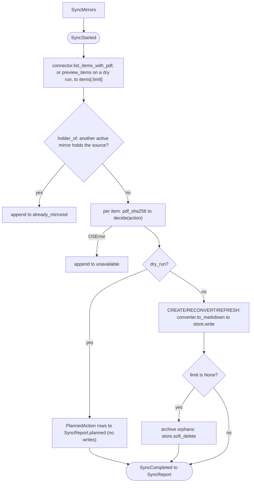

# sync, source to Sources/ mirror reconcile

## Purpose

The `sync` slice converges the knowledge base's `Sources/` mirrors to whatever the knowledge
base's declared connectors hold, in one idempotent reconcile pass: it converts changed PDFs to
Markdown, refreshes metadata-only mirrors, and soft-deletes (archives) mirrors whose item
left the connector. The connector is the source of truth. Mirrors are **disposable**
projections whose only mutable state is each note's frontmatter. The slice was
absorbed from the earlier standalone sync tool (root ADR
`0003-absorb-zotero-sync-into-wiki-app.md`). It is **optional**: a knowledge base's
`KnowledgeBaseSchema` gates it via `sources.enabled`, and a domain-general knowledge base may read no
sources at all (engram ADR-0014). It
does **not** read any host's library, convert
PDFs, or write files directly. It drives three ports for
those, and it does **not** build the queryable Postgres surface (that is the
`index` slice, which reads the mirrors this slice writes). The connector and converter
implementations behind two of those ports live in the sibling `connectors` project and are resolved
by entry point ([root ADR-0018](../../../docs/adr/0018-corpus-bundles-and-provider-packages.md)).

## Entry points

| Surface | Entry | Defined in |
|---|---|---|
| CLI | `studio sync [--dry-run] [--limit N]` | `studio/src/studio/knowledge_base/cli.py` (`sync_cmd`) |
| HTTP | `POST /api/knowledge-bases/{name}/refresh` queues a `kb.refresh` job and answers 202 with its id, or 409 with the id of the one already live. `GET /api/jobs/{job_id}` reads it | `studio/src/studio/knowledge_base/http/controllers/refresh.py` (`start_refresh`) |
| Bus | `SyncMirrors` command to `SyncMirrorsHandler`, or `MultiConnectorSync` when a knowledge base declares more than one connector | `engram/src/engram/sources/service/sync.py` |

Both surfaces dispatch `SyncMirrors` on the knowledge base's `MessageBus`. `build_command_routes`
(`studio/src/studio/knowledge_base/container.py`) binds it to the handler `sync_handler_provider`
(`studio/src/studio/knowledge_base/wiring/sync.py`) provides, a `MultiConnectorSync` over one
`SyncMirrorsHandler` per declared connector. The CLI scans the watch list, dispatches inline and
prints a report. A CLI dry run (`--dry-run`) scans nothing, since a scanner may call a paid model: it
prints each watch-list row's scanner and ref (marked `(no scanner)` when this host built none for it), then the
sync's plan. The HTTP route queues a `kb.refresh` job, and `studio worker` runs it as
`RefreshKnowledgeBaseJob`: when the schema turns sources on, it scans the watch list if there is one
and dispatches `SyncMirrors`, and then it indexes, as the [indexing reference](indexing.md) describes.

## Public contract

- **Inputs:** `SyncMirrors` (`engram/src/engram/sources/domain/sync.py`). `dry_run` plans from
  what each connector already holds, through `Connector.preview_items`, with no fetch, no model call,
  no conversion and no write. A benchmark connector whose dataset was never downloaded downloads it, as
  a real listing would. `limit` processes at most N items **and**
  disables orphan archiving (a partial view must never archive the rest of the
  library).
- **Outputs:** `SyncReport` (`engram/src/engram/sources/domain/sync.py`). Per-action counters
  (`created`/`updated`/`archived`/`skipped`), per-item `errors`
  (`SyncError`), an `unavailable` list (items whose attachment path could not
  resolve), `already_mirrored` (each item refused because another active mirror holds its
  source, mapped to that mirror's key), dry-run `planned` rows (`PlannedAction` over the `SyncAction`
  enum), and dry-run `would_resolve` rows (`UnresolvedItem`: the connector, key, source type and URL of each row a
  real listing would fetch or resolve before planning it). Events `SyncStarted` / `SyncCompleted` (carrying the report) bracket the
  run.
- **Ports:** the handler drives three protocols, never their
  adapters. `Connector` (`engram/src/engram/sources/internal_contracts.py`, served by a connector in
  `engram-connectors`), `DocumentConverter` (`engram/src/engram/sources/internal_contracts.py`,
  served by a converter in the same project), `MirrorStore` (`engram/src/engram/sources/internal_contracts.py`, served
  by `store.py`, engram's own). `MultiConnectorSync` (`multi.py`) runs one handler per declared
  connector from a single `SyncMirrors` dispatch and merges their reports, and each run's orphan
  pass narrows the mirror index by the mirror's `provider` field, so one connector's run never archives another's
  mirrors.
- **Invariants:** idempotent. Re-running on an unchanged library is all SKIP.
  Per-item fault-tolerant: a missing/unreadable PDF lands in `unavailable`, any
  other per-item failure lands in `errors`, and neither aborts the run. A limited
  run never archives orphans. One mirror per source ([ADR-0051](../adr/0051-a-sync-admits-one-mirror-per-source.md)):
  an item with no live mirror of its own whose URL, arXiv id or DOI an active mirror under
  another key already holds is never converted or written, whichever connector holds that
  mirror. The first mirror in wins, within an applying run too. A dry run over several connectors plans each
  connector against the mirrors on disk, so it can plan a mirror a later connector's applying run refuses.
- **Errors:** the CLI exits 1 when `report.errors` is non-empty.
  `unavailable` items do not fail the run, and a dry run never fails.
- **Config:** `KnowledgeBaseSettings`, `DocumentIntelligenceSettings` and the knowledge base's own
  per-connector settings blocks, bundled into a `SourceResources` (`engram/src/engram/config.py`) for a
  connector's `build`, all resolved by wireup in
  `studio/src/studio/knowledge_base/wiring/{sources,conversion,mirror,sync}.py`. The Zotero library's own
  block is `sources.zotero`, validated by `engram_connectors.zotero.contracts.LibrarySettings`.

## Runtime flow



Before `decide`, `holder_of` (`engram/src/engram/sources/domain/sync.py`) names the active mirror
under another key that already holds the item's source, matched on `source_identities` (the URL,
the arXiv id, also read from an arXiv DOI, and the lower-cased DOI). An item it names goes to `already_mirrored` and is not
decided. `decide` (`handlers.py`) is the pure per-item function: CREATE when there is no
live mirror, RECONVERT when the PDF hash changed, REFRESH when only the metadata
version changed, else SKIP. A dry run lists through `preview_items`, so the source-queue connector serves only
the rows it already cached and the YouTube connector serves none, each naming the rows a real listing would
fetch or resolve in `would_resolve`. It computes the same decisions for the items at hand into
`report.planned` with **zero** fetches, model calls, conversions or writes (the marked exit), and
appends a DELETE row per orphaned mirror only when unlimited, never for a mirror of a row awaiting resolution.

## Examples

```bash
# Preview the plan: the watch-list rows a real run would scan, each item's action and each row a real
# run would resolve first, with no scan, fetch, model call, conversion or write (never exits non-zero)
studio sync --dry-run

# Partial backfill of at most 25 items; skips orphan archiving
studio sync --limit 25

# Full applying reconcile (converts changed PDFs, archives orphans)
studio sync
```

```bash
# Queue a refresh job over HTTP, which scans, syncs and indexes (poll the returned id at /api/jobs/{id})
curl -X POST localhost:8100/api/knowledge-bases/research/refresh
```

## Patterns used

- **Vertical-slice DDD**. The slice owns its `domain`, `handlers`, and `deps`. The
  three ports live in their own slices. See
  `../../../docs/explanation/design-patterns.md#vertical-slice-ddd`, root ADR
  `../../../docs/adr/0003-absorb-zotero-sync-into-wiki-app.md`.
- **CQRS message bus**. `SyncMirrors` dispatched through the shared bus. The
  handler leaves its events for the bus to hand to the outbox, delivered by the job runner. See
  `../../../docs/explanation/design-patterns.md#cqrs-message-bus`.
- **DI seams / fakes-over-mocks**. The three Protocol ports plus the injected
  `clock` and the `resolve_sync_bus` funnel. See
  `../../../docs/explanation/design-patterns.md#di-seams-and-fakes-over-mocks`.
- **Zod-at-the-boundary**. The HTTP `SyncJobRequest` body and CLI options parse
  into the `SyncMirrors` command at the edge. See
  `../../../docs/explanation/design-patterns.md#zod-at-the-boundary`.
- **Immutable mirror**. Mirrors are disposable, title-named, immutable bodies.
  Only frontmatter is rewritten. See
  `../../../docs/explanation/design-patterns.md#immutable-mirror`, ADRs
  `../adr/0002-disposable-mirror-zotero-source-of-truth.md`,
  `../adr/0004-title-named-mirrors.md`.
- **Composite / Chain-of-Responsibility**. `HybridConverter` composes two
  `DocumentConverter`s (`_html` + `_di`) and dispatches along the chain: it tries
  the arXiv-HTML route first and falls back to Azure DI over the PDF only on a
  `ConversionError` from the HTML adapter (any other exception propagates). It is
  not a strategy registry. The converter holds its collaborators directly rather
  than dispatching through a keyed `Mapping`. Only the BM25 dialect seam is a true
  registry. See `connectors/src/engram_connectors/conversion/infrastructure/hybrid.py`, ADRs
  `../adr/0001-pdf-to-markdown-via-azure-document-intelligence.md`,
  `../adr/0003-hybrid-html-first-conversion.md`,
  `../adr/0005-zotero-linked-files-and-collection-filter.md`.

See the glossary at `../../CONTEXT.md` for slice, port, and mirror definitions.

## Testing seams

- **Protocol ports**. `Connector`, `DocumentConverter`,
  `MirrorStore` are the substitution points. The handler also takes an injected
  `clock` so tests pin the `synced` timestamp (no `now()` in the loop).
- **Wireup container**. `connectors_provider`
  (`wiring/sources.py`), `document_converters_provider` (`wiring/conversion.py`) and
  `mirror_store_provider` (`wiring/mirror.py`) resolve the ports, the first two through
  `engram.sources.registry`. Tests inject fakes or
  use `container.override.injectable(...)`.
- **`ctx.obj` factory seam**. The CLI resolves its container from a `ctx.obj`
  factory when set (`CliRunner.invoke(..., obj=...)`), the env-backed default
  otherwise, no monkeypatching.
- **Fakes:** all in the `engram[testing]` toolkit. `FakeConnector`
  (`engram/src/engram/testing/fakes/source_provider.py`, which also satisfies
  `ConnectorClass`, so it doubles as a registry `source` entry),
  `FakeDocumentConverter` (`.../fakes/conversion.py`), `FakeMirrorStore`
  (`.../fakes/mirror.py`). A reconcile test that seeds a mirror naming a real connector passes
  `name="zotero"` explicitly, since the fake's own default is the vendor-neutral `"fake"`.
- **Factories:** `MirrorFileFactory` (`engram/src/engram/testing/factories/mirror.py`) and the
  connector-side `ZoteroItemFactory` (`connectors/src/engram_connectors/testing/factories/zotero.py`),
  polyfactory.
- **Tests:** `engram/tests/unit/engram/sources/sync/` (`test_handlers.py`,
  `test_archival_rule.py`) and `studio/tests/unit/knowledge_base/` (`test_cli_sync.py`,
  `test_container_sync.py`, the last covers the `resolve_sync_bus` ordering invariant and the
  multi-connector path).
