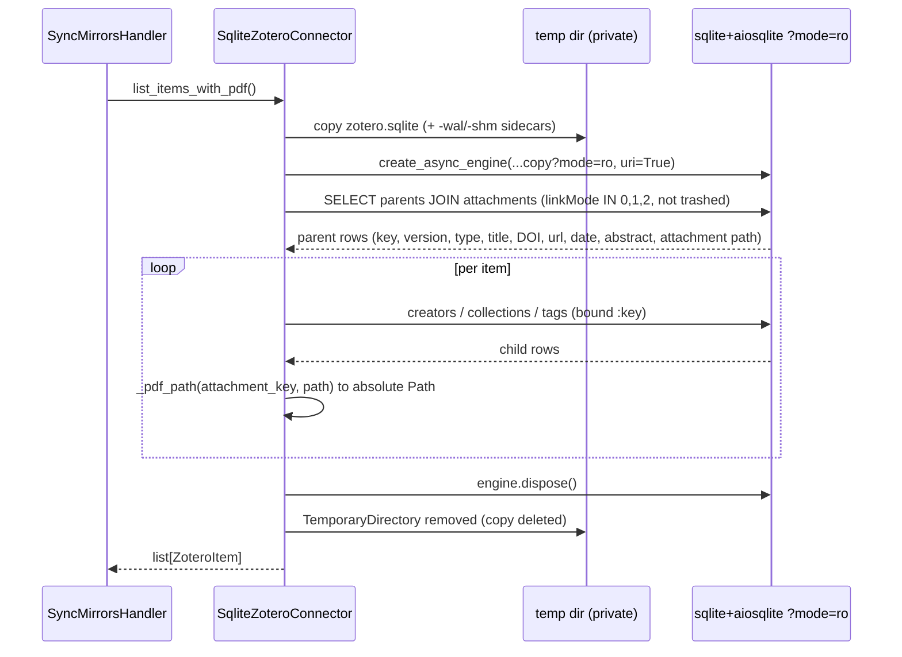

# zotero, read-only access to the local Zotero library

> **Where the code lives.** engram owns the `Connector` port
> (`engram/src/engram/sources/internal_contracts.py`) and the sync that consumes it. The Zotero adapter
> described here ships in the sibling `connectors` project, under
> `connectors/src/engram_connectors/zotero/`, behind the `engram-connectors[zotero]` extra, and
> reaches a host through the `engram.sources.connectors` entry-point group
> ([root ADR-0018](../../../docs/adr/0018-corpus-bundles-and-provider-packages.md)). This page is
> the contract for the port and its reference implementation together.

## Purpose

The Zotero connector is one provenance root of the Ingestion context: it reads the user's
**local Zotero library** (`zotero.sqlite` plus the
`storage/` attachment tree) and projects every PDF-bearing top-level item into a
`ZoteroItem` aggregate (title, creators, year, DOI, tags, collections, and the
resolved absolute `pdf_path`), which it maps onto engram's vendor-neutral `SourceItem`. It is the
*source side* of `studio sync`, feeding items + attachment paths to the reconcile handler.

The load-bearing boundary is the **read-only invariant, nothing here ever writes
Zotero** (ADR [`0002`](../adr/0002-disposable-mirror-zotero-source-of-truth.md)).
The adapter owns only reads against the user's library and the `storage/` linked
files. It does **not** convert PDFs to Markdown (that is a `DocumentConverter`), does **not**
write mirrors (that is the `mirror` slice), and does **not** decide
add/update/archive (that is `sync`). A knowledge base reaches this connector only by naming `zotero` in its
schema's `sources.connectors`, and engram builds with the package not installed at all (ADR
[`0005`](../adr/0005-zotero-linked-files-and-collection-filter.md)).

## Entry points

The connector has no CLI/HTTP surface of its own. It is consumed through engram's port by
the `sync` slice.

| Surface | Entry | Defined in |
|---|---|---|
| Programmatic (port) | `Connector.list_items_with_pdf()` / `.get(provider_key)` | `engram/src/engram/sources/internal_contracts.py` |
| Adapter | `SqliteZoteroConnector`, built by `SqliteZoteroConnector.build(resources)` | `connectors/src/engram_connectors/zotero/infrastructure/connector.py` |
| Registration | the name `zotero` under the `engram.sources.connectors` entry-point group | `connectors/pyproject.toml` |
| Resolution | `connector_class("zotero")` loads that one entry point, `ConnectorNotInstalledError` when nothing registers it | `engram/src/engram/sources/registry.py` |
| DI | `connectors_provider` (wireup singleton, resolves every name in `spec.sources.connectors` and builds each from a `SourceResources` object) | `studio/src/studio/knowledge_base/wiring/sources.py` |

Nothing imports this adapter by name. A knowledge base declares `zotero` in its schema's `sources.connectors`,
the composition root resolves that string through `engram.sources.registry`, and
`SqliteZoteroConnector.build(resources)` constructs it from the `SourceResources` object
(`engram/src/engram/config.py`), reading its own `zotero` settings block through
`engram_connectors.zotero.domain.library_settings`. `SyncMirrorsHandler`
then calls `list_items_with_pdf()` once per reconcile (`engram/src/engram/sources/service/sync.py`),
and `MultiConnectorSync` (`engram/src/engram/sources/service/sync.py`) runs one handler per declared
connector when a knowledge base names more than one.

## Public contract

- **Port:** `Connector` (Protocol, `engram/src/engram/sources/internal_contracts.py`), exposes **only
  reads**:
  - `async def list_items_with_pdf(self) -> list[SourceItem]`, every non-trashed
    top-level item that owns a non-trashed PDF attachment with a local file.
  - `async def get(self, provider_key: str) -> SourceItem | None`, one item by key, or
    `None` if absent / trashed / lacking a PDF.
  - `claims(url)`, `key_for(url)`, `source_type_of(item_type)`, the stateless classification trio every
    connector answers for its own host, used with the bare class before any settings exist.
  - `build(resources: SourceResources) -> Connector`, the classmethod a host calls once it
    has settings.
- **Adapter aggregate:** `ZoteroItem` (`BaseModel`,
  `connectors/src/engram_connectors/zotero/domain.py`), `key`, `version`,
  `item_type`, `title`, `creators: list[Creator]`, `year: int | None`,
  `doi`/`url`/`abstract: str | None`, `collections: list[str]`, `tags: list[str]`,
  `date_added`/`date_modified: datetime`, and `pdf_path: Path` (the resolved
  absolute attachment location). A `zotero_link` property derives the
  `zotero://select/library/items/<key>` deep link, and `to_source_item()` maps the aggregate onto
  engram's `SourceItem`, passing that deep link through as `source_link`. engram itself builds no
  vendor link: whatever a connector fills in there is what the mirror carries.
- **Value object:** `Creator` (`BaseModel`), `last_name`, `first_name`,
  `creator_type` (default `"author"`).
- **Config:** `LibrarySettings` (`connectors/src/engram_connectors/zotero/domain.py`), `data_dir`
  (default `~/Zotero`, holds `zotero.sqlite` + `storage/`), `base_attachment_dir` (resolves
  `attachments:` linked-file paths), `collection` (a single Zotero collection to
  mirror, empty = the whole library). All fields default, so the settings construct
  with no config present. `library_settings(resources)` validates the resources object's `zotero`
  block into them, and an absent block is the all-default library. The host writes that block under
  `sources` in `engram/config/application_settings.json`.
- **Invariants:**
  - **Read-only on two layers.** The port exposes no write method, and the adapter
    never opens the live DB (see Runtime flow). The `storage/` access is read-only
    file reads downstream. No write path exists, even in principle.
  - **Trash- and link-mode-filtered.** Only `linkMode IN (0, 1, 2)`
    (imported_file / imported_url / linked_file) is returned, never `linked_url`
    (3, a web link with no local file). Rows in `deletedItems` are excluded on both
    the attachment and the parent.
  - **`pdf_path` resolution is total.** `_pdf_path` never raises. An unresolvable
    `attachments:` path (no base dir) yields a path that simply won't exist, leaving
    the missing file to be reported per-item by `sync` rather than aborting the
    whole list build.
  - **Brittleness (documented debt):** the adapter is raw SQL against Zotero's
    **hard-coded SQLite schema** (`items`, `itemAttachments`, `itemData`, `fields`,
    `creators`, …) keyed on stable field names, plus **magic `linkMode` integers**.
    A Zotero schema change can break it silently. There is no schema-version guard.

## Runtime flow

A read (`list_items_with_pdf`) copies the live DB, opens the copy read-only, then
runs the parent-item query plus per-item child queries. The **structural** C4-L3
component + domain-model diagrams live in the arc42 master section 3 (zotero), see [the
arc42 master section 3](../architecture/sections/03-ingestion-bounded-context.md). This is
the behavioral view.



Source: `connectors/src/engram_connectors/zotero/infrastructure/connector.py`,
`connectors/src/engram_connectors/zotero/domain.py`, `connectors/pyproject.toml`,
`engram/src/engram/sources/internal_contracts.py`, `engram/src/engram/sources/registry.py`,
`studio/src/studio/knowledge_base/wiring/sources.py`, `engram/src/engram/sources/service/sync.py`,
`studio/src/studio/knowledge_base/settings.py`.

The copy-then-`?mode=ro` dance is why the adapter works whether or not Zotero is
running: Zotero keeps a write lock on its DB while the app is open, so the original
is never opened directly. The throwaway copy (and its sidecars) lives in a
`TemporaryDirectory` that is removed when the context exits, and the engine is
always `dispose()`d in a `finally`.

## Examples

```python
from engram.sources.registry import connector_class

# The name a knowledge base declares, resolved through the entry point. Nothing imports the adapter.
zotero = connector_class("zotero")
repo = zotero.build(resources)            # reads resources.settings["zotero"]
items = await repo.list_items_with_pdf()  # only the collection LibrarySettings names
item = await repo.get("ABCD1234")         # None if outside the collection / trashed
print(item.pdf_path, item.source_link)    # resolved storage/<key>/file.pdf, deep link
```

The slice is exercised end to end through the CLI over it:

```bash
# Reconcile the knowledge_base's Sources/ mirrors against the Zotero library (read side = this slice)
studio sync --dry-run   # preview only; never writes Zotero, never writes the knowledge base
```

## Patterns used

- **Repository / read port**. The `Connector` Protocol with a single
  SQLite adapter behind it. The port is the substitution point. See
  `../../../docs/explanation/design-patterns.md#di-seams-and-fakes-over-mocks`.
- **Read-only copy adapter**. Copy-then-`?mode=ro` is the structural enforcement
  of the immutable-source invariant. See
  `../../../docs/explanation/design-patterns.md#immutable-mirror`, ADR
  [`0002`](../adr/0002-disposable-mirror-zotero-source-of-truth.md).
- **Vertical-slice DDD**. The connector owns its `domain.py` + `infrastructure/connector.py`. DI
  lives at the composition root, which never names the adapter. See
  `../../../docs/explanation/design-patterns.md#vertical-slice-ddd`, ADR
  `../../../docs/adr/0001-wiki-app-placement-and-core.md` (root).
- App placement & docs standard: ADRs
  `../../../docs/adr/0001-wiki-app-placement-and-core.md`,
  `../../../docs/adr/0005-docs-as-code-standard.md`.

See the glossary at `../../CONTEXT.md` for slice, port, aggregate, and mirror
definitions.

## Testing seams

- **Protocol port**. `Connector` (`engram/src/engram/sources/internal_contracts.py`) is the
  substitution point. `sync` depends on the port, never on `SqliteZoteroConnector`.
- **Fake over mock**. `FakeConnector` (`engram/src/engram/testing/fakes/source_provider.py`,
  shipped in the `engram[testing]` toolkit): a structural in-memory double seeded with a
  `list[SourceItem]`, `get` a `provider_key` lookup over the same list, and `claims`/`key_for`/
  `source_type_of` scriptable through public attributes. It satisfies `ConnectorClass` too, so a
  test passes a constructed instance as a registry `source` entry and needs no connector package
  installed. Used by every `sync` reconcile test.
- **Adapter tests**. The SQLite adapter is tested against a built fixture
  DB in `connectors/tests/unit/zotero/test_connector.py` (the SQL JOINs, the trash/linkMode
  filter, the `storage:` / `attachments:` path resolution, the deep link reaching `source_link`),
  with the aggregate shape covered in `connectors/tests/unit/zotero/test_domain.py`.
