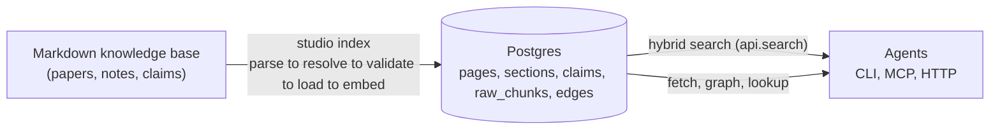
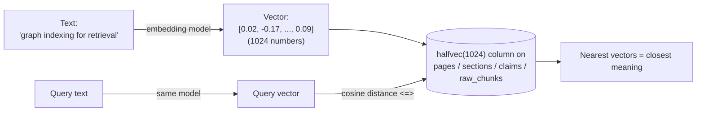
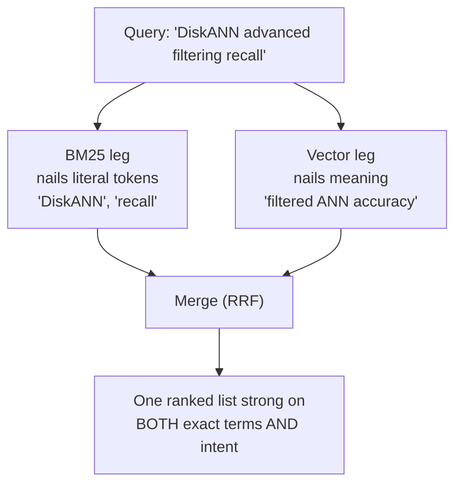
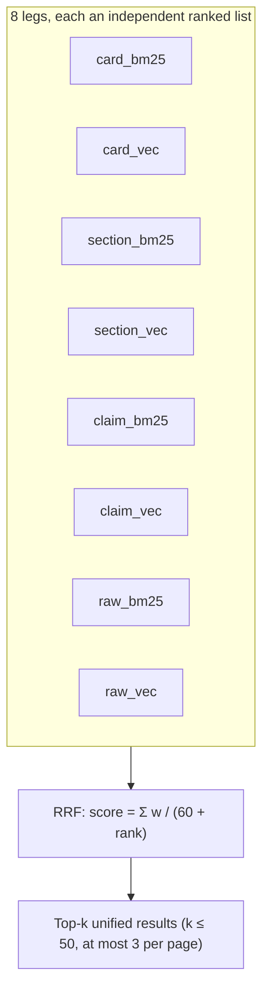
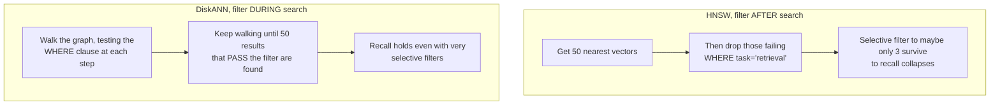
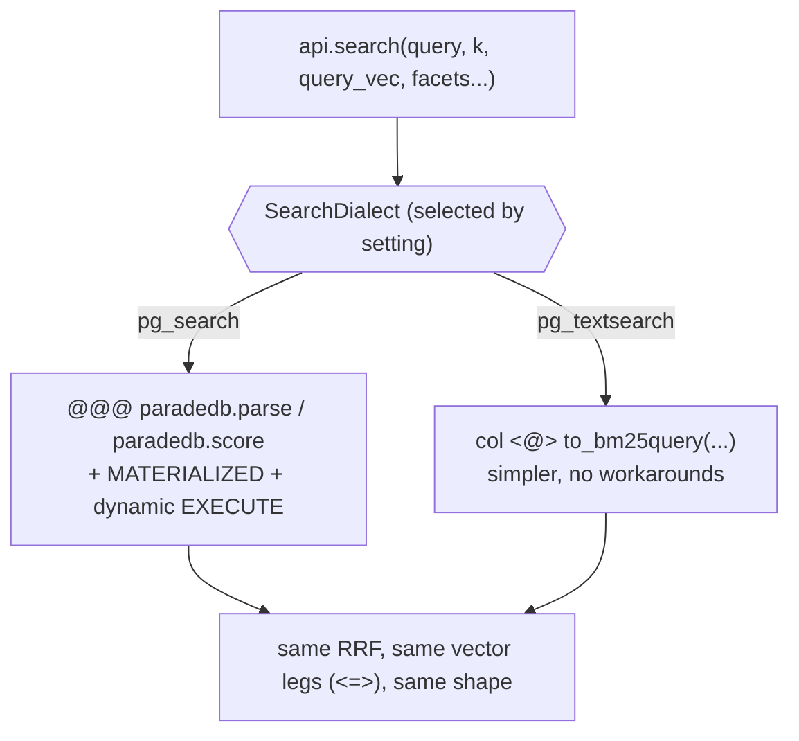
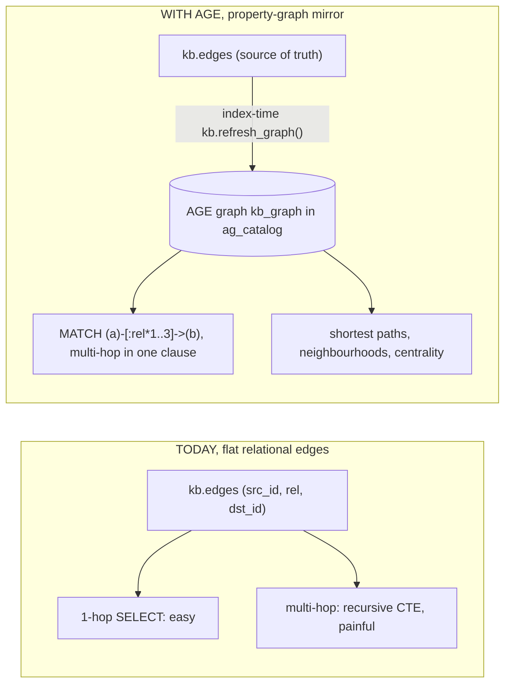

# The Knowledge Base's Retrieval Stack, Concepts from First Principles

> A standalone teaching guide for the terms, dialects, and algorithms behind the knowledge base's hybrid retrieval and its **managed Postgres target** (a managed Postgres that ships the same extensions). Written to be understood *in depth*, plain-English definitions, intuitive analogies, worked examples, and diagrams, not skimmed.

---

## 0. The big picture, what the knowledge base actually does

The knowledge base **indexes** a Markdown collection of notes (research notes, papers, claims, entities) into Postgres once, then **serves read-only hybrid retrieval** to agents over CLI / MCP / HTTP. "Index once, retrieve many," the knowledge is structured up front so each query is cheap and grounded.



Locally that Postgres is the `pg_textsearch` bed (the default, engram ADR-0017), with **ParadeDB** as an opt-in bed. The *managed* target is a managed Postgres with the same extensions. To understand why one codebase serves both *except* for one function, you need the concepts below.

---

## 1. Embeddings, vectors, and "distance"

An **embedding** turns text into a fixed-length list of numbers (a **vector**) such that *similar meanings land close together* in space, even with no shared words. "noise-cancelling earbuds" sits near "wireless headphones that block sound." "Tax law" sits far away.

The knowledge base uses **1024-dimensional** vectors from Azure OpenAI's `text-embedding-3-large`. "1024-dimensional" just means the list has 1024 numbers, a single point in a 1024-D space. We can't picture 1024-D, but "near vs far" behaves exactly as it does in 2-D.

- **`halfvec(1024)`**: the knowledge base stores each vector as 1024 **half-precision** (16-bit) floats instead of full 32-bit. Half the bytes, negligible accuracy loss.
- **Cosine distance**: the `<=>` operator. It measures the **angle** between two vectors, ignoring length. Small angle gives similar meaning. Picture two compass needles: same heading = similar. Perpendicular = unrelated.



**Why it matters here:** the query and every stored chunk are embedded by the *same* model, so "nearest vector" = "most semantically similar passage." This is the semantic half of search.

---

## 2. Two ways to search: lexical (BM25) vs semantic (vector)

There are two fundamentally different ways to decide a passage is relevant.

### Lexical / keyword search: "does it literally contain these words?"

The industry-standard score is **BM25** ("Best Matching 25"). Naive word-counting has three flaws. BM25 fixes each:

1. **Term-frequency saturation**: the 10th occurrence of "transformer" adds far less than the 2nd. Keyword-stuffing can't dominate.
2. **Document-length normalization**: a short section *titled* "DiskANN" beats a 10,000-word survey that mentions "DiskANN" once.
3. **IDF (inverse document frequency)**: rare, discriminating words ("DiskANN", "PG-4012") count for far more than common ones ("the", "model").

> **Intuition:** BM25 rewards a passage for containing your *rare* query words, *enough* times, *concentrated* in a *short* span. It's the same ranker behind Elasticsearch, Solr, and Azure AI Search.

Lexical search is unbeatable for **exact tokens**: identifiers, author names, dataset names, error codes, things an embedding model may have never seen.

### Semantic / vector search: "what does it *mean*?"

Embed the query, return the nearest stored vectors (section 1). Unbeatable for **paraphrase and intent**: "ways to speed up nearest-neighbour search" finds a section about "ANN index latency" with zero shared keywords. Its blind spot is the exact, never-before-seen token.

### Hybrid: run both, merge

Each method covers the other's blind spot. Hybrid is the knowledge base's approach.



---

## 3. "The legs" and Reciprocal Rank Fusion (RRF)

A **leg** is one *individual ranked sub-query* feeding the merge. The knowledge base is searched at **four granularities**, called surfaces or read-levels:

| Surface | What it is | Table |
|---|---|---|
| **card** (L1) | the one-paragraph card for a whole page | `kb.pages` |
| **section** (L2) | an H2/H3 leaf section | `kb.sections` |
| **claim** | a single finding ("X beats Y on Z") | `kb.claims` |
| **raw** (L4) | a raw PDF chunk, for quote verification | `kb.raw_chunks` |

For **each** surface it runs **both** a BM25 leg and a vector leg: **4 surfaces by 2 methods = 8 legs**, each an independent ranked list (`card_bm25`, `card_vec`, `section_bm25`, `section_vec`, `claim_bm25`, `claim_vec`, `raw_bm25`, `raw_vec`). Each leg ranks at most a **budget** of rows, 50 by default and never fewer than `k`: a BM25 leg its best-scored rows, a vector leg its nearest rows by exact distance.

**RRF (Reciprocal Rank Fusion)** merges those 8 lists into one:

> A document's fused score = Σ over every leg it appears in of **w / (c + rank_in_that_leg)**, with **c = 60** and a weight **w = 1** for every surface and leg by default.

**Why rank, not raw score?** A BM25 score (e.g. 7.3) and a cosine distance (e.g. 0.21) live on *incompatible scales*, adding them is nonsense. But "came 1st" / "came 2nd" *are* comparable across legs. The constant **c = 60** dampens the top spot so the #1 hit can't run away with it, what floats a document up is **appearing high in several legs at once**.

**Worked example.** Suppose section `S` ranks 2nd in `section_bm25` and 1st in `section_vec`, and is absent elsewhere:

```
score(S) = 1/(60+2) + 1/(60+1) = 0.01613 + 0.01639 = 0.03252
```

A document that ranked 1st in only *one* leg scores `1/(60+1) = 0.01639`, less than `S`, because `S` showed up strongly in **two** legs. That cross-leg agreement is exactly what RRF rewards.

**The numbers are tuned, not fixed.** The constant, the budget, the weights, the `k` ceiling of 50 and the snippet length of 480 characters are defaults. `api.search` reads them from the default row of `kb.retrieval_tuning` each time it runs and holds them to bounds generated into the function, so a measurement changes a number with an `UPDATE` and no new function (engram ADR-0048). After the fusion three rules apply by rank. A card whose title is exactly the query goes first when no other candidate holds that title. Then each page keeps at most 3 hits across its card, sections and claims, so one long page cannot fill the list. Then each document keeps its best hit, so `k` counts documents: a source and every page made from it are one document, a page made from no source is its own, and the document's next matching units ride under its best hit as `folded_units`, each with a short snippet of the text it matched. The owner can raise that cap or set it to 0, which keeps every hit, for the whole database or for one knowledge base in that knowledge base's own row, and the `search` tool's description states the cap the database applied when the process read it, with the exceptions the [serve reference](reference/serve.md) lists.



**This is the heart of what the dialect seam touches.** The vector legs (`<=>`) are identical on ParadeDB and `pg_textsearch`. Only the **BM25 legs** change syntax (section 5).

---

## 4. Vector indexes: flat to HNSW to DiskANN (and "advanced filtering")

To find the nearest vectors you *could* compare the query against **every** stored vector, exact but O(n) ("flat" / brute-force). Fine for thousands of rows, hopeless for millions. So we use an **ANN (Approximate Nearest Neighbour)** index: trade a sliver of accuracy for a huge speed-up by checking only a smart subset.

- **Recall** = of the truly-nearest results, what fraction the approximate index returned. 1.0 = perfect.

### HNSW (Hierarchical Navigable Small World)

Builds a multi-layer graph of vectors, like an **airline hub network**: long hops between hubs on the top layer, short hops in local neighbourhoods at the bottom. Search starts at a hub and "walks downhill" toward the query. Fast, high recall, great general default. **Two limits:** capped at **2000 dimensions**, and it does **filtering *after* the search**.

The knowledge base builds HNSW indexes on its embedding columns, but `api.search`'s vector leg does not rank through them. It orders the rows its filters keep by exact distance and takes its budget, because an approximate index under a filter can stop before it has the budget's rows (the filtering limit below).

### DiskANN: Microsoft Research's graph ANN

Optimized so the index lives on **SSD** (scales to *billions* of vectors without holding everything in RAM), up to **16,000 dimensions**, the recommended default wherever `pg_diskann` is available. Its headline feature is **advanced filtering**: it evaluates your `WHERE` clause *during* the graph walk.

The difference is decisive for **filtered** queries (most of the knowledge base's faceted retrieval):



**Restaurant analogy.** HNSW filtering = "give me the 50 nearest restaurants, *then* cross off the non-vegan ones" (might leave 3). DiskANN advanced filtering = "keep finding nearest restaurants *until I have 50 vegan ones*."

**Two caveats for us (from the docs):**
- DiskANN examples use full `vector` + `vector_cosine_ops`. **No documented `halfvec` support**. Adopting it likely means `halfvec(1024)` becomes `vector(1024)` (2 times the storage, a few MB at our scale, irrelevant).
- Advanced-filter predicates must reference **the same table** as the indexed vector. Joins evaluate *after*. The knowledge base's facets live on `kb.pages`, so the **card** leg benefits directly. **Section/claim/raw** legs reach facets via a join and still need a pre-filter.

**Reality check:** our knowledge base is *tiny* (~343 pages, ~808 edges, a few thousand sections/claims/chunks). An exact scan of the filtered rows is fast at this size. DiskANN is **future-proofing + filtered-recall**, not a present need.

---

## 5. The BM25 dialect problem: `pg_search` vs `pg_textsearch`

Both ParadeDB's `pg_search` and `pg_textsearch` implement BM25 as a custom **`USING bm25` index**, but with **different SQL surfaces**. This mismatch *is* what the dialect seam exists for.

| | ParadeDB `pg_search` (opt-in local bed) | `pg_textsearch` (local default, managed target) |
|---|---|---|
| Match operator | `text @@@ paradedb.parse('q')` | `text <@> to_bm25query('q','idx_name')` |
| Get the score | `paradedb.score(id)` (separate fn) | the `<@>` operator returns it (negative, lower = better) |
| Index DDL | `USING bm25 (id, …) WITH (key_field='id')` | `USING bm25 (col, …) WITH (text_config='english')` |
| In PL/pgSQL | needed a dynamic-SQL workaround | **must** name the index via `to_bm25query` |

The ParadeDB rendering of `api.search` carries **two ParadeDB-specific workarounds**: each scoring leg is a `MATERIALIZED` CTE (because `paradedb.score()` can't cross a `UNION ALL`), and the whole function runs via dynamic `RETURN QUERY EXECUTE` (because the BM25 custom scan mis-projects columns in static PL/pgSQL).

**Good news:** because `pg_textsearch`'s `<@>` is an *ordinary operator* (not a special score function), the `pg_textsearch` rendering needs **neither workaround**, so it is the *simpler* function.

### The "dialect seam"

A thin abstraction that emits the right BM25 SQL for whichever backend, so **one** codebase serves both ParadeDB (the opt-in local bed) and `pg_textsearch` (the local default and the managed target). Modelled on the project's **Strategy Registry** pattern (a frozen dataclass wrapping an enum-to-strategy `Mapping`, a wireup singleton). The vector legs and everything else stay shared. Only the BM25 index DDL and the `api.search` body differ per dialect.



---

## 6. Graphs: relational edges to Apache AGE to Cypher to GraphRAG

The knowledge base already stores a graph: `kb.edges(src_id, rel, dst_id, qualifiers, provenance_claim)`. But it's a **flat relational table**: great for one hop, painful for traversal.

- *"What does paper X cite?"*: one `SELECT ... WHERE src_id='X'`. Easy.
- *"Everything X transitively builds on, up to 3 hops?"*: a **recursive CTE**, verbose, fiddly, no real path semantics.
- *"Shortest path from technique A to dataset B?"*: genuinely hard in SQL.

### Apache AGE ("A Graph Extension") + openCypher

AGE adds a **property graph** (nodes + typed, directed edges as first-class things) and the **openCypher** query language inside Postgres. **Cypher expressiveness** means you describe the *pattern* and the engine handles the traversal:

```cypher
-- "what does paper X transitively build on, 1 to 3 hops?"  ← one clause
MATCH (x:Page {id:'paper:x'})-[:builds_on|extends*1..3]->(p:Page)
RETURN p.id, p.title
```

`[:builds_on*1..3]` = "follow `builds_on` edges between 1 and 3 times." In SQL that's a dozen-plus lines of recursive CTE. In Cypher it's a clause. *That* is expressiveness.

**How AGE stores it (key fact):** AGE keeps the graph in its **own `ag_catalog` schema** (separate vertex/edge tables). It does **not** run over `kb.edges`. The knowledge base **projects `kb.edges` into an AGE graph (`kb_graph`) during indexing**: a writer-only `kb.refresh_graph()` the load step runs after replacing the edges, so the read functions never write. `kb.edges` stays the source of truth, and `api.edges` / `/api/graph` keep working. Cypher returns `agtype` values, joinable back to relational tables.



**As shipped (ADR-0007).** This is implemented as a **dual graph backend** behind one API: `retrieval.graph_backend` selects `cte` (reads `kb.visible_edges`, the portable fallback used by the ParadeDB opt-in bed) or `age` (reads the `kb_graph` projection, the local/CI default via the local Postgres and the managed target's backend, engram ADR-0017). Both render the *same* walks from one generated body: each walk keeps the set of nodes it has reached and takes one hop at a time from the newest of them. The `cte` backend reads that hop from the edge relation, the `age` backend from a single-hop cypher match. Neither lists paths with a variable-length match like the one above, because the number of paths grows past what a dense graph can answer, while the nodes and edges a walk reaches stay small (engram ADR-0049). Both expose `api.graph_expand` (the typed-relation neighbourhood, at most 6 hops), `api.graph_paths` (routes shortest first, at most 8 hops) and `api.graph_reach` (how far a seed set reaches with no hop limit, stopping at 10,000 nodes), surfaced to agents as the MCP `graph_expand` / `find_paths` tools and `POST /api/graph/expand|paths`. A walk's answer carries its reach, so the agent is told whether nodes lie past the last hop or that no route exists. Because the AGE `kb_graph` projection is rebuilt at index time (writer-only `kb.refresh_graph()`, not per query), every function is pure-read and executes as the read-only `kb_reader` role. AGE also runs locally via the `postgres` Docker image (port 5434), so the openCypher path is testable offline.

### GraphRAG

Retrieval-Augmented Generation that *uses the graph*. **Plain RAG:** embed query, then fetch top-k similar chunks, then hand the LLM isolated fragments. **GraphRAG:** fetch seed nodes by vector/BM25, then **traverse** the graph to pull in *connected* entities and claims, then hand the LLM a connected sub-graph. It answers multi-hop questions flat retrieval can't, e.g. *"trace how method A's idea propagated through later papers and where it was contradicted."* Our domain maps 1:1 onto a typical GraphRAG sample (papers≈cases, edges≈citations, claims≈findings).

**Caveats:** a second copy of the graph (the index-time `kb_graph` projection). `agtype` parsing app-side. AGE isn't in the ParadeDB image, so the **AGE backend is now the local/CI default** via the local `postgres` image (engram ADR-0017) and also serves the managed target, while the relational `cte` backend is the portable fallback used by the ParadeDB opt-in bed. Both backends walk one hop at a time, so the choice is where the graph lives, not how fast a walk runs. AGE's win is a projected graph a caller can also query in openCypher, the base for a true GraphRAG retrieval mode.

---

## 7. Where the managed Postgres target fits

The design targets a managed Postgres (HA and failover, backups, point-in-time restore, read replicas) that speaks the standard Postgres wire protocol, so asyncpg and SQLAlchemy work unchanged, and whose **primary and reader endpoints** map onto the knowledge base's existing two-URL design. It ships the retrieval toolbox as Postgres extensions:

| Extension | Gives us | Status here |
|---|---|---|
| `vector` | `halfvec`, HNSW, IVFFlat, `<=>` | ports as-is (Slice A) |
| `pg_textsearch` | BM25 (`<@>`, `to_bm25query`), replaces `pg_search` | the rewrite (Slice A) |
| `pg_diskann` | DiskANN + advanced filtering | optional (Slice B) |
| `age` | property graph + openCypher | **implemented**, dual graph backend (ADR-0007) |
| an in-database AI extension | in-SQL embeddings and rerank | not adopted (embeddings stay app-side) |
| `ltree`, `pg_trgm`, `pg_cron`, a blob storage extension | section paths, fuzzy, scheduling, blob I/O | available |

**Not available:** ParadeDB's `pg_search`, which is the entire reason the BM25 dialect swap exists.

---

## 8. Glossary cheat-sheet

| Term | Plain-English meaning |
|---|---|
| **embedding / vector** | text turned into a list of numbers capturing meaning |
| **halfvec** | a vector stored at 16-bit precision (half the bytes) |
| **`<=>`** | cosine-distance operator (semantic nearness), also `<->` L2, `<#>` inner-product |
| **BM25** | the standard keyword-relevance score (fixes term saturation, length, IDF) |
| **IDF** | inverse document frequency, rare words count more than common ones |
| **`@@@` / `paradedb.parse` / `paradedb.score`** | ParadeDB's BM25 grammar (opt-in local bed) |
| **`<@>` / `to_bm25query`** | `pg_textsearch`'s BM25 grammar (local default, managed target) |
| **leg** | one independent ranked sub-query feeding the merge |
| **RRF** | Reciprocal Rank Fusion, merge ranked lists by `Σ w/(c + rank)`, with c = 60 and w = 1 by default |
| **ANN** | Approximate Nearest Neighbour, fast, slightly-lossy vector search |
| **recall** | fraction of the true nearest results the index actually returned |
| **HNSW** | graph ANN index, fast, filters *after* search, ≤2000 dims |
| **DiskANN** | MSR graph ANN, SSD-scale, ≤16000 dims, filters *during* search ("advanced filtering") |
| **IVFFlat** | a third ANN index (clustering-based), not used here |
| **`ltree`** | Postgres type for hierarchical paths (the knowledge base's section tree) |
| **Apache AGE** | property graph + openCypher inside Postgres (`ag_catalog` schema) |
| **Cypher / openCypher** | graph query language (`MATCH (a)-[:rel*1..3]->(b)`) |
| **`agtype`** | AGE's return type for graph values |
| **GraphRAG** | RAG that traverses a graph to gather connected context |
| **semantic reranking** | a 2nd-stage cross-encoder rescoring of the top-k |
| **server parameters** | a managed host's mechanism to allow-list extensions and set `shared_preload_libraries` |
| **dialect seam** | our abstraction emitting backend-specific BM25 SQL, one codebase, two backends |
