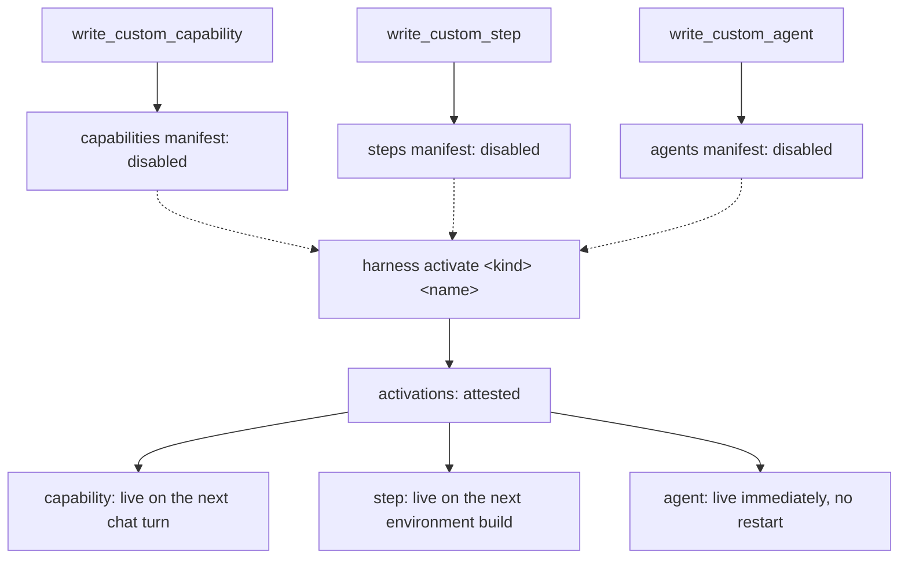
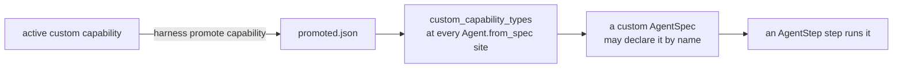

# self-authoring, the harness the agent grows

## Purpose

The AI Factory Studio agent grows its own harness at runtime. It can author a pydantic-ai **capability** (Python), a
`StepRegistry` **step** (Python), and a declarative **agent** (an `AgentSpec` document, YAML): three types of custom
item, each written by its own tool, each landing in its own on-disk store. A fourth type, the **workflow**, is
authored too, but through a Python builder pen rather than a stored custom item of its own. It stays in the existing
library once built.

Every custom capability, step, and agent lands **pending**: written and validated immediately, but inert until the
owner reviews it and flips it live through `harness`. Nothing an agent authors becomes part of the harness by
authoring it, activation is a separate, attested, owner-only act. The backend is one slice,
`harness/src/harness/features/selfauthoring/`, plus the builder in `core/src/core/ai/workflows/authoring.py`. This
document is written from that code, and every claim below names the module a reader can check it in.

---

## 1. The four types, at a glance

| Type | Tool | Composes | Store | Manifest lives at |
|---|---|---|---|---|
| Capability | `write_custom_capability` (adopted from the harness's `capability_creation`) | a Python `AbstractCapability` subclass | `FileCustomCapabilities` (`infrastructure/capabilities.py`) | `custom/capabilities/manifest.json` |
| Step | `write_custom_step` | one or more `async def` functions, every parameter and the return annotated | `FileCustomSteps` (`infrastructure/steps.py`) | `custom/steps/manifest.json` |
| Agent | `write_custom_agent` | pydantic-ai's own `AgentSpec`, as YAML: model, instructions, settings, named capabilities | `FileCustomAgents` (`infrastructure/agents.py`) | `custom/agents/manifest.json` |
| Workflow | `WorkflowBuilder` (`core.ai.workflows`) | the four workflow node verbs, wired in Python | none of its own, emits a `Workflow` that flows through the ordinary `save_workflow` gate | the library, unchanged |

A workflow is not a fifth manifest type here: `WorkflowBuilder` holds no runtime behaviour and executes nothing. It
only assembles the data a `Workflow` is made of, and the emitted spec is saved exactly like a hand-written one,
through `check_draft` to `save_workflow`, with the same lineage and evidence. See
[store-protocol](store-protocol.md) for what happens to it from there.

---

## 2. Capabilities, `write_custom_capability`

`PendingCapabilityCreation` (`tools.py`) wires the harness's own `capability_creation.CapabilityCreation` to a
harness-side store instead of the vendor's default one. The vendor's `CapabilityStore.write()` activates a validated
capability the moment it lands. `FileCustomCapabilities.write()` overrides that single method to land every entry
`disabled` regardless of whether it validated. Pending is the only landing state, not a fallback for a broken one.

`activate(name)` / `deactivate(name)` are `harness`'s own acts. `disable(name)` is the agent's own
`disable_custom_capability` tool, reused from the vendor toolset, attested with `via="agent"` rather than
`via="cli"`. Every deactivation is recorded regardless of which channel it came through, but only a person ever
activates. `PENDING_GUIDANCE` replaces the vendor's default system-prompt text, whose "becomes active on the next run"
claim is false under this store. The vendor keeps its own three tool names, and `PendingCapabilityCreation` mounts them
under this app's (`_TOOL_NAMES` in `tools.py`), so the agent only ever sees `write_custom_capability`,
`list_custom_capabilities` and `disable_custom_capability`.

## 3. Steps, `write_custom_step`

There is no vendor equivalent for this one: `capability_creation` targets the pydantic-ai capability registry, not
`core.ai.workflows`' `StepRegistry`, so `StepCreation` (`tools.py`) and `FileCustomSteps` (`infrastructure/steps.py`) supply the whole pattern themselves,
matching the capability store's shape.

**Validation is registration.** `FileCustomSteps.write()` loads the written module fresh (no bytecode cache, so
re-authoring the same name always re-executes the new source) and feeds every public `async def` it defines through
`StepRegistry().copy().register()`, a throwaway registry, so the engine's own entry point is the validator: async
only, every parameter and the return annotated, `Any` refused. The refusal text an authoring agent sees is the
registry's own, not a paraphrase.

**Activation is next-environment-build, not next-turn.** `FileCustomSteps.load_active(registry)` is called once, by
`composition.build_environment()`, right before the session's registry is handed back, never per request. A step the owner just
activated is not callable mid-process. It becomes callable the next time this process starts (or, in a test harness
that rebuilds the environment per session, the next session). This is a deliberate asymmetry from capability activation
(section 6), and `STEP_GUIDANCE` states it to the authoring agent in exactly those terms rather than leaving it to be
discovered.

Unlike a capability, a step has no agent-facing disable tool. The vendor toolset's `disable_authored_capability` has
no step equivalent, so `harness disable step <name>` is the only way.

## 4. Agents, `write_custom_agent`

`AgentCreation` (`tools.py`) and `FileCustomAgents` (`infrastructure/agents.py`) follow the same shape once more: no vendor
equivalent (declarative agents are not a `capability_creation` concern), so these two modules are the validator, the
store, and the toolset together.

**Validation is the framework's own `AgentSpec.model_validate`, plus capability resolution.** `validate_agent_document`
parses the YAML to a mapping, validates it as `AgentSpec`, then checks every named capability against
`get_capability_registry(custom_capability_types)`, the same registry a built-in capability name is checked against,
with promoted custom capabilities (section 8) folded in. An unknown name is refused, naming it. If the name matches a
custom-but-not-yet-promoted capability, the refusal also names the exact `harness promote capability <name>` that
would fix it.

**Resolution is the fastest of the three.** `FileCustomAgents.resolve_active(name)` (the function `composition.py`'s
`_resolve_stored_agent` wires as `core.ai.workflows`' `AgentResolver` seam) reads the manifest and the document fresh
from disk on *every* call. There is no environment-build cache and no per-turn re-injection to wait on: the moment the
owner runs `harness activate agent <name>`, the very next thing that resolves that name, this run or any later one,
sees it active. A pending name raises `LookupError` naming the activate command as the fix.

A `AgentStep` step (`core.ai.workflows.domain.vocabulary.AgentStep.agent`) may hold the document inline or a plain string
naming a stored agent. `composition.build_environment`'s `run_agent_step` resolves a string reference through this same store, so
the two paths build the identical `Agent.from_spec` call. Host kwargs (model, output type, tool grants, capability
guards) always override the document, exactly as an inline `agent:` document is overridden today.

Like a step, an agent has no agent-facing disable tool of its own. `harness disable agent <name>` is the only way.

## 5. Workflows, the `WorkflowBuilder` pen

`WorkflowBuilder` (`core/src/core/ai/workflows/authoring.py`) is a fluent
builder over the grammar's four node verbs (`.run`, `.map`, `.gate`, `.judge`) plus `.parameter` and `.output`,
ending in `.build()`. It refuses cold, at the call that introduced the problem, rather than waiting for a downstream
check: a duplicate node id, a wire naming a node not yet added, an output wired to nowhere, or (when constructed with
a `registry=`) a `.judge` whose step's return type cannot serve as a verdict. Everything else (type mismatches, dead
ends, cycles, work nobody registered) is `validate`'s job on the `Workflow` `.build()` emits, unchanged from a
hand-authored spec.

The agent writes builder code in the existing code-mode sandbox. The runtime never executes written orchestration
code. Only the spec the builder emits ever gets saved, and it is saved exactly like any other draft.

### The presentation a workflow file declares

A workflow file imported with `harness import <dir>` may declare a `presentation` key in its frontmatter, beside
`title`, `description` and `uses`. It is the author's own words about the workflow for the surfaces a person meets
it on: `purpose`, `produces`, `owner_participation`, `not_for`, labelled `inputs`, display-only `result_fields`, and
`actions` over the artifacts the spec's `result` declares. The importer validates it against `WorkflowPresentation`
and carries it into the library on `put`, unchanged.

Nothing infers one. A file that declares no `presentation` is stored with none, and the procedural `description`
is never promoted into a purpose the author did not write. A presentation that does not parse, names an input the
spec declares no parameter for, or names an artifact the spec's `result` does not declare refuses the whole folder
before anything is written, the same rule an unrunnable workflow already follows. The action vocabulary is closed
(`save_note`, `record_owner_review`): a file cannot supply an endpoint, a method, a path, or a request body.

### A turn that only designs starts nothing

A request carrying `design_only: true` (the Studio's guided authoring route sends it) has
`run_workflow`, `schedule_workflow`, `update_schedule`, `delete_schedule` and `run_schedule_now`
withheld from that turn's tool set, rather than discouraged in prose. A sentence in the
instructions is advice a model may read past, and somebody who asked to be shown a workflow did not
ask for one to start. The reads stay (`check_runs`, `schedules`, `recent_runs`, `run_values`,
`spend_report`), and so does `stop_run`, which only ends something already going. It narrows and
never widens, so a surface that says nothing gets the ordinary agent.

Such a turn still records what the person asked for. `check_draft` takes an optional `intent`
beside the card fields, and `PUT /api/sessions/{id}/intent` writes one onto the session's draft
without validating it against the spec, saving anything, or starting anything. What that record is
for, how it differs from the presentation beside it, and why the gate below reads one and not the
other, is in
[workflow-monitoring.md](workflow-monitoring.md#the-intent-and-the-presentation-two-records-one-card).

### The described-readiness gate on every save

A workflow is kept only once somebody has described it. The rule lives in one place
(`src/harness/domain/readiness.py`) and every save path reads it: `POST /api/save` and
`POST /api/sessions/{id}/save` (the Save button and the agent's own draft), `PATCH
/api/workflow/{id}/card` (the card editor), and `GET /api/workflow/{id}`, which carries the same
reading so a form and the gate can never disagree.

`card_readiness` answers two independent questions about one workflow:

- **described**: the card carries a title (1 to 80 characters after stripping), a summary (1 to
  280), and the author's four sentences (`purpose`, `produces`, `owner_participation`, `not_for`,
  each at most 2,000 characters). Every one of them is refused when it is blank or when it
  normalises to a placeholder. The placeholder set is exactly `tbd`, `todo`, `n/a`,
  `(not stated)`, `coming soon`, compared after trimming, collapsing inner runs of whitespace, and
  casefolding. No English is read for meaning, and no model grades anything.
- **executable**: every step name the graph uses resolves in this run's registry and the wiring
  checks out.

The two never decide each other. A workflow this run cannot build is still described, and a
described workflow with a missing step still saves and still reads `executable: false`.

Findings come back as `{field, severity, message}`, `field` drawn from a closed set (the six card
fields plus `work`). **Only an `error` refuses a write**, and `described` is exactly "no error
findings". A warning is advice: a summary that repeats the spec's own `description`, or work
nothing here can build.

Every fallback on the save path is gone. `save_draft` no longer substitutes the spec's name for a
missing title, its description for a missing summary, or the string `(not stated)` for a missing
applicability. An undescribed draft is refused with every finding at once, and the refusal carries
the reading (`{"ok": false, "detail": ..., "readiness": ...}`, status 400) so a form can put each
finding beside its own box.

`check_draft` takes the four sentences beside the card fields, merges them onto the draft
(absent means unchanged, one field at a time), and ends its answer with what the draft still owes.
The standing instruction block says the rule. What one draft owes is the tool result's, so the
instructions stay byte-identical while the registry holds still.

The card route is the one place a partial answer lands. It merges the patch onto the card the
library holds, refuses when a field **the patch itself carries** fails, and otherwise writes and
reports the rest. A workflow saved before anybody wrote the author's words down can therefore be
described a box at a time, from the workflow's own "what it does" page, which carries a box per
card field and a box per sentence with its finding under it. A patch naming no sentence leaves the
words the library holds (`WorkflowLibrary.redescribe` takes the presentation as an optional
argument, and absent means unchanged).

The agent's own write goes through the same bar. `save_workflow` and `adapt_workflow` take the
four sentences beside the card fields, and this deployment installs a `SaveGuard` on the workflow
contract port built from the same `card_readiness` and `refusal_text`. A workflow the agent saves
is therefore described exactly as far as one the person saves, and a blank title is no longer
derived from the spec's own name behind the bar.

---

## 6. Activation and evidence, `harness`

The owner's review-and-activate surface has two paths onto one gate: `harness` (`routes_cli.py`, mounted on the root
`harness` CLI) in a terminal, and AI Factory Studio's Harness station over `/api/harness/*` (`controller.py`, same acts,
same stores, same refusal wording, type-to-store resolution shared in `service.py`). `capability`, `step`, and `agent`
are all wired, no custom type is left out:

```
harness list <kind>                    # capability | agent | step
harness activate <kind> <name>
harness disable <kind> <name>
harness delete <kind> <name>           # disabled custom items only: disable first
harness plugins [--on NAME | --off NAME]
harness promote capability <name>      # capability-only: see §8
harness demote capability <name>
```

`profile` is the fourth type: a named YAML set of plugins, custom items to hold active, standing instructions, and
pinned workflows. Beyond activate lies one more owner act, **selection** (`harness profile <name>`,
`PUT /api/harness/selection`): the set is validated whole (unknown plugins, missing or broken referenced custom items
refuse it), the referenced lists are reconciled to active through the stores' own activation records, and the
plugins plus instructions are snapshotted beside the transcript, effective on the very next turn, and immune to
later document edits until re-selected. The Studio refuses a switch mid-conversation. The model stays its own knob,
deliberately outside the set.

`delete` removes a custom item outright (its manifest entry and its source file) and is refused while the item is
active, so the composition never changes as a side effect of routine cleanup (`DELETE /api/harness/{kind}/{name}` is
the Studio's same path). `plugins` is the adjacent surface over the agent's *built-in* setup (`harness.plugins`):
every functional plugin (knowledge base, leveled-reads, sql, pydantic-ai-docs, recall, skills, shell, files, and the
three authoring plugins) can be turned on or off, persisted beside the transcript, with next-turn effect and no restart
(`Switched` reads the set when a request is composed). The always-on set (spend limits, code mode, loop detection,
output limits, step persistence, instructions, the workflow process) is listed but never toggleable. SQL starts off.

Every activate, deactivate, delete, promote, and demote is recorded to one shared, append-only JSONL activation
log (`FileActivationLog`, `infrastructure/activation_log.py`) at `activation_log_path()`, beside the transcript, under this deployment's
`.state/`. Each line is one of five events, past tense: `CapabilityActivated`, `StepActivated`, `AgentActivated`,
`ProfileActivated`, `CapabilityPromoted`. Each carries `name`, `action` (`activate` / `deactivate` / `delete`) and
`via` (`cli` / `agent`, though activation itself never records `agent`, since an agent never self-activates), plus a
UTC timestamp. A promotion is a `CapabilityPromoted` with `action="activate"`, a demotion the same event with
`action="deactivate"`, so the existing vocabulary carries the fourth type rather than growing a fifth.

This activation log is separate from the workflow evidence record described in `../../CONTEXT.md`. That one
records what a *workflow run* did. This one records who flipped a *custom item* live or dark, and when.

`activate` itself refuses, naming the stored error, when the record it would flip live still carries one from its
last write. Activating known-broken code is never the fix, for any of the three types.

## 7. Activation timings, side by side

The pending gate is the same for all three types. When activation actually takes effect is not, and the guidance
text each tool returns says so honestly rather than leaving an agent to discover it by surprise. Promotion is not a
fourth type (it has no pending state of its own, it can only apply to an already-active capability), but it has its
own timing, worth reading beside the three:

| Type | Where it is read | Takes effect |
|---|---|---|
| Capability | `session.custom_capabilities.load_active()`, threaded into `agent.run(capabilities=...)` on every chat turn (`features/authoring/service.py`) | the very next chat turn, never the one that wrote it |
| Step | `FileCustomSteps.load_active(registry)`, called once by `composition.build_environment()` | the next environment build (in production, the next process start) |
| Agent | `FileCustomAgents.resolve_active(name)`, read fresh from disk on every resolution | immediately, no restart, no waiting for the next turn |
| Promotion (section 8) | `promoted_capability_types(store)`, called once by `composition.build_environment()` and once by `build_agent()` | the next environment build or session, never the one `promote`/`demote` ran in |

Capabilities and agents both avoid a process restart, but for different reasons: a capability is re-loaded into the
*whole capability list* fresh each turn, while an agent document is resolved individually, on demand, only when a
`AgentStep` string reference actually names it. A step and a promotion both genuinely wait for the next
environment build, they join, respectively, the `StepRegistry` and the
`custom_capability_types`/`capability_grants` a process boots with, and both are built once per environment.



---

## 8. The promotion bridge

Promotion is the owner's act that joins an already-**active** custom capability to the pydantic-ai capability
registry, so a custom *agent* document can declare it by name, `harness promote|demote capability <name>`
(`infrastructure/promotion.py`), with no agent-facing tool. A pending capability is refused with a pointer at `activate` first.

**The contract.** `promote_capability` loads the capability class through the store's own loader and checks two
things directly on the class:

- `get_serialization_name()` returns something other than `None`.
- The class itself is declared as a dataclass (`"__dataclass_fields__" in cls.__dict__`), inheriting one from
  `AbstractCapability` does not count.

Either half missing is named in the refusal. The check is deliberately not "frozen": `AbstractCapability` is itself a
plain, non-frozen dataclass, and Python refuses a `frozen=True` subclass of a non-frozen base. So no
`AbstractCapability` subclass, built-in or custom, can ever be frozen in that literal sense. What is checked is the
vendor registry's own validation (`get_capability_registry`'s `_validate_capability`): a dataclass declared directly
on the class, the same shape every built-in capability already has.

**Where it lands.** Promotion is idempotent and persists as one small, sorted `promoted.json` beside the capability
manifest (`custom/capabilities/promoted.json`), the second file that directory holds. `promoted_capability_types`
re-resolves the classes through the same loader on every call. `capability_grants_for` derives the matching
`StepRegistry.capability_grants` list. Both are read once per environment build or per session by their callers
(`composition.build_environment`, `build_agent`). A `promote`/`demote` that runs while a session is already live takes effect on
the next one, not the current one.

**The closure.** A promoted capability's class joins `custom_capability_types` at every `Agent.from_spec` call site:
`composition.py`'s worker runner, and `AgentCreation`'s own validation, so an agent document naming it is checked at
author time the same way a built-in capability name already is.



This whole path (author a capability, promote it, author an agent that declares it, run it as a workflow step) is
tested end to end (`harness/tests/unit/test_promotion.py::test_the_full_promotion_closure`).

---

## 9. On disk

One settings-declared, git-tracked root holds every type's source and manifests:

```
custom/
├── capabilities/
│   ├── <name>.py          # one custom capability's source
│   ├── manifest.json      # AuthoredCapability records: name, class_name, status, last_error
│   └── promoted.json      # the sorted list of promoted names
├── steps/
│   ├── <name>.py          # one custom step module (one or more public async functions)
│   └── manifest.json      # CustomStep records: name, module_file, function_names, status, last_error
└── agents/
    ├── <name>.yaml         # one custom AgentSpec document, verbatim
    └── manifest.json      # CustomAgent records: name, document_file, model, status, last_error
```

`SelfAuthoringSettings.custom_root` (`settings.py`, env `APP_SELF_AUTHORING__CUSTOM_ROOT`) resolves the root. Unset, it defaults
to the checkout's own `harness/custom/`. Workflows are not a fourth subdirectory here. They stay in whichever
library this deployment already uses. Every manifest write goes through the same atomic-replace idiom (write to a
sibling temp file, then `Path.replace`), so a crash mid-write can never leave a manifest that reads back as "nothing
authored".

**The pending gate is a review control, not a containment boundary.** It stops a custom item from joining the
harness *unreviewed*. It does not stop the agent from reaching the custom root directly. The same agent that calls
`write_custom_capability`/`write_custom_step`/`write_custom_agent` also holds a shell and a filesystem, both scoped to `WORKSPACE`
(`harness.settings.WORKSPACE`, the repo root by default, `APP_WORKSPACE` to move it), and `custom/` sits inside it:
nothing stops the agent editing `manifest.json` or `promoted.json` by hand instead of going through the stores' own
methods. What actually holds is that the custom root is git-tracked and reviewed like every other file in the
checkout. A hand-edit is a diff a person reads before it reaches a real deployment, the same way any other
unreviewed code change would be. The gate's integrity rests on that review discipline, not on the agent being unable
to reach the files.

---

## 10. Trust: what a custom item leaves in a `WorkflowFingerprint`

A custom step and a string-referenced custom agent both feed the same staleness machinery `WorkflowFingerprint`/`drift`
implement for every other step and worker (see [store-protocol section 1.4](store-protocol.md), whose mechanics this
section does not repeat):

- **A step's introspected contract** (its parameter names, their schemas, and its output type) is hashed into
  `WorkflowFingerprint.steps` exactly like a hand-registered one. `fingerprint()` cannot tell a custom step from a
  hard-wired one, by design.
- **A `AgentStep` step naming a stored agent by string** has the document that name currently resolves to hashed
  into `WorkflowFingerprint.agents`. An *inline* `agent:` document is deliberately not stamped: it travels inside the
  workflow, so nothing external can move under it. But a string reference names a document that lives in a mutable
  store outside the workflow, so it is stamped the same way a step is. Re-authoring the same name and re-activating
  it is exactly the move this stamp exists to catch: `drift` reports it as *"agent `<name>` changed its stored
  document since this was saved"*, and a name that no longer resolves at all (deactivated, renamed, never written)
  reports as *"agent `<name>` is no longer resolvable here"*.

This is tested end to end for both types: `test_custom_step_fingerprint.py` proves pending to activated to loaded
to callable to stamped for a step, and `test_custom_agent_worker.py` proves the same closure for a stored agent
resolving as a real `AgentStep` worker.

Promotion carries no `WorkflowFingerprint` entry of its own, and does not need one for the SET of promoted names: a
promoted capability changes what an *agent document* may declare, not what a *workflow* names, and every
`Agent.from_spec` site refuses cold, loudly, on an unpromoted or unresolvable name. There is no silent membership
gap for a fingerprint to catch. What that cold check cannot see is a promoted name's own SOURCE changing
underneath an unchanged name: re-authoring and re-promoting the identical capability is a legitimate, reviewed act
that still changes what runs. That half is covered instead by `adapters.model_tiers.environment_stamps(custom)`'s `promoted_capabilities`
entry, a digest over every promoted capability's name and its current source bytes, read fresh on every call. So
`drift()` reports a changed promoted source the same way it reports any other environment-stamp change, without a
`WorkflowFingerprint` schema change.

---

## 11. Skills, the registry of skills and `list_skills`

`harness/skills/` (`settings.SKILLS`) is the one skills registry, every skill an agent in this app may hold, and
the same files this repository's `.claude/skills/` symlinks point at. A profile (`ProfileDoc.skills`) and a custom
agent document (`skills`) each carry a plain list of names, never a directory. A name is checked against the
registry plus the project's own libraries wherever the document is written or selected: `write_custom_agent`,
`write_custom_profile`, and profile selection all validate the same list, and an unknown name is refused with the names on
file rather than a generic complaint.

**Mounting is narrowing, not opening.** The harness turns an agent's names into `Skills(SKILLS, include=names)`.
The agent holds exactly those skills and nothing else the registry carries. A custom agent gets its own mount
at build time. The chat agent's mount tracks the active profile's list, or the constant `ORCHESTRATOR_SKILLS` (every
registry skill, named one by one) when no profile is selected.

**`list_skills`** answers one line per registry skill, name and description, the same shape `list_custom_agents`
already answers. It sits beside `write_custom_agent` and `write_custom_profile` on the authoring path, and the instructions tell
the agent to call it before naming a skill on the agent it is writing: list first, then name.

`Skills` also joins the capabilities `validate_agent_document` and `build_worker_agent` already know by name, so a
hand-authored `AgentSpec` may carry the upstream entry directly instead of the `skills` short form. The short form
is sugar over the same capability, not a replacement for it.
