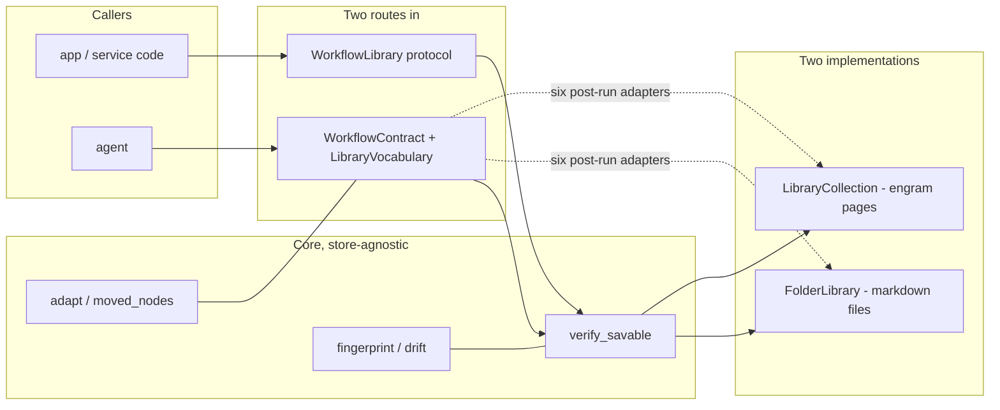

# store-protocol, the library protocol

## Purpose

A library keeps workflows of *intent*: typed graphs somebody or something decided
were worth running again. This document is the protocol such a library implements. It is
written from the code in `core/src/core/ai/workflows/`, and every claim below names the
module and the function or class where a reader can check it.

The protocol exists because the alternative is a library-shaped dependency. A component
that hard-codes where workflows live, how candidates are ranked, or what an id looks like
has not built a library seam, it has built one library and named it a protocol. The test of
the seam is a second implementation that agrees with the first on nothing except the
contract. Two exist:

| Implementation | Where workflows live | Dependencies |
|---|---|---|
| `FolderLibrary` (`core/src/core/ai/workflows/infrastructure/folder.py`) | `<name>-v<n>.md` files in one directory | none beyond the core |
| `LibraryCollection` (`core/src/core/ai/workflows/infrastructure/library_collection.py`) | one page per version in the sibling `engram` app's Postgres | engram's ingest path for writes, a read-only SQL role for reads |

**What the two agree on is the protocol. Where they differ is what the protocol must not
specify.** Everything in this document is derived from that rule.

Terms used here are the ones in [the vocabulary design](../../../docs/initiatives/2026-09-02-vocabulary/design.md), section 4.5: workflow, step, inline step, node, contract port, save, adaptation, fingerprint, evidence, birth check, carried trust. This document introduces no synonyms for them.

---

## 1. What a workflow is

A workflow is six things that travel together. Only three of them are the workflow
proper. The rest are records *about* it, and the difference matters because it decides
what a library keeps and what a reader derives.

### 1.1 Identity, a name and a version

`Workflow` (`core/src/core/ai/workflows/domain/vocabulary.py`) carries `name` (a kebab slug,
pattern-constrained) and `version` (a `PositiveInt`). Together they identify a workflow.
An adaptation is *the next version of the same name*, never a different name:
`adapt` in `core/src/core/ai/workflows/domain/lineage.py` copies the parent with
`version = spec.version + 1` and leaves `name` alone.

Identity is **not** the library's id. The id is an address the library mints and the caller
reads back. See invariant I6. `name@version` is the identity. `wf.<name>.v<n>` and
`audit-a-claim@1` are two libraries' addresses for it.

### 1.2 The applicability contract

Three fields describe a workflow to whoever is choosing: `title`, `summary`,
`applicability`. They are arguments to `put` and fields of `SavedWorkflow`
(`core/src/core/ai/workflows/read_models.py`), deliberately **not** fields of `Workflow`,
which forbids extra keys and rejects them outright. The graph describes what runs. The
card describes when to reach for it.

`applicability` is the load-bearing one and the protocol treats it as such.
`WorkflowContract._pack` (`adapters/contract_port.py`) refuses a write whose
applicability is blank, *"a card nobody can choose by is not worth storing"*, while
`title` and `summary` fall back to `spec.name` and `spec.description`. The asymmetry is
the point: the spec already names and describes itself, and nothing in it can say when
*not* to use the thing.

`SavedWorkflow` also carries `score` (the library's own ranking number, or `None`),
`provisional` (the library's honesty flag: this one has not earned trust here), and
`metadata`, an untyped bag for whatever a library knows that the protocol does not model.

### 1.3 The typed spec body

`Workflow` is the workflow: parameters, a tuple of nodes over the closed node types
(`run`, `map`, `gate`, `judge`), the wires between them, an output wire, and optionally
`inline`, steps the workflow carries as instructions plus declared shapes. Every
node-type model sets `extra="forbid"`, so an unrecognised key is a refusal rather
than a silent drop.

The spec crosses a library **as data**. `LibraryCollection` stores it as a JSON document in
the page's frontmatter and selects that document back. `FolderLibrary` stores it under a
frontmatter key of a markdown file via `dump_spec_document` and reads it back with
`load_spec_document` (`core/src/core/ai/workflows/domain/document.py`). Neither renders the spec
into prose and re-parses it. See invariant I7.

### 1.4 Environment stamps

`WorkflowFingerprint` (`core/src/core/ai/workflows/domain/fingerprint.py`) records the environment a
workflow was saved against: `steps` (each registered step the spec names, hashed by its
introspected contract), `grants` (a hash of the tool names a declared step may draw on),
and `world` (host-contributed stamps such as a model id, opaque to the module).

It is **derived, never declared**. `fingerprint(spec, registry, world=...)` reads
everything off the registry at save time, so no workflow carries a hand-maintained
requirements list that an author could forget to update. Steps the workflow *brings* are
deliberately not stamped, they ride inside the workflow, so the environment cannot drift out
from under them.

The same module owns a second hash answering a different question. `spec_identity(spec)` is
a sha256 over the spec's canonical JSON, sorted keys, `mode="json"`, defaults included, and
it is the workflow's **content address**: the same string in every library, unchanged by any
move. It is what trust events are keyed on. See 1.5 and I2.

### 1.5 Trust events

Trust is a fold over an append-only event log, not a field.
`core/src/core/ai/workflows/domain/evidence.py` defines two event kinds:

- `RunEvidence`, one run's structural outcome: `outcome` (`completed` / `failed`),
 `gates_approved`, `params`, `produced` (node id to the *shape* of the value, never the
 value), `runner`, `spec_hash`, `workflow_id`, `workflow_version`, `at`.
- `Approval`, a deliberate human act, recorded with its author, the `spec_hash` and the
 version approved.

`approved_gates(spec, values)` derives the approved-gate list from run state rather than
accepting a self-report: an approved gate wrote its pass-through value under its own id, a
rejected or waiting one wrote nothing. Judges are excluded, a machine clearing a machine
is not a human in the loop.

**Events are keyed on `spec_hash`, not on `workflow_id`.** A library id is an *address*: it
differs between libraries, changes at every step of the personal to team to production path, and
changes again whenever a library re-keys, which the collection here already did once, from one
page per name to one page per version. History filed under an address is lost on any of those,
and lost silently, because the empty lookup that results is indistinguishable from "never ran".
`workflow_id` is still recorded as provenance: it says where the run was launched from.

`spec_hash` defaults to `""`, and that default is load-bearing in the same way `WorkflowFingerprint.steps`
is (see I5): records written before content addressing exist and must still parse. `""` means
*this record does not know what it exercised*, unknown, not "matches nothing". Asking an evidence log or
`trust_level` for `""` raises: `require_spec_identity` refuses it, because answering would return
every unknown record as though the question had been settled.

The evidence log is a separate port, `EvidenceLog`, with one shipped implementation
(`FileEvidenceLog` in `adapters/evidence_log.py`, one JSONL file, append-only, a damaged
line skipped rather than fatal). **A library is not required to be the evidence log**, and neither
shipped library is one. It answers two questions:

| Verb | Keyed on | Answers |
|---|---|---|
| `events_for(workflow_id)` | an address | every event filed there, correct only for a workflow that never moved and whose library never re-keyed |
| `history_for(spec_hash=..., workflow_id=None)` | content, plus an optional address | a `EvidenceHistory` with two buckets |

`EvidenceHistory.matched` holds events carrying this spec's hash **wherever they were filed**, that is what keeps runs with evidence findable across a move. `EvidenceHistory.legacy` holds events at
the given address that carry no hash at all. The two are never merged: merging would let a record
of unknown provenance count as this workflow's run, and dropping would orphan the history a real
evidence log already holds. An event naming a *different* hash is in neither bucket, it said what it
exercised, and it was not this.

`EvidenceHistory.basis` is the tri-state, and it is the point of the split:

| `basis` | Means | A level folded from `matched` |
|---|---|---|
| `content` | something carries this spec's hash | is about this workflow |
| `address-only` | nothing does, but the address holds unattributable history | reads `unverified`, meaning *unconfirmed*, not never-run |
| `none` | nothing recorded either way | reads `unverified`, meaning nothing has ever run it |

**Two properties of content addressing a reader must not be sold short.**

*Canonicalisation is the whole risk.* Sorted keys are what save a workflow whose mapping keys
came back reordered from a jsonb column. `mode="json"` and included defaults are what stop "how
the object was built" from leaking into the key. A future pydantic that serialises differently
would still shift every hash and orphan all the evidence written before it, the same class of
bug, one layer out. What pins it is a test holding one literal digest of one fixed spec
(`tests/unit/test_spec_identity.py::test_the_identity_of_a_fixed_spec_is_pinned_to_a_literal`),
so the shift is a loud failure and a decision, never a silent re-key.

*A content address says what ran, never whose it was.* Two teams who independently author
byte-identical specs share an identity. In a per-owner evidence log that is harmless. In an evidence log both
write to, one team's runs count for the other team's workflow, and nothing in the machinery can
tell them apart. The evidence log is a per-integrator port precisely so this is the integrator's
decision. The protocol does not pretend the problem is absent.

### 1.6 Lineage, and what an adaptation claims

`Lineage` (`core/src/core/ai/workflows/domain/lineage.py`) records `parent_name`,
`parent_version`, `ops` (the typed diff that produced this child), `touched` (the node ids
that diff moved), and two fields that say why the child exists and what it claims. `adapt`
returns the child and the lineage together. The parent is not mutated.

`Lineage` records a *name and a version*, never a library id, which is true wherever the
workflow is kept, and is what forces the `locate` verb to exist.

**`evidence` is prose and nothing grades it.** It answers "why does this version exist" for
the person who later asks. Its docstring is explicit that it is read, never scored, on the
ground that a grader parsing it would turn it into text written for the grader.

**`predictions` is the half that gets graded.** A `Prediction` is a structural claim drawn
from a closed vocabulary, and the vocabulary is closed to exactly what a `RunEvidence`
records, so every claim has a mechanical answer:

| `claim` | Holds when | `subject` | `shape` |
|---|---|---|---|
| `completes` | a run of this version finishes | not required | forbidden |
| `produces` | the node named yields a value, of the named type when one is given | required | optional |
| `accepts` | a run is given the parameter named | required | forbidden |
| `approves` | the gate named releases its value | required | forbidden |

`Prediction._answerable` refuses a claim the evidence log cannot answer, a non-`completes` claim
with no subject, or any non-`produces` claim carrying a shape, so an ungradeable claim
cannot be constructed, let alone stored.

The verdict is derived, exactly as the trust level is. `grade(lineage, events, version=n)`
folds the evidence log and returns one `PredictionOutcome` per claim, in the order they were
claimed. `prediction_record(outcomes)` folds many outcomes into the signal the *adapter* is
judged by. Neither stores anything, and no model appears in either.

### 1.7 Birth evidence

`_birth.py` answers a different question from staleness: not "has the environment moved" but
"does this workflow still do what the run that bore it actually did". `check_birth` is free
and structural, the spec still validates here, every node the birth run produced a value
for still exists, and the step behind each still declares the type that run returned.
`replay_birth` spends a real run against the origin inputs and compares shape by shape.

Shapes, never values (`shapes_of`): two honest runs over a live knowledge base say different things
and must not be different *kinds* of thing. Neither check asks a model anything.

### 1.8 Data at rest versus derived on read

This is the table a library implementer should read first.

| Fact | Where it lives | How a reader gets it |
|---|---|---|
| Name, version | inside the spec | read |
| Title, summary, applicability | library-side card | read |
| Spec body | library-side, as data | read |
| Library id | library-side, minted by the library | returned by `put`, or `locate(name, version)` |
| `WorkflowFingerprint` | library-side, beside the workflow | `fetch_fingerprint` |
| `Lineage`, parent, ops, `touched` | library-side, beside the child | `fetch_lineage` |
| `Lineage.evidence` (prose) | library-side, beside the child | `fetch_lineage`. Read, never scored |
| `Lineage.predictions` (claims) | library-side, beside the child | `fetch_lineage` |
| RunEvidence, approvals | evidence log-side, append-only | `EvidenceLog.history_for(spec_hash=...)`, or `events_for(id)` for legacy records |
| **Content address** | nowhere | derived: `spec_identity(spec)` |
| **Trust level** | nowhere | derived: `trust_level(history.matched).level` |
| **Whether that level is about this workflow** | nowhere | derived: `EvidenceHistory.basis` |
| **Prediction verdicts** | nowhere | derived: `grade(lineage, events, version=...)` |
| **Adapter hit rate** | nowhere | derived: `prediction_record(outcomes).hit_rate` |
| **Staleness** | nowhere | derived: `drift(recorded, fingerprint(spec, registry, world))` |
| **Fit** | nowhere | derived: the port's `_fit` against this run's registry |
| **Birth verdict** | nowhere | derived: `check_birth(spec, registry, born)` |
| **Carried trust** | nowhere | derived: `carried_trust(born, lineage)` |
| `provisional` on a card | library-side status, mapped | the library maps its own status vocabulary |

The bottom half of that table is the design. Every judgement about a workflow is computed
against *this* run's environment at the moment it is asked for. Nothing a writer could set makes
a workflow trusted, fresh, fitting, or born-intact.

---

## 2. The verbs

There are two surfaces, and they carry the same four ideas.

**The library seam**, `WorkflowLibrary` in `core/src/core/ai/workflows/internal_contracts.py`, a Python
`Protocol` for code that holds a library object. Three methods are the contract (`search`,
`fetch_workflow`, `put`). Four more (`fetch_fingerprint`, `fetch_lineage`, `fetch_card`,
`locate`) are named there so that a library which *can* answer them uses these names, and
every caller reaches them through `getattr` with a defined answer for absent.

**The contract port**, `WorkflowContract` in `adapters/contract_port.py`, which
exposes four tools to an agent (`search_workflows`, `fetch_workflow`, `save_workflow`,
`adapt_workflow`) over *somebody else's* toolset. A `LibraryVocabulary` names which host
tools mean search / fetch / keep and supplies six small adapters that run after the
foreign tool returns.

The port is not a wrapper around the library seam. It is the second way to reach a library,
for a host that brings its own write tool, an MCP server, a warehouse, a filesystem
toolset. Both routes pass the same gate. See I1.

### 2.1 search

| | |
|---|---|
| **Takes** | a task description in the caller's own words, and a `limit` |
| **Returns** | candidate cards, best first, id, title, summary, applicability, an optional score, a `provisional` flag |
| **Refuses** | an empty task (`_search` raises `ModelRetry`: *"describe what you are trying to accomplish"*) |

Proposing is not deciding. The docstring on `WorkflowLibrary.search` says so, and the
machinery enforces it: nothing downstream trusts a candidate because the library ranked it
first. The port renders cards with `render_cards`, which prints the applicability line
under each hit because the "when not to" half is usually the deciding information, and
prints *"(no saved workflow matches. Plan fresh instead of forcing a bad fit)"* for an
empty result. A step search answers its own empty case, *"(no reusable step matches. Plan
fresh instead of forcing a bad fit)"*, so a search for one kind never reports on the other.

A host whose search tool fails is a distinct answer from a host with nothing to offer.
`_search` catches the host failure and returns a string beginning `STORE SEARCH
UNAVAILABLE`, explicitly saying *"This is NOT 'nothing matched'"*. An unchecked library is
not an empty one, and a caller that conflates them concludes the library is bare.

### 2.2 fetch

| | |
|---|---|
| **Takes** | one library id, verbatim from a search result |
| **Returns** | `FetchedWorkflow`, `summary`, `fit`, `fits_here`, `spec_yaml`, `staleness` |
| **Refuses** | an id that yields no valid spec, as a `ModelRetry` naming the failure and adding *"do not invent one to replace it"* |

At the library seam, `fetch_workflow` returns the validated `Workflow` and raises when the
library has no such workflow (`KeyError` in `FolderLibrary`, `LibraryError` in
`LibraryCollection`, see the divergence table). `fetch_fingerprint` and `fetch_lineage`
answer the other halves of the same question.

At the port, the return is a `TypedDict` with named fields, not one rendered blob. The
reason is mechanical: these tools live where a *program* consumes the return, so
`r["spec_yaml"]` is the whole interface, and a spec fenced inside prose would force string
surgery on tool output. `spec_yaml` is the workflow exactly as stored, ready for the
validator.

**The fit verdict is rendered into the fetch result.** `WorkflowContract._fit`
compares the steps the spec names against this run's registry and answers three ways:

- `FITS THIS RUN` / `fits_here: True`, every named step is registered here, or the
 workflow brings its own steps and this run can perform a briefing.
- `DOES NOT FIT THIS RUN` / `fits_here: False`, a named step is missing, or the workflow
 brings steps and `registry.performs_briefings` is false. The prose names the missing
 steps and adds *"do not keep re-reading it"*.
- `fit: unknown from here` / `fits_here: None`, the port has no registry, so nothing can
 say. **Unknown is not a no.**

There is deliberately no `check_fit` tool to call. The port already holds the registry, so
it answers rather than delegating. A dangling instruction, "call the fit tool" pointing at
a tool that does not exist, or one the model must remember to reach for, is worse than no
instruction: the model spends calls hunting for it, and when it cannot find it, it guesses.
The same ruling governs staleness, which `_staleness` computes on the same fetch and folds
into the `fit` prose with a `STALE:` prefix when the environment moved. Both verdicts arrive
where the decision is made, unasked.

`staleness` is a tri-state and each state is a different claim: `[]` is checked and fresh,
a non-empty list names exactly what moved, `None` means the workflow carries no readable
stamp, unknown, which is neither fresh nor stale.

### 2.3 save

| | |
|---|---|
| **Takes** | a spec as structured data, an applicability note, optional title and summary |
| **Returns** | the library's id for the workflow, plus the honest caveat that it is provisional until it has been run and attested |
| **Refuses** | a spec that does not validate against this run's steps. A spec requiring parameters nobody supplies. A blank applicability |

`save` (`_library.py`) validates, then calls `library.put` with the derived fingerprint and
provenance. `WorkflowContract._verified_write` validates, then calls the host's write
tool through `LibraryVocabulary.put_args`. Both call the same `verify_savable` object, not
the same rules written twice, the same function. A second copy of a gate is a second place
for it to drift open.

The spec goes in as structured data rather than text, so a malformed graph is caught by
the tool call's own schema. A refusal is delivered with the validator's findings so the
caller can fix and retry. The port raises the refusal as a `ModelRetry` with
`REFUSED -- nothing was written` and allows `save_retries` corrections, because designing
a graph is an authoring loop and a single retry would spend the whole budget on being told
what is wrong.

Provenance is stamped at the point of entry: `saved_by` is supplied by the port or the calling
service, never by the model, so a model cannot claim to be a human.

### 2.4 adapt

| | |
|---|---|
| **Takes** | an existing id, a list of edit ops as data, an applicability note |
| **Returns** | the child's id and version, the statement that the parent is kept and linked forward, and which nodes still carry their parent's evidence |
| **Refuses** | an empty op list. An op naming something that is not there. A blank applicability. A child that does not validate |

The known ops are a closed set enforced by `adapt`: `remove_node`, `add_node`,
`replace_node`, `rewire`, `set_output`, `remove_inline_step`, `replace_inline_step`, `add_inline_step`,
`add_parameter`, `set_description`.
Every op is checked before any is applied, so a half-applied adaptation cannot exist. What
`adapt` does *not* claim is that a coherent set of ops produces a runnable graph, removing a
producer leaves a dangling wire, and the validator is still the one that says so. That
refusal happens at the write gate, before anything is stored.

`replace_inline_step` is how an inline step's *implementation* changes, a briefing becomes a
program, without the workflow losing its lineage. It carries the task's name and a whole
new `InlineStep` of any kind, and refuses a replacement under a different name: a rename is
a removal and an addition, because every `{like: <name>}` slot in the workflow names the old
one. Its `touched` is wider than the node that runs the step, and `_reimplemented`
(`_lineage.py`) is where that is derived: a slot saying `{like: <replaced>}` borrows the
replaced step's type by name, so if the replacement answers with a different type, the
borrowing step's contract moved without a byte of its own definition changing, invisible to
`moved_nodes`, which compares each node against its own definition, and invisible to the
validator, which is satisfied *because* the reference still resolves. The move travels
(a step whose own output is `{like: <retyped>}` is retyped in turn), and it is conditional:
an identical output leaves every borrower carrying its parent's evidence, which is what makes
trust node-granular rather than merely cautious.

`add_inline_step` is the third task op: a whole new `InlineStep` under a name the workflow does not
declare, refused under a declared one (that is `replace_inline_step`'s business). It touches nothing by
itself, because nothing runs the step until an `add_node` or `replace_node` in the same set does,
and those touch their own node. Without it a redesign that needed a new step had to repurpose an
existing task's name or re-save, so it is what keeps a growing workflow on its lineage.

`add_parameter` is the one parameter op: a whole `ParameterSpec` under a name the workflow does
not take, refused under a taken one. Like `add_inline_step` it touches nothing by itself: a parameter
changes nothing until a node wires it (`{"parameter": <name>}`), and the `replace_node` or
`rewire` that does so touches that node. It exists for the scoping input a saved workflow gains
after its first runs (a hand fire over chosen items rather than the whole batch), which before it
meant a re-save.

Adapting is preferred over fetching, editing and re-saving, and the port's injected
guidance says why: a re-save keeps an orphan, while an adaptation records its parent and
the untouched nodes keep the evidence the parent's runs earned.

**There is no argument through which parentage can be asserted.** The tool takes *ops*.
`WorkflowWrite.lineage` is populated only by machinery from ops it applied itself. A
lineage that could be claimed is a lineage that could be laundered.

`adapt` also accepts `evidence` and `predictions`, which travel in the lineage to the library
and are graded later against the evidence log. These are the one part of a lineage an author
*does* supply, safely, because prose is never scored and a claim is only ever answered by
runs that actually happened. Both are keyword arguments with empty defaults, and the
contract port does not yet pass them. See Known gaps.

### 2.5 The optional read verbs

| Verb | Answers | Absent means |
|---|---|---|
| `fetch_fingerprint` | the environment-stamp recorded at save | staleness unknown, never fresh |
| `fetch_lineage` | the diff that produced this workflow | nobody adapted anything to make it |
| `fetch_card` | the prose a chooser reads, by id | the adaptation arrives undescribed |
| `locate(name, version)` | the id one version is kept under | the parent has no clickable address |
| `current(workflow_id)` | the id of the newest live version of the workflow this id names, or the id itself | a standing reference (a schedule) runs the version it was written with |

`fetch_card` exists because a diff edits the *spec* while title, summary and applicability
belong to the library, without it a child would arrive described as nothing, and `search`
is no route to a card when the caller already knows which workflow it holds.

---

## 3. The invariants a conforming library must keep

Each is stated so a reader can test it, and names the module it comes from.

### I1, The workflow is typed and validated before storage. `verify_savable` is the only route in

`verify_savable(spec, registry, supplied_parameters=...)` in `_library.py` runs `validate`
against this run's registry and `unsatisfied_parameters` against what the caller promises
to supply, and raises `SaveRefusedError` carrying the full report. It is called from
exactly two places: `save` (the library-object route) and
`WorkflowContract._verified_write` (the borrowed-write-tool route). A library of
procedures that do not run is a landfill.

The gate covers steps the workflow brings with it: `StepRegistry.including` builds them
from their briefings first, so a declared step whose shape does not build into a type is
refused before it is ever stored, rather than becoming a saved workflow that fails the
first time somebody trusts it.

The port makes the guarantee structural rather than instructional. Filtering hides a host
tool from the *model* but not from the port, so leaving the raw write tool out of `expose`
makes the verified path the only route in.

**Test it:** point a port at a host whose write tool is reachable and hidden, save a spec
naming a step this run does not have, and assert the host's write log is empty.
`tests/unit/test_contract_port.py::test_save_refuses_a_spec_this_run_cannot_execute_and_writes_nothing`
asserts on what did *not* happen (`host.calls == []`).
`tests/unit/test_folder_port.py::test_a_spec_that_will_not_run_is_refused_before_a_file_is_written`
asserts `list(root.glob("*.md")) == []`.

### I2, Trust is derived from recorded events, never a stored field, and is keyed on what ran

`TrustLevel.level` in `_evidence.py` is a `@property` over counts folded by
`trust_level`: `approved` if anyone approved it, else `machine-confirmed` if any run
completed, else `unverified`. There is no field anywhere a writer could set to skip the
ladder, and that absence is the design.

**The key is a content address, not a library id.** `trust_level(events, spec_hash=h)` filters to
events that recorded `spec_hash == h`, and an event that recorded none is *excluded*, it is not
evidence about this one. Because `version` is a field of the spec, a version bump is a different
hash: version scoping falls out of content addressing rather than needing a filter beside it.
Two workflows that differ anywhere differ here.

`trust_level(events, version=n)` remains, and it is the only question a record written before
content addressing can still answer. It filters to events that recorded `workflow_version == n`
and excludes an event that recorded no version. The two filters compose. Without either, an
adapted child re-saved at its parent's address inherits the parent's runs and reads
`machine-confirmed` having never executed anything. This is the same ruling staleness makes:
unknown is not earned.

The same ruling governs `grade` (`_lineage.py`), which answers an adaptation's predictions
only from runs that recorded the child's version, excludes runs that recorded none, and
treats an approval as grading nothing. One derivation discipline, applied twice.

**Test it:** attest the same spec under two different library ids and require both runs to count. Attest a *different* spec at this workflow's own address and require it to count for nothing. Append a record with no `spec_hash` and require it to count for no particular workflow.
`tests/unit/test_evidence.py::test_trust_is_asked_by_what_ran_rather_than_by_where_it_was_kept`,
`::test_a_record_that_never_said_what_it_ran_cannot_count_for_a_hash`,
`::test_a_version_bump_needs_no_version_filter`,
`::test_history_found_by_hash_survives_a_change_of_address`,
`::test_trust_does_not_carry_across_a_version_the_ledger_never_saw`,
`::test_an_evidence_record_that_never_recorded_a_version_cannot_count_for_one`.
`tests/unit/test_artifact_view.py::test_a_child_cannot_inherit_its_parents_runs_through_the_hash`.
`tests/unit/test_prediction.py::test_a_run_of_a_different_version_grades_nothing`,
`::test_a_run_that_never_said_which_version_it_exercised_is_not_evidence`,
`::test_an_approval_grades_nothing`.

### I3, Absent evidence answers *unknown*, never *fresh* or *true*

The tri-state appears in six places and behaves the same way in all of them.

| Question | Fresh / yes | Named problem | Unknown |
|---|---|---|---|
| Staleness | `[]` | a list of drift findings | `None` |
| Fit | `fits_here: True` | `False` | `None` (no registry) |
| Birth | `[]` | a list of findings | `None` (nothing ever ran it) |
| Trust | a level folded from `matched` |, | `unverified`, qualified by `basis` |
| Trust evidence | `basis: content` |, | `basis: address-only`, and `basis: none` for nothing recorded |
| A prediction | `holds: True` | `holds: False` | `holds: None` (nothing has tested it) |
| An adapter's rate | a float | a float | `hit_rate: None` (nothing measured) |

The trust rows are two questions because a level alone cannot carry them both. `unverified` is
the honest fold over no confirmed evidence, and it is the same string whether nothing ever ran
the workflow or its whole history sits at an address nothing can attribute to it. `basis`
separates them, so a workflow whose evidence merely moved is no longer reported as never run.

The last two are the newest and the most explicit about it. `PredictionRecord` counts
`unmeasurable` apart from `misses`, because an untested claim is not a wrong one, and
`hit_rate` returns `None` rather than `0.0` when nothing has been measured, a rate of zero
reads as an adapter that is always wrong, which is a different statement from one nothing
has tested yet. `grade` treats a failed run as measuring nothing about what a version
*produces* (it may have died before reaching the node) while treating it as evidence
against a `completes` claim, whose subject is exactly that failure.

`fetch_fingerprint` returns `None` both when no stamp was kept and when the recorded stamp
no longer parses, both adapters catch `ValidationError` and return `None` rather than a
partial stamp, on the stated ground that *a stamp that no longer parses is no stamp. Unknown, not fresh*. `_staleness` in `contract_port.py` returns `None` when the vocabulary
has no `to_fingerprint` adapter or the port has no registry.

`drift` is asymmetric on purpose: only the recorded side is walked, because a step the
current environment has and the workflow never depended on cannot stale it. Within the recorded
side, absence *is* drift, a recorded environment stamp the current environment does not report is
reported as moved, not as unknown. The distinction is between "the workflow never said what
it was" (unknown) and "the workflow said, and the environment no longer matches" (drift).

**Test it:** `tests/unit/test_staleness.py::test_an_unstamped_artifact_reads_as_unknown`
(`staleness is None`), `::test_save_then_fetch_reports_fresh` (`staleness == []`),
`tests/unit/test_contract_port.py::test_without_a_registry_fits_here_is_unknown_not_false`,
`tests/unit/test_artifact_view.py::test_a_stamp_that_no_longer_parses_is_unknown_rather_than_a_crash`
and `::test_an_artifact_nobody_has_run_has_no_birth_to_check`.
`tests/unit/test_prediction.py::test_a_claim_about_a_version_nothing_has_run_is_unmeasurable_rather_than_missed`,
`::test_a_record_with_nothing_measured_has_no_rate_rather_than_a_zero`,
`::test_a_failed_run_measures_nothing_about_what_a_version_produces`.

### I4, Lineage is kept. Supersession is a link, never a deletion

`adapt` does not touch the incumbent, the child is a `model_copy` and the parent object is
returned unchanged. A library must preserve that at rest: **an upsert must never replace a
parent that a child's lineage names.**

The teeth are in the id scheme. A library keying pages on the workflow *name* turns saving
v2 into an upsert of v1's page, so the parent the child's lineage records stops existing
and the record of what used to be true is overwritten by the thing that superseded it.
`LibraryCollection.page_id` therefore mints `wf.<name>.v<n>`, one page per version, and
its docstring states exactly that reason. `FolderLibrary` writes a new file per version and
the previous one stays on disk.

Linking forward is a library-side capability, not a protocol requirement, the protocol
requires only that the parent survives. `LibraryCollection._supersede` reads the parent
page back, rebuilds the envelope engram strips into columns, and writes it with
`superseded_by`, so the library's own retrieval stops proposing the retired version without
this adapter reimplementing supersession. The child is written first because
`kb.pages.superseded_by` is a foreign key.

The two writes are not equal and are not treated as one: the child's write *is* the save,
the link is bookkeeping. A bookkeeping failure raises a `SupersessionIncompleteWarning` warning
and still returns the child's id, because losing the link degrades retrieval (both versions
stay on the library until somebody re-saves) while losing the child loses the work. Both
writes are upserts, so saving again redoes them.

`touched` may only widen. `moved_nodes(parent, child)` re-derives what actually differs, comparing each node's wiring **and** the step definition it binds to, because a workflow
that brings its own steps can be changed completely by rewriting `tasks[x].instructions`
without a `nodes:` entry moving. The saving path unions that into `touched`
(`app/features/authoring/service.py::_honest_about_what_moved`), so a mistake can only
withdraw trust, never launder it.

**Test it:** save v1, adapt to v2, then fetch v1 and require it unchanged.
`tests/unit/test_library_collection.py::test_a_second_version_lands_on_its_own_page_rather_than_over_the_first`,
`::test_saving_a_child_links_the_parent_forward_to_it` (which also asserts the parent
keeps its own spec, *this is a link, not a rewrite*),
`::test_a_child_that_could_not_be_linked_is_still_a_child_that_was_stored`,
`tests/unit/test_folder_port.py::test_the_port_can_adapt_a_stored_workflow_and_the_diff_travels`
(`"the incumbent is untouched"`), `tests/unit/test_lineage.py::test_the_incumbent_is_never_mutated`
and `::test_a_node_the_ops_did_not_name_but_that_moved_anyway_counts_as_touched`.

### I5, Any container that can legitimately be empty must survive coming back absent

A library may drop empty containers on the way in or out. A record whose legitimately-empty
field comes back missing must still validate, or the library turns a valid workflow into a
broken one, and the failure is silent, because the layer above reads a `ValidationError`
as "no such record".

Four fields carry defaults for exactly this reason, and each says so in its own docstring:

- `WorkflowFingerprint.steps` defaults to `{}`. A spec whose steps are all brought stamps no
 steps at all. A required field would turn that legitimately empty stamp into a validation
 failure at fetch time, which `fetch_fingerprint` reads as "no stamp", which retrieval
 reports as unknown staleness, permanently unstaleable, in exactly the feature staleness
 exists for.
- `Lineage.touched` defaults to `()`. `set_description` and `set_output` move no node, so an
 empty `touched` is a real state, a diff that changed the prose and left every node alone.
- `Lineage.predictions` defaults to `()`. An adaptation may honestly claim nothing, and the
 record has to come back as one that claimed nothing rather than as a broken one.
- `Lineage.evidence` defaults to `""`. The rule is not only about containers: a library that
 drops empty *strings* hits the same trap, and a required `evidence` would make an
 adaptation that said nothing about why read as an adaptation that never happened.

**`Lineage.ops` deliberately stays required.** An adaptation with no operations is not one,
so a record that came back without them is broken and must read as broken rather than as an
empty edit. The rule is not "default everything". It is "default what can legitimately be
empty, and only that".

**Test it:** round-trip through a library that strips `{}`, `[]` and `""` from the payload,
then require the record to come back non-`None` with the empty field intact.
`tests/unit/test_library_collection.py::test_a_stamp_with_no_registered_steps_survives_the_store`
and `::test_an_adaptation_that_moved_no_node_still_reads_back_as_an_adaptation` install an
ingest that drops empties and assert the library *really did* drop the key before asserting
recovery. `tests/unit/test_prediction.py` pins the same property for `evidence` and
`predictions` on **both** libraries, `::test_a_folder_record_whose_empty_claims_went_missing_still_reads_as_an_adaptation` and
`::test_a_collection_record_whose_empty_claims_were_dropped_still_reads_as_an_adaptation`.

### I6, Only the library mints ids

`put` returns a string rather than taking one, and `locate(name, version)` is its inverse.
A `Lineage` records a parent's name and version, which is a fact about the workflow. Turning that into an address is a fact about the library, and libraries disagree about it on
purpose. A caller that built `f"{name}@{version}"` itself would be right about a folder
library and wrong about everything else.

The port enforces the same rule across the wire: `LibraryVocabulary.to_id` reads the id out
of the host's write acknowledgement, and a write whose id the adapter invented instead of
reading would be unfetchable later. When `to_id` cannot read the answer, the port says so
honestly, *"the workflow may or may not be stored -- check with `search_workflows` before
saving again"*, rather than fabricating an id.

**Test it:** ask both libraries to locate the same `(name, version)` and require different,
each-library-correct answers. Require `None` for a version nobody saved.
`tests/unit/test_library_collection.py::test_a_parent_is_located_by_name_and_version_because_only_the_store_mints_ids`,
`tests/unit/test_lineage.py::test_a_child_is_kept_beside_its_parent_with_the_diff_that_made_it`.

### I7, A spec round-trips as data

What comes back is the object that went in, not a re-parse of a rendering of it. Both
libraries keep the spec as a document (JSON in a jsonb frontmatter column. A YAML mapping
under a frontmatter key), and both validate on the way out.

**Test it:** equality, not substring matching. A summary that merely *looks* like a spec
passes a substring check and fails a person.
`tests/unit/test_library_collection.py::test_a_stored_spec_comes_back_identical`
(`fetch_workflow(...) == spec`),
`tests/unit/test_contract_port.py::test_a_fetched_spec_comes_back_as_usable_yaml`
(`Workflow.model_validate(yaml.safe_load(fetched["spec_yaml"])) == quarterly_report`),
`tests/unit/test_document.py::test_round_trip`.

### I8, A failure to serve is reported as a failure, never as an absence

`LibraryError` is defined at the seam rather than in an implementation, so a caller catches
one exception in one place instead of importing a backend to handle a failure any backend
can have. `fetch_workflow` raises when there is no such workflow. It never returns an empty
spec. A page that exists but carries no spec answers the same as no page, it is not a
workflow.

At the port, the equivalent is the `LIBRARY SEARCH UNAVAILABLE` answer described in 2.1.

**Test it:**
`tests/unit/test_library_collection.py::test_a_missing_id_raises_rather_than_returning_an_empty_spec`,
`::test_a_page_without_a_spec_is_not_a_workflow_artifact`,
`tests/unit/test_contract_port.py::test_a_broken_host_search_is_reported_as_broken_not_as_empty`.

### I9, A boundary crossing that cannot be translated is a refusal, never a half-parse

Every post-run adapter (`to_cards`, `to_spec`, `to_fingerprint`, `to_id`) is wrapped in a
`try` that catches `ValueError`, `KeyError`, `TypeError` and `ValidationError` and converts
the failure into a `ModelRetry` naming what went wrong. A spec that crosses this boundary
has been validated against the vocabulary, so downstream code can stop asking whether it is
well-formed.

**Test it:** `tests/unit/test_contract_port.py::test_an_untranslatable_answer_is_a_retry_not_a_half_parsed_card`.

### I10, A write surface is declared whole, or not at all

`LibraryVocabulary.__post_init__` refuses a construction with some but not all of
`put_tool`, `put_args`, `to_id`. `can_write` is the three-way conjunction. `can_pack` also
requires a registry, because no way to verify means no way to write. A read-only host is
offered no save or adapt tool at all, and the injected guidance says *"This store is
read-only from here, so do not promise to save anything."* A tool that would fail when
called is worse than no tool.

**Test it:**
`tests/unit/test_contract_port.py::test_a_half_declared_write_surface_is_a_construction_error`,
`::test_a_read_only_host_offers_no_way_to_save`,
`::test_a_writable_host_without_a_registry_still_offers_no_save`,
`tests/unit/test_folder_port.py::test_a_read_only_store_offers_no_adapt_tool`.

---

## 4. What the protocol deliberately does not specify

A component that hard-codes any of the following is selling a retrieval policy and calling
it a protocol.

### 4.1 How candidates are proposed

Lexical, vector, hybrid, learned, or a human-curated list, the protocol says only *best
first* and *proposing is not deciding*. The two implementations already disagree:
`FolderLibrary.search` counts token overlap of three characters or more across title, summary
and applicability, with a stable `(-overlap, id)` tie-break so results never drift between
calls. `LibraryCollection.SEARCH_SQL` delegates to engram's `api.search`, which fuses BM25
over cards and sections with reciprocal-rank fusion, then folds per-unit hits to a per-page
best score before joining the card row and the applicability section.

`SavedWorkflow.score` is `float | None` and the two libraries put **incomparable numbers**
in it, an integer overlap count cast to a float, and a fusion score. Nothing in the
protocol compares scores across libraries, and nothing should.

Dullness is a legitimate choice here. A library that ranks cleverly and wrongly is worse than
one that ranks plainly, because a confident bad match skips planning and executes.

### 4.2 Where workflows live

A directory of markdown files with no dependencies at all, or rows in Postgres written
through another application's ingest API. Both are libraries. The seam is three methods, not a
storage engine.

### 4.3 The id scheme, and this one has teeth

`FolderLibrary` mints `name@version` and mangles it to `name-vN.md` on disk.
`LibraryCollection` mints `wf.<name>.v<n>`. Neither is the protocol's business.

**A library minting one id per workflow *name* rather than per version is legal, and so is a library
changing its id scheme.** That is not a concession, it is the reason the trust model is shaped
the way it is. `RunEvidence.spec_hash` exists precisely because an id cannot say what ran and
cannot be relied on to stay put: under a name-scoped id an adapted child re-saved at the same
address would inherit its parent's runs, and under any re-keying the parent's own runs would
become unfindable. So a run records the content address of what it exercised, `trust_level` and
`history_for` key on that, and an event that recorded none counts for nothing.
`RunEvidence.workflow_version` answers the weaker version-only question for records that predate
the hash.

Invariant I4 constrains such a library in the other direction: whatever its id scheme, the
parent a child's lineage names must still be fetchable. A name-scoped library therefore needs
some other mechanism to keep superseded versions, which is a library's design problem, not
the protocol's.

### 4.4 The wire format

`core/src/core/ai/workflows/domain/document.py` owns no metadata schema. It finds a spec under one
configurable frontmatter key, enforces format hygiene (a closed frontmatter block, YAML
that parses, no keys YAML 1.1 silently coerced into booleans or `None`), and hands the rest
of the frontmatter back untouched for whoever owns that vocabulary.

The frontmatter is plain YAML, so a document that happens to satisfy some interchange
format's rules satisfies them without the loader knowing the format exists. **Compliance is
a property of what you author, never an import.** An interchange format is an export
adapter. It is never the authoring contract, and a library that required one would have made
its serialisation everybody's problem.

### 4.5 How trust levels map to permissions

`TrustLevel.level` derives three names, `unverified`, `machine-confirmed`, `approved`, and
stops. Nothing in the package consumes a level as an authorization decision. Whether a
`approved` workflow may run unattended, whether an `unverified` one may be scheduled, and who
may approve are integrator policy.

The same holds one level down. `SavedWorkflow.provisional` is the library's own honesty
flag, and the two libraries compute it from **different status vocabularies**: `FolderLibrary`
treats `{stable, verified, attested}` as non-provisional, `LibraryCollection` treats only
engram's `verified` that way. Two conforming libraries disagreeing about which statuses mean
"trusted" is direct evidence that the mapping is not specified.

### 4.6 What else rides along

`SavedWorkflow.metadata` is a `Mapping[str, object]` explicitly documented as *"whatever
the library knows that this protocol does not model. Read it if you know the library. Ignore it
if you do not."* `FolderLibrary` puts the file path and the frontmatter status there.
`LibraryCollection` puts the engram status and a superseded flag. Neither is portable and
neither pretends to be.

---

## 5. The two implementations, compared

### 5.1 By verb

| | `FolderLibrary` / `FOLDER` | `LibraryCollection` / `WORKFLOW_COLLECTION` |
|---|---|---|
| **Storage** | one `<name>-v<n>.md` per version in a directory | one engram page per version in a collection |
| **Id** | `name@version` (`put`), path-mangled by `_path_for` | `wf.<name>.v<n>` (`page_id`) |
| **search** | token overlap ≥ 3 chars over title + summary + applicability. Candidates with zero overlap are dropped. `(-overlap, id)` sort | `api.search` BM25 + reciprocal-rank fusion over cards and sections, `k` widened to `min(50, limit * 5)` per level, per-page max score, then `limit` |
| **search: superseded** | not filtered, every parseable file ranks | dropped by `api.search`'s `only_current` default |
| **search: unparseable workflow** | skipped silently by `_load_all` (*"the operator can see it on disk"*) | not applicable. The page grammar validated it at write time |
| **fetch_workflow** | `load_spec_document(...).workflow` from the file's frontmatter | `select frontmatter from api.cards where id = $1`, then `frontmatter["spec"]` |
| **fetch_workflow: missing** | raises `KeyError` | raises `LibraryError` |
| **fetch_workflow: exists, no spec** | not reachable, a file without the key fails to load | raises `LibraryError` (*"carries no spec ... not a workflow"*) |
| **fetch_fingerprint** | frontmatter key `fingerprint`. Unparseable to `None` | same key, same rule |
| **fetch_lineage** | frontmatter key `lineage`. Unparseable to `None` | same key, same rule |
| **fetch_card** | one file's frontmatter, no ranking pass | `PAGE_SQL`, card columns plus the applicability section |
| **locate** | is `<name>-v<n>.md` a file? | does `wf.<name>.v<n>` have a row? |
| **put: transport** | direct filesystem write | an `Ingest` callable (`engram ingest`). This adapter never touches `kb.*` tables |
| **put: read/write split** | one process, one path | reads over the `kb_reader` read-only role. The process holds no writer credential |
| **put: applicability** | a frontmatter key *and* a `## Applicability` body section | a real page section, `canon = 'applicability'`, which search ranks over |
| **put: status written** | `"draft"` | `"draft"` |
| **put: supersession** | implicit, the previous version's file stays on disk. **no forward link is written** | explicit, the lineage's parent page, and every live lower version of the same name (lineage or not), is read back, rebuilt and re-ingested with `superseded_by: [[child]]`. `search`, `catalog` and `current` then read only pages nothing has superseded |
| **put: failure modes** | one write. It succeeds or raises | two writes, no transaction. Child first (foreign key), link second. A link failure warns `SupersessionIncompleteWarning` and still returns the child's id |
| **Port vocabulary** | `find_files` / `read_file` / `write_file`, args `words` / `most` / `name` | `find_workflows` / `read_workflow` / `write_workflow`, args `task` / `most` / `workflow_id` |

### 5.2 By invariant

| Invariant | `FolderLibrary` | `LibraryCollection` |
|---|---|---|
| I1 verify-before-library | kept, via `save` or the port, provided the host's raw `write_file` is kept out of `expose` (see Known gaps) | kept identically, same proviso for `write_workflow` |
| I2 trust derived, content-keyed | kept, neither library holds a level field, and neither library's id is the key | kept |
| I3 tri-state unknown | kept, `fetch_fingerprint` returns `None` for a stamp that no longer parses | kept, same rule |
| I4 lineage kept, parent survives | kept, a new file per version, parent untouched. **Weaker:** no forward link, so retrieval keeps proposing retired versions | kept, versioned pages plus a real `superseded_by` link. **Weaker:** the link is a second, untransacted write |
| I5 empty containers survive | kept, YAML round-trips `{}` and `()` faithfully, so the property is never exercised here | kept, and this is the library where it *is* exercised: engram's ingest drops empty containers |
| I6 only the library mints ids | kept | kept |
| I7 spec round-trips as data | kept, a YAML mapping under a frontmatter key | kept, a jsonb document |
| I8 failure ≠ absence | kept, but raises `KeyError` rather than `LibraryError` | kept, raises `LibraryError` |
| I9 untranslatable to refusal | kept, the port's adapters, not the library's | kept, same adapters |
| I10 write surface declared whole | kept, `FOLDER` declares all three write slots | kept |

### 5.3 What the divergence proves

Every difference in 5.1 is absorbed by six small adapters and none of it reaches the port
or the model. Concretely, the pair demonstrates that the seam survives:

- **A different retrieval engine.** Integer token overlap against BM25-plus-fusion.
- **A different id scheme.** `audit-a-claim@1` against `wf.audit-a-claim.v1`, with the
 folder library further mangling its own id into a filename.
- **A different write model.** A file created per version, against a whole-page upsert
 validated by somebody else's page grammar.
- **A different transport and trust boundary.** A local filesystem call, against a
 read-only SQL role for reads and a separate ingest callable for writes.
- **A different supersession mechanism.** Nothing written at all, against a foreign-key
 forward link in the host library's own vocabulary.
- **Different argument names for the same ideas.** `words`/`most`/`name` against
 `task`/`most`/`workflow_id`.

The contract tools the agent sees are identical across both, which
`tests/unit/test_folder_port.py::test_the_contract_tools_are_the_same_four` asserts
directly. A third host with none of these properties, `FakeHost` in
`tests/unit/test_contract_port.py`, whose tools are `find_row` / `read_row` / `store_row`
with arguments `text` / `top` / `key`, drives the same port, which is what makes "the port
adapts somebody else's library" a tested claim rather than a description of a wrapper around
our own types.

### 5.4 Where each is weaker

Stated plainly, because a comparison that only lists strengths is marketing.

**`FolderLibrary` writes no supersession link.** `put` creates a new file and the old one
stays. Nothing marks it retired, and `_load_all` ranks every parseable file. Both versions
sit on the library indefinitely, and a searcher can be handed a superseded workflow as the top
hit. The docstring calls this *"the cheapest possible supersession"*, which is accurate
about preservation (I4 holds) and silent about retrieval (the library keeps proposing the
retired version).

**`FolderLibrary` can never write a non-provisional card.** `put` always writes
`status: "draft"`, and `_TRUSTED` is `{stable, verified, attested}`, none of which this
adapter ever sets. A workflow in a folder library becomes non-provisional only if a person
edits the file's frontmatter by hand. That is defensible for a git-reviewed personal library
and worth knowing before relying on the flag.

**`FolderLibrary.search` has no fallback for zero overlap.** A task phrased without any
three-character token in common with a stored card returns nothing, even when the library
holds one obviously relevant workflow. The port then correctly reports "no saved workflow
matches", and the caller plans fresh.

**`LibraryCollection` can leave a torn supersession.** Two writes with no transaction. The
failure mode is deliberate and documented, the child is safe, the link is retryable, and
the symptom is visible as two versions side by side, but a reader should not mistake it for
atomicity.

**`LibraryCollection._supersede` declines silently in two cases.** No page at the derived
id (a workflow stored under a version-less id scheme), and a page that carries no spec
(not this adapter's page). Both return `False` without a warning, so a caller cannot
distinguish "nothing to link" from "declined to link", only the write-refused case warns.

**`LibraryCollection` surfaces a flag its own query cannot set.** `SEARCH_SQL` selects
`c.superseded` into `metadata`, but it also filters on `not c.superseded` (as `CATALOG_SQL`
does, since `api.cards` is a plain scan with no `only_current` default), so the flag is false
for every row this query can return.

**Neither library demonstrates non-lexical retrieval.** 4.1 says the protocol does not specify
how candidates are proposed, and the two implementations disagree about ranking, but both
are lexical. `api.search` accepts a query-vector leg. `SEARCH_SQL` passes only the text and
`k`, so the collection uses the BM25 leg. The claim that the protocol accommodates vector or
hybrid retrieval is sound by construction and **not yet demonstrated by a shipped library**.

**Both libraries overwrite on a re-save of the same version.** `FolderLibrary.put` writes the
same path again. `LibraryCollection.put` upserts the same page. "Never overwriting" is true
*across versions* and false *within one*: re-saving v1 replaces v1's document, including
its recorded fingerprint and lineage. Nothing in the protocol forbids this, and nothing in
either library warns about it.

---

## 6. Conformance checklist

A third implementer can work through this list. Each item is testable, and each names the
test that pins it for the existing libraries.

1. **Three verbs exist.** `search(task, *, limit)`, `fetch_workflow(workflow_id)`,
 `put(spec, *, title, summary, applicability, provenance, fingerprint=None, lineage=None)`.
 Anything beyond these is a capability, not a requirement.
 *Pinned by:* `tests/unit/test_folder_port.py::test_the_contract_tools_are_the_same_four`.

2. **`search` returns cards, best first, and an empty result is an answer.** A fresh library
 answers "nothing matched" rather than raising.
 *Pinned by:* `tests/unit/test_folder_port.py::test_an_empty_directory_says_nothing_matched_rather_than_failing`.

3. **`search` surfaces the applicability text.** The "when not to use" half must survive the
 host round trip. It is what decides reuse.
 *Pinned by:* `tests/unit/test_folder_port.py::test_save_then_search_then_fetch_round_trips_through_files`
 (`"Do not use for a broad"`), `tests/unit/test_library_collection.py::test_search_ranks_with_engram_and_reads_the_applicability_section`.

4. **A library failure is distinguishable from an empty library.** A search that could not run
 says so. It does not answer with zero candidates.
 *Pinned by:* `tests/unit/test_contract_port.py::test_a_broken_host_search_is_reported_as_broken_not_as_empty`.

5. **`fetch_workflow` returns the exact spec that was stored.** Assert equality against the
 saved object, not a substring of a rendering.
 *Pinned by:* `tests/unit/test_library_collection.py::test_a_stored_spec_comes_back_identical`,
 `tests/unit/test_contract_port.py::test_a_fetched_spec_comes_back_as_usable_yaml`.

6. **`fetch_workflow` raises for a missing workflow, and for one that is not a workflow.**
 It never returns an empty or partial spec.
 *Pinned by:* `tests/unit/test_library_collection.py::test_a_missing_id_raises_rather_than_returning_an_empty_spec`,
 `::test_a_page_without_a_spec_is_not_a_workflow_artifact`.

7. **Nothing unexecutable reaches storage.** Route a write through `save` or the contract
 port, hand it a spec naming a step this run lacks, and assert the backend was never
 called.
 *Pinned by:* `tests/unit/test_contract_port.py::test_save_refuses_a_spec_this_run_cannot_execute_and_writes_nothing`,
 `tests/unit/test_folder_port.py::test_a_spec_that_will_not_run_is_refused_before_a_file_is_written`.

8. **A spec that brings its own steps is verified, not rejected out of hand.** The write gate
 builds declared steps before deciding, and refuses cold when this run cannot perform a
 briefing.
 *Pinned by:* `tests/unit/test_contract_port.py::test_save_builds_the_steps_a_spec_brought_before_deciding`,
 `::test_a_port_with_no_author_refuses_a_spec_that_brought_a_step`.

9. **A refused write keeps nothing.** No partial record, no orphan row, no half-written file.
 *Pinned by:* `tests/unit/test_library_collection.py::test_a_refused_ingest_surfaces_as_a_library_error`
 (`ingest.payloads == []`).

10. **`put` records provenance verbatim.** `provenance["saved_by"]` arrives at rest as given. It is never inferred or defaulted to the caller's identity.
 *Pinned by:* `tests/unit/test_library_collection.py::test_put_builds_a_page_whose_frontmatter_carries_the_spec_as_data`
 (*"provenance is recorded, never inferred"*),
 `tests/unit/test_contract_port.py::test_save_writes_through_the_hosts_own_write_tool`.

11. **`put` returns the id the library actually used, and the caller reads it.** No caller
 constructs an address.
 *Pinned by:* `tests/unit/test_contract_port.py::test_save_writes_through_the_hosts_own_write_tool`,
 `tests/unit/test_folder_port.py::test_save_then_search_then_fetch_round_trips_through_files`.

12. **A second version does not overwrite the first.** Save v1, save v2, fetch v1.
 *Pinned by:* `tests/unit/test_library_collection.py::test_a_second_version_lands_on_its_own_page_rather_than_over_the_first`,
 `tests/unit/test_folder_port.py::test_the_port_can_adapt_a_stored_workflow_and_the_diff_travels`.

13. **A child's lineage travels to the library and comes back.** Parent name, parent version and
 ops survive the round trip.
 *Pinned by:* `tests/unit/test_folder_port.py::test_the_port_can_adapt_a_stored_workflow_and_the_diff_travels`,
 `tests/unit/test_library_collection.py::test_the_collection_s_write_tool_carries_a_diff_into_the_frontmatter`.

14. **A supersession link, if the library writes one, is a link.** The parent keeps its own spec
 and its own long-tail frontmatter. Only the forward pointer is added.
 *Pinned by:* `tests/unit/test_library_collection.py::test_saving_a_child_links_the_parent_forward_to_it`
 (*"the parent keeps its own spec -- this is a link, not a rewrite"*).

15. **A parent the library does not hold is not invented.** Saving a child whose parent has no
 address still stores the child.
 *Pinned by:* `tests/unit/test_library_collection.py::test_a_parent_the_collection_does_not_hold_is_not_invented`.

16. **A failed supersession does not lose the child.** The save reports where the workflow
 landed. The missing link is a warning.
 *Pinned by:* `tests/unit/test_library_collection.py::test_a_child_that_could_not_be_linked_is_still_a_child_that_was_stored`.

17. **An empty `steps` stamp survives the library.** Round-trip a `WorkflowFingerprint` through a
 backend that strips empty containers and require `fetch_fingerprint` to answer non-`None`.
 *Pinned by:* `tests/unit/test_library_collection.py::test_a_stamp_with_no_registered_steps_survives_the_store`.

18. **Every legitimately-empty lineage field survives the library**, `touched`,
 `predictions`, and the empty-string `evidence`. Same test as 17, one model over, and it
 must be run against every library: a claim the library cannot keep is a claim nothing will
 ever grade. A lineage whose diff moved no node, claimed nothing and said nothing about
 why must still read as an adaptation, not as a workflow nobody adapted.
 *Pinned by:* `tests/unit/test_library_collection.py::test_an_adaptation_that_moved_no_node_still_reads_back_as_an_adaptation`,
 `tests/unit/test_prediction.py::test_a_folder_record_whose_empty_claims_went_missing_still_reads_as_an_adaptation`,
 `::test_a_collection_record_whose_empty_claims_were_dropped_still_reads_as_an_adaptation`.
 The non-empty round trip is pinned by
 `::test_a_folder_keeps_the_claims_and_the_prose_beside_the_diff` and
 `::test_the_collection_keeps_the_claims_and_the_prose_beside_the_diff`.

19. **A stamp that no longer parses reads as unknown, not as fresh.** `fetch_fingerprint`
 returns `None`. Nothing crashes and nothing claims freshness.
 *Pinned by:* `tests/unit/test_artifact_view.py::test_a_stamp_that_no_longer_parses_is_unknown_rather_than_a_crash`.

20. **Staleness is answered on the fetch, in all three states.** `[]`, a list of findings,
 and `None`.
 *Pinned by:* `tests/unit/test_staleness.py::test_save_then_fetch_reports_fresh`,
 `::test_a_drifted_step_marks_the_artifact_stale`, `::test_an_unstamped_artifact_reads_as_unknown`,
 `::test_world_stamp_drift_is_reported`.

21. **Fit is answered on the fetch, in all three states**, and no `fits_here: None` is
 rendered as a refusal.
 *Pinned by:* `tests/unit/test_contract_port.py::test_a_fetched_spec_says_whether_this_run_can_execute_it`,
 `::test_without_a_registry_fits_here_is_unknown_not_false`,
 `::test_a_fetched_spec_that_brings_its_own_step_is_reported_as_fitting`.

22. **The fetch return is subscriptable data, not prose.** Exactly the five named fields, and
 `spec_yaml` is unfenced.
 *Pinned by:* `tests/unit/test_contract_port.py::test_a_fetch_is_a_structured_return_a_program_can_subscript`.

23. **`locate(name, version)` answers this library's own address, or `None`.**
 *Pinned by:* `tests/unit/test_library_collection.py::test_a_parent_is_located_by_name_and_version_because_only_the_store_mints_ids`.

24. **`fetch_card` answers by id without a search pass, and `None` for an unknown id.**
 *Pinned by:* `tests/unit/test_library_collection.py::test_one_artifact_s_card_is_readable_without_searching_for_it`.

25. **A read-only library offers no write verbs**, and a half-declared write surface is a
 construction error.
 *Pinned by:* `tests/unit/test_contract_port.py::test_a_read_only_host_offers_no_way_to_save`,
 `::test_a_half_declared_write_surface_is_a_construction_error`,
 `tests/unit/test_folder_port.py::test_a_read_only_store_offers_no_adapt_tool`.

26. **Trust is derived, and keyed on what ran rather than on this library's id.** Keep no level. Fold the evidence log by `spec_hash`. Require a workflow re-keyed or moved between libraries to keep
 its runs, and an unseen spec to read `unverified`.
 *Pinned by:* `tests/unit/test_evidence.py::test_trust_is_asked_by_what_ran_rather_than_by_where_it_was_kept`,
 `::test_history_found_by_hash_survives_a_change_of_address`,
 `::test_trust_does_not_carry_across_a_version_the_ledger_never_saw`,
 `::test_an_evidence_record_that_never_recorded_a_version_cannot_count_for_one`,
 `::test_nothing_attested_is_unverified`.

27. **`touched` only widens at save time.** Re-derive against the stored parent and union. Never trust what the ops named.
 *Pinned by:* `tests/unit/test_lineage.py::test_a_node_the_ops_did_not_name_but_that_moved_anyway_counts_as_touched`,
 `::test_rewriting_a_brought_step_moves_every_node_that_runs_it`.

28. **An untranslatable host answer is a refusal naming the failure.**
 *Pinned by:* `tests/unit/test_contract_port.py::test_an_untranslatable_answer_is_a_retry_not_a_half_parsed_card`.

29. **An address's unattributable history is distinguishable from no history.** A lookup that can
 only answer `unverified` for both has reproduced the silent failure. `EvidenceHistory.basis`
 must say which.
 *Pinned by:* `tests/unit/test_evidence.py::test_nothing_recorded_is_distinguishable_from_a_history_nobody_can_confirm`,
 `::test_legacy_records_are_offered_apart_from_confirmed_ones_never_merged`,
 `tests/unit/test_artifact_view.py::test_history_that_predates_hashes_reads_as_unconfirmed_rather_than_never_run`.

30. **A content address survives the round trip through the library.** Hash a spec, put it, fetch
 it, hash it again, including through a backend that reorders object keys.
 *Pinned by:* `tests/unit/test_spec_identity.py::test_a_spec_that_crossed_a_store_keeps_its_identity`,
 `::test_a_spec_whose_mapping_keys_came_back_reordered_keeps_its_identity`,
 `::test_a_field_omitted_and_a_field_set_to_its_default_are_one_identity`.

---

## Known gaps

Things the code does that this document would otherwise have to smooth over.

**`WorkflowLibrary` is `runtime_checkable`, and the check contradicts the docstring.** The
protocol body declares all seven methods, so `isinstance(store, WorkflowLibrary)` requires all
seven, a three-verb library, which the same docstring calls *"the minimum bar for a third
implementation"*, fails the check. `isinstance(FolderLibrary(...), WorkflowLibrary)` is `True`
only because `FolderLibrary` happens to implement everything. `isinstance` is therefore not a
conformance test for this protocol, and nothing in the codebase uses it as one, every
caller reaches the optional verbs through `getattr` instead. A reader who trusts the runtime
check will get the wrong answer about a minimal library.

**Two exception types for one condition, and the callers do not agree.**
`FolderLibrary.fetch_workflow` raises `KeyError` for a missing workflow.
`LibraryCollection.fetch_workflow` raises `LibraryError`. `WorkflowLibrary.fetch_workflow` documents
`KeyError`. `LibraryError` is documented at the seam as the thing *"every store raises"*. The
protocol has not picked one, and the divergence has reached the callers unevenly:
`features/browsing/controller.py` and `features/authoring/controller.py` catch
`(LibraryError, KeyError, ValidationError)`, while `app/features/authoring/service.py` catches
only `(KeyError, ValidationError)` in `_card` and `_honest_about_what_moved`. Against a
`LibraryCollection`, a `LibraryError` from either of those two helpers propagates rather than
degrading to the documented "a library that cannot answer is not an error" behaviour.

**The port exposes every host tool by default.** `WorkflowContract.expose` defaults to
`None`, which the field documents as exposing all of the host's tools, including its raw
write tool. The structural guarantee in I1 (*"leaving the raw write tool out of `expose`
makes the verified path the only route in"*) therefore holds only when an integrator opts
into it. `app/main.py` passes `expose=()`, and every test passes `expose=()` or an explicit
allow-list, so the shipped configurations are safe. The default is not.

**The port's argument slots are positional and fixed.** `LibraryVocabulary.search_args` and
`fetch_args` take `(task, limit)` and `(id)`. Both shipped hosts happen to want exactly
those, so the slots fit, but a host wanting a facet filter, a collection selector, or a
cursor has nowhere to put it. The honest fix is another slot rather than a `**kwargs`. Two
instances show the slots are not shaped around one library. They do not show the slots are
complete. This limit is stated in `FOLDER`'s own docstring.

**Predictions are storable and gradeable but not yet reachable from either route.**
`adapt(spec, *, ops, evidence, predictions)` accepts them, both libraries round-trip them, and
`grade` / `prediction_record` answer them. Nothing calls that path outside the tests:
`WorkflowContract._adapt` calls `adapt(parent, ops=ops)` with neither argument and has
no tool parameter for either, and `app/features/authoring/service.py::adapt_stored` does the
same. So an agent or a person adapting through the shipped surfaces produces a lineage whose
`evidence` is `""` and whose `predictions` are `()`, and the grading machinery has nothing to
grade. The invariant in this document (I5, checklist 18) is about what a library must *keep*. The gap is that nothing currently hands it anything to keep.

**Nothing renders a prediction verdict to a person.** `grade` and `prediction_record` are
exported from the package, and `features/browsing/controller.py`, which already assembles
staleness, birth, lineage and carried trust for the workflow view, does not call either.
By the README's own standard (*"a trust fact the model can read but a person cannot see
counts as unshipped"*), this one is unshipped in both directions.

**No library implements the evidence log.** `EvidenceLog` is a separate protocol
and the only implementation is a JSONL file (`adapters/evidence_log.py`). This is a shape, not a
defect, a library is not required to be the evidence log, but it does mean the protocol has one
evidence log implementation and therefore no second implementation disagreeing with it, which is the
test the library seam itself is held to in the Purpose section.

**Records written before content addressing can never be confirmed.** `spec_hash` defaults to
`""` so they still parse, and `history_for` returns them in their own `legacy` bucket at the
address they were filed under, but nothing can decide whether such a record is this workflow's,
an adapted child's, or a namesake's. They are reported and never counted. The honest end state is
a migration that re-derives the hash for records whose workflow is still fetchable at the
recorded id, and nothing does that. The bucket is the interim answer. There are seven such
records in this repository's own `.state/evidence.jsonl`.

**Identical specs from different authors share an identity.** `spec_identity` hashes the spec and
nothing else, so two teams who independently write the same graph get one content address. In a
per-owner evidence log this is invisible. In a shared one, one team's runs raise the other team's
workflow to `machine-confirmed`, and no field in either record can distinguish them, the
evidence log's events carry a `runner` string, but the fold does not scope by it. An integrator running
a shared evidence log has to decide whether that is acceptable before it is. The protocol will not
decide it for them.

**Canonicalisation is pinned by a test, not by a version bound.** A pydantic release that changes
how a model serialises to JSON shifts every content address, and all the evidence written before
it becomes unmatchable, the orphaning bug, relocated. `tests/unit/test_spec_identity.py::test_the_identity_of_a_fixed_spec_is_pinned_to_a_literal`
holds one digest of one fixed spec so the shift fails loudly, and adding a field to `Workflow`
trips the same test for the same reason. Neither is prevented. Both are made visible.

**Two reads in the workflow view are still keyed on an address.** `features/browsing/controller.py`
answers trust by content address on both the workflow page and `/api/library`, but
`_changes_since_first_run` and `_inherited_nodes` call `events_for(workflow_id)`. A workflow that
moved therefore keeps its trust and loses its birth verdict. Switching them is mechanical. What
holds it back is that the legacy records those paths currently answer from would go silent, and
that is a visible regression to weigh against the fix rather than an oversight.

**Provenance is one key by convention.** `put` takes `provenance: Mapping[str, str]`, and
both libraries read only `saved_by` out of it. `FolderLibrary` splats the whole mapping into the
frontmatter. `LibraryCollection` reads the single key and defaults it to `"unknown"`.
Anything else a caller puts in the mapping survives in one library and is dropped by the other.

**`README.md` describes the port as three verbs.** Its "The library is behind a port" section
names `search_workflows` / `fetch_workflow` / `save_workflow`, and `adapt_workflow`
does not appear in the file at all, although the behaviour it provides is described there
under "adaptation keeps what was earned". `WorkflowContract.get_toolset` registers four
tools, and the glossary at `CONTEXT.md` and this document say four.

**Both libraries write `status: "draft"` and neither ever changes it.** The trust ladder is
derived from the evidence log, but the card's `provisional` flag is derived from a library status
that no code path in this repository advances. On the folder side that means the flag is
permanently `True` unless a person edits the file. On the collection side it means engram's
own curation, outside this app, is what moves a page to `verified`.
