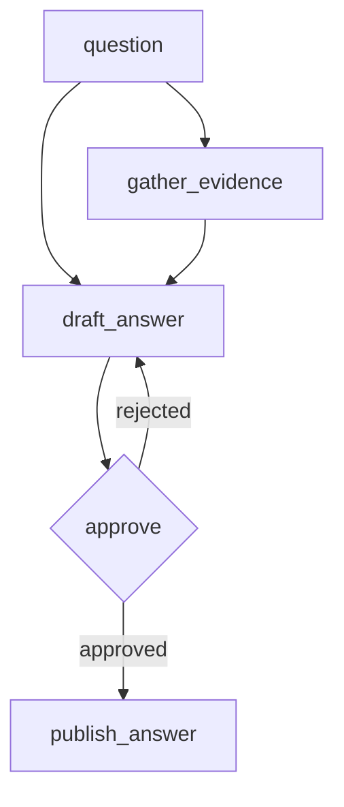

## What this is

A workflow artifact as a file: frontmatter carries whatever metadata the surrounding
system wants, the spec sits under one key, and the package validates and indexes it.
Nothing here is a format -- plain YAML frontmatter satisfies several interchange formats
without the loader knowing any of them exist.

`publish_answer` wires its input from the **gate**, not from the draft: publishing an
unapproved answer is structurally impossible, and the validator proves it cold.

## Notes

Evidence comes from a indexed knowledge base, reached either as an exported bundle (offline) or
live over ranked search on a read-only role. The drafting leaf is a pydantic-ai agent;
the workflow neither knows nor cares.
